# CHUYÊN ĐỀ 1: MÔ HÌNH THỰC THỂ MỐI KẾT HỢP (ERD) & ÁNH XẠ QUAN HỆ
**Môn học:** IT004 — Cơ sở dữ liệu | **Hệ thống:** UIT Exam Mastery
**Biên soạn:** VÕ TRỌNG PHÚC | **Số lượng bài tập độc lập:** 25 bài chuẩn hóa

---

## Bài 01 [ERD-P01] — Thiết kế ERD & Ánh xạ Schema: Quản Lý Đăng Ký Học Phần & Thời Khóa Biểu UIT
- **Mức độ:** Mức B | **Thời gian khuyến nghị:** 25 phút | **Điểm số:** 2.5 điểm
- **Lược đồ tham chiếu:** `SINHVIEN(MSSV PK, HOTEN, NGAYSINH, PHAI, MALOP), GIANGVIEN(MAGV PK, HOTEN, HOCHAM, HOCVI), MONHOC(MAMH PK, TENMH, SOTC), LOPHOCPHAN(MALHP PK, MAMH FK, MAGV FK, HOCKY, NAMHOC, PHONG), DANGKY(MSSV PK FK, MALHP PK FK, DIEMGK, DIEMCK)`
- **Trạng thái kiểm định:** `SEMANTICALLY_REVIEWED` (Đã rà soát học thuật & công thức toán học)

### 1. Đề Bài
Thiết kế mô hình ERD và chuyển sang Lược đồ quan hệ cho Hệ thống Quản lý Đăng ký học phần tín chỉ tại UIT. Hệ thống cần quản lý thông tin sinh viên, giảng viên, môn học, các lớp học phần mở trong từng học kỳ và kết quả đăng ký học phần của sinh viên.

### 2. Hướng Dẫn & Lời Giải Chi Tiết
**Các thực thể và thuộc tính:**
- SINHVIEN: MSSV (PK), HOTEN, NGAYSINH, PHAI, MALOP
- GIANGVIEN: MAGV (PK), HOTEN, HOCHAM, HOCVI
- MONHOC: MAMH (PK), TENMH, SOTC
- LOPHOCPHAN: MALHP (PK), HOCKY, NAMHOC, PHONG
- DANGKY: DIEMGK, DIEMCK

**Mối kết hợp và bản số min-max:**
- GIANGVIEN - LOPHOCPHAN: 1:N | Bản số: GIANGVIEN (0,N) - (1,1) LOPHOCPHAN (Một giảng viên phụ trách nhiều lớp học phần hoặc chưa phụ trách; mỗi lớp học phần do đúng 1 giảng viên giảng dạy).
- MONHOC - LOPHOCPHAN: 1:N | Bản số: MONHOC (0,N) - (1,1) LOPHOCPHAN (Một môn học có thể mở nhiều lớp học phần; mỗi lớp học phần tương ứng duy nhất 1 môn học).
- SINHVIEN - DANGKY - LOPHOCPHAN: M:N | Bản số: SINHVIEN (0,N) - (1,1) DANGKY, LOPHOCPHAN (1,N) - (1,1) DANGKY (Sinh viên đăng ký nhiều lớp học phần, lớp học phần có nhiều sinh viên đăng ký qua bảng trung gian DANGKY).

**Lược đồ quan hệ chuyển đổi:**
- SINHVIEN(MSSV PK, HOTEN, NGAYSINH, PHAI, MALOP)
- GIANGVIEN(MAGV PK, HOTEN, HOCHAM, HOCVI)
- MONHOC(MAMH PK, TENMH, SOTC)
- LOPHOCPHAN(MALHP PK, MAMH FK, MAGV FK, HOCKY, NAMHOC, PHONG)
- DANGKY(MSSV PK FK, MALHP PK FK, DIEMGK, DIEMCK)

**Sơ đồ Thực thể - Mối kết hợp (ERD):**
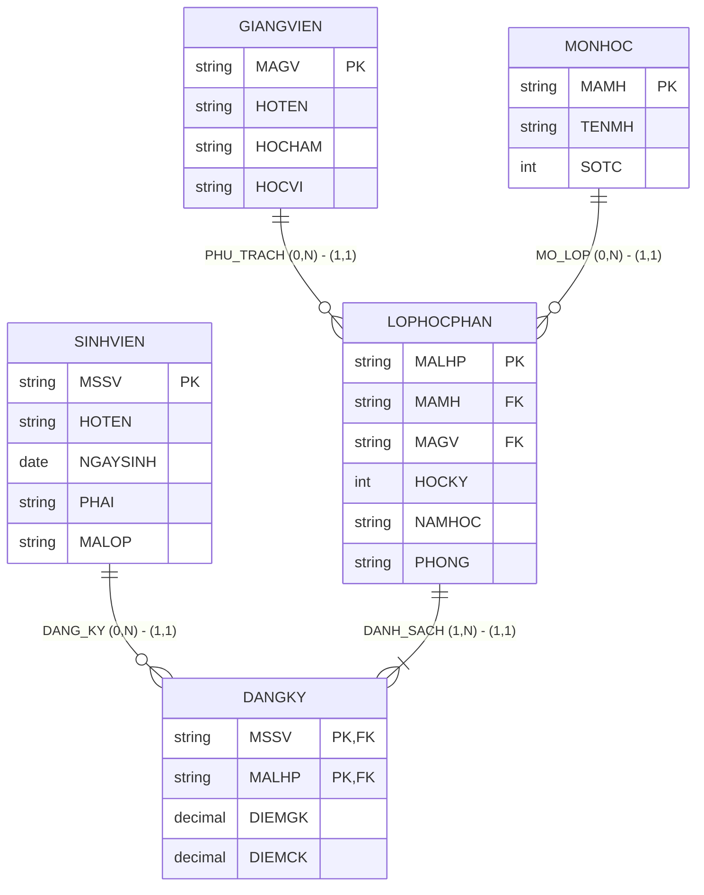

**Các bước suy luận tư duy:**
1. Bước 1: Xác định đầy đủ các tập thực thể độc lập, thực thể yếu, thuộc tính đơn và thuộc tính khóa chính (PK).
1. Bước 2: Phân tích kỹ lưỡng các mối kết hợp nghiệp vụ giữa các thực thể, xác định chính xác bản số min-max hai phía ((0,1), (1,1), (0,N), (1,N)).
1. Bước 3: Chuyển đổi mối kết hợp 1:N bằng cách đưa khóa chính phía 1 sang làm khóa ngoại (FK) ở phía N.
1. Bước 4: Chuyển đổi mối kết hợp M:N thành bảng trung gian, khóa chính là khóa phức hợp gồm 2 khóa ngoại tham chiếu đến 2 thực thể liên quan.

**Phân tích trường hợp biên (Edge Cases):**
Lớp học phần mở nhưng chưa có sinh viên đăng ký (DANGKY rỗng); sinh viên đăng ký nhưng chưa có điểm thi (DIEMGK, DIEMCK mang giá trị NULL); kiểm tra ràng buộc CHECK điểm số từ 0.0 đến 10.0.

**Barem chấm điểm đề xuất:**
- `total_points`: 2.5đ
- `entities_and_keys`: 0.5đ
- `relationships_and_cardinalities`: 1.0đ
- `relational_mapping_and_foreign_keys`: 1.0đ

---

## Bài 02 [ERD-P02] — Thiết kế ERD & Ánh xạ Schema: Quản Lý Ký Túc Xá Sinh Viên Đại Học
- **Mức độ:** Mức B | **Thời gian khuyến nghị:** 25 phút | **Điểm số:** 2.5 điểm
- **Lược đồ tham chiếu:** `TOANHA(MATN PK, TENTN, DIACHI, SOTANG), PHONG(MAPHONG PK, MATN FK, TENPHONG, SOGIUONG, GIALE), SINHVIEN(MSSV PK, HOTEN, GIOITINH, SDT, QUEQUAN), HOPDONG(MAHD PK, MSSV FK, MAPHONG FK, NGAYBD, NGAYKT, TIENCOC), DICHVU(MADV PK, TENDV, DONGIA), SUDUNG_DV(MAHD PK FK, MADV PK FK, THANG PK, NAM PK, CHISO_CU, CHISO_MOI)`
- **Trạng thái kiểm định:** `SEMANTICALLY_REVIEWED` (Đã rà soát học thuật & công thức toán học)

### 1. Đề Bài
Thiết kế mô hình ERD và chuyển đổi quan hệ cho Hệ thống Ký túc xá Đại học gồm các tòa nhà, phòng ở, sinh viên lưu trú, hợp đồng thuê phòng và việc sử dụng các dịch vụ (điện, nước, internet).

### 2. Hướng Dẫn & Lời Giải Chi Tiết
**Các thực thể và thuộc tính:**
- TOANHA: MATN (PK), TENTN, DIACHI, SOTANG
- PHONG: MAPHONG (PK), TENPHONG, SOGIUONG, GIALE
- SINHVIEN: MSSV (PK), HOTEN, GIOITINH, SDT, QUEQUAN
- HOPDONG: MAHD (PK), NGAYBD, NGAYKT, TIENCOC
- DICHVU: MADV (PK), TENDV, DONGIA
- SUDUNG_DV: THANG, NAM, CHISO_CU, CHISO_MOI

**Mối kết hợp và bản số min-max:**
- TOANHA - PHONG: 1:N | Bản số: TOANHA (1,N) - (1,1) PHONG (Một tòa nhà có ít nhất 1 phòng; mỗi phòng thuộc duy nhất 1 tòa nhà).
- PHONG - HOPDONG: 1:N | Bản số: PHONG (0,N) - (1,1) HOPDONG (Phòng ký túc xá được thuê qua nhiều hợp đồng theo các học kỳ).
- SINHVIEN - HOPDONG: 1:N | Bản số: SINHVIEN (0,N) - (1,1) HOPDONG (Sinh viên có thể ký nhiều hợp đồng lưu trú qua các năm).
- HOPDONG - DICHVU: M:N qua SUDUNG_DV | Bản số: HOPDONG (0,N) - (1,1) SUDUNG_DV, DICHVU (0,N) - (1,1) SUDUNG_DV.

**Lược đồ quan hệ chuyển đổi:**
- TOANHA(MATN PK, TENTN, DIACHI, SOTANG)
- PHONG(MAPHONG PK, MATN FK, TENPHONG, SOGIUONG, GIALE)
- SINHVIEN(MSSV PK, HOTEN, GIOITINH, SDT, QUEQUAN)
- HOPDONG(MAHD PK, MSSV FK, MAPHONG FK, NGAYBD, NGAYKT, TIENCOC)
- DICHVU(MADV PK, TENDV, DONGIA)
- SUDUNG_DV(MAHD PK FK, MADV PK FK, THANG PK, NAM PK, CHISO_CU, CHISO_MOI)

**Sơ đồ Thực thể - Mối kết hợp (ERD):**
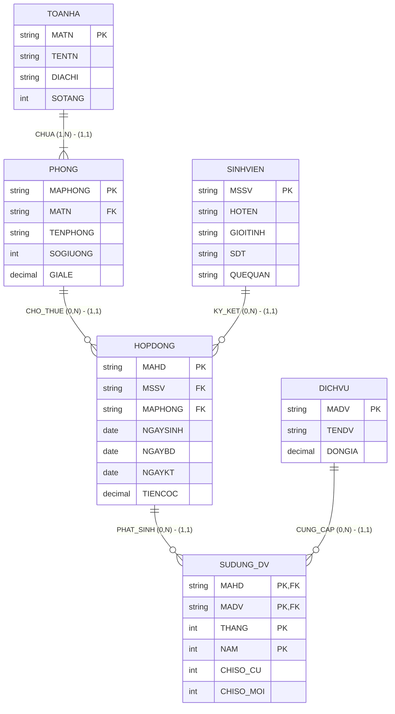

**Các bước suy luận tư duy:**
1. Bước 1: Xác định đầy đủ các tập thực thể độc lập, thực thể yếu, thuộc tính đơn và thuộc tính khóa chính (PK).
1. Bước 2: Phân tích kỹ lưỡng các mối kết hợp nghiệp vụ giữa các thực thể, xác định chính xác bản số min-max hai phía ((0,1), (1,1), (0,N), (1,N)).
1. Bước 3: Chuyển đổi mối kết hợp 1:N bằng cách đưa khóa chính phía 1 sang làm khóa ngoại (FK) ở phía N.
1. Bước 4: Chuyển đổi mối kết hợp M:N thành bảng trung gian, khóa chính là khóa phức hợp gồm 2 khóa ngoại tham chiếu đến 2 thực thể liên quan.

**Phân tích trường hợp biên (Edge Cases):**
Kiểm tra ràng buộc CHISO_MOI >= CHISO_CU; số người đang ở thực tế trong phòng không được vượt quá SOGIUONG; ngày kết thúc hợp đồng NGAYKT phải sau NGAYBD.

**Barem chấm điểm đề xuất:**
- `total_points`: 2.5đ
- `entities_and_keys`: 0.5đ
- `relationships_and_cardinalities`: 1.0đ
- `relational_mapping_and_foreign_keys`: 1.0đ

---

## Bài 03 [ERD-P03] — Thiết kế ERD & Ánh xạ Schema: Quản Lý Chuỗi Nhà Thuốc & Bán Lẻ Dược Phẩm
- **Mức độ:** Mức B | **Thời gian khuyến nghị:** 25 phút | **Điểm số:** 2.5 điểm
- **Lược đồ tham chiếu:** `NHATHUOC(MANT PK, TENNT, DIACHI, MADS_QL FK), DUOCSI(MADS PK, HOTEN, BANGTHOAN, SDT, MANT FK), THUOC(MATHUOC PK, TENTHUOC, HOATCHAT, DVT, DONGIA), HOADON(MAHD PK, MANT FK, MADS FK, NGAYLAP, HOTEN_KH), CHITIET_HD(MAHD PK FK, MATHUOC PK FK, SOLUONG, GIABAN)`
- **Trạng thái kiểm định:** `SEMANTICALLY_REVIEWED` (Đã rà soát học thuật & công thức toán học)

### 1. Đề Bài
Thiết kế mô hình ERD và lược đồ quan hệ cho Chuỗi Nhà thuốc bán lẻ gồm thông tin nhà thuốc, dược sĩ, danh mục dược phẩm và các hóa đơn bán hàng theo đơn hoặc không kê đơn.

### 2. Hướng Dẫn & Lời Giải Chi Tiết
**Các thực thể và thuộc tính:**
- NHATHUOC: MANT (PK), TENNT, DIACHI, MADS_QL
- DUOCSI: MADS (PK), HOTEN, BANGTHOAN, SDT
- THUOC: MATHUOC (PK), TENTHUOC, HOATCHAT, DVT, DONGIA
- HOADON: MAHD (PK), NGAYLAP, HOTEN_KH
- CHITIET_HD: SOLUONG, GIABAN

**Mối kết hợp và bản số min-max:**
- NHATHUOC - DUOCSI: 1:N | Bản số: NHATHUOC (1,N) - (1,1) DUOCSI (Nhà thuốc có nhiều dược sĩ làm việc; mỗi dược sĩ làm việc tại 1 nhà thuốc).
- DUOCSI - NHATHUOC (Quản lý): 1:1 | Bản số: DUOCSI (0,1) - (1,1) NHATHUOC (Mỗi nhà thuốc do đúng 1 dược sĩ phụ trách chuyên môn quản lý).
- DUOCSI - HOADON: 1:N | Bản số: DUOCSI (0,N) - (1,1) HOADON (Dược sĩ bán hàng lập hóa đơn cho khách).
- NHATHUOC - HOADON: 1:N | Bản số: NHATHUOC (0,N) - (1,1) HOADON (Hóa đơn phát sinh tại nhà thuốc).
- HOADON - THUOC: M:N qua CHITIET_HD | Bản số: HOADON (1,N) - (1,1) CHITIET_HD, THUOC (0,N) - (1,1) CHITIET_HD.

**Lược đồ quan hệ chuyển đổi:**
- NHATHUOC(MANT PK, TENNT, DIACHI, MADS_QL FK)
- DUOCSI(MADS PK, HOTEN, BANGTHOAN, SDT, MANT FK)
- THUOC(MATHUOC PK, TENTHUOC, HOATCHAT, DVT, DONGIA)
- HOADON(MAHD PK, MANT FK, MADS FK, NGAYLAP, HOTEN_KH)
- CHITIET_HD(MAHD PK FK, MATHUOC PK FK, SOLUONG, GIABAN)

**Sơ đồ Thực thể - Mối kết hợp (ERD):**
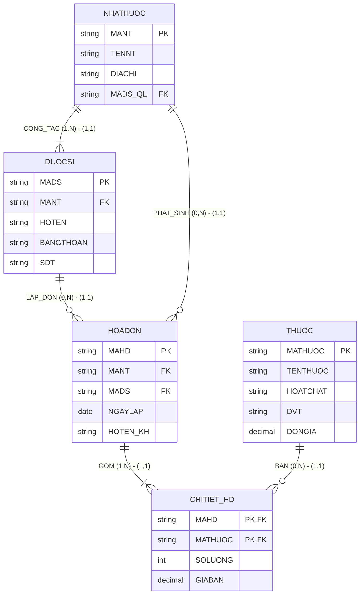

**Các bước suy luận tư duy:**
1. Bước 1: Xác định đầy đủ các tập thực thể độc lập, thực thể yếu, thuộc tính đơn và thuộc tính khóa chính (PK).
1. Bước 2: Phân tích kỹ lưỡng các mối kết hợp nghiệp vụ giữa các thực thể, xác định chính xác bản số min-max hai phía ((0,1), (1,1), (0,N), (1,N)).
1. Bước 3: Chuyển đổi mối kết hợp 1:N bằng cách đưa khóa chính phía 1 sang làm khóa ngoại (FK) ở phía N.
1. Bước 4: Chuyển đổi mối kết hợp M:N thành bảng trung gian, khóa chính là khóa phức hợp gồm 2 khóa ngoại tham chiếu đến 2 thực thể liên quan.

**Phân tích trường hợp biên (Edge Cases):**
Tránh chu trình đệ quy khóa ngoại giữa NHATHUOC và DUOCSI bằng cách cho phép MADS_QL được NULL khi khởi tạo hoặc sử dụng ALTER TABLE ADD CONSTRAINT; đảm bảo SOLUONG > 0 và GIABAN >= 0.

**Barem chấm điểm đề xuất:**
- `total_points`: 2.5đ
- `entities_and_keys`: 0.5đ
- `relationships_and_cardinalities`: 1.0đ
- `relational_mapping_and_foreign_keys`: 1.0đ

---

## Bài 04 [ERD-P04] — Thiết kế ERD & Ánh xạ Schema: Quản Lý Hãng Hàng Không & Lịch Bay Nội Địa
- **Mức độ:** Mức B | **Thời gian khuyến nghị:** 25 phút | **Điểm số:** 2.5 điểm
- **Lược đồ tham chiếu:** `SANBAY(MASB PK, TENSB, THANHPHO, QUOCGIA), MAYBAY(MAMB PK, SOHIEU, LOAIMB, SOGHE, NAMSX), CHUYENBAY(MACB PK, MAMB FK, MASB_DI FK, MASB_DEN FK, NGAYBAY, GIOBAY, GIAGOC), HANHKHACH(MAHK PK, HOTEN, CCCD, SDT, EMAIL), VEBAY(MAVE PK, MACB FK, MAHK FK, SOGHE, HANGVE, GIATHOA)`
- **Trạng thái kiểm định:** `SEMANTICALLY_REVIEWED` (Đã rà soát học thuật & công thức toán học)

### 1. Đề Bài
Thiết kế mô hình ERD quản lý lịch trình các chuyến bay, máy bay khai thác, sân bay đi - đến và hành khách mua vé của một hãng hàng không nội địa.

### 2. Hướng Dẫn & Lời Giải Chi Tiết
**Các thực thể và thuộc tính:**
- SANBAY: MASB (PK), TENSB, THANHPHO, QUOCGIA
- MAYBAY: MAMB (PK), SOHIEU, LOAIMB, SOGHE, NAMSX
- CHUYENBAY: MACB (PK), NGAYBAY, GIOBAY, GIAGOC
- HANHKHACH: MAHK (PK), HOTEN, CCCD, SDT, EMAIL
- VEBAY: MAVE (PK), SOGHE, HANGVE, GIATHOA

**Mối kết hợp và bản số min-max:**
- MAYBAY - CHUYENBAY: 1:N | Bản số: MAYBAY (0,N) - (1,1) CHUYENBAY (Máy bay thực hiện nhiều chuyến bay; mỗi chuyến bay do 1 máy bay cụ thể phục vụ).
- SANBAY - CHUYENBAY (Sân bay đi): 1:N | Bản số: SANBAY (0,N) - (1,1) CHUYENBAY.
- SANBAY - CHUYENBAY (Sân bay đến): 1:N | Bản số: SANBAY (0,N) - (1,1) CHUYENBAY.
- CHUYENBAY - VEBAY: 1:N | Bản số: CHUYENBAY (0,N) - (1,1) VEBAY.
- HANHKHACH - VEBAY: 1:N | Bản số: HANHKHACH (0,N) - (1,1) VEBAY.

**Lược đồ quan hệ chuyển đổi:**
- SANBAY(MASB PK, TENSB, THANHPHO, QUOCGIA)
- MAYBAY(MAMB PK, SOHIEU, LOAIMB, SOGHE, NAMSX)
- CHUYENBAY(MACB PK, MAMB FK, MASB_DI FK, MASB_DEN FK, NGAYBAY, GIOBAY, GIAGOC)
- HANHKHACH(MAHK PK, HOTEN, CCCD, SDT, EMAIL)
- VEBAY(MAVE PK, MACB FK, MAHK FK, SOGHE, HANGVE, GIATHOA)

**Sơ đồ Thực thể - Mối kết hợp (ERD):**
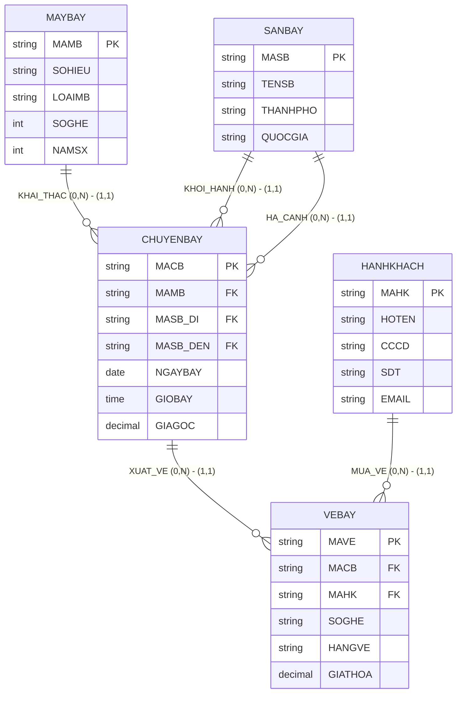

**Các bước suy luận tư duy:**
1. Bước 1: Xác định đầy đủ các tập thực thể độc lập, thực thể yếu, thuộc tính đơn và thuộc tính khóa chính (PK).
1. Bước 2: Phân tích kỹ lưỡng các mối kết hợp nghiệp vụ giữa các thực thể, xác định chính xác bản số min-max hai phía ((0,1), (1,1), (0,N), (1,N)).
1. Bước 3: Chuyển đổi mối kết hợp 1:N bằng cách đưa khóa chính phía 1 sang làm khóa ngoại (FK) ở phía N.
1. Bước 4: Chuyển đổi mối kết hợp M:N thành bảng trung gian, khóa chính là khóa phức hợp gồm 2 khóa ngoại tham chiếu đến 2 thực thể liên quan.

**Phân tích trường hợp biên (Edge Cases):**
Ràng buộc kiểm tra MASB_DI <> MASB_DEN (sân bay đi và đến phải khác nhau); tổng số vé bay của 1 chuyến bay không được vượt quá SOGHE của tàu bay; số ghế SOGHE trong vé là duy nhất trên mỗi chuyến bay.

**Barem chấm điểm đề xuất:**
- `total_points`: 2.5đ
- `entities_and_keys`: 0.5đ
- `relationships_and_cardinalities`: 1.0đ
- `relational_mapping_and_foreign_keys`: 1.0đ

---

## Bài 05 [ERD-P05] — Thiết kế ERD & Ánh xạ Schema: Quản Lý Hệ Thống Tuyển Sinh & Xét Tuyển Đại Học
- **Mức độ:** Mức B | **Thời gian khuyến nghị:** 25 phút | **Điểm số:** 2.5 điểm
- **Lược đồ tham chiếu:** `NGANH(MANGANH PK, TENNGANH, CHITIEU, DIEMCHUAN), THISINH(SBD PK, HOTEN, NGAYSINH, KHUVUC, DIEMTOC), MONTHI(MAMT PK, TENMT), DIEMTHI(SBD PK FK, MAMT PK FK, DIEMSO), NGUYENVONG(SBD PK FK, THUTU_NV PK, MANGANH FK, TOHOP, TRANGTHAI)`
- **Trạng thái kiểm định:** `SEMANTICALLY_REVIEWED` (Đã rà soát học thuật & công thức toán học)

### 1. Đề Bài
Thiết kế ERD cho Hệ thống Đăng ký Xét tuyển Đại học: Thí sinh đăng ký nhiều nguyện vọng theo thứ tự ưu tiên vào các ngành học, quản lý điểm thi các môn theo tổ hợp xét tuyển.

### 2. Hướng Dẫn & Lời Giải Chi Tiết
**Các thực thể và thuộc tính:**
- NGANH: MANGANH (PK), TENNGANH, CHITIEU, DIEMCHUAN
- THISINH: SBD (PK), HOTEN, NGAYSINH, KHUVUC, DIEMTOC
- MONTHI: MAMT (PK), TENMT
- DIEMTHI: DIEMSO
- NGUYENVONG: THUTU_NV, TOHOP, TRANGTHAI

**Mối kết hợp và bản số min-max:**
- THISINH - MONTHI: M:N qua DIEMTHI | Bản số: THISINH (1,N) - (1,1) DIEMTHI, MONTHI (0,N) - (1,1) DIEMTHI.
- THISINH - NGANH: M:N qua NGUYENVONG | Bản số: THISINH (1,N) - (1,1) NGUYENVONG, NGANH (0,N) - (1,1) NGUYENVONG.

**Lược đồ quan hệ chuyển đổi:**
- NGANH(MANGANH PK, TENNGANH, CHITIEU, DIEMCHUAN)
- THISINH(SBD PK, HOTEN, NGAYSINH, KHUVUC, DIEMTOC)
- MONTHI(MAMT PK, TENMT)
- DIEMTHI(SBD PK FK, MAMT PK FK, DIEMSO)
- NGUYENVONG(SBD PK FK, THUTU_NV PK, MANGANH FK, TOHOP, TRANGTHAI)

**Sơ đồ Thực thể - Mối kết hợp (ERD):**
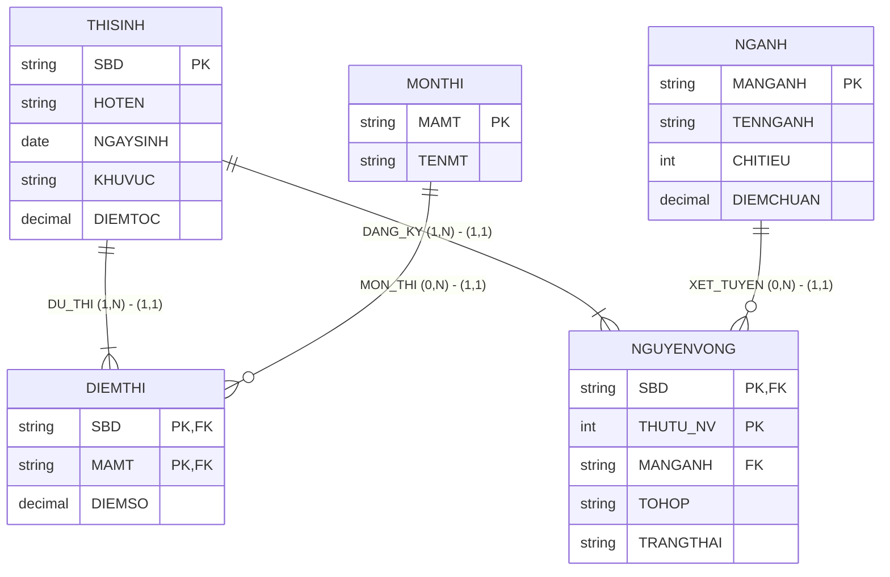

**Các bước suy luận tư duy:**
1. Bước 1: Xác định đầy đủ các tập thực thể độc lập, thực thể yếu, thuộc tính đơn và thuộc tính khóa chính (PK).
1. Bước 2: Phân tích kỹ lưỡng các mối kết hợp nghiệp vụ giữa các thực thể, xác định chính xác bản số min-max hai phía ((0,1), (1,1), (0,N), (1,N)).
1. Bước 3: Chuyển đổi mối kết hợp 1:N bằng cách đưa khóa chính phía 1 sang làm khóa ngoại (FK) ở phía N.
1. Bước 4: Chuyển đổi mối kết hợp M:N thành bảng trung gian, khóa chính là khóa phức hợp gồm 2 khóa ngoại tham chiếu đến 2 thực thể liên quan.

**Phân tích trường hợp biên (Edge Cases):**
Thứ tự nguyện vọng THUTU_NV bắt đầu từ 1 và liên tục; điểm thi DIEMSO thuộc [0.0, 10.0]; thí sinh chỉ có tối đa 1 nguyện vọng trúng tuyển chính thức.

**Barem chấm điểm đề xuất:**
- `total_points`: 2.5đ
- `entities_and_keys`: 0.5đ
- `relationships_and_cardinalities`: 1.0đ
- `relational_mapping_and_foreign_keys`: 1.0đ

---

## Bài 06 [ERD-P06] — Thiết kế ERD & Ánh xạ Schema: Quản Lý Hệ Thống Ngân Hàng & Giao Dịch Thẻ ATM
- **Mức độ:** Mức B | **Thời gian khuyến nghị:** 25 phút | **Điểm số:** 2.5 điểm
- **Lược đồ tham chiếu:** `CHINHANH(MACN PK, TENCN, DIACHI, SDT), KHACHHANG(MAKH PK, HOTEN, CCCD, DIACHI, SDT), TAIKHOAN(SOTK PK, MAKH FK, MACN FK, SODU, LOAITK, NGAYMO), THE_ATM(MATHE PK, SOTK FK, NGAYPHATHANH, NGAYHETHAN, LOAITHE), GIAODICH(MAGD PK, MATHE FK, NGAYGD, SOTIEN, LOAIGD, NOIDUNG)`
- **Trạng thái kiểm định:** `SEMANTICALLY_REVIEWED` (Đã rà soát học thuật & công thức toán học)

### 1. Đề Bài
Thiết kế ERD cho Hệ thống Ngân hàng thương mại: Quản lý khách hàng, tài khoản thanh toán tại các chi nhánh, phát hành thẻ ATM và lịch sử các giao dịch gửi/rút/chuyển khoản.

### 2. Hướng Dẫn & Lời Giải Chi Tiết
**Các thực thể và thuộc tính:**
- CHINHANH: MACN (PK), TENCN, DIACHI, SDT
- KHACHHANG: MAKH (PK), HOTEN, CCCD, DIACHI, SDT
- TAIKHOAN: SOTK (PK), SODU, LOAITK, NGAYMO
- THE_ATM: MATHE (PK), NGAYPHATHANH, NGAYHETHAN, LOAITHE
- GIAODICH: MAGD (PK), NGAYGD, SOTIEN, LOAIGD, NOIDUNG

**Mối kết hợp và bản số min-max:**
- CHINHANH - TAIKHOAN: 1:N | Bản số: CHINHANH (0,N) - (1,1) TAIKHOAN
- KHACHHANG - TAIKHOAN: 1:N | Bản số: KHACHHANG (1,N) - (1,1) TAIKHOAN
- TAIKHOAN - THE_ATM: 1:N | Bản số: TAIKHOAN (0,N) - (1,1) THE_ATM
- THE_ATM - GIAODICH: 1:N | Bản số: THE_ATM (0,N) - (1,1) GIAODICH

**Lược đồ quan hệ chuyển đổi:**
- CHINHANH(MACN PK, TENCN, DIACHI, SDT)
- KHACHHANG(MAKH PK, HOTEN, CCCD, DIACHI, SDT)
- TAIKHOAN(SOTK PK, MAKH FK, MACN FK, SODU, LOAITK, NGAYMO)
- THE_ATM(MATHE PK, SOTK FK, NGAYPHATHANH, NGAYHETHAN, LOAITHE)
- GIAODICH(MAGD PK, MATHE FK, NGAYGD, SOTIEN, LOAIGD, NOIDUNG)

**Sơ đồ Thực thể - Mối kết hợp (ERD):**
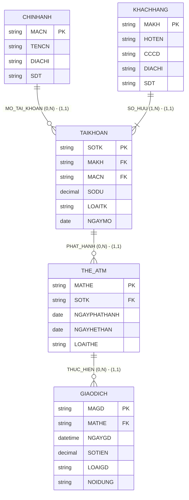

**Các bước suy luận tư duy:**
1. Bước 1: Xác định đầy đủ các tập thực thể độc lập, thực thể yếu, thuộc tính đơn và thuộc tính khóa chính (PK).
1. Bước 2: Phân tích kỹ lưỡng các mối kết hợp nghiệp vụ giữa các thực thể, xác định chính xác bản số min-max hai phía ((0,1), (1,1), (0,N), (1,N)).
1. Bước 3: Chuyển đổi mối kết hợp 1:N bằng cách đưa khóa chính phía 1 sang làm khóa ngoại (FK) ở phía N.
1. Bước 4: Chuyển đổi mối kết hợp M:N thành bảng trung gian, khóa chính là khóa phức hợp gồm 2 khóa ngoại tham chiếu đến 2 thực thể liên quan.

**Phân tích trường hợp biên (Edge Cases):**
Số dư SODU >= 0; số tiền giao dịch SOTIEN > 0; ngày hết hạn thẻ NGAYHETHAN > NGAYPHATHANH.

**Barem chấm điểm đề xuất:**
- `total_points`: 2.5đ
- `entities_and_keys`: 0.5đ
- `relationships_and_cardinalities`: 1.0đ
- `relational_mapping_and_foreign_keys`: 1.0đ

---

## Bài 07 [ERD-P07] — Thiết kế ERD & Ánh xạ Schema: Quản Lý Khách Sạn & Đặt Phòng Nghỉ Dưỡng
- **Mức độ:** Mức B | **Thời gian khuyến nghị:** 25 phút | **Điểm số:** 2.5 điểm
- **Lược đồ tham chiếu:** `KHACHSAN(MAKS PK, TENKS, DIACHI, TIEUCHUAN_SAO), LOAIPHONG(MALP PK, TENLP, SOGIUONG, DONGIA_NGAY), PHONG(MAPHONG PK, MAKS FK, MALP FK, SOPHONG, TRANGTHAI), KHACHHANG(MAKH PK, HOTEN, SDT, QUOCTICH), PHIEUDAT(MAPD PK, MAKH FK, MAPHONG FK, NGAYDEN, NGAYDI, TIENCOC)`
- **Trạng thái kiểm định:** `SEMANTICALLY_REVIEWED` (Đã rà soát học thuật & công thức toán học)

### 1. Đề Bài
Thiết kế mô hình ERD quản lý chuỗi khách sạn nghỉ dưỡng: Quản lý chi nhánh khách sạn, các loại phòng, danh sách phòng thực tế và các phiếu đặt phòng của khách hàng.

### 2. Hướng Dẫn & Lời Giải Chi Tiết
**Các thực thể và thuộc tính:**
- KHACHSAN: MAKS (PK), TENKS, DIACHI, TIEUCHUAN_SAO
- LOAIPHONG: MALP (PK), TENLP, SOGIUONG, DONGIA_NGAY
- PHONG: MAPHONG (PK), SOPHONG, TRANGTHAI
- KHACHHANG: MAKH (PK), HOTEN, SDT, QUOCTICH
- PHIEUDAT: MAPD (PK), NGAYDEN, NGAYDI, TIENCOC

**Mối kết hợp và bản số min-max:**
- KHACHSAN - PHONG: 1:N | Bản số: KHACHSAN (1,N) - (1,1) PHONG
- LOAIPHONG - PHONG: 1:N | Bản số: LOAIPHONG (0,N) - (1,1) PHONG
- PHONG - PHIEUDAT: 1:N | Bản số: PHONG (0,N) - (1,1) PHIEUDAT
- KHACHHANG - PHIEUDAT: 1:N | Bản số: KHACHHANG (0,N) - (1,1) PHIEUDAT

**Lược đồ quan hệ chuyển đổi:**
- KHACHSAN(MAKS PK, TENKS, DIACHI, TIEUCHUAN_SAO)
- LOAIPHONG(MALP PK, TENLP, SOGIUONG, DONGIA_NGAY)
- PHONG(MAPHONG PK, MAKS FK, MALP FK, SOPHONG, TRANGTHAI)
- KHACHHANG(MAKH PK, HOTEN, SDT, QUOCTICH)
- PHIEUDAT(MAPD PK, MAKH FK, MAPHONG FK, NGAYDEN, NGAYDI, TIENCOC)

**Sơ đồ Thực thể - Mối kết hợp (ERD):**
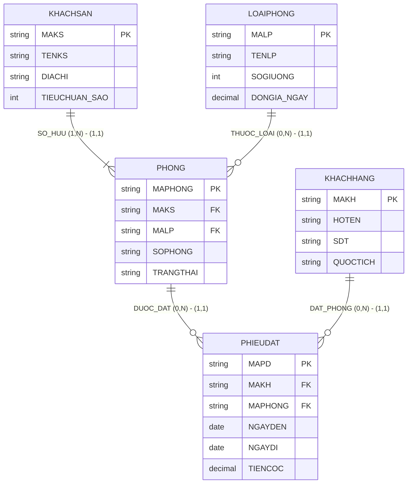

**Các bước suy luận tư duy:**
1. Bước 1: Xác định đầy đủ các tập thực thể độc lập, thực thể yếu, thuộc tính đơn và thuộc tính khóa chính (PK).
1. Bước 2: Phân tích kỹ lưỡng các mối kết hợp nghiệp vụ giữa các thực thể, xác định chính xác bản số min-max hai phía ((0,1), (1,1), (0,N), (1,N)).
1. Bước 3: Chuyển đổi mối kết hợp 1:N bằng cách đưa khóa chính phía 1 sang làm khóa ngoại (FK) ở phía N.
1. Bước 4: Chuyển đổi mối kết hợp M:N thành bảng trung gian, khóa chính là khóa phức hợp gồm 2 khóa ngoại tham chiếu đến 2 thực thể liên quan.

**Phân tích trường hợp biên (Edge Cases):**
Khoảng thời gian thuê NGAYDI > NGAYDEN; không đặt trùng phòng trong cùng khoảng thời gian; TIENCOC >= 0.

**Barem chấm điểm đề xuất:**
- `total_points`: 2.5đ
- `entities_and_keys`: 0.5đ
- `relationships_and_cardinalities`: 1.0đ
- `relational_mapping_and_foreign_keys`: 1.0đ

---

## Bài 08 [ERD-P08] — Thiết kế ERD & Ánh xạ Schema: Quản Lý Garage Sửa Chữa & Bảo Dưỡng Ô Tô
- **Mức độ:** Mức B | **Thời gian khuyến nghị:** 25 phút | **Điểm số:** 2.5 điểm
- **Lược đồ tham chiếu:** `KHACHHANG(MAKH PK, HOTEN, SDT, DIACHI), XE(MAXE PK, MAKH FK, BIENSO, HIEUXE, NAMSX), THO_SUACHUA(MATHO PK, HOTEN, TAYNGHE, SDT), PHIEU_SC(MAPSC PK, MAXE FK, MATHO FK, NGAYVAO, NGAYRA, TONGTIEN), LINHKIEN(MALK PK, TENLK, DVT, DONGIA, TONKHO), CT_PHIEUSC(MAPSC PK FK, MALK PK FK, SOLUONG, DONGIA_THAY, TIENCONG)`
- **Trạng thái kiểm định:** `SEMANTICALLY_REVIEWED` (Đã rà soát học thuật & công thức toán học)

### 1. Đề Bài
Thiết kế ERD cho Hệ thống Garage Ô tô: Tiếp nhận xe của khách hàng sửa chữa, phân công thợ phụ trách chính, sử dụng các linh kiện thay thế và lập hóa đơn thanh toán.

### 2. Hướng Dẫn & Lời Giải Chi Tiết
**Các thực thể và thuộc tính:**
- KHACHHANG: MAKH (PK), HOTEN, SDT, DIACHI
- XE: MAXE (PK), BIENSO, HIEUXE, NAMSX
- THO_SUACHUA: MATHO (PK), HOTEN, TAYNGHE, SDT
- PHIEU_SC: MAPSC (PK), NGAYVAO, NGAYRA, TONGTIEN
- LINHKIEN: MALK (PK), TENLK, DVT, DONGIA, TONKHO
- CT_PHIEUSC: SOLUONG, DONGIA_THAY, TIENCONG

**Mối kết hợp và bản số min-max:**
- KHACHHANG - XE: 1:N | Bản số: KHACHHANG (1,N) - (1,1) XE
- XE - PHIEU_SC: 1:N | Bản số: XE (0,N) - (1,1) PHIEU_SC
- THO_SUACHUA - PHIEU_SC: 1:N | Bản số: THO_SUACHUA (0,N) - (1,1) PHIEU_SC
- PHIEU_SC - LINHKIEN: M:N qua CT_PHIEUSC | Bản số: PHIEU_SC (1,N) - (1,1) CT_PHIEUSC, LINHKIEN (0,N) - (1,1) CT_PHIEUSC

**Lược đồ quan hệ chuyển đổi:**
- KHACHHANG(MAKH PK, HOTEN, SDT, DIACHI)
- XE(MAXE PK, MAKH FK, BIENSO, HIEUXE, NAMSX)
- THO_SUACHUA(MATHO PK, HOTEN, TAYNGHE, SDT)
- PHIEU_SC(MAPSC PK, MAXE FK, MATHO FK, NGAYVAO, NGAYRA, TONGTIEN)
- LINHKIEN(MALK PK, TENLK, DVT, DONGIA, TONKHO)
- CT_PHIEUSC(MAPSC PK FK, MALK PK FK, SOLUONG, DONGIA_THAY, TIENCONG)

**Sơ đồ Thực thể - Mối kết hợp (ERD):**
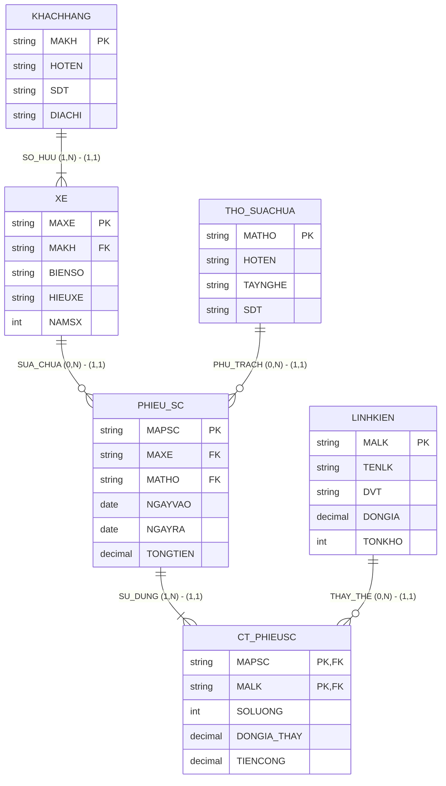

**Các bước suy luận tư duy:**
1. Bước 1: Xác định đầy đủ các tập thực thể độc lập, thực thể yếu, thuộc tính đơn và thuộc tính khóa chính (PK).
1. Bước 2: Phân tích kỹ lưỡng các mối kết hợp nghiệp vụ giữa các thực thể, xác định chính xác bản số min-max hai phía ((0,1), (1,1), (0,N), (1,N)).
1. Bước 3: Chuyển đổi mối kết hợp 1:N bằng cách đưa khóa chính phía 1 sang làm khóa ngoại (FK) ở phía N.
1. Bước 4: Chuyển đổi mối kết hợp M:N thành bảng trung gian, khóa chính là khóa phức hợp gồm 2 khóa ngoại tham chiếu đến 2 thực thể liên quan.

**Phân tích trường hợp biên (Edge Cases):**
Xe chưa sửa xong thì NGAYRA là NULL; số lượng linh kiện SOLUONG > 0; tồn kho không âm TONKHO >= 0.

**Barem chấm điểm đề xuất:**
- `total_points`: 2.5đ
- `entities_and_keys`: 0.5đ
- `relationships_and_cardinalities`: 1.0đ
- `relational_mapping_and_foreign_keys`: 1.0đ

---

## Bài 09 [ERD-P09] — Thiết kế ERD & Ánh xạ Schema: Quản Lý Chuỗi Siêu Thị Mini & Điểm Bán Hàng (POS)
- **Mức độ:** Mức B | **Thời gian khuyến nghị:** 25 phút | **Điểm số:** 2.5 điểm
- **Lược đồ tham chiếu:** `CUAHANG(MACH PK, TENCH, DIACHI, SDT), NHANVIEN(MANV PK, HOTEN, CHUCVU, MACH FK), SANPHAM(MASP PK, TENSP, DVT, GIABAN, LOAISP), HOADON(MAHD PK, MACH FK, MANV FK, NGAYLAP, TONGTIEN), CTHD(MAHD PK FK, MASP PK FK, SOLUONG, DONGIA_BAN, GIAMGIA)`
- **Trạng thái kiểm định:** `SEMANTICALLY_REVIEWED` (Đã rà soát học thuật & công thức toán học)

### 1. Đề Bài
Thiết kế ERD cho Hệ thống Chuỗi Siêu thị mini: Bán lẻ sản phẩm tại các điểm bán POS theo cửa hàng, quản lý nhân viên thu ngân và chi tiết hóa đơn thanh toán.

### 2. Hướng Dẫn & Lời Giải Chi Tiết
**Các thực thể và thuộc tính:**
- CUAHANG: MACH (PK), TENCH, DIACHI, SDT
- NHANVIEN: MANV (PK), HOTEN, CHUCVU
- SANPHAM: MASP (PK), TENSP, DVT, GIABAN, LOAISP
- HOADON: MAHD (PK), NGAYLAP, TONGTIEN
- CTHD: SOLUONG, DONGIA_BAN, GIAMGIA

**Mối kết hợp và bản số min-max:**
- CUAHANG - NHANVIEN: 1:N | Bản số: CUAHANG (1,N) - (1,1) NHANVIEN
- CUAHANG - HOADON: 1:N | Bản số: CUAHANG (0,N) - (1,1) HOADON
- NHANVIEN - HOADON: 1:N | Bản số: NHANVIEN (0,N) - (1,1) HOADON
- HOADON - SANPHAM: M:N qua CTHD | Bản số: HOADON (1,N) - (1,1) CTHD, SANPHAM (0,N) - (1,1) CTHD

**Lược đồ quan hệ chuyển đổi:**
- CUAHANG(MACH PK, TENCH, DIACHI, SDT)
- NHANVIEN(MANV PK, HOTEN, CHUCVU, MACH FK)
- SANPHAM(MASP PK, TENSP, DVT, GIABAN, LOAISP)
- HOADON(MAHD PK, MACH FK, MANV FK, NGAYLAP, TONGTIEN)
- CTHD(MAHD PK FK, MASP PK FK, SOLUONG, DONGIA_BAN, GIAMGIA)

**Sơ đồ Thực thể - Mối kết hợp (ERD):**
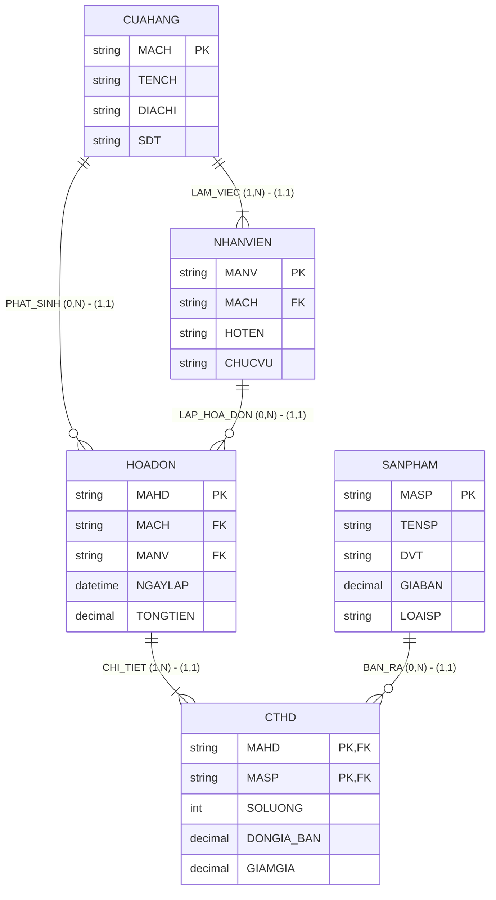

**Các bước suy luận tư duy:**
1. Bước 1: Xác định đầy đủ các tập thực thể độc lập, thực thể yếu, thuộc tính đơn và thuộc tính khóa chính (PK).
1. Bước 2: Phân tích kỹ lưỡng các mối kết hợp nghiệp vụ giữa các thực thể, xác định chính xác bản số min-max hai phía ((0,1), (1,1), (0,N), (1,N)).
1. Bước 3: Chuyển đổi mối kết hợp 1:N bằng cách đưa khóa chính phía 1 sang làm khóa ngoại (FK) ở phía N.
1. Bước 4: Chuyển đổi mối kết hợp M:N thành bảng trung gian, khóa chính là khóa phức hợp gồm 2 khóa ngoại tham chiếu đến 2 thực thể liên quan.

**Phân tích trường hợp biên (Edge Cases):**
Mức giảm giá GIAMGIA thuộc [0.0, 1.0]; nhân viên lập hóa đơn phải thuộc chính cửa hàng phát sinh hóa đơn.

**Barem chấm điểm đề xuất:**
- `total_points`: 2.5đ
- `entities_and_keys`: 0.5đ
- `relationships_and_cardinalities`: 1.0đ
- `relational_mapping_and_foreign_keys`: 1.0đ

---

## Bài 10 [ERD-P10] — Thiết kế ERD & Ánh xạ Schema: Quản Lý Thư Viện Đại Học & Mượn Trả Tài Liệu
- **Mức độ:** Mức B | **Thời gian khuyến nghị:** 25 phút | **Điểm số:** 2.5 điểm
- **Lược đồ tham chiếu:** `DOCGIA(MADG PK, HOTEN, LOAIDG, KHOA, SDT), DAUSACH(MADS PK, TENSACH, TACGIA, NXB, THELOAI), CUONSACH(MACS PK, MADS FK, TINHTRANG, VITRI), PHIEUMUON(MAPM PK, MADG FK, NGAYMUON, NGAYHEN_TRA), CTPM(MAPM PK FK, MACS PK FK, NGAYTRA_THUC, TIENPHAT)`
- **Trạng thái kiểm định:** `SEMANTICALLY_REVIEWED` (Đã rà soát học thuật & công thức toán học)

### 1. Đề Bài
Thiết kế ERD cho Thư viện Trường Đại học: Quản lý đầu sách, từng cuốn sách vật lý trên giá, bạn đọc và các phiếu mượn/trả sách kèm tiền phạt quá hạn nếu có.

### 2. Hướng Dẫn & Lời Giải Chi Tiết
**Các thực thể và thuộc tính:**
- DOCGIA: MADG (PK), HOTEN, LOAIDG, KHOA, SDT
- DAUSACH: MADS (PK), TENSACH, TACGIA, NXB, THELOAI
- CUONSACH: MACS (PK), TINHTRANG, VITRI
- PHIEUMUON: MAPM (PK), NGAYMUON, NGAYHEN_TRA
- CTPM: NGAYTRA_THUC, TIENPHAT

**Mối kết hợp và bản số min-max:**
- DAUSACH - CUONSACH: 1:N | Bản số: DAUSACH (1,N) - (1,1) CUONSACH
- DOCGIA - PHIEUMUON: 1:N | Bản số: DOCGIA (0,N) - (1,1) PHIEUMUON
- PHIEUMUON - CUONSACH: M:N qua CTPM | Bản số: PHIEUMUON (1,N) - (1,1) CTPM, CUONSACH (0,N) - (1,1) CTPM

**Lược đồ quan hệ chuyển đổi:**
- DOCGIA(MADG PK, HOTEN, LOAIDG, KHOA, SDT)
- DAUSACH(MADS PK, TENSACH, TACGIA, NXB, THELOAI)
- CUONSACH(MACS PK, MADS FK, TINHTRANG, VITRI)
- PHIEUMUON(MAPM PK, MADG FK, NGAYMUON, NGAYHEN_TRA)
- CTPM(MAPM PK FK, MACS PK FK, NGAYTRA_THUC, TIENPHAT)

**Sơ đồ Thực thể - Mối kết hợp (ERD):**
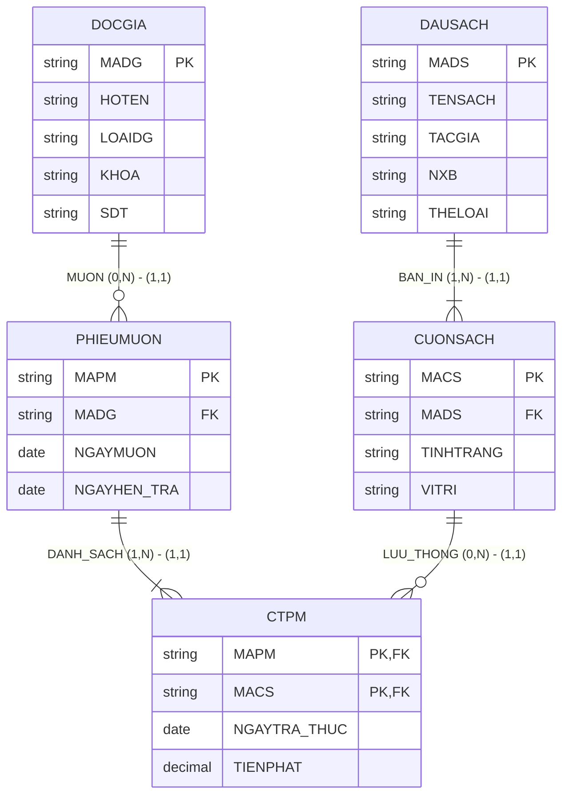

**Các bước suy luận tư duy:**
1. Bước 1: Xác định đầy đủ các tập thực thể độc lập, thực thể yếu, thuộc tính đơn và thuộc tính khóa chính (PK).
1. Bước 2: Phân tích kỹ lưỡng các mối kết hợp nghiệp vụ giữa các thực thể, xác định chính xác bản số min-max hai phía ((0,1), (1,1), (0,N), (1,N)).
1. Bước 3: Chuyển đổi mối kết hợp 1:N bằng cách đưa khóa chính phía 1 sang làm khóa ngoại (FK) ở phía N.
1. Bước 4: Chuyển đổi mối kết hợp M:N thành bảng trung gian, khóa chính là khóa phức hợp gồm 2 khóa ngoại tham chiếu đến 2 thực thể liên quan.

**Phân tích trường hợp biên (Edge Cases):**
Cuốn sách đang được mượn (chưa có NGAYTRA_THUC) không được phép cho mượn tiếp; NGAYHEN_TRA > NGAYMUON.

**Barem chấm điểm đề xuất:**
- `total_points`: 2.5đ
- `entities_and_keys`: 0.5đ
- `relationships_and_cardinalities`: 1.0đ
- `relational_mapping_and_foreign_keys`: 1.0đ

---

## Bài 11 [ERD-P11] — Thiết kế ERD & Ánh xạ Schema: Quản Lý Cụm Rạp Chiếu Phim Đa Cụm
- **Mức độ:** Mức B | **Thời gian khuyến nghị:** 25 phút | **Điểm số:** 2.5 điểm
- **Lược đồ tham chiếu:** `CUMRAP(MACR PK, TENCR, DIACHI, TONGPHONG), PHONGCHIEU(MAPHONG PK, MACR FK, TENPHONG, SOGHE, LOAIMANHINH), PHIM(MAPHIM PK, TENPHIM, THELOAI, THOILUONG, NAMSX), SUATCHIEU(MASC PK, MAPHONG FK, MAPHIM FK, NGAYCHIEU, GIOCHIEU, GIAGOC), VE(MAVE PK, MASC FK, SOGHE, GIAVE, LOAIVE)`
- **Trạng thái kiểm định:** `SEMANTICALLY_REVIEWED` (Đã rà soát học thuật & công thức toán học)

### 1. Đề Bài
Thiết kế ERD cho Cụm Rạp Chiếu Phim: Quản lý các phòng chiếu, suất chiếu phim và vé xem phim bán cho khách hàng theo vị trí ghế ngồi.

### 2. Hướng Dẫn & Lời Giải Chi Tiết
**Các thực thể và thuộc tính:**
- CUMRAP: MACR (PK), TENCR, DIACHI, TONGPHONG
- PHONGCHIEU: MAPHONG (PK), TENPHONG, SOGHE, LOAIMANHINH
- PHIM: MAPHIM (PK), TENPHIM, THELOAI, THOILUONG, NAMSX
- SUATCHIEU: MASC (PK), NGAYCHIEU, GIOCHIEU, GIAGOC
- VE: MAVE (PK), SOGHE, GIAVE, LOAIVE

**Mối kết hợp và bản số min-max:**
- CUMRAP - PHONGCHIEU: 1:N | Bản số: CUMRAP (1,N) - (1,1) PHONGCHIEU
- PHONGCHIEU - SUATCHIEU: 1:N | Bản số: PHONGCHIEU (0,N) - (1,1) SUATCHIEU
- PHIM - SUATCHIEU: 1:N | Bản số: PHIM (0,N) - (1,1) SUATCHIEU
- SUATCHIEU - VE: 1:N | Bản số: SUATCHIEU (0,N) - (1,1) VE

**Lược đồ quan hệ chuyển đổi:**
- CUMRAP(MACR PK, TENCR, DIACHI, TONGPHONG)
- PHONGCHIEU(MAPHONG PK, MACR FK, TENPHONG, SOGHE, LOAIMANHINH)
- PHIM(MAPHIM PK, TENPHIM, THELOAI, THOILUONG, NAMSX)
- SUATCHIEU(MASC PK, MAPHONG FK, MAPHIM FK, NGAYCHIEU, GIOCHIEU, GIAGOC)
- VE(MAVE PK, MASC FK, SOGHE, GIAVE, LOAIVE)

**Sơ đồ Thực thể - Mối kết hợp (ERD):**
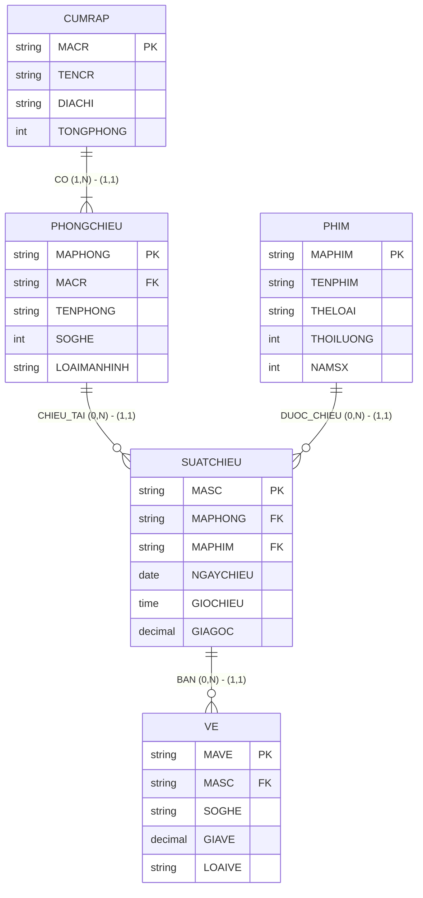

**Các bước suy luận tư duy:**
1. Bước 1: Xác định đầy đủ các tập thực thể độc lập, thực thể yếu, thuộc tính đơn và thuộc tính khóa chính (PK).
1. Bước 2: Phân tích kỹ lưỡng các mối kết hợp nghiệp vụ giữa các thực thể, xác định chính xác bản số min-max hai phía ((0,1), (1,1), (0,N), (1,N)).
1. Bước 3: Chuyển đổi mối kết hợp 1:N bằng cách đưa khóa chính phía 1 sang làm khóa ngoại (FK) ở phía N.
1. Bước 4: Chuyển đổi mối kết hợp M:N thành bảng trung gian, khóa chính là khóa phức hợp gồm 2 khóa ngoại tham chiếu đến 2 thực thể liên quan.

**Phân tích trường hợp biên (Edge Cases):**
Không xếp 2 suất chiếu trùng giờ tại cùng một phòng; SOGHE trong cùng một suất chiếu không được trùng nhau.

**Barem chấm điểm đề xuất:**
- `total_points`: 2.5đ
- `entities_and_keys`: 0.5đ
- `relationships_and_cardinalities`: 1.0đ
- `relational_mapping_and_foreign_keys`: 1.0đ

---

## Bài 12 [ERD-P12] — Thiết kế ERD & Ánh xạ Schema: Quản Lý Sàn Giao Dịch Thương Mại Điện Tử
- **Mức độ:** Mức B | **Thời gian khuyến nghị:** 25 phút | **Điểm số:** 2.5 điểm
- **Lược đồ tham chiếu:** `NGUOIDUNG(MAND PK, HOTEN, EMAIL, SDT, DIACHI), GIANHANG(MAGH PK, MAND_CHUGIAN FK, TENGH, NGAYTAO, DIEMUY_TIN), SANPHAM(MASP PK, MAGH FK, TENSP, DANHMUC, GIABAN, TONKHO), DONHANG(MADON PK, MAND_MUA FK, NGAYDAT, TONGTIEN, TRANGTHAI), CTDH(MADON PK FK, MASP PK FK, SOLUONG, GIAMUA)`
- **Trạng thái kiểm định:** `SEMANTICALLY_REVIEWED` (Đã rà soát học thuật & công thức toán học)

### 1. Đề Bài
Thiết kế ERD cho Sàn Thương mại điện tử: Người dùng có thể vừa mở gian hàng bán sản phẩm, vừa đặt mua đơn hàng từ các gian hàng khác nhau.

### 2. Hướng Dẫn & Lời Giải Chi Tiết
**Các thực thể và thuộc tính:**
- NGUOIDUNG: MAND (PK), HOTEN, EMAIL, SDT, DIACHI
- GIANHANG: MAGH (PK), TENGH, NGAYTAO, DIEMUY_TIN
- SANPHAM: MASP (PK), TENSP, DANHMUC, GIABAN, TONKHO
- DONHANG: MADON (PK), NGAYDAT, TONGTIEN, TRANGTHAI
- CTDH: SOLUONG, GIAMUA

**Mối kết hợp và bản số min-max:**
- NGUOIDUNG - GIANHANG: 1:N | Bản số: NGUOIDUNG (0,N) - (1,1) GIANHANG
- GIANHANG - SANPHAM: 1:N | Bản số: GIANHANG (1,N) - (1,1) SANPHAM
- NGUOIDUNG - DONHANG: 1:N | Bản số: NGUOIDUNG (0,N) - (1,1) DONHANG
- DONHANG - SANPHAM: M:N qua CTDH | Bản số: DONHANG (1,N) - (1,1) CTDH, SANPHAM (0,N) - (1,1) CTDH

**Lược đồ quan hệ chuyển đổi:**
- NGUOIDUNG(MAND PK, HOTEN, EMAIL, SDT, DIACHI)
- GIANHANG(MAGH PK, MAND_CHUGIAN FK, TENGH, NGAYTAO, DIEMUY_TIN)
- SANPHAM(MASP PK, MAGH FK, TENSP, DANHMUC, GIABAN, TONKHO)
- DONHANG(MADON PK, MAND_MUA FK, NGAYDAT, TONGTIEN, TRANGTHAI)
- CTDH(MADON PK FK, MASP PK FK, SOLUONG, GIAMUA)

**Sơ đồ Thực thể - Mối kết hợp (ERD):**
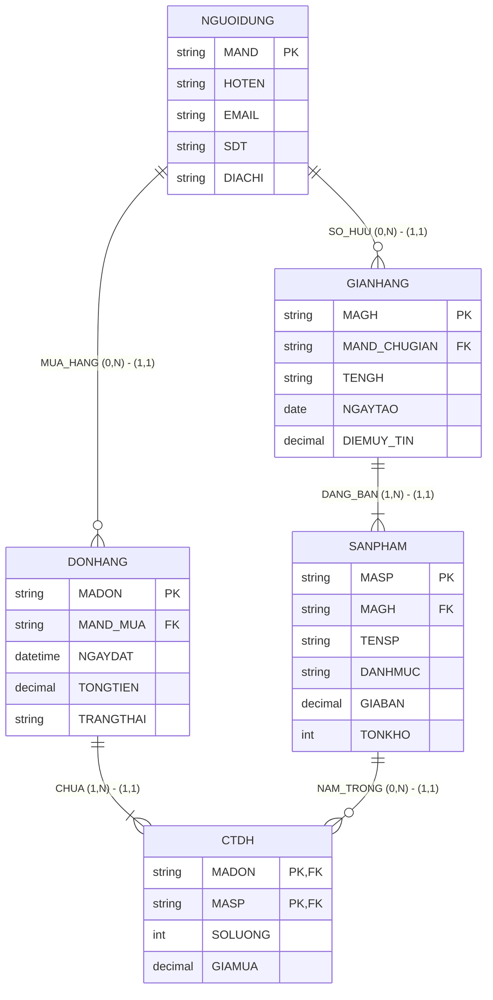

**Các bước suy luận tư duy:**
1. Bước 1: Xác định đầy đủ các tập thực thể độc lập, thực thể yếu, thuộc tính đơn và thuộc tính khóa chính (PK).
1. Bước 2: Phân tích kỹ lưỡng các mối kết hợp nghiệp vụ giữa các thực thể, xác định chính xác bản số min-max hai phía ((0,1), (1,1), (0,N), (1,N)).
1. Bước 3: Chuyển đổi mối kết hợp 1:N bằng cách đưa khóa chính phía 1 sang làm khóa ngoại (FK) ở phía N.
1. Bước 4: Chuyển đổi mối kết hợp M:N thành bảng trung gian, khóa chính là khóa phức hợp gồm 2 khóa ngoại tham chiếu đến 2 thực thể liên quan.

**Phân tích trường hợp biên (Edge Cases):**
Người mua không được đặt mua sản phẩm từ chính gian hàng của mình; TONKHO tự động giảm tương ứng khi đơn hoàn tất.

**Barem chấm điểm đề xuất:**
- `total_points`: 2.5đ
- `entities_and_keys`: 0.5đ
- `relationships_and_cardinalities`: 1.0đ
- `relational_mapping_and_foreign_keys`: 1.0đ

---

## Bài 13 [ERD-P13] — Thiết kế ERD & Ánh xạ Schema: Quản Lý Chuỗi Cửa Hàng Cà Phê Nhượng Quyền
- **Mức độ:** Mức B | **Thời gian khuyến nghị:** 25 phút | **Điểm số:** 2.5 điểm
- **Lược đồ tham chiếu:** `DAILY(MADL PK, TENDL, DIACHI, CHUDAUTU, SDT), NGUYENLIEU(MANL PK, TENNL, DVT, QUYCACH), DOUONG(MADU PK, TENDU, LOAIDU, DONGIA), CONGTHUC(MADU PK FK, MANL PK FK, DINHMUC), PHIEUXUAT_NL(MAPX PK, MADL FK, NGAYXUAT, TONGTRIGIA), CT_PHIEUXUAT(MAPX PK FK, MANL PK FK, SOLUONG)`
- **Trạng thái kiểm định:** `SEMANTICALLY_REVIEWED` (Đã rà soát học thuật & công thức toán học)

### 1. Đề Bài
Thiết kế ERD cho Chuỗi Cà Phê: Quản lý công thức pha chế đồ uống từ nguyên liệu, cung cấp nguyên liệu định kỳ cho các đại lý nhượng quyền.

### 2. Hướng Dẫn & Lời Giải Chi Tiết
**Các thực thể và thuộc tính:**
- DAILY: MADL (PK), TENDL, DIACHI, CHUDAUTU, SDT
- NGUYENLIEU: MANL (PK), TENNL, DVT, QUYCACH
- DOUONG: MADU (PK), TENDU, LOAIDU, DONGIA
- CONGTHUC: DINHMUC
- PHIEUXUAT_NL: MAPX (PK), NGAYXUAT, TONGTRIGIA
- CT_PHIEUXUAT: SOLUONG

**Mối kết hợp và bản số min-max:**
- DOUONG - NGUYENLIEU: M:N qua CONGTHUC | Bản số: DOUONG (1,N) - (1,1) CONGTHUC, NGUYENLIEU (0,N) - (1,1) CONGTHUC
- DAILY - PHIEUXUAT_NL: 1:N | Bản số: DAILY (0,N) - (1,1) PHIEUXUAT_NL
- PHIEUXUAT_NL - NGUYENLIEU: M:N qua CT_PHIEUXUAT | Bản số: PHIEUXUAT_NL (1,N) - (1,1) CT_PHIEUXUAT, NGUYENLIEU (0,N) - (1,1) CT_PHIEUXUAT

**Lược đồ quan hệ chuyển đổi:**
- DAILY(MADL PK, TENDL, DIACHI, CHUDAUTU, SDT)
- NGUYENLIEU(MANL PK, TENNL, DVT, QUYCACH)
- DOUONG(MADU PK, TENDU, LOAIDU, DONGIA)
- CONGTHUC(MADU PK FK, MANL PK FK, DINHMUC)
- PHIEUXUAT_NL(MAPX PK, MADL FK, NGAYXUAT, TONGTRIGIA)
- CT_PHIEUXUAT(MAPX PK FK, MANL PK FK, SOLUONG)

**Sơ đồ Thực thể - Mối kết hợp (ERD):**
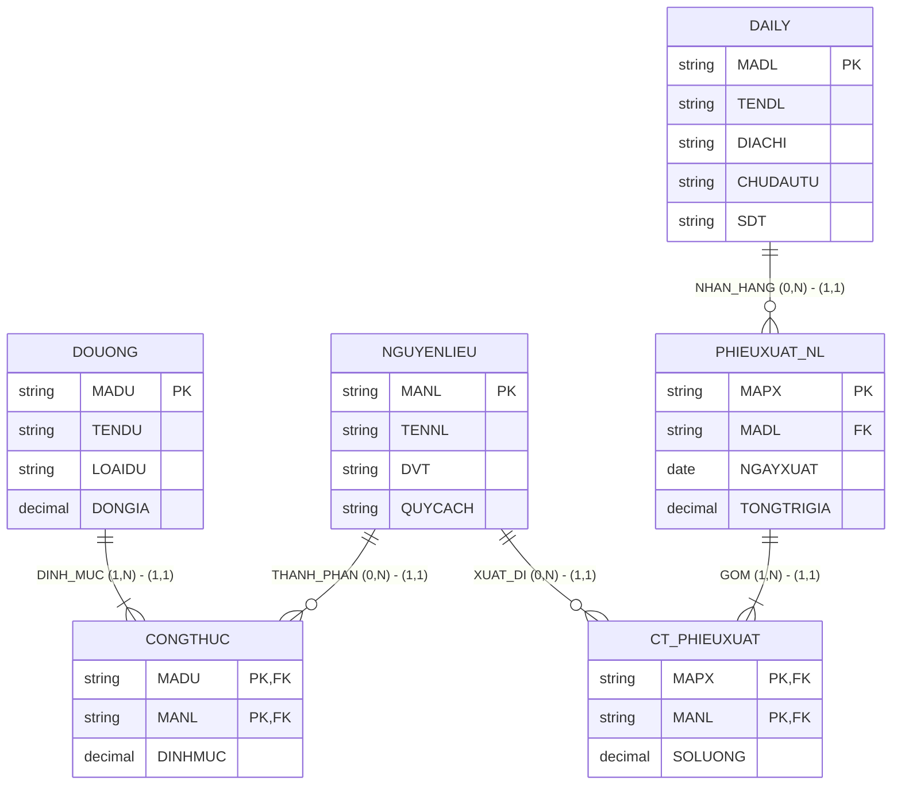

**Các bước suy luận tư duy:**
1. Bước 1: Xác định đầy đủ các tập thực thể độc lập, thực thể yếu, thuộc tính đơn và thuộc tính khóa chính (PK).
1. Bước 2: Phân tích kỹ lưỡng các mối kết hợp nghiệp vụ giữa các thực thể, xác định chính xác bản số min-max hai phía ((0,1), (1,1), (0,N), (1,N)).
1. Bước 3: Chuyển đổi mối kết hợp 1:N bằng cách đưa khóa chính phía 1 sang làm khóa ngoại (FK) ở phía N.
1. Bước 4: Chuyển đổi mối kết hợp M:N thành bảng trung gian, khóa chính là khóa phức hợp gồm 2 khóa ngoại tham chiếu đến 2 thực thể liên quan.

**Phân tích trường hợp biên (Edge Cases):**
Định mức nguyên liệu DINHMUC > 0; số lượng xuất SOLUONG > 0; tổng trị giá phiếu xuất bằng tổng thành tiền từng nguyên liệu.

**Barem chấm điểm đề xuất:**
- `total_points`: 2.5đ
- `entities_and_keys`: 0.5đ
- `relationships_and_cardinalities`: 1.0đ
- `relational_mapping_and_foreign_keys`: 1.0đ

---

## Bài 14 [ERD-P14] — Thiết kế ERD & Ánh xạ Schema: Quản Lý Trung Tâm Thể Thao & Phòng Tập Gym/Fitness
- **Mức độ:** Mức B | **Thời gian khuyến nghị:** 25 phút | **Điểm số:** 2.5 điểm
- **Lược đồ tham chiếu:** `HOIVIEN(MAHV PK, HOTEN, SDT, NGAYTHAMGIA, HANGTHE), HLV(MAHLV PK, HOTEN, CHUYENMON, SDT, GIA_GIO), GOITAP(MAGT PK, TENGT, THOIHAN_THANG, DONGIA), DANGKY_GOI(MADK PK, MAHV FK, MAGT FK, NGAYBD, NGAYKT, SOTIENTRA), LICH_PT(MALICH PK, MAHV FK, MAHLV FK, THOIGIAN, PHONGTAP, NOIDUNG)`
- **Trạng thái kiểm định:** `SEMANTICALLY_REVIEWED` (Đã rà soát học thuật & công thức toán học)

### 1. Đề Bài
Thiết kế ERD quản lý phòng tập Gym: Hội viên đăng ký các gói tập, thuê huấn luyện viên cá nhân (Personal Trainer) theo các buổi hẹn lịch tập cụ thể.

### 2. Hướng Dẫn & Lời Giải Chi Tiết
**Các thực thể và thuộc tính:**
- HOIVIEN: MAHV (PK), HOTEN, SDT, NGAYTHAMGIA, HANGTHE
- HLV: MAHLV (PK), HOTEN, CHUYENMON, SDT, GIA_GIO
- GOITAP: MAGT (PK), TENGT, THOIHAN_THANG, DONGIA
- DANGKY_GOI: MADK (PK), NGAYBD, NGAYKT, SOTIENTRA
- LICH_PT: MALICH (PK), THOIGIAN, PHONGTAP, NOIDUNG

**Mối kết hợp và bản số min-max:**
- HOIVIEN - DANGKY_GOI: 1:N | Bản số: HOIVIEN (1,N) - (1,1) DANGKY_GOI
- GOITAP - DANGKY_GOI: 1:N | Bản số: GOITAP (0,N) - (1,1) DANGKY_GOI
- HOIVIEN - LICH_PT: 1:N | Bản số: HOIVIEN (0,N) - (1,1) LICH_PT
- HLV - LICH_PT: 1:N | Bản số: HLV (0,N) - (1,1) LICH_PT

**Lược đồ quan hệ chuyển đổi:**
- HOIVIEN(MAHV PK, HOTEN, SDT, NGAYTHAMGIA, HANGTHE)
- HLV(MAHLV PK, HOTEN, CHUYENMON, SDT, GIA_GIO)
- GOITAP(MAGT PK, TENGT, THOIHAN_THANG, DONGIA)
- DANGKY_GOI(MADK PK, MAHV FK, MAGT FK, NGAYBD, NGAYKT, SOTIENTRA)
- LICH_PT(MALICH PK, MAHV FK, MAHLV FK, THOIGIAN, PHONGTAP, NOIDUNG)

**Sơ đồ Thực thể - Mối kết hợp (ERD):**
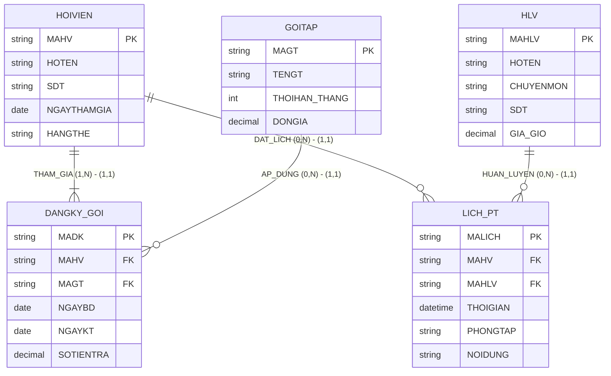

**Các bước suy luận tư duy:**
1. Bước 1: Xác định đầy đủ các tập thực thể độc lập, thực thể yếu, thuộc tính đơn và thuộc tính khóa chính (PK).
1. Bước 2: Phân tích kỹ lưỡng các mối kết hợp nghiệp vụ giữa các thực thể, xác định chính xác bản số min-max hai phía ((0,1), (1,1), (0,N), (1,N)).
1. Bước 3: Chuyển đổi mối kết hợp 1:N bằng cách đưa khóa chính phía 1 sang làm khóa ngoại (FK) ở phía N.
1. Bước 4: Chuyển đổi mối kết hợp M:N thành bảng trung gian, khóa chính là khóa phức hợp gồm 2 khóa ngoại tham chiếu đến 2 thực thể liên quan.

**Phân tích trường hợp biên (Edge Cases):**
Lịch PT của cùng 1 HLV không được trùng thời gian; ngày kết thúc gói tập NGAYKT phải sau NGAYBD.

**Barem chấm điểm đề xuất:**
- `total_points`: 2.5đ
- `entities_and_keys`: 0.5đ
- `relationships_and_cardinalities`: 1.0đ
- `relational_mapping_and_foreign_keys`: 1.0đ

---

## Bài 15 [ERD-P15] — Thiết kế ERD & Ánh xạ Schema: Quản Lý Kho Bãi & Vận Tải Logistics Đa Phương Thức
- **Mức độ:** Mức B | **Thời gian khuyến nghị:** 25 phút | **Điểm số:** 2.5 điểm
- **Lược đồ tham chiếu:** `KHO(MAKHO PK, TENKHO, DIACHI, SUCCHUA_M3), DOIXE(MADOI PK, TENDOI, TRUONGDOI, SDT), PHUONGTIEN(MAPT PK, MADOI FK, BIENSO, TAITRONG_TAN, LOAIPT), KHACHHANG(MAKH PK, TENKH, DIACHI, SDT, MASOTHUE), VANDON(MAVD PK, MAKH FK, MAKHO_GUI FK, MAKHO_NHAN FK, MAPT FK, NGAYGUI, NGAYGIAODUKIEN, CUOCPHI)`
- **Trạng thái kiểm định:** `SEMANTICALLY_REVIEWED` (Đã rà soát học thuật & công thức toán học)

### 1. Đề Bài
Thiết kế ERD cho Doanh nghiệp Logistics: Quản lý mạng lưới kho bãi phân phối, đội xe vận chuyển hàng hóa giữa các kho và các vận đơn ký gửi của khách hàng.

### 2. Hướng Dẫn & Lời Giải Chi Tiết
**Các thực thể và thuộc tính:**
- KHO: MAKHO (PK), TENKHO, DIACHI, SUCCHUA_M3
- DOIXE: MADOI (PK), TENDOI, TRUONGDOI, SDT
- PHUONGTIEN: MAPT (PK), BIENSO, TAITRONG_TAN, LOAIPT
- KHACHHANG: MAKH (PK), TENKH, DIACHI, SDT, MASOTHUE
- VANDON: MAVD (PK), NGAYGUI, NGAYGIAODUKIEN, CUOCPHI

**Mối kết hợp và bản số min-max:**
- DOIXE - PHUONGTIEN: 1:N | Bản số: DOIXE (1,N) - (1,1) PHUONGTIEN
- KHO - VANDON (Kho gửi): 1:N | Bản số: KHO (0,N) - (1,1) VANDON
- KHO - VANDON (Kho nhận): 1:N | Bản số: KHO (0,N) - (1,1) VANDON
- PHUONGTIEN - VANDON: 1:N | Bản số: PHUONGTIEN (0,N) - (1,1) VANDON
- KHACHHANG - VANDON: 1:N | Bản số: KHACHHANG (0,N) - (1,1) VANDON

**Lược đồ quan hệ chuyển đổi:**
- KHO(MAKHO PK, TENKHO, DIACHI, SUCCHUA_M3)
- DOIXE(MADOI PK, TENDOI, TRUONGDOI, SDT)
- PHUONGTIEN(MAPT PK, MADOI FK, BIENSO, TAITRONG_TAN, LOAIPT)
- KHACHHANG(MAKH PK, TENKH, DIACHI, SDT, MASOTHUE)
- VANDON(MAVD PK, MAKH FK, MAKHO_GUI FK, MAKHO_NHAN FK, MAPT FK, NGAYGUI, NGAYGIAODUKIEN, CUOCPHI)

**Sơ đồ Thực thể - Mối kết hợp (ERD):**
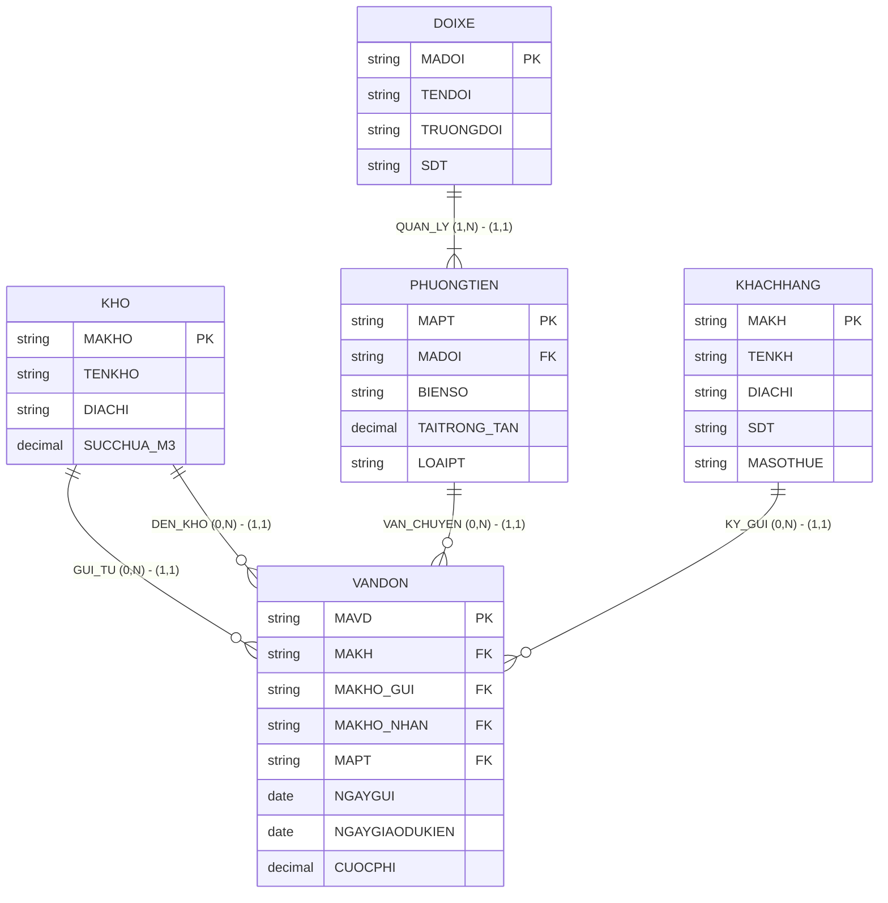

**Các bước suy luận tư duy:**
1. Bước 1: Xác định đầy đủ các tập thực thể độc lập, thực thể yếu, thuộc tính đơn và thuộc tính khóa chính (PK).
1. Bước 2: Phân tích kỹ lưỡng các mối kết hợp nghiệp vụ giữa các thực thể, xác định chính xác bản số min-max hai phía ((0,1), (1,1), (0,N), (1,N)).
1. Bước 3: Chuyển đổi mối kết hợp 1:N bằng cách đưa khóa chính phía 1 sang làm khóa ngoại (FK) ở phía N.
1. Bước 4: Chuyển đổi mối kết hợp M:N thành bảng trung gian, khóa chính là khóa phức hợp gồm 2 khóa ngoại tham chiếu đến 2 thực thể liên quan.

**Phân tích trường hợp biên (Edge Cases):**
Kho gửi MAKHO_GUI phải khác kho nhận MAKHO_NHAN; ngày giao dự kiến >= ngày gửi; cước phí > 0.

**Barem chấm điểm đề xuất:**
- `total_points`: 2.5đ
- `entities_and_keys`: 0.5đ
- `relationships_and_cardinalities`: 1.0đ
- `relational_mapping_and_foreign_keys`: 1.0đ

---

## Bài 16 [ERD-P16] — Thiết kế ERD & Ánh xạ Schema: Quản Lý Sàn Giao Dịch Bất Động Sản & Dự Án Đô Thị
- **Mức độ:** Mức B | **Thời gian khuyến nghị:** 25 phút | **Điểm số:** 2.5 điểm
- **Lược đồ tham chiếu:** `DUAN(MADA PK, TENDA, CHUDAUTU, VITRI, QUYMO_HA), TOANHA(MATN PK, MADA FK, TENTN, SOTANG, SOCAN), CANHO(MACAN PK, MATN FK, SOHIEUCAN, DIENTICH, PHONGNGU, GIABAN_DUKIEN, TRANGTHAI), KHACHHANG(MAKH PK, HOTEN, CCCD, SDT, EMAIL), HOPDONG_MUA(MAHD PK, MACAN FK, MAKH FK, NGAYKY, GIATRI_HD, TIENDADAT)`
- **Trạng thái kiểm định:** `SEMANTICALLY_REVIEWED` (Đã rà soát học thuật & công thức toán học)

### 1. Đề Bài
Thiết kế ERD cho Chủ đầu tư Bất động sản: Quản lý dự án căn hộ cao cấp, tháp chung cư, từng căn hộ cụ thể và hợp đồng mua bán của khách hàng.

### 2. Hướng Dẫn & Lời Giải Chi Tiết
**Các thực thể và thuộc tính:**
- DUAN: MADA (PK), TENDA, CHUDAUTU, VITRI, QUYMO_HA
- TOANHA: MATN (PK), TENTN, SOTANG, SOCAN
- CANHO: MACAN (PK), SOHIEUCAN, DIENTICH, PHONGNGU, GIABAN_DUKIEN, TRANGTHAI
- KHACHHANG: MAKH (PK), HOTEN, CCCD, SDT, EMAIL
- HOPDONG_MUA: MAHD (PK), NGAYKY, GIATRI_HD, TIENDADAT

**Mối kết hợp và bản số min-max:**
- DUAN - TOANHA: 1:N | Bản số: DUAN (1,N) - (1,1) TOANHA
- TOANHA - CANHO: 1:N | Bản số: TOANHA (1,N) - (1,1) CANHO
- CANHO - HOPDONG_MUA: 1:1 | Bản số: CANHO (0,1) - (1,1) HOPDONG_MUA
- KHACHHANG - HOPDONG_MUA: 1:N | Bản số: KHACHHANG (0,N) - (1,1) HOPDONG_MUA

**Lược đồ quan hệ chuyển đổi:**
- DUAN(MADA PK, TENDA, CHUDAUTU, VITRI, QUYMO_HA)
- TOANHA(MATN PK, MADA FK, TENTN, SOTANG, SOCAN)
- CANHO(MACAN PK, MATN FK, SOHIEUCAN, DIENTICH, PHONGNGU, GIABAN_DUKIEN, TRANGTHAI)
- KHACHHANG(MAKH PK, HOTEN, CCCD, SDT, EMAIL)
- HOPDONG_MUA(MAHD PK, MACAN FK, MAKH FK, NGAYKY, GIATRI_HD, TIENDADAT)

**Sơ đồ Thực thể - Mối kết hợp (ERD):**
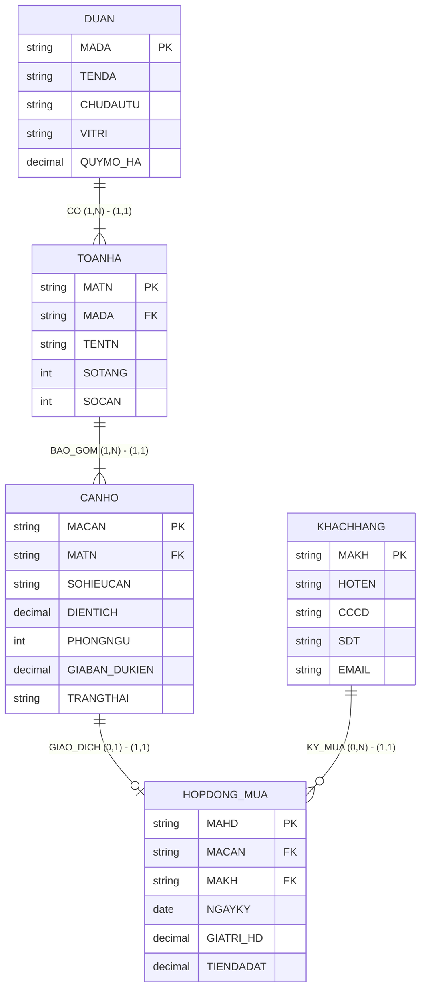

**Các bước suy luận tư duy:**
1. Bước 1: Xác định đầy đủ các tập thực thể độc lập, thực thể yếu, thuộc tính đơn và thuộc tính khóa chính (PK).
1. Bước 2: Phân tích kỹ lưỡng các mối kết hợp nghiệp vụ giữa các thực thể, xác định chính xác bản số min-max hai phía ((0,1), (1,1), (0,N), (1,N)).
1. Bước 3: Chuyển đổi mối kết hợp 1:N bằng cách đưa khóa chính phía 1 sang làm khóa ngoại (FK) ở phía N.
1. Bước 4: Chuyển đổi mối kết hợp M:N thành bảng trung gian, khóa chính là khóa phức hợp gồm 2 khóa ngoại tham chiếu đến 2 thực thể liên quan.

**Phân tích trường hợp biên (Edge Cases):**
Mỗi căn hộ chỉ được ký hợp đồng bán 1 lần (quan hệ 1:1 bảo đảm tính toàn vẹn thương phẩm); TIENDADAT <= GIATRI_HD.

**Barem chấm điểm đề xuất:**
- `total_points`: 2.5đ
- `entities_and_keys`: 0.5đ
- `relationships_and_cardinalities`: 1.0đ
- `relational_mapping_and_foreign_keys`: 1.0đ

---

## Bài 17 [ERD-P17] — Thiết kế ERD & Ánh xạ Schema: Quản Lý Bệnh Viện Đa Khoa & Khám Chữa Bệnh Ngoại Trú
- **Mức độ:** Mức B | **Thời gian khuyến nghị:** 25 phút | **Điểm số:** 2.5 điểm
- **Lược đồ tham chiếu:** `KHOA_KHAM(MAKHOA PK, TENKHOA, TRUONGKHOA, VITRI), BACSI(MABS PK, MAKHOA FK, HOTEN, HOCVI, CHUYENKHOA), BENHNHAN(MABN PK, HOTEN, BHYT, NGAYSINH, GIOITINH, SDT), PHIEUKHAM(MAPK PK, MABN FK, MABS FK, NGAYKHAM, CHANDOAN, KETLUAN), TOATHUOC(MATOA PK, MAPK FK, NGAYKE, LOIDAN), CT_TOATHUOC(MATOA PK FK, MATHUOC PK FK, SOLUONG, CACHDUNG)`
- **Trạng thái kiểm định:** `SEMANTICALLY_REVIEWED` (Đã rà soát học thuật & công thức toán học)

### 1. Đề Bài
Thiết kế ERD cho Bệnh viện Đa khoa: Bệnh nhân đăng ký khám bệnh theo khoa phòng, bác sĩ chuyên khoa khám, lập hồ sơ bệnh án và kê toa thuốc.

### 2. Hướng Dẫn & Lời Giải Chi Tiết
**Các thực thể và thuộc tính:**
- KHOA_KHAM: MAKHOA (PK), TENKHOA, TRUONGKHOA, VITRI
- BACSI: MABS (PK), HOTEN, HOCVI, CHUYENKHOA
- BENHNHAN: MABN (PK), HOTEN, BHYT, NGAYSINH, GIOITINH, SDT
- PHIEUKHAM: MAPK (PK), NGAYKHAM, CHANDOAN, KETLUAN
- TOATHUOC: MATOA (PK), NGAYKE, LOIDAN
- CT_TOATHUOC: SOLUONG, CACHDUNG

**Mối kết hợp và bản số min-max:**
- KHOA_KHAM - BACSI: 1:N | Bản số: KHOA_KHAM (1,N) - (1,1) BACSI
- BENHNHAN - PHIEUKHAM: 1:N | Bản số: BENHNHAN (1,N) - (1,1) PHIEUKHAM
- BACSI - PHIEUKHAM: 1:N | Bản số: BACSI (0,N) - (1,1) PHIEUKHAM
- PHIEUKHAM - TOATHUOC: 1:1 | Bản số: PHIEUKHAM (0,1) - (1,1) TOATHUOC
- TOATHUOC - CT_TOATHUOC: 1:N | Bản số: TOATHUOC (1,N) - (1,1) CT_TOATHUOC

**Lược đồ quan hệ chuyển đổi:**
- KHOA_KHAM(MAKHOA PK, TENKHOA, TRUONGKHOA, VITRI)
- BACSI(MABS PK, MAKHOA FK, HOTEN, HOCVI, CHUYENKHOA)
- BENHNHAN(MABN PK, HOTEN, BHYT, NGAYSINH, GIOITINH, SDT)
- PHIEUKHAM(MAPK PK, MABN FK, MABS FK, NGAYKHAM, CHANDOAN, KETLUAN)
- TOATHUOC(MATOA PK, MAPK FK, NGAYKE, LOIDAN)
- CT_TOATHUOC(MATOA PK FK, MATHUOC PK FK, SOLUONG, CACHDUNG)

**Sơ đồ Thực thể - Mối kết hợp (ERD):**
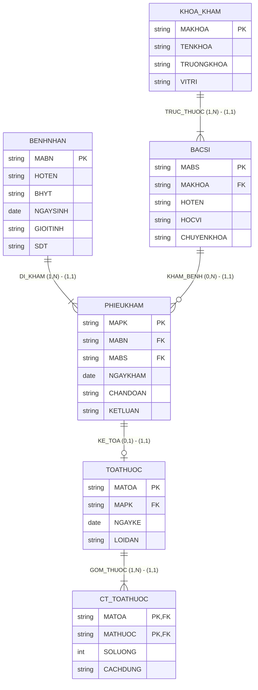

**Các bước suy luận tư duy:**
1. Bước 1: Xác định đầy đủ các tập thực thể độc lập, thực thể yếu, thuộc tính đơn và thuộc tính khóa chính (PK).
1. Bước 2: Phân tích kỹ lưỡng các mối kết hợp nghiệp vụ giữa các thực thể, xác định chính xác bản số min-max hai phía ((0,1), (1,1), (0,N), (1,N)).
1. Bước 3: Chuyển đổi mối kết hợp 1:N bằng cách đưa khóa chính phía 1 sang làm khóa ngoại (FK) ở phía N.
1. Bước 4: Chuyển đổi mối kết hợp M:N thành bảng trung gian, khóa chính là khóa phức hợp gồm 2 khóa ngoại tham chiếu đến 2 thực thể liên quan.

**Phân tích trường hợp biên (Edge Cases):**
Mỗi phiếu khám có tối đa 1 toa thuốc (0..1); thuốc kê trong toa phải có số lượng dương SOLUONG > 0.

**Barem chấm điểm đề xuất:**
- `total_points`: 2.5đ
- `entities_and_keys`: 0.5đ
- `relationships_and_cardinalities`: 1.0đ
- `relational_mapping_and_foreign_keys`: 1.0đ

---

## Bài 18 [ERD-P18] — Thiết kế ERD & Ánh xạ Schema: Quản Lý Công Ty Lữ Hành & Tour Du Lịch Quốc Tế
- **Mức độ:** Mức B | **Thời gian khuyến nghị:** 25 phút | **Điểm số:** 2.5 điểm
- **Lược đồ tham chiếu:** `DIEMDEN(MADD PK, TENDD, QUOCGIA, KHUVUC), TOUR(MATOUR PK, TENTOUR, SONGAY, SODEM, GIATOUR), LOTRINH(MATOUR PK FK, MADD PK FK, THUTU_NGAY, HOATDONG), DOAN_DULICH(MADOAN PK, MATOUR FK, NGAYKHOIHANH, HDV_DAN_DOAN, SOKHACH_MAX), KHACHHANG(MAKH PK, HOTEN, HOCHIEU, QUOCTICH, SDT), DANGKY_TOUR(MADK PK, MADOAN FK, MAKH FK, NGAYDK, SOTIENTRA)`
- **Trạng thái kiểm định:** `SEMANTICALLY_REVIEWED` (Đã rà soát học thuật & công thức toán học)

### 1. Đề Bài
Thiết kế ERD cho Doanh nghiệp Lữ hành: Thiết kế lộ trình tour qua các điểm đến danh lam thắng cảnh, tổ chức các đoàn khởi hành và khách đặt chỗ.

### 2. Hướng Dẫn & Lời Giải Chi Tiết
**Các thực thể và thuộc tính:**
- DIEMDEN: MADD (PK), TENDD, QUOCGIA, KHUVUC
- TOUR: MATOUR (PK), TENTOUR, SONGAY, SODEM, GIATOUR
- LOTRINH: THUTU_NGAY, HOATDONG
- DOAN_DULICH: MADOAN (PK), NGAYKHOIHANH, HDV_DAN_DOAN, SOKHACH_MAX
- KHACHHANG: MAKH (PK), HOTEN, HOCHIEU, QUOCTICH, SDT
- DANGKY_TOUR: MADK (PK), NGAYDK, SOTIENTRA

**Mối kết hợp và bản số min-max:**
- TOUR - DIEMDEN: M:N qua LOTRINH | Bản số: TOUR (1,N) - (1,1) LOTRINH, DIEMDEN (0,N) - (1,1) LOTRINH
- TOUR - DOAN_DULICH: 1:N | Bản số: TOUR (0,N) - (1,1) DOAN_DULICH
- DOAN_DULICH - KHACHHANG: M:N qua DANGKY_TOUR | Bản số: DOAN_DULICH (0,N) - (1,1) DANGKY_TOUR, KHACHHANG (0,N) - (1,1) DANGKY_TOUR

**Lược đồ quan hệ chuyển đổi:**
- DIEMDEN(MADD PK, TENDD, QUOCGIA, KHUVUC)
- TOUR(MATOUR PK, TENTOUR, SONGAY, SODEM, GIATOUR)
- LOTRINH(MATOUR PK FK, MADD PK FK, THUTU_NGAY, HOATDONG)
- DOAN_DULICH(MADOAN PK, MATOUR FK, NGAYKHOIHANH, HDV_DAN_DOAN, SOKHACH_MAX)
- KHACHHANG(MAKH PK, HOTEN, HOCHIEU, QUOCTICH, SDT)
- DANGKY_TOUR(MADK PK, MADOAN FK, MAKH FK, NGAYDK, SOTIENTRA)

**Sơ đồ Thực thể - Mối kết hợp (ERD):**
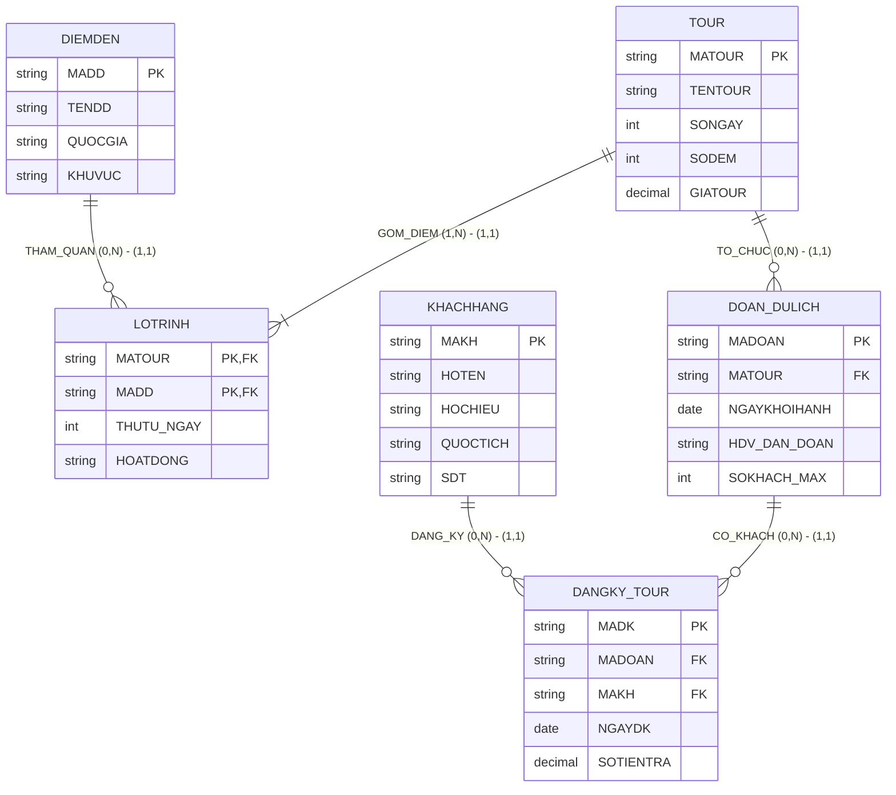

**Các bước suy luận tư duy:**
1. Bước 1: Xác định đầy đủ các tập thực thể độc lập, thực thể yếu, thuộc tính đơn và thuộc tính khóa chính (PK).
1. Bước 2: Phân tích kỹ lưỡng các mối kết hợp nghiệp vụ giữa các thực thể, xác định chính xác bản số min-max hai phía ((0,1), (1,1), (0,N), (1,N)).
1. Bước 3: Chuyển đổi mối kết hợp 1:N bằng cách đưa khóa chính phía 1 sang làm khóa ngoại (FK) ở phía N.
1. Bước 4: Chuyển đổi mối kết hợp M:N thành bảng trung gian, khóa chính là khóa phức hợp gồm 2 khóa ngoại tham chiếu đến 2 thực thể liên quan.

**Phân tích trường hợp biên (Edge Cases):**
Số lượng khách đăng ký thực tế không vượt quá SOKHACH_MAX của đoàn; ngày khởi hành phải sau ngày mở đăng ký.

**Barem chấm điểm đề xuất:**
- `total_points`: 2.5đ
- `entities_and_keys`: 0.5đ
- `relationships_and_cardinalities`: 1.0đ
- `relational_mapping_and_foreign_keys`: 1.0đ

---

## Bài 19 [ERD-P19] — Thiết kế ERD & Ánh xạ Schema: Quản Lý Viện Nghiên Cứu & Đề Tài Khoa Học Công Nghệ
- **Mức độ:** Mức B | **Thời gian khuyến nghị:** 25 phút | **Điểm số:** 2.5 điểm
- **Lược đồ tham chiếu:** `PHONGLAB(MALAB PK, TENLAB, TRUONGLAB, LINHVUC), NHAKHOAHOC(MANKH PK, MALAB FK, HOTEN, HOCHAM, HOCVI, CHUYENNGANH), DETAI_KH(MADT PK, TENDT, CAPQUANLY, KINHPHI, NGAYBD, NGAYNT), THAMGIA_DT(MADT PK FK, MANKH PK FK, VAITRO, SOTHANG_CONGTAC), CONGBO_KH(MACB PK, MADT FK, TENTAPCHI, NAM_CONGBO, HESI_IF)`
- **Trạng thái kiểm định:** `SEMANTICALLY_REVIEWED` (Đã rà soát học thuật & công thức toán học)

### 1. Đề Bài
Thiết kế ERD cho Viện Khoa học Công nghệ: Quản lý các phòng thí nghiệm, nhà khoa học chủ trì hoặc tham gia đề tài nghiên cứu và các bài báo quốc tế công bố.

### 2. Hướng Dẫn & Lời Giải Chi Tiết
**Các thực thể và thuộc tính:**
- PHONGLAB: MALAB (PK), TENLAB, TRUONGLAB, LINHVUC
- NHAKHOAHOC: MANKH (PK), HOTEN, HOCHAM, HOCVI, CHUYENNGANH
- DETAI_KH: MADT (PK), TENDT, CAPQUANLY, KINHPHI, NGAYBD, NGAYNT
- THAMGIA_DT: VAITRO, SOTHANG_CONGTAC
- CONGBO_KH: MACB (PK), TENTAPCHI, NAM_CONGBO, HESI_IF

**Mối kết hợp và bản số min-max:**
- PHONGLAB - NHAKHOAHOC: 1:N | Bản số: PHONGLAB (1,N) - (1,1) NHAKHOAHOC
- DETAI_KH - NHAKHOAHOC: M:N qua THAMGIA_DT | Bản số: DETAI_KH (1,N) - (1,1) THAMGIA_DT, NHAKHOAHOC (0,N) - (1,1) THAMGIA_DT
- DETAI_KH - CONGBO_KH: 1:N | Bản số: DETAI_KH (0,N) - (1,1) CONGBO_KH

**Lược đồ quan hệ chuyển đổi:**
- PHONGLAB(MALAB PK, TENLAB, TRUONGLAB, LINHVUC)
- NHAKHOAHOC(MANKH PK, MALAB FK, HOTEN, HOCHAM, HOCVI, CHUYENNGANH)
- DETAI_KH(MADT PK, TENDT, CAPQUANLY, KINHPHI, NGAYBD, NGAYNT)
- THAMGIA_DT(MADT PK FK, MANKH PK FK, VAITRO, SOTHANG_CONGTAC)
- CONGBO_KH(MACB PK, MADT FK, TENTAPCHI, NAM_CONGBO, HESI_IF)

**Sơ đồ Thực thể - Mối kết hợp (ERD):**
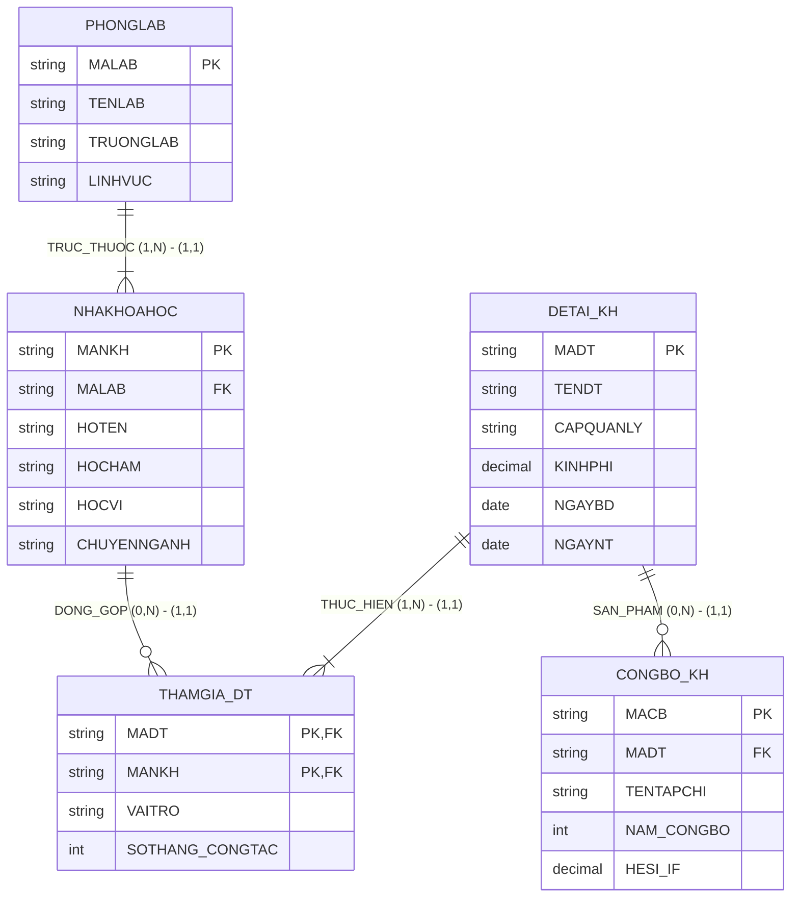

**Các bước suy luận tư duy:**
1. Bước 1: Xác định đầy đủ các tập thực thể độc lập, thực thể yếu, thuộc tính đơn và thuộc tính khóa chính (PK).
1. Bước 2: Phân tích kỹ lưỡng các mối kết hợp nghiệp vụ giữa các thực thể, xác định chính xác bản số min-max hai phía ((0,1), (1,1), (0,N), (1,N)).
1. Bước 3: Chuyển đổi mối kết hợp 1:N bằng cách đưa khóa chính phía 1 sang làm khóa ngoại (FK) ở phía N.
1. Bước 4: Chuyển đổi mối kết hợp M:N thành bảng trung gian, khóa chính là khóa phức hợp gồm 2 khóa ngoại tham chiếu đến 2 thực thể liên quan.

**Phân tích trường hợp biên (Edge Cases):**
Mỗi đề tài có đúng 1 nhà khoa học giữ vai trò 'Chu nhiem'; ngày nghiệm thu NGAYNT >= NGAYBD; kinh phí KINHPHI > 0.

**Barem chấm điểm đề xuất:**
- `total_points`: 2.5đ
- `entities_and_keys`: 0.5đ
- `relationships_and_cardinalities`: 1.0đ
- `relational_mapping_and_foreign_keys`: 1.0đ

---

## Bài 20 [ERD-P20] — Thiết kế ERD & Ánh xạ Schema: Quản Lý Nền Tảng Học Trực Tuyến & Khóa Học E-Learning
- **Mức độ:** Mức B | **Thời gian khuyến nghị:** 25 phút | **Điểm số:** 2.5 điểm
- **Lược đồ tham chiếu:** `GIANGVIEN(MAGV PK, HOTEN, EMAIL, CHUYENMON, DANHGIA_SAO), KHOAHOC(MAKH PK, MAGV FK, TENKH, THELOAI, HOCPHI, TONGGIO), BAIHOC(MABH PK, MAKH FK, THUTU, TIEUDE, THOILUONG_PHUT, VIDEO_URL), HOCVIEN(MAHV PK, HOTEN, EMAIL, NGAYDK_TK), DANGKY_KH(MADK PK, MAHV FK, MAKH FK, NGAYDK, SOTIENDANOP, TIENDO_HOANTHANH)`
- **Trạng thái kiểm định:** `SEMANTICALLY_REVIEWED` (Đã rà soát học thuật & công thức toán học)

### 1. Đề Bài
Thiết kế ERD cho Hệ thống Học trực tuyến (MOOC): Giảng viên xây dựng khóa học và các bài học video, học viên đăng ký tham gia và theo dõi tiến độ.

### 2. Hướng Dẫn & Lời Giải Chi Tiết
**Các thực thể và thuộc tính:**
- GIANGVIEN: MAGV (PK), HOTEN, EMAIL, CHUYENMON, DANHGIA_SAO
- KHOAHOC: MAKH (PK), TENKH, THELOAI, HOCPHI, TONGGIO
- BAIHOC: MABH (PK), THUTU, TIEUDE, THOILUONG_PHUT, VIDEO_URL
- HOCVIEN: MAHV (PK), HOTEN, EMAIL, NGAYDK_TK
- DANGKY_KH: MADK (PK), NGAYDK, SOTIENDANOP, TIENDO_HOANTHANH

**Mối kết hợp và bản số min-max:**
- GIANGVIEN - KHOAHOC: 1:N | Bản số: GIANGVIEN (0,N) - (1,1) KHOAHOC
- KHOAHOC - BAIHOC: 1:N | Bản số: KHOAHOC (1,N) - (1,1) BAIHOC
- HOCVIEN - DANGKY_KH: 1:N | Bản số: HOCVIEN (0,N) - (1,1) DANGKY_KH
- KHOAHOC - DANGKY_KH: 1:N | Bản số: KHOAHOC (0,N) - (1,1) DANGKY_KH

**Lược đồ quan hệ chuyển đổi:**
- GIANGVIEN(MAGV PK, HOTEN, EMAIL, CHUYENMON, DANHGIA_SAO)
- KHOAHOC(MAKH PK, MAGV FK, TENKH, THELOAI, HOCPHI, TONGGIO)
- BAIHOC(MABH PK, MAKH FK, THUTU, TIEUDE, THOILUONG_PHUT, VIDEO_URL)
- HOCVIEN(MAHV PK, HOTEN, EMAIL, NGAYDK_TK)
- DANGKY_KH(MADK PK, MAHV FK, MAKH FK, NGAYDK, SOTIENDANOP, TIENDO_HOANTHANH)

**Sơ đồ Thực thể - Mối kết hợp (ERD):**
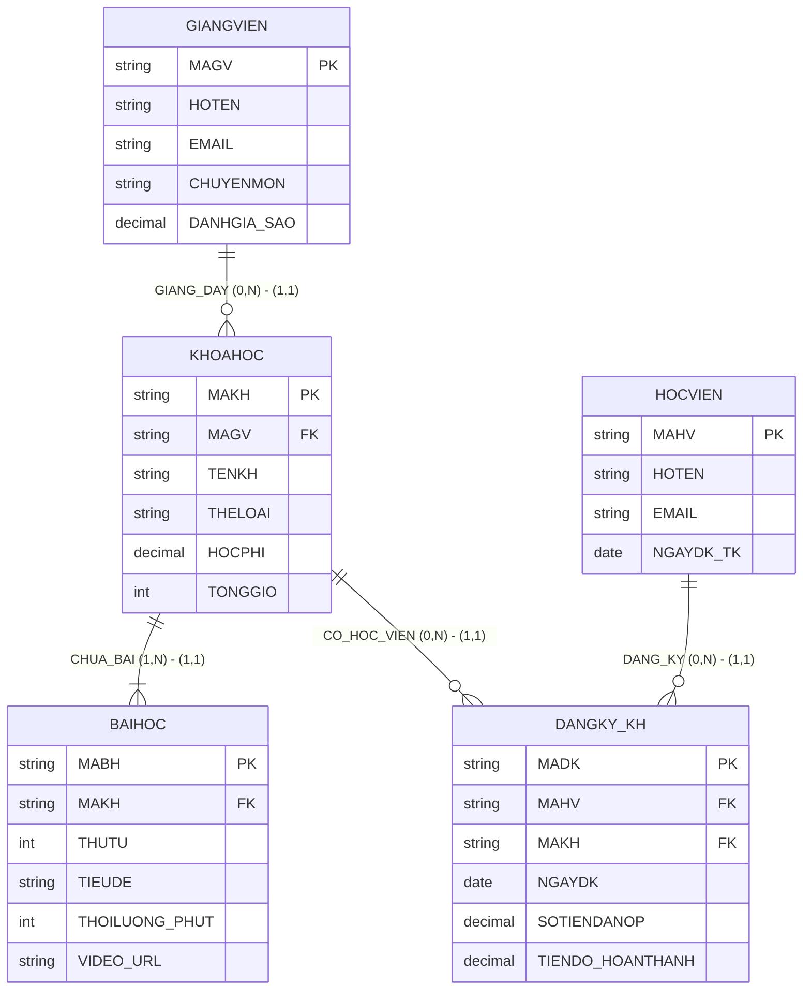

**Các bước suy luận tư duy:**
1. Bước 1: Xác định đầy đủ các tập thực thể độc lập, thực thể yếu, thuộc tính đơn và thuộc tính khóa chính (PK).
1. Bước 2: Phân tích kỹ lưỡng các mối kết hợp nghiệp vụ giữa các thực thể, xác định chính xác bản số min-max hai phía ((0,1), (1,1), (0,N), (1,N)).
1. Bước 3: Chuyển đổi mối kết hợp 1:N bằng cách đưa khóa chính phía 1 sang làm khóa ngoại (FK) ở phía N.
1. Bước 4: Chuyển đổi mối kết hợp M:N thành bảng trung gian, khóa chính là khóa phức hợp gồm 2 khóa ngoại tham chiếu đến 2 thực thể liên quan.

**Phân tích trường hợp biên (Edge Cases):**
Tiến độ hoàn thành TIENDO_HOANTHANH thuộc [0.0, 100.0]; học phí HOCPHI >= 0; số thứ tự bài học THUTU > 0.

**Barem chấm điểm đề xuất:**
- `total_points`: 2.5đ
- `entities_and_keys`: 0.5đ
- `relationships_and_cardinalities`: 1.0đ
- `relational_mapping_and_foreign_keys`: 1.0đ

---

## Bài 21 [ERD-P21] — Thiết kế ERD & Ánh xạ Schema: Quản Lý Khu Công Nghiệp & Cho Thuê Đất Xưởng
- **Mức độ:** Mức B | **Thời gian khuyến nghị:** 25 phút | **Điểm số:** 2.5 điểm
- **Lược đồ tham chiếu:** `KHU_CN(MAKCN PK, TENKCN, TINH_TP, DIENTICH_HA), PHANKHU(MAPK PK, MAKCN FK, TENPK, QUYHOACH_NGANH), LODAT(MALO PK, MAPK FK, DIENTICH_M2, VITRI, GIATHUE_M2_NAM, TRANGTHAI), DOANHNGHIEP(MADN PK, TENDN, MASOTHUE, NGUOIDAIDIEN, QUOCTICH), HOPDONG_THUE(MAHD PK, MALO FK, MADN FK, NGAYKY, THOIHAN_NAM, TIENCOC, GIATHUE_HANGNAM)`
- **Trạng thái kiểm định:** `SEMANTICALLY_REVIEWED` (Đã rà soát học thuật & công thức toán học)

### 1. Đề Bài
Thiết kế ERD cho Ban Quản lý Khu Công nghiệp: Quản lý phân lô đất xưởng theo ngành nghề, doanh nghiệp thuê đất dài hạn và các hợp đồng pháp lý.

### 2. Hướng Dẫn & Lời Giải Chi Tiết
**Các thực thể và thuộc tính:**
- KHU_CN: MAKCN (PK), TENKCN, TINH_TP, DIENTICH_HA
- PHANKHU: MAPK (PK), TENPK, QUYHOACH_NGANH
- LODAT: MALO (PK), DIENTICH_M2, VITRI, GIATHUE_M2_NAM, TRANGTHAI
- DOANHNGHIEP: MADN (PK), TENDN, MASOTHUE, NGUOIDAIDIEN, QUOCTICH
- HOPDONG_THUE: MAHD (PK), NGAYKY, THOIHAN_NAM, TIENCOC, GIATHUE_HANGNAM

**Mối kết hợp và bản số min-max:**
- KHU_CN - PHANKHU: 1:N | Bản số: KHU_CN (1,N) - (1,1) PHANKHU
- PHANKHU - LODAT: 1:N | Bản số: PHANKHU (1,N) - (1,1) LODAT
- LODAT - HOPDONG_THUE: 1:N | Bản số: LODAT (0,N) - (1,1) HOPDONG_THUE
- DOANHNGHIEP - HOPDONG_THUE: 1:N | Bản số: DOANHNGHIEP (0,N) - (1,1) HOPDONG_THUE

**Lược đồ quan hệ chuyển đổi:**
- KHU_CN(MAKCN PK, TENKCN, TINH_TP, DIENTICH_HA)
- PHANKHU(MAPK PK, MAKCN FK, TENPK, QUYHOACH_NGANH)
- LODAT(MALO PK, MAPK FK, DIENTICH_M2, VITRI, GIATHUE_M2_NAM, TRANGTHAI)
- DOANHNGHIEP(MADN PK, TENDN, MASOTHUE, NGUOIDAIDIEN, QUOCTICH)
- HOPDONG_THUE(MAHD PK, MALO FK, MADN FK, NGAYKY, THOIHAN_NAM, TIENCOC, GIATHUE_HANGNAM)

**Sơ đồ Thực thể - Mối kết hợp (ERD):**
```mermaid
erDiagram
    KHU_CN ||--|{ PHANKHU : "PHAN_CHIA (1,N) - (1,1)"
    PHANKHU ||--|{ LODAT : "QUY_HOACH (1,N) - (1,1)"
    LODAT ||--o{ HOPDONG_THUE : "CHO_THUE (0,N) - (1,1)"
    DOANHNGHIEP ||--o{ HOPDONG_THUE : "KY_THUE (0,N) - (1,1)"

    KHU_CN { string MAKCN PK
 string TENKCN
 string TINH_TP
 decimal DIENTICH_HA }
    PHANKHU { string MAPK PK
 string MAKCN FK
 string TENPK
 string QUYHOACH_NGANH }
    LODAT { string MALO PK
 string MAPK FK
 decimal DIENTICH_M2
 string VITRI
 decimal GIATHUE_M2_NAM
 string TRANGTHAI }
    DOANHNGHIEP { string MADN PK
 string TENDN
 string MASOTHUE
 string NGUOIDAIDIEN
 string QUOCTICH }
    HOPDONG_THUE { string MAHD PK
 string MALO FK
 string MADN FK
 date NGAYKY
 int THOIHAN_NAM
 decimal TIENCOC
 decimal GIATHUE_HANGNAM }
```

**Các bước suy luận tư duy:**
1. Bước 1: Xác định đầy đủ các tập thực thể độc lập, thực thể yếu, thuộc tính đơn và thuộc tính khóa chính (PK).
1. Bước 2: Phân tích kỹ lưỡng các mối kết hợp nghiệp vụ giữa các thực thể, xác định chính xác bản số min-max hai phía ((0,1), (1,1), (0,N), (1,N)).
1. Bước 3: Chuyển đổi mối kết hợp 1:N bằng cách đưa khóa chính phía 1 sang làm khóa ngoại (FK) ở phía N.
1. Bước 4: Chuyển đổi mối kết hợp M:N thành bảng trung gian, khóa chính là khóa phức hợp gồm 2 khóa ngoại tham chiếu đến 2 thực thể liên quan.

**Phân tích trường hợp biên (Edge Cases):**
Lô đất đã cho thuê (TRANGTHAI = 'Da thue') không được ký hợp đồng mới trước ngày hết hạn; THOIHAN_NAM > 0.

**Barem chấm điểm đề xuất:**
- `total_points`: 2.5đ
- `entities_and_keys`: 0.5đ
- `relationships_and_cardinalities`: 1.0đ
- `relational_mapping_and_foreign_keys`: 1.0đ

---

## Bài 22 [ERD-P22] — Thiết kế ERD & Ánh xạ Schema: Quản Lý Hãng Xe Công Nghệ & Chuyến Xe
- **Mức độ:** Mức B | **Thời gian khuyến nghị:** 25 phút | **Điểm số:** 2.5 điểm
- **Lược đồ tham chiếu:** `DOI_XE(MADOI PK, TENDOI, THANHPHO), TAIXE(MATX PK, MADOI FK, HOTEN, CCCD, SDT, BIENSO, LOAIXE), KHACHHANG(MAKH PK, HOTEN, SDT, DIEM_TICHLUY), CHUYENXE(MACHUYEN PK, MATX FK, MAKH FK, DIEMDON, DIEMDEN, QUANGDUONG_KM, GIA_CUOC, THOIGIAN_BD, THOIGIAN_KT, TRANGTHAI), DANHGIA(MADG PK, MACHUYEN FK, DIEM_SAO, NHANXET)`
- **Trạng thái kiểm định:** `SEMANTICALLY_REVIEWED` (Đã rà soát học thuật & công thức toán học)

### 1. Đề Bài
Thiết kế ERD cho Ứng dụng đặt xe công nghệ (Ride-hailing): Quản lý tài xế theo đội xe, khách hàng đặt các chuyến đi từ điểm đón đến điểm đến và đánh giá sao.

### 2. Hướng Dẫn & Lời Giải Chi Tiết
**Các thực thể và thuộc tính:**
- DOI_XE: MADOI (PK), TENDOI, THANHPHO
- TAIXE: MATX (PK), HOTEN, CCCD, SDT, BIENSO, LOAIXE
- KHACHHANG: MAKH (PK), HOTEN, SDT, DIEM_TICHLUY
- CHUYENXE: MACHUYEN (PK), DIEMDON, DIEMDEN, QUANGDUONG_KM, GIA_CUOC, THOIGIAN_BD, THOIGIAN_KT, TRANGTHAI
- DANHGIA: MADG (PK), DIEM_SAO, NHANXET

**Mối kết hợp và bản số min-max:**
- DOI_XE - TAIXE: 1:N | Bản số: DOI_XE (1,N) - (1,1) TAIXE
- TAIXE - CHUYENXE: 1:N | Bản số: TAIXE (0,N) - (1,1) CHUYENXE
- KHACHHANG - CHUYENXE: 1:N | Bản số: KHACHHANG (0,N) - (1,1) CHUYENXE
- CHUYENXE - DANHGIA: 1:1 | Bản số: CHUYENXE (0,1) - (1,1) DANHGIA

**Lược đồ quan hệ chuyển đổi:**
- DOI_XE(MADOI PK, TENDOI, THANHPHO)
- TAIXE(MATX PK, MADOI FK, HOTEN, CCCD, SDT, BIENSO, LOAIXE)
- KHACHHANG(MAKH PK, HOTEN, SDT, DIEM_TICHLUY)
- CHUYENXE(MACHUYEN PK, MATX FK, MAKH FK, DIEMDON, DIEMDEN, QUANGDUONG_KM, GIA_CUOC, THOIGIAN_BD, THOIGIAN_KT, TRANGTHAI)
- DANHGIA(MADG PK, MACHUYEN FK, DIEM_SAO, NHANXET)

**Sơ đồ Thực thể - Mối kết hợp (ERD):**
```mermaid
erDiagram
    DOI_XE ||--|{ TAIXE : "QUAN_LY (1,N) - (1,1)"
    TAIXE ||--o{ CHUYENXE : "DON_KHACH (0,N) - (1,1)"
    KHACHHANG ||--o{ CHUYENXE : "DAT_XE (0,N) - (1,1)"
    CHUYENXE ||--o| DANHGIA : "DANH_GIA (0,1) - (1,1)"

    DOI_XE { string MADOI PK
 string TENDOI
 string THANHPHO }
    TAIXE { string MATX PK
 string MADOI FK
 string HOTEN
 string CCCD
 string SDT
 string BIENSO
 string LOAIXE }
    KHACHHANG { string MAKH PK
 string HOTEN
 string SDT
 int DIEM_TICHLUY }
    CHUYENXE { string MACHUYEN PK
 string MATX FK
 string MAKH FK
 string DIEMDON
 string DIEMDEN
 decimal QUANGDUONG_KM
 decimal GIA_CUOC
 datetime THOIGIAN_BD
 datetime THOIGIAN_KT
 string TRANGTHAI }
    DANHGIA { string MADG PK
 string MACHUYEN FK
 int DIEM_SAO
 string NHANXET }
```

**Các bước suy luận tư duy:**
1. Bước 1: Xác định đầy đủ các tập thực thể độc lập, thực thể yếu, thuộc tính đơn và thuộc tính khóa chính (PK).
1. Bước 2: Phân tích kỹ lưỡng các mối kết hợp nghiệp vụ giữa các thực thể, xác định chính xác bản số min-max hai phía ((0,1), (1,1), (0,N), (1,N)).
1. Bước 3: Chuyển đổi mối kết hợp 1:N bằng cách đưa khóa chính phía 1 sang làm khóa ngoại (FK) ở phía N.
1. Bước 4: Chuyển đổi mối kết hợp M:N thành bảng trung gian, khóa chính là khóa phức hợp gồm 2 khóa ngoại tham chiếu đến 2 thực thể liên quan.

**Phân tích trường hợp biên (Edge Cases):**
Điểm sao DIEM_SAO thuộc thang 1 đến 5 sao; chuyến xe hoàn thành mới được đánh giá; THOIGIAN_KT >= THOIGIAN_BD.

**Barem chấm điểm đề xuất:**
- `total_points`: 2.5đ
- `entities_and_keys`: 0.5đ
- `relationships_and_cardinalities`: 1.0đ
- `relational_mapping_and_foreign_keys`: 1.0đ

---

## Bài 23 [ERD-P23] — Thiết kế ERD & Ánh xạ Schema: Quản Lý Nhà Máy Xử Lý & Tái Chế Rác Thải
- **Mức độ:** Mức B | **Thời gian khuyến nghị:** 25 phút | **Điểm số:** 2.5 điểm
- **Lược đồ tham chiếu:** `NHAMAY(MANM PK, TENNM, DIACHI, CONGSUAT_TAN_NGAY), KHUVUC_GOM(MAKV PK, TENKV, QUAN_HUYEN), XE_THUGOM(MAXE PK, MANM FK, BIENSO, TRONGLUONG_MAX), CONGNHAN(MACN PK, MANM FK, HOTEN, SDT), CHUYEN_GOM(MACHUYEN PK, MAXE FK, MAKV FK, MACN_LAIXE FK, NGAYGOM, KHOILUONG_KG), DOTHANH_XULY(MADOT PK, MANM FK, NGAYXULY, KHOILUONG_TAICHE_KG, KHOILUONG_CHONLAP_KG)`
- **Trạng thái kiểm định:** `SEMANTICALLY_REVIEWED` (Đã rà soát học thuật & công thức toán học)

### 1. Đề Bài
Thiết kế ERD quản lý thu gom và tái chế rác thải đô thị: Xe chuyên dụng gom rác từ các khu vực chuyển về nhà máy xử lý phân loại tái chế hoặc chôn lấp.

### 2. Hướng Dẫn & Lời Giải Chi Tiết
**Các thực thể và thuộc tính:**
- NHAMAY: MANM (PK), TENNM, DIACHI, CONGSUAT_TAN_NGAY
- KHUVUC_GOM: MAKV (PK), TENKV, QUAN_HUYEN
- XE_THUGOM: MAXE (PK), BIENSO, TRONGLUONG_MAX
- CONGNHAN: MACN (PK), HOTEN, SDT
- CHUYEN_GOM: MACHUYEN (PK), NGAYGOM, KHOILUONG_KG
- DOTHANH_XULY: MADOT (PK), NGAYXULY, KHOILUONG_TAICHE_KG, KHOILUONG_CHONLAP_KG

**Mối kết hợp và bản số min-max:**
- NHAMAY - XE_THUGOM: 1:N | Bản số: NHAMAY (1,N) - (1,1) XE_THUGOM
- NHAMAY - CONGNHAN: 1:N | Bản số: NHAMAY (1,N) - (1,1) CONGNHAN
- XE_THUGOM - CHUYEN_GOM: 1:N | Bản số: XE_THUGOM (0,N) - (1,1) CHUYEN_GOM
- KHUVUC_GOM - CHUYEN_GOM: 1:N | Bản số: KHUVUC_GOM (0,N) - (1,1) CHUYEN_GOM
- NHAMAY - DOTHANH_XULY: 1:N | Bản số: NHAMAY (0,N) - (1,1) DOTHANH_XULY

**Lược đồ quan hệ chuyển đổi:**
- NHAMAY(MANM PK, TENNM, DIACHI, CONGSUAT_TAN_NGAY)
- KHUVUC_GOM(MAKV PK, TENKV, QUAN_HUYEN)
- XE_THUGOM(MAXE PK, MANM FK, BIENSO, TRONGLUONG_MAX)
- CONGNHAN(MACN PK, MANM FK, HOTEN, SDT)
- CHUYEN_GOM(MACHUYEN PK, MAXE FK, MAKV FK, MACN_LAIXE FK, NGAYGOM, KHOILUONG_KG)
- DOTHANH_XULY(MADOT PK, MANM FK, NGAYXULY, KHOILUONG_TAICHE_KG, KHOILUONG_CHONLAP_KG)

**Sơ đồ Thực thể - Mối kết hợp (ERD):**
```mermaid
erDiagram
    NHAMAY ||--|{ XE_THUGOM : "SO_HUU (1,N) - (1,1)"
    NHAMAY ||--|{ CONGNHAN : "TUYEN_DUNG (1,N) - (1,1)"
    XE_THUGOM ||--o{ CHUYEN_GOM : "THUC_HIEN (0,N) - (1,1)"
    KHUVUC_GOM ||--o{ CHUYEN_GOM : "THU_GOM (0,N) - (1,1)"
    NHAMAY ||--o{ DOTHANH_XULY : "XU_LY (0,N) - (1,1)"

    NHAMAY { string MANM PK
 string TENNM
 string DIACHI
 decimal CONGSUAT_TAN_NGAY }
    KHUVUC_GOM { string MAKV PK
 string TENKV
 string QUAN_HUYEN }
    XE_THUGOM { string MAXE PK
 string MANM FK
 string BIENSO
 decimal TRONGLUONG_MAX }
    CONGNHAN { string MACN PK
 string MANM FK
 string HOTEN
 string SDT }
    CHUYEN_GOM { string MACHUYEN PK
 string MAXE FK
 string MAKV FK
 string MACN_LAIXE FK
 date NGAYGOM
 decimal KHOILUONG_KG }
    DOTHANH_XULY { string MADOT PK
 string MANM FK
 date NGAYXULY
 decimal KHOILUONG_TAICHE_KG
 decimal KHOILUONG_CHONLAP_KG }
```

**Các bước suy luận tư duy:**
1. Bước 1: Xác định đầy đủ các tập thực thể độc lập, thực thể yếu, thuộc tính đơn và thuộc tính khóa chính (PK).
1. Bước 2: Phân tích kỹ lưỡng các mối kết hợp nghiệp vụ giữa các thực thể, xác định chính xác bản số min-max hai phía ((0,1), (1,1), (0,N), (1,N)).
1. Bước 3: Chuyển đổi mối kết hợp 1:N bằng cách đưa khóa chính phía 1 sang làm khóa ngoại (FK) ở phía N.
1. Bước 4: Chuyển đổi mối kết hợp M:N thành bảng trung gian, khóa chính là khóa phức hợp gồm 2 khóa ngoại tham chiếu đến 2 thực thể liên quan.

**Phân tích trường hợp biên (Edge Cases):**
Khối lượng gom không được vượt tải trọng xe TRONGLUONG_MAX; tổng khối lượng tái chế và chôn lấp phải tương thích tổng lượng rác tiếp nhận.

**Barem chấm điểm đề xuất:**
- `total_points`: 2.5đ
- `entities_and_keys`: 0.5đ
- `relationships_and_cardinalities`: 1.0đ
- `relational_mapping_and_foreign_keys`: 1.0đ

---

## Bài 24 [ERD-P24] — Thiết kế ERD & Ánh xạ Schema: Quản Lý Bản Quyền Âm Nhạc Trực Tuyến
- **Mức độ:** Mức B | **Thời gian khuyến nghị:** 25 phút | **Điểm số:** 2.5 điểm
- **Lược đồ tham chiếu:** `TRUNGTAM_BQ(MATT PK, TENTT, QUOCGIA), NHACSI(MANS PK, HOTEN, BUTDANH, QUOCTICH), CASI(MACS PK, NGHEDANH, SDT, EMAIL), BAIHAT(MABH PK, MATT FK, MANS FK, TENBH, THELOAI, NAMST), HOPDONG_BIEUDIEN(MAHD PK, MABH FK, MACS FK, NGAYKY, PHIBANQUYEN_USD, THOIHAN_NAM), BAN_THUAM(MABT PK, MABH FK, MACS FK, NGAYPHATHANH, NEN_TANG, LUOT_STREAM)`
- **Trạng thái kiểm định:** `SEMANTICALLY_REVIEWED` (Đã rà soát học thuật & công thức toán học)

### 1. Đề Bài
Thiết kế ERD quản lý sở hữu trí tuệ âm nhạc: Nhạc sĩ đăng ký bản quyền bài hát, cấp phép cho ca sĩ biểu diễn hoặc phát hành bản thu âm trên các nền tảng số.

### 2. Hướng Dẫn & Lời Giải Chi Tiết
**Các thực thể và thuộc tính:**
- TRUNGTAM_BQ: MATT (PK), TENTT, QUOCGIA
- NHACSI: MANS (PK), HOTEN, BUTDANH, QUOCTICH
- CASI: MACS (PK), NGHEDANH, SDT, EMAIL
- BAIHAT: MABH (PK), TENBH, THELOAI, NAMST
- HOPDONG_BIEUDIEN: MAHD (PK), NGAYKY, PHIBANQUYEN_USD, THOIHAN_NAM
- BAN_THUAM: MABT (PK), NGAYPHATHANH, NEN_TANG, LUOT_STREAM

**Mối kết hợp và bản số min-max:**
- TRUNGTAM_BQ - BAIHAT: 1:N | Bản số: TRUNGTAM_BQ (1,N) - (1,1) BAIHAT
- NHACSI - BAIHAT: 1:N | Bản số: NHACSI (1,N) - (1,1) BAIHAT
- BAIHAT - CASI: M:N qua HOPDONG_BIEUDIEN | Bản số: BAIHAT (0,N) - (1,1) HOPDONG_BIEUDIEN, CASI (0,N) - (1,1) HOPDONG_BIEUDIEN
- BAIHAT - CASI: M:N qua BAN_THUAM | Bản số: BAIHAT (0,N) - (1,1) BAN_THUAM, CASI (0,N) - (1,1) BAN_THUAM

**Lược đồ quan hệ chuyển đổi:**
- TRUNGTAM_BQ(MATT PK, TENTT, QUOCGIA)
- NHACSI(MANS PK, HOTEN, BUTDANH, QUOCTICH)
- CASI(MACS PK, NGHEDANH, SDT, EMAIL)
- BAIHAT(MABH PK, MATT FK, MANS FK, TENBH, THELOAI, NAMST)
- HOPDONG_BIEUDIEN(MAHD PK, MABH FK, MACS FK, NGAYKY, PHIBANQUYEN_USD, THOIHAN_NAM)
- BAN_THUAM(MABT PK, MABH FK, MACS FK, NGAYPHATHANH, NEN_TANG, LUOT_STREAM)

**Sơ đồ Thực thể - Mối kết hợp (ERD):**
```mermaid
erDiagram
    TRUNGTAM_BQ ||--|{ BAIHAT : "DANG_KY (1,N) - (1,1)"
    NHACSI ||--|{ BAIHAT : "SANG_TAC (1,N) - (1,1)"
    BAIHAT ||--o{ HOPDONG_BIEUDIEN : "CAP_QUYEN (0,N) - (1,1)"
    CASI ||--o{ HOPDONG_BIEUDIEN : "BIEU_DIEN (0,N) - (1,1)"
    BAIHAT ||--o{ BAN_THUAM : "PHAT_HANH (0,N) - (1,1)"
    CASI ||--o{ BAN_THUAM : "THU_AM (0,N) - (1,1)"

    TRUNGTAM_BQ { string MATT PK
 string TENTT
 string QUOCGIA }
    NHACSI { string MANS PK
 string HOTEN
 string BUTDANH
 string QUOCTICH }
    CASI { string MACS PK
 string NGHEDANH
 string SDT
 string EMAIL }
    BAIHAT { string MABH PK
 string MATT FK
 string MANS FK
 string TENBH
 string THELOAI
 int NAMST }
    HOPDONG_BIEUDIEN { string MAHD PK
 string MABH FK
 string MACS FK
 date NGAYKY
 decimal PHIBANQUYEN_USD
 int THOIHAN_NAM }
    BAN_THUAM { string MABT PK
 string MABH FK
 string MACS FK
 date NGAYPHATHANH
 string NEN_TANG
 bigint LUOT_STREAM }
```

**Các bước suy luận tư duy:**
1. Bước 1: Xác định đầy đủ các tập thực thể độc lập, thực thể yếu, thuộc tính đơn và thuộc tính khóa chính (PK).
1. Bước 2: Phân tích kỹ lưỡng các mối kết hợp nghiệp vụ giữa các thực thể, xác định chính xác bản số min-max hai phía ((0,1), (1,1), (0,N), (1,N)).
1. Bước 3: Chuyển đổi mối kết hợp 1:N bằng cách đưa khóa chính phía 1 sang làm khóa ngoại (FK) ở phía N.
1. Bước 4: Chuyển đổi mối kết hợp M:N thành bảng trung gian, khóa chính là khóa phức hợp gồm 2 khóa ngoại tham chiếu đến 2 thực thể liên quan.

**Phân tích trường hợp biên (Edge Cases):**
Phí bản quyền PHIBANQUYEN_USD >= 0; lượt nghe LUOT_STREAM >= 0; ca sĩ phát hành bản thu phải có hợp đồng biểu diễn còn hiệu lực.

**Barem chấm điểm đề xuất:**
- `total_points`: 2.5đ
- `entities_and_keys`: 0.5đ
- `relationships_and_cardinalities`: 1.0đ
- `relational_mapping_and_foreign_keys`: 1.0đ

---

## Bài 25 [ERD-P25] — Thiết kế ERD & Ánh xạ Schema: Quản Lý Trạm Khí Tượng Thủy Văn & Dự Báo
- **Mức độ:** Mức B | **Thời gian khuyến nghị:** 25 phút | **Điểm số:** 2.5 điểm
- **Lược đồ tham chiếu:** `COQUAN_KT(MACQ PK, TENCQ, CAP_QUANLY), TRAM_DO(MATRAM PK, MACQ FK, TENTRAM, TOADO_GPS, DIABAN), THIETBI(MATB PK, MATRAM FK, LOAITB, NAMSX, TRANGTHAI), CHUYENGIA(MACG PK, MACQ FK, HOTEN, CHUYENNGANH), PHIEN_DODAC(MAPHIEN PK, MATRAM FK, THOIDIEM, NHIETDO_C, AP_SUAT_HPA, LUONGMUA_MM, TOCDOGIO_KMH), BAN_TIN_DB(MABANTIN PK, MACG FK, THOIDIEM_PHAT, PHAMVI_DUBAO, CAP_CANHBAO, NOIDUNG)`
- **Trạng thái kiểm định:** `SEMANTICALLY_REVIEWED` (Đã rà soát học thuật & công thức toán học)

### 1. Đề Bài
Thiết kế ERD cho Mạng lưới trạm quan trắc khí tượng thủy văn: Thu thập dữ liệu nhiệt độ, áp suất, lượng mưa tự động và chuyên gia lập bản tin cảnh báo thiên tai.

### 2. Hướng Dẫn & Lời Giải Chi Tiết
**Các thực thể và thuộc tính:**
- COQUAN_KT: MACQ (PK), TENCQ, CAP_QUANLY
- TRAM_DO: MATRAM (PK), TENTRAM, TOADO_GPS, DIABAN
- THIETBI: MATB (PK), LOAITB, NAMSX, TRANGTHAI
- CHUYENGIA: MACG (PK), HOTEN, CHUYENNGANH
- PHIEN_DODAC: MAPHIEN (PK), THOIDIEM, NHIETDO_C, AP_SUAT_HPA, LUONGMUA_MM, TOCDOGIO_KMH
- BAN_TIN_DB: MABANTIN (PK), THOIDIEM_PHAT, PHAMVI_DUBAO, CAP_CANHBAO, NOIDUNG

**Mối kết hợp và bản số min-max:**
- COQUAN_KT - TRAM_DO: 1:N | Bản số: COQUAN_KT (1,N) - (1,1) TRAM_DO
- COQUAN_KT - CHUYENGIA: 1:N | Bản số: COQUAN_KT (1,N) - (1,1) CHUYENGIA
- TRAM_DO - THIETBI: 1:N | Bản số: TRAM_DO (1,N) - (1,1) THIETBI
- TRAM_DO - PHIEN_DODAC: 1:N | Bản số: TRAM_DO (1,N) - (1,1) PHIEN_DODAC
- CHUYENGIA - BAN_TIN_DB: 1:N | Bản số: CHUYENGIA (0,N) - (1,1) BAN_TIN_DB

**Lược đồ quan hệ chuyển đổi:**
- COQUAN_KT(MACQ PK, TENCQ, CAP_QUANLY)
- TRAM_DO(MATRAM PK, MACQ FK, TENTRAM, TOADO_GPS, DIABAN)
- THIETBI(MATB PK, MATRAM FK, LOAITB, NAMSX, TRANGTHAI)
- CHUYENGIA(MACG PK, MACQ FK, HOTEN, CHUYENNGANH)
- PHIEN_DODAC(MAPHIEN PK, MATRAM FK, THOIDIEM, NHIETDO_C, AP_SUAT_HPA, LUONGMUA_MM, TOCDOGIO_KMH)
- BAN_TIN_DB(MABANTIN PK, MACG FK, THOIDIEM_PHAT, PHAMVI_DUBAO, CAP_CANHBAO, NOIDUNG)

**Sơ đồ Thực thể - Mối kết hợp (ERD):**
```mermaid
erDiagram
    COQUAN_KT ||--|{ TRAM_DO : "QUAN_LY (1,N) - (1,1)"
    COQUAN_KT ||--|{ CHUYENGIA : "CONG_TAC (1,N) - (1,1)"
    TRAM_DO ||--|{ THIETBI : "LAP_DAT (1,N) - (1,1)"
    TRAM_DO ||--|{ PHIEN_DODAC : "QUAN_TRAC (1,N) - (1,1)"
    CHUYENGIA ||--o{ BAN_TIN_DB : "PHAT_BAN_TIN (0,N) - (1,1)"

    COQUAN_KT { string MACQ PK
 string TENCQ
 string CAP_QUANLY }
    TRAM_DO { string MATRAM PK
 string MACQ FK
 string TENTRAM
 string TOADO_GPS
 string DIABAN }
    THIETBI { string MATB PK
 string MATRAM FK
 string LOAITB
 int NAMSX
 string TRANGTHAI }
    CHUYENGIA { string MACG PK
 string MACQ FK
 string HOTEN
 string CHUYENNGANH }
    PHIEN_DODAC { string MAPHIEN PK
 string MATRAM FK
 datetime THOIDIEM
 decimal NHIETDO_C
 decimal AP_SUAT_HPA
 decimal LUONGMUA_MM
 decimal TOCDOGIO_KMH }
    BAN_TIN_DB { string MABANTIN PK
 string MACG FK
 datetime THOIDIEM_PHAT
 string PHAMVI_DUBAO
 string CAP_CANHBAO
 string NOIDUNG }
```

**Các bước suy luận tư duy:**
1. Bước 1: Xác định đầy đủ các tập thực thể độc lập, thực thể yếu, thuộc tính đơn và thuộc tính khóa chính (PK).
1. Bước 2: Phân tích kỹ lưỡng các mối kết hợp nghiệp vụ giữa các thực thể, xác định chính xác bản số min-max hai phía ((0,1), (1,1), (0,N), (1,N)).
1. Bước 3: Chuyển đổi mối kết hợp 1:N bằng cách đưa khóa chính phía 1 sang làm khóa ngoại (FK) ở phía N.
1. Bước 4: Chuyển đổi mối kết hợp M:N thành bảng trung gian, khóa chính là khóa phức hợp gồm 2 khóa ngoại tham chiếu đến 2 thực thể liên quan.

**Phân tích trường hợp biên (Edge Cases):**
Lượng mưa LUONGMUA_MM >= 0; tốc độ gió TOCDOGIO_KMH >= 0; bản tin phát phải có cấp cảnh báo hợp lệ theo thang tiêu chuẩn.

**Barem chấm điểm đề xuất:**
- `total_points`: 2.5đ
- `entities_and_keys`: 0.5đ
- `relationships_and_cardinalities`: 1.0đ
- `relational_mapping_and_foreign_keys`: 1.0đ

---
