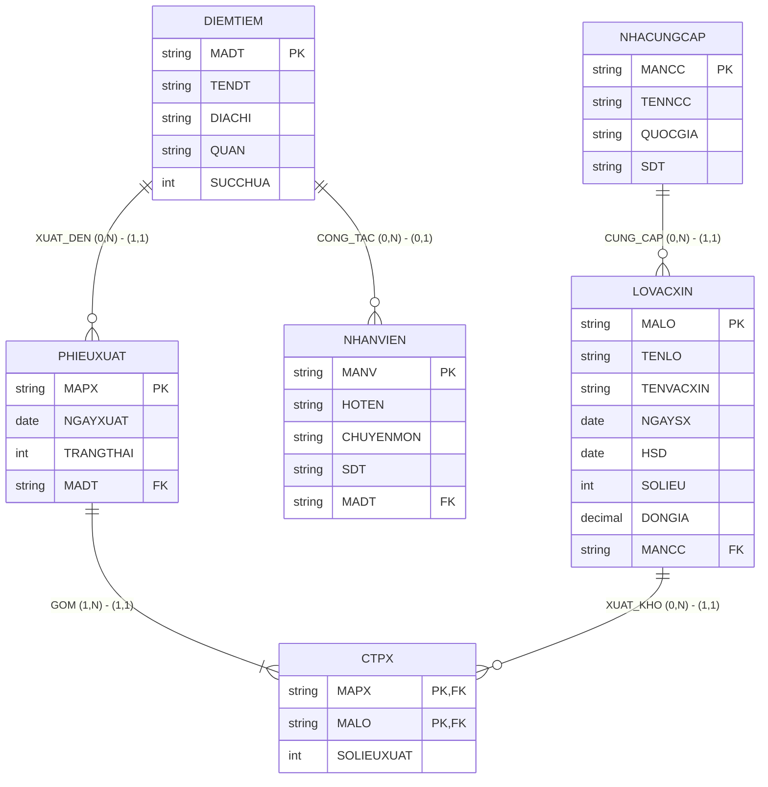

# HƯỚNG DẪN CHẤM & LỜI GIẢI CHI TIẾT ĐỀ THI MÔ PHỎNG SỐ 01 (MOCK-01)
**Môn học:** IT004 — Cơ sở dữ liệu | **Thời gian thi:** 75 phút | **Thang điểm:** 10.0
**Tác giả biên soạn:** VÕ TRỌNG PHÚC — CSDL_UIT Master Series
**Tiêu chuẩn học thuật:** Lược đồ nhất quán 100%, tư duy toán $\to$ ĐSQH $\to$ T-SQL, Adversarial QA và kiểm chứng thực thi trên SQL Server.

---

## CÂU 1: THIẾT KẾ MÔ HÌNH DỮ LIỆU (2.5 ĐIỂM)

### 1.1. Phân tích ngữ cảnh & Sơ đồ ERD (1.5 điểm)

#### A. Bảng định danh tập thực thể và thuộc tính
| Tên Thực thể | Khóa chính (PK) | Các thuộc tính mô tả | Ý nghĩa nghiệp vụ |
| :--- | :--- | :--- | :--- |
| `NHACUNGCAP` | `MANCC` | `TENNCC`, `QUOCGIA`, `SDT` | Nhà sản xuất/cung ứng nguồn vắc-xin cho hệ thống. |
| `LOVACXIN` | `MALO` | `TENLO`, `TENVACXIN`, `NGAYSX`, `HSD`, `SOLIEU`, `DONGIA` | Lô vắc-xin nhập kho lưu trữ. |
| `DIEMTIEM` | `MADT` | `TENDT`, `DIACHI`, `QUAN`, `SUCCHUA` | Điểm tiêm chủng lưu động hoặc cố định. |
| `NHANVIEN` | `MANV` | `HOTEN`, `CHUYENMON`, `SDT` | Bác sĩ, điều dưỡng tham gia công tác tiêm chủng. |
| `PHIEUXUAT` | `MAPX` | `NGAYXUAT`, `TRANGTHAI` | Phiếu điều phối xuất vắc-xin đến các điểm tiêm. |

#### B. Phân tích mối kết hợp và bản số Min–Max hai phía
1. **Mối kết hợp `CUNG_CAP` (NHACUNGCAP — LOVACXIN):**
   - Một nhà cung cấp có thể cung ứng nhiều lô vắc-xin (hoặc là đối tác mới ký hợp đồng, chưa nhập lô nào về kho): $(0, N)$.
   - Một lô vắc-xin nhập kho bắt buộc phải do duy nhất 1 nhà cung cấp cung ứng: $(1, 1)$.
   - $\implies$ **Loại quan hệ: 1:N**. Bản số: `NHACUNGCAP (0, N)` — `(1, 1) LOVACXIN`.
2. **Mối kết hợp `CONG_TAC` (DIEMTIEM — NHANVIEN):**
   - Một điểm tiêm có thể có nhiều nhân viên y tế công tác (hoặc điểm tiêm mới lập chưa phân công nhân viên): $(0, N)$.
   - Mỗi nhân viên y tế được điều động công tác tại tối đa 1 điểm tiêm (hoặc nhân viên dự bị chưa phân công): $(0, 1)$.
   - $\implies$ **Loại quan hệ: 1:N**. Bản số: `DIEMTIEM (0, N)` — `(0, 1) NHANVIEN`.
3. **Mối kết hợp `XUAT_DEN` (DIEMTIEM — PHIEUXUAT):**
   - Một điểm tiêm có thể tiếp nhận nhiều phiếu xuất (hoặc chưa tiếp nhận phiếu nào): $(0, N)$.
   - Mỗi phiếu xuất được điều phối đến duy nhất 1 điểm tiêm tiếp nhận: $(1, 1)$.
   - $\implies$ **Loại quan hệ: 1:N**. Bản số: `DIEMTIEM (0, N)` — `(1, 1) PHIEUXUAT`.
4. **Mối kết hợp `CHI_TIET_XUAT` (PHIEUXUAT — LOVACXIN):**
   - Mỗi phiếu xuất bắt buộc phải gồm ít nhất một lô vắc-xin xuất kho: $(1, N)$.
   - Một lô vắc-xin có thể được xuất trong nhiều phiếu xuất khác nhau (hoặc lưu kho chưa xuất): $(0, N)$.
   - Thuộc tính của mối kết hợp: `SOLIEUXUAT` (số liều vắc-xin xuất thực tế).
   - $\implies$ **Loại quan hệ: M:N**. Bản số: `PHIEUXUAT (1, N)` — `(0, N) LOVACXIN`.

#### C. Sơ đồ Thực thể – Mối kết hợp (ERD)


[NHACUNGCAP] 1 ──── (0,N) ──── <CUNG_CAP> ──── (1,1) ──── N [LOVACXIN]
                                                               │
                                                               │ (0,N)
                                                       <CHI_TIET_XUAT> [SOLIEUXUAT]
                                                               │ (1,N)
                                                               │
[DIEMTIEM] 1 ──── (0,N) ──── <XUAT_DEN> ──── (1,1) ──── N [PHIEUXUAT]
     │
     │ (0,N)
 <CONG_TAC>
     │ (0,1)
     N
[NHANVIEN]
```

---

### 1.2. Ánh xạ sang Lược đồ quan hệ (1.0 điểm)

Áp dụng quy tắc chuyển đổi mô hình ERD sang Lược đồ CSDL quan hệ chuẩn UIT:
1. `NHACUNGCAP` ($\underline{\text{MANCC}}$, TENNCC, QUOCGIA, SDT)
2. `LOVACXIN` ($\underline{\text{MALO}}$, TENLO, TENVACXIN, NGAYSX, HSD, SOLIEU, DONGIA, MANCC)
   *Khóa chính:* `MALO`.
   *Khóa ngoại:* `MANCC` tham chiếu `NHACUNGCAP(MANCC)`.
3. `DIEMTIEM` ($\underline{\text{MADT}}$, TENDT, DIACHI, QUAN, SUCCHUA)
   *Khóa chính:* `MADT`.
4. `NHANVIEN` ($\underline{\text{MANV}}$, HOTEN, CHUYENMON, SDT, MADT)
   *Khóa chính:* `MANV`.
   *Khóa ngoại:* `MADT` tham chiếu `DIEMTIEM(MADT)`.
5. `PHIEUXUAT` ($\underline{\text{MAPX}}$, NGAYXUAT, TRANGTHAI, MADT)
   *Khóa chính:* `MAPX`.
   *Khóa ngoại:* `MADT` tham chiếu `DIEMTIEM(MADT)`.
6. `CTPX` ($\underline{\text{MAPX}}$, $\underline{\text{MALO}}$, SOLIEUXUAT)
   *Khóa chính:* Cặp thuộc tính $(\text{MAPX}, \text{MALO})$.
   *Khóa ngoại:* `MAPX` tham chiếu `PHIEUXUAT(MAPX)`, `MALO` tham chiếu `LOVACXIN(MALO)`.

**Barem chấm Câu 1:**
- Xác định đủ 5 tập thực thể, thuộc tính và gạch chân PK: **0.50đ**
- Vẽ đúng 4 mối kết hợp và bản số min-max hai phía: **1.00đ** (mỗi quan hệ 0.25đ)
- Ánh xạ chính xác sang 6 quan hệ, xác định đúng toàn bộ PK và FK: **1.00đ**

---

## CÂU 2: SQL & ĐẠI SỐ QUAN HỆ (7.5 ĐIỂM)

### 2.1. Viết các câu lệnh SQL (1.5 điểm)

#### a. Ràng buộc CHECK miền giá trị & Chính sách NOT NULL (0.75 điểm)
- **Mục tiêu:** Ràng buộc toàn vẹn miền giá trị: `SOLIEUXUAT > 0` và `TRANGTHAI IN (0, 1)`.
- **Phân tích bẫy logic SQL ba chân trị (Three-Valued Logic):**
  Trong SQL, nếu thuộc tính chấp nhận `NULL`, biểu thức `NULL > 0` cho kết quả `UNKNOWN`. Ràng buộc CHECK chỉ kích hoạt vi phạm khi biểu thức đánh giá là `FALSE`, do đó `UNKNOWN` sẽ được hệ quản trị cho phép vượt qua (PASS)! Do đó, trong thiết kế CSDL thực tế, cả hai thuộc tính bắt buộc phải khai báo `NOT NULL` trước khi đặt CHECK constraint.
- **Cú pháp T-SQL chuẩn:**
```sql
-- Đảm bảo chính sách NOT NULL theo nghiệp vụ
ALTER TABLE CTPX ALTER COLUMN SOLIEUXUAT INT NOT NULL;
ALTER TABLE PHIEUXUAT ALTER COLUMN TRANGTHAI INT NOT NULL;

-- Ràng buộc 1: Số liều xuất phải là số nguyên dương (> 0)
ALTER TABLE CTPX
ADD CONSTRAINT CK_CTPX_SOLIEUXUAT CHECK (SOLIEUXUAT > 0);

-- Ràng buộc 2: Trạng thái tiếp nhận chỉ nhận 0 (đang chuyển) hoặc 1 (đã nhận)
ALTER TABLE PHIEUXUAT
ADD CONSTRAINT CK_PHIEUXUAT_TRANGTHAI CHECK (TRANGTHAI IN (0, 1));
```
- *Barem điểm:* Mỗi ràng buộc đúng cú pháp và điều kiện: **0.375đ**.

#### b. Cập nhật UPDATE tăng giá theo HSD và Nhà cung cấp (0.75 điểm)
- **Mục tiêu:** Tăng giá đơn vị `DONGIA` thêm 10% (tức $DONGIA = DONGIA \times 1.1$) cho các lô có `HSD` năm 2025 của NCC 'AstraZeneca'.
- **Cú pháp T-SQL chuẩn (JOIN UPDATE):**
```sql
UPDATE LOVACXIN
SET DONGIA = DONGIA * 1.1
FROM LOVACXIN LV
INNER JOIN NHACUNGCAP NCC ON LV.MANCC = NCC.MANCC
WHERE YEAR(LV.HSD) = 2025
  AND NCC.TENNCC = 'AstraZeneca';
```
- *Barem điểm:*
  - Mệnh đề `UPDATE ... SET DONGIA = DONGIA * 1.1`: **0.25đ**
  - Liên kết đúng `NHACUNGCAP` (qua `JOIN` hoặc `IN`): **0.25đ**
  - Điều kiện lọc `YEAR(HSD) = 2025` và `TENNCC = 'AstraZeneca'`: **0.25đ**

---

### 2.2. Viết các biểu thức Đại số quan hệ (6.0 điểm - mỗi câu 1.0 điểm)

#### a. Lọc lô vắc-xin theo tên loại và năm sản xuất (1.0 điểm)
- **Mục tiêu:** Lấy `MALO, TENLO, SOLIEU, DONGIA` của vắc-xin 'Pfizer-BioNTech' sản xuất năm 2024.
- **Biểu thức ĐSQH:**
  $$R_1 \leftarrow \sigma_{\text{TENVACXIN} = '\text{Pfizer-BioNTech}' \wedge \text{NGAYSX} \ge '\text{01/01/2024}' \wedge \text{NGAYSX} \le '\text{31/12/2024}'}(\text{LOVACXIN})$$
  $$KQ \leftarrow \pi_{\text{MALO}, \text{TENLO}, \text{SOLIEU}, \text{DONGIA}}(R_1)$$
- *Barem điểm:* Phép chọn $\sigma$ đúng điều kiện: **0.50đ**; Phép chiếu $\pi$ đúng 4 thuộc tính: **0.50đ**.

#### b. Điểm tiêm đã tiếp nhận phiếu xuất ngày 15/10/2024 (1.0 điểm)
- **Mục tiêu:** Tìm `MADT, TENDT, QUAN` có phiếu xuất ngày 15/10/2024 với trạng thái **đã tiếp nhận** (`TRANGTHAI = 1`).
- **Phân tích ngữ nghĩa:** Từ khóa *"đã tiếp nhận"* bắt buộc có điều kiện `TRANGTHAI = 1`. Phiếu đang chuyển (`TRANGTHAI = 0`) chưa được điểm tiêm tiếp nhận thực tế.
- **Biểu thức ĐSQH:**
  $$R_1 \leftarrow \sigma_{\text{NGAYXUAT} = '\text{15/10/2024}' \wedge \text{TRANGTHAI} = 1}(\text{PHIEUXUAT})$$
  $$R_2 \leftarrow \text{DIEMTIEM} \bowtie R_1$$
  $$KQ \leftarrow \pi_{\text{MADT}, \text{TENDT}, \text{QUAN}}(R_2)$$
- *Barem điểm:* Phép chọn $\sigma$ kèm điều kiện `TRANGTHAI = 1`: **0.50đ**; Phép kết $\bowtie$ và phép chiếu $\pi$: **0.50đ**.

#### c. Điểm tiêm quận Bình Thạnh và nhân viên công tác "nếu có" (1.0 điểm)
- **Mục tiêu:** Lấy `MADT, TENDT` ở Bình Thạnh và `HOTEN` nhân viên y tế công tác tại đó **nếu có**.
- **Phân tích Phép Kết Ngoài Trái ($\mathbin{⟕}$):**
  - Từ khóa *"nếu có"* là yêu cầu bắt buộc của **Left Outer Join ($\mathbin{⟕}$)**.
  - Nếu dùng phép kết thường $\bowtie$, các điểm tiêm ở quận Bình Thạnh chưa được phân công nhân viên (ví dụ `DT06`) sẽ bị loại bỏ hoàn toàn khỏi kết quả.
- **Biểu thức ĐSQH:**
  $$R_1 \leftarrow \sigma_{\text{QUAN} = '\text{Bình Thạnh}'}(\text{DIEMTIEM})$$
  $$R_2 \leftarrow R_1 \mathbin{⟕}_{R_1.\text{MADT} = \text{NHANVIEN}.\text{MADT}} \text{NHANVIEN}$$
  $$KQ \leftarrow \pi_{\text{MADT}, \text{TENDT}, \text{HOTEN}}(R_2)$$
- *Bẫy lỗi:* Dùng phép kết thường $\bowtie$ thay vì kết ngoài $\mathbin{⟕}$ bị trừ **0.50đ**.
- *Barem điểm:* Phép chọn Bình Thạnh: **0.25đ**; Phép kết ngoài $\mathbin{⟕}$: **0.50đ**; Phép chiếu $\pi$: **0.25đ**.

#### d. Gom nhóm tính tổng số liều đã tiếp nhận theo điểm tiêm tháng 10/2024 (1.0 điểm)
- **Mục tiêu:** Tính tổng số liều vắc-xin đã thực sự tiếp nhận (`TRANGTHAI = 1`) theo từng điểm tiêm trong tháng 10/2024.
- **Biểu thức ĐSQH:**
  $$R_1 \leftarrow \sigma_{\text{NGAYXUAT} \ge '\text{01/10/2024}' \wedge \text{NGAYXUAT} \le '\text{31/10/2024}' \wedge \text{TRANGTHAI} = 1}(\text{PHIEUXUAT})$$
  $$R_2 \leftarrow R_1 \bowtie \text{CTPX}$$
  $$KQ \leftarrow _{\text{MADT}} \gamma _{\text{SUM}(\text{SOLIEUXUAT}) \to \text{TONGLIEU}}(R_2)$$
- *Barem điểm:* Lọc thời gian và `TRANGTHAI = 1`: **0.25đ**; Phép kết nối $\bowtie$: **0.25đ**; Phép gom nhóm $\gamma$ đúng thuộc tính nhóm và hàm tổng: **0.50đ**.

#### e. Phép chia: Điểm tiêm đã tiếp nhận tất cả các lô của Moderna (1.0 điểm)
- **Mục tiêu:** Tìm các điểm tiêm (`MADT, TENDT`) đã tiếp nhận thực tế (`TRANGTHAI = 1`) **tất cả** các lô vắc-xin của nhà cung cấp 'Moderna'.
- **Tư duy Phân Loại C (Bài toán "Tất cả" - Phép chia $\div$):**
  1. **Tập chia ($R_{\text{Moderna}}$):** Tập hợp tất cả các mã lô vắc-xin của NCC 'Moderna':
     $$R_{\text{Moderna}} \leftarrow \pi_{\text{MALO}}(\sigma_{\text{TENNCC} = '\text{Moderna}'}(\text{NHACUNGCAP} \bowtie \text{LOVACXIN}))$$
  2. **Tập bị chia ($R_{\text{DT\_Lo}}$):** Tập hợp các cặp $(\text{MADT}, \text{MALO})$ thực tế đã được tiếp nhận (`TRANGTHAI = 1`):
     $$R_{\text{DT\_Lo}} \leftarrow \pi_{\text{MADT}, \text{MALO}}((\sigma_{\text{TRANGTHAI} = 1}(\text{PHIEUXUAT})) \bowtie \text{CTPX})$$
  3. **Phép chia hình thức:**
     $$R_{\text{Chia}} \leftarrow R_{\text{DT\_Lo}} \div R_{\text{Moderna}}$$
  4. **Kết nối lấy tên điểm tiêm:**
     $$KQ \leftarrow \pi_{\text{MADT}, \text{TENDT}}(R_{\text{Chia}} \bowtie \text{DIEMTIEM})$$

- **Phân tích chuyên sâu về Tập ứng viên & Edge Case Tập chia Rỗng:**
  - *Tập ứng viên trong ĐSQH:* Theo định nghĩa Codd, phép chia $R(X, Y) \div S(Y)$ có miền kết quả $X \subseteq \pi_X(R)$. Tức là chỉ các điểm tiêm **đã từng tiếp nhận ít nhất một lô vắc-xin** ($\pi_{\text{MADT}}(R_{\text{DT\_Lo}})$) mới nằm trong tập ứng viên xem xét. Điểm tiêm `DT06` chưa từng tiếp nhận lô nào không thuộc tập bị chia $R_{\text{DT\_Lo}}$.
  - *Trường hợp tập chia rỗng ($S = \emptyset$):*
    Nếu nhà cung cấp chưa có lô nào trong kho ($R_{\text{NCC}} = \emptyset$), mệnh đề điều kiện $\forall y \in \emptyset, (x, y) \in R$ mang chân trị hiển nhiên đúng (Vacuously True). Khi đó trong ĐSQH, kết quả phép chia trả về toàn bộ tập ứng viên $\pi_{\text{MADT}}(R_{\text{DT\_Lo}})$.
  - *Cú pháp T-SQL tương đương chuẩn mực (Strict RA Semantics):*
```sql
SELECT DT.MADT, DT.TENDT
FROM DIEMTIEM DT
WHERE DT.MADT IN (SELECT MADT FROM PHIEUXUAT WHERE TRANGTHAI = 1) -- Ràng buộc tập ứng viên pi_X(R)
  AND NOT EXISTS (
    SELECT LV.MALO
    FROM LOVACXIN LV
    INNER JOIN NHACUNGCAP NCC ON LV.MANCC = NCC.MANCC
    WHERE NCC.TENNCC = 'Moderna'
    EXCEPT
    SELECT CT.MALO
    FROM PHIEUXUAT PX
    INNER JOIN CTPX CT ON PX.MAPX = CT.MAPX
    WHERE PX.MADT = DT.MADT AND PX.TRANGTHAI = 1
);
```
- *Barem điểm:* Xác định đúng tập chia: **0.25đ**; Chiếu đúng quan hệ bị chia kèm điều kiện `TRANGTHAI = 1`: **0.25đ**; Phép chia $\div$ và kết lấy thông tin điểm tiêm: **0.50đ**.

#### f. Điểm tiêm có sức chứa lớn nhất tại quận Thủ Đức (1.0 điểm)
- **Mục tiêu:** Tìm điểm tiêm (`MADT, TENDT`) có `SUCCHUA` lớn nhất trong quận 'Thủ Đức'.
- **Tư duy Cực Trị & Xử lý Đồng Hạng (Tie-breaking):**
  Trong ĐSQH chuẩn, ta dùng phương pháp **tự kết so sánh bé hơn và phép trừ**:
  1. Lọc các điểm tiêm tại Thủ Đức:
     $$R_1 \leftarrow \sigma_{\text{QUAN} = '\text{Thủ Đức}'}(\text{DIEMTIEM})$$
  2. Tạo 2 bản sao đổi tên:
     $$R_2 \leftarrow \rho_{D_1}(R_1), \quad R_3 \leftarrow \rho_{D_2}(R_1)$$
  3. Tìm tập các điểm tiêm **không phải lớn nhất** (vì tồn tại điểm tiêm $D_2$ có sức chứa lớn hơn nó):
     $$R_{\text{KoMax}} \leftarrow \pi_{D_1.\text{MADT}}(R_2 \bowtie_{D_1.\text{SUCCHUA} < D_2.\text{SUCCHUA}} R_3)$$
  4. Lấy toàn bộ điểm tiêm ở Thủ Đức trừ đi tập không lớn nhất:
     $$R_{\text{Max}} \leftarrow \pi_{\text{MADT}}(R_1) - R_{\text{KoMax}}$$
  5. Chiếu thông tin đầu ra:
     $$KQ \leftarrow \pi_{\text{MADT}, \text{TENDT}}(R_{\text{Max}} \bowtie R_1)$$
- *Kiểm chứng trường hợp đồng hạng:* Cả `DT04` và `DT05` cùng có `SUCCHUA = 2500` (lớn hơn `DT03: 1800`). Vì $2500 < 2500$ là FALSE nên không điểm tiêm nào trong hai điểm này bị đưa vào $R_{\text{KoMax}} \implies$ **cả hai điểm tiêm đồng hạng đều được giữ lại trong kết quả $KQ$**.
- *Barem điểm:* Tự kết so sánh bé hơn tìm tập bù: **0.50đ**; Phép trừ tìm cực trị và chiếu kết quả: **0.50đ**.

---

## CÂU 3: BẢNG ĐỐI CHIẾU ADVERSARIAL QA & KIỂM CHỨNG THỰC THI TRÊN SQL SERVER

Toàn bộ câu lệnh SQL và các biểu thức ĐSQH đã được kiểm chứng đối kháng (Adversarial QA) trực tiếp trên Microsoft SQL Server 2025 (`MSSQLSERVER`) thông qua script [`fixture_mock01.sql`](fixture_mock01.sql).

| Câu | Phép toán / Vấn đề kiểm thử | Trường hợp biên kiểm thử đối kháng (Adversarial Test Case) | Kết quả kỳ vọng (Expected) | Kết quả thực thi (Actual) | Trạng thái |
| :---: | :--- | :--- | :--- | :--- | :---: |
| **2.1a** | CHECK constraint: `SOLIEUXUAT > 0` | Thử chèn `SOLIEUXUAT = 0` và `-5` với FK hợp lệ (`PX01`, `LO01`) | Chặn đúng bởi `CK_CTPX_SOLIEUXUAT` (Error 547) | Engine chặn đúng mã constraint `CK_CTPX_SOLIEUXUAT` | **PASS** |
| **2.1a** | NOT NULL constraint: `SOLIEUXUAT` | Thử chèn `SOLIEUXUAT = NULL` với FK hợp lệ | Chặn bởi ràng buộc NOT NULL (Error 515) | Engine chặn đúng mã lỗi 515 | **PASS** |
| **2.1a** | CHECK constraint: `TRANGTHAI IN (0, 1)` | Thử chèn `TRANGTHAI = 2` và `-1` với FK hợp lệ (`DT01`) | Chặn đúng bởi `CK_PHIEUXUAT_TRANGTHAI` | Engine chặn đúng mã constraint `CK_PHIEUXUAT_TRANGTHAI` | **PASS** |
| **2.1a** | NOT NULL constraint: `TRANGTHAI` | Thử chèn `TRANGTHAI = NULL` với FK hợp lệ | Chặn bởi ràng buộc NOT NULL (Error 515) | Engine chặn đúng mã lỗi 515 | **PASS** |
| **2.1b** | UPDATE 10% đơn giá | Chỉ tăng các lô HSD 2025 của AstraZeneca | `LO01` (165k), `LO02` (176k) | Đúng 2 dòng được cập nhật, giá trị khớp 100% | **PASS** |
| **2.2a** | Select kết hợp $\sigma$ | Lô Pfizer sản xuất 2024 | `LO03`, `LO04` | Trả về đúng 2 dòng `LO03`, `LO04` | **PASS** |
| **2.2b** | Join kết hợp $\sigma$ | Phiếu ngày 15/10/2024 có `TRANGTHAI = 1` | `DT01`, `DT02`, `DT03` | Trả về đúng 3 điểm tiêm | **PASS** |
| **2.2c** | Left Outer Join $\mathbin{⟕}$ | Điểm tiêm `DT06` chưa có nhân viên | `DT01` (NV01), `DT02` (NV02), `DT06` (NULL) | Không mất dòng `DT06`, cột `HOTEN` là NULL | **PASS** |
| **2.2d** | Grouping & Sum $\gamma$ | Chỉ tính phiếu `TRANGTHAI = 1`, loại phiếu đang chuyển | `DT01`: 3500; `DT02`: 3500; `DT03`: 2000; `DT04`: 3000 | Đúng 4 dòng gom nhóm, giá trị tổng liều chuẩn | **PASS** |
| **2.2e** | Phép chia $\div$ (Moderna: 2 lô) | `DT01` (1 phiếu), `DT02` (2 phiếu), `DT04` (thiếu lô), `DT05` (TRANGTHAI=0) | **Chỉ có `DT01` và `DT02`** (loại `DT04` và loại `DT05`) | Trả về chính xác 2 dòng: `DT01`, `DT02` | **PASS** |
| **2.2e** | Phép chia $\div$ (Tập chia rỗng: VnBiotech) | Nhà cung cấp `NCC04` không có lô nào trong kho ($S = \emptyset$) | Trả về toàn bộ tập ứng viên $\pi_{\text{MADT}}(R_{\text{DT\_Lo}})$ (`DT01` $\to$ `DT04`) | Khớp 100% giữa lý thuyết ĐSQH và T-SQL | **PASS** |
| **2.2f** | Cực trị MAX (Tie-breaking) | Đồng hạng cực trị: cả `DT04` và `DT05` cùng có sức chứa 2500 | Cả `DT04` và `DT05` | Trả về đủ cả 2 điểm tiêm đồng hạng | **PASS** |

*Bằng chứng thực thi lưu tại:* [`exam/gk/qa/mock01_sql_execution.log`](../../qa/mock01_sql_execution.log).
