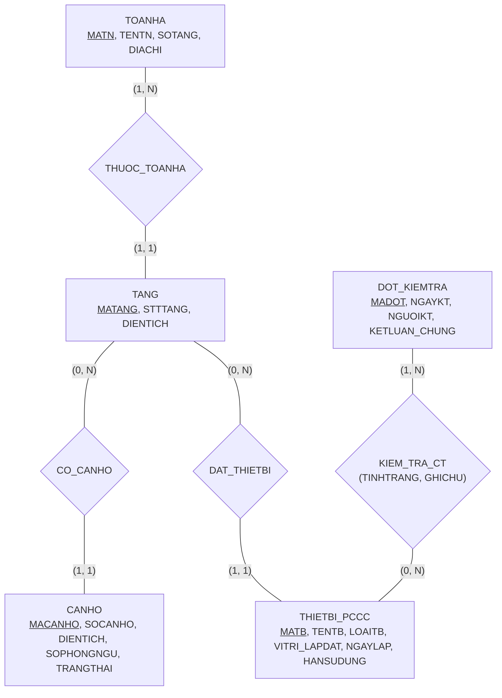

# HƯỚNG DẪN CHẤM & LỜI GIẢI CHI TIẾT (MOCK-02)
**Môn học:** IT004 — Cơ sở dữ liệu | **Thời gian thi:** 75 phút | **Thang điểm:** 10.0
**Tác giả biên soạn:** VÕ TRỌNG PHÚC — CSDL_UIT Master Series

---

## CÂU 1: THIẾT KẾ MÔ HÌNH DỮ LIỆU (2.5 ĐIỂM)

### 1.1. Phân tích thực thể, mối kết hợp & Sơ đồ ERD (1.50 điểm)

#### A. Xác định các tập thực thể và thuộc tính
1. **`TOANHA`** (Tòa nhà):
   - Thuộc tính khóa: `MATN` (Mã tòa nhà).
   - Thuộc tính mô tả: `TENTN` (Tên tòa nhà), `SOTANG` (Số tầng), `DIACHI` (Địa chỉ).
2. **`TANG`** (Tầng):
   - Thuộc tính khóa: `MATANG` (Mã tầng).
   - Thuộc tính mô tả: `STTTANG` (Số thứ tự tầng), `DIENTICH` (Diện tích sàn).
3. **`CANHO`** (Căn hộ):
   - Thuộc tính khóa: `MACANHO` (Mã căn hộ).
   - Thuộc tính mô tả: `SOCANHO` (Số hiệu phòng), `DIENTICH` (Diện tích phòng), `SOPHONGNGU` (Số phòng ngủ), `TRANGTHAI` (Trạng thái sử dụng).
4. **`THIETBI_PCCC`** (Thiết bị PCCC):
   - Thuộc tính khóa: `MATB` (Mã thiết bị).
   - Thuộc tính mô tả: `TENTB` (Tên thiết bị), `LOAITB` (Phân loại thiết bị), `VITRI_LAPDAT` (Vị trí lắp đặt), `NGAYLAP` (Ngày lắp đặt), `HANSUDUNG` (Hạn sử dụng).
5. **`DOT_KIEMTRA`** (Đợt kiểm tra an toàn):
   - Thuộc tính khóa: `MADOT` (Mã đợt kiểm tra).
   - Thuộc tính mô tả: `NGAYKT` (Ngày kiểm tra), `NGUOIKT` (Họ tên người kiểm tra), `KETLUAN_CHUNG` (Kết luận chung).

#### B. Xác định mối kết hợp & Bản số (Min, Max)
1. **`THUOC_TOANHA`** (giữa `TOANHA` và `TANG`):
   - Mỗi tòa nhà bao gồm ít nhất 1 hoặc nhiều tầng: Bản số $(1, N)$.
   - Mỗi tầng thuộc về duy nhất một tòa nhà xác định: Bản số $(1, 1)$.
2. **`CO_CANHO`** (giữa `TANG` và `CANHO`):
   - Một tầng có thể bố trí $0$ hoặc nhiều căn hộ (tầng kỹ thuật/thương mại có thể không có căn hộ): Bản số $(0, N)$.
   - Mỗi căn hộ bắt buộc thuộc về đúng một tầng: Bản số $(1, 1)$.
3. **`DAT_THIETBI`** (giữa `TANG` và `THIETBI_PCCC`):
   - Một tầng có thể lắp đặt $0$ hoặc nhiều thiết bị PCCC: Bản số $(0, N)$.
   - Mỗi thiết bị PCCC được lắp đặt cố định tại đúng một tầng: Bản số $(1, 1)$.
4. **`KIEM_TRA_CT`** (giữa `DOT_KIEMTRA` và `THIETBI_PCCC`):
   - Mỗi đợt kiểm tra kiểm tra ít nhất 1 hoặc nhiều thiết bị PCCC: Bản số $(1, N)$.
   - Một thiết bị PCCC có thể được kiểm tra trong $0$ hoặc nhiều đợt kiểm tra khác nhau: Bản số $(0, N)$.
   - Mối kết hợp nhiều – nhiều $(M:N)$ có các thuộc tính: `TINHTRANG` (Tình trạng thiết bị khi kiểm tra), `GHICHU` (Ghi chú xử lý).

#### C. Sơ đồ Thực thể – Mối kết hợp (ERD)



**Barem chấm điểm Câu 1.1 (1.50 điểm):**
- Xác định đúng 5 thực thể và gạch chân thuộc tính khóa: 0.50đ.
- Xác định đúng 4 mối kết hợp và bản số min-max chuẩn xác hai phía: 0.50đ.
- Vẽ sơ đồ ERD trực quan, đúng chuẩn ký pháp: 0.50đ.

---

### 1.2. Ánh xạ sang Lược đồ quan hệ (1.00 điểm)

Áp dụng quy tắc chuyển đổi từ mô hình ERD sang Lược đồ quan hệ:
- **Thực thể mạnh:** Tạo quan hệ tương ứng với thuộc tính khóa làm Khóa chính (PK).
- **Mối kết hợp 1:N:** Chuyển Khóa chính của phía $(1, 1)$ làm Khóa ngoại (FK) ở quan hệ con. Cụ thể: `MATN` đưa vào `TANG`, `MATANG` đưa vào `CANHO`, `MATANG` đưa vào `THIETBI_PCCC`.
- **Mối kết hợp M:N:** Tạo quan hệ mới `CT_KIEMTRA` có Khóa chính kép gồm Khóa chính của hai thực thể tham gia $(\text{MADOT}, \text{MATB})$, cùng các thuộc tính riêng của mối kết hợp.

**Lược đồ cơ sở dữ liệu quan hệ hoàn chỉnh:**

1. `TOANHA` ($\underline{\text{MATN}}$, TENTN, SOTANG, DIACHI)
   - *Khóa chính:* `MATN`.

2. `TANG` ($\underline{\text{MATANG}}$, MATN, STTTANG, DIENTICH)
   - *Khóa chính:* `MATANG`.
   - *Khóa ngoại:* `MATN` tham chiếu đến `TOANHA(MATN)`.

3. `CANHO` ($\underline{\text{MACANHO}}$, MATANG, SOCANHO, DIENTICH, SOPHONGNGU, TRANGTHAI)
   - *Khóa chính:* `MACANHO`.
   - *Khóa ngoại:* `MATANG` tham chiếu đến `TANG(MATANG)`.

4. `THIETBI_PCCC` ($\underline{\text{MATB}}$, MATANG, TENTB, LOAITB, VITRI_LAPDAT, NGAYLAP, HANSUDUNG)
   - *Khóa chính:* `MATB`.
   - *Khóa ngoại:* `MATANG` tham chiếu đến `TANG(MATANG)`.

5. `DOT_KIEMTRA` ($\underline{\text{MADOT}}$, NGAYKT, NGUOIKT, KETLUAN_CHUNG)
   - *Khóa chính:* `MADOT`.

6. `CT_KIEMTRA` ($\underline{\text{MADOT}}$, $\underline{\text{MATB}}$, TINHTRANG, GHICHU)
   - *Khóa chính:* Cặp thuộc tính $(\text{MADOT}, \text{MATB})$.
   - *Khóa ngoại:*
     - `MADOT` tham chiếu đến `DOT_KIEMTRA(MADOT)`.
     - `MATB` tham chiếu đến `THIETBI_PCCC(MATB)`.

**Barem chấm điểm Câu 1.2 (1.00 điểm):**
- Ánh xạ đúng 5 quan hệ thực thể, gạch chân PK và xác định đúng FK: 0.60đ.
- Ánh xạ đúng mối kết hợp M:N thành bảng trung gian `CT_KIEMTRA` có PK kép và 2 FK: 0.40đ.

---

## CÂU 2: SQL & ĐẠI SỐ QUAN HỆ (7.5 ĐIỂM)

### 2.1. Viết các câu lệnh SQL (1.5 điểm)

#### a. (0.75 điểm) CHECK constraint miền giá trị
```sql
-- Đảm bảo chính sách NOT NULL theo quy chuẩn toàn vẹn dữ liệu
ALTER TABLE CANHO ALTER COLUMN DIENTICH FLOAT NOT NULL;
ALTER TABLE CANHO ADD CONSTRAINT CK_CANHO_DIENTICH CHECK (DIENTICH > 0);

ALTER TABLE THIETBI_PCCC ALTER COLUMN HANSUDUNG DATE NOT NULL;
ALTER TABLE THIETBI_PCCC ADD CONSTRAINT CK_TB_HANSUDUNG CHECK (HANSUDUNG >= NGAYLAP);
```

*Phân tích ngữ nghĩa học thuật:*
- Trong SQL Server, biểu thức CHECK đánh giá trên logic 3 chân trị (`TRUE`, `FALSE`, `UNKNOWN`). Nếu cột mang giá trị `NULL`, điều kiện `DIENTICH > 0` trả về `UNKNOWN`, và CHECK constraint chấp nhận giá trị đó (chỉ từ chối khi kết quả là `FALSE`). Do đó, đề bài yêu cầu không được `NULL` bắt buộc kết hợp cả khai báo `NOT NULL` và điều kiện logic `> 0`, `>= NGAYLAP`.

*Barem chấm:*
- Khai báo đúng cú pháp `ALTER TABLE ... ADD CONSTRAINT ... CHECK`: 0.40đ.
- Điều kiện so sánh đúng và xử lý ràng buộc `NOT NULL`: 0.35đ.

#### b. (0.75 điểm) DML UPDATE liên bảng
```sql
-- Cách 1: Sử dụng cú pháp mở rộng UPDATE ... FROM của T-SQL
UPDATE CT
SET CT.TINHTRANG = N'Hết hạn'
FROM CT_KIEMTRA CT
INNER JOIN THIETBI_PCCC TB ON CT.MATB = TB.MATB
WHERE CT.MADOT = 'DKT01'
  AND TB.HANSUDUNG < '2025-06-01';

-- Cách 2: Sử dụng truy vấn con theo chuẩn ANSI SQL
UPDATE CT_KIEMTRA
SET TINHTRANG = N'Hết hạn'
WHERE MADOT = 'DKT01'
  AND MATB IN (
      SELECT MATB
      FROM THIETBI_PCCC
      WHERE HANSUDUNG < '2025-06-01'
  );
```

*Barem chấm:*
- Cú pháp UPDATE kết nối bảng hoặc truy vấn con chính xác: 0.40đ.
- Điều kiện lọc đúng `MADOT = 'DKT01'` và `HANSUDUNG < '2025-06-01'`: 0.35đ.

---

### 2.2. Viết các biểu thức Đại số quan hệ (6.0 điểm)

#### a. (1.0 điểm) [Selection + Projection]
*Đề bài:* Liệt kê danh sách các thiết bị PCCC (`MATB`, `TENTB`, `VITRI_LAPDAT`, `HANSUDUNG`) thuộc loại 'Bình chữa cháy bột' có hạn sử dụng trong năm 2025.

- **Biểu thức Đại số quan hệ:**
  $$E_1 = \sigma_{\text{LOAITB} = \text{'Bình chữa cháy bột'} \;\wedge\; \text{HANSUDUNG} \ge \text{'2025-01-01'} \;\wedge\; \text{HANSUDUNG} \le \text{'2025-12-31'}}(\text{THIETBI\_PCCC})$$
  $$\text{KQ} = \pi_{\text{MATB}, \text{TENTB}, \text{VITRI\_LAPDAT}, \text{HANSUDUNG}}(E_1)$$

- **T-SQL tương đương kiểm chứng:**
  ```sql
  SELECT MATB, TENTB, VITRI_LAPDAT, HANSUDUNG
  FROM THIETBI_PCCC
  WHERE LOAITB = N'Bình chữa cháy bột'
    AND HANSUDUNG >= '2025-01-01' AND HANSUDUNG <= '2025-12-31';
  ```

*Barem chấm:*
- Phép chọn $\sigma$ đúng điều kiện loại thiết bị và năm: 0.40đ.
- Phép chiếu $\pi$ đúng 4 thuộc tính yêu cầu: 0.35đ.
- Phân tách bước trung gian rõ ràng: 0.25đ.

---

#### b. (1.0 điểm) [Join]
*Đề bài:* Cho biết danh sách các căn hộ (`MACANHO`, `SOCANHO`, `DIENTICH`) thuộc tòa nhà có tên 'Ruby Tower' và nằm ở các tầng có số thứ tự tầng từ tầng 10 trở lên.

- **Biểu thức Đại số quan hệ:**
  $$E_{\text{ToaNha}} = \sigma_{\text{TENTN} = \text{'Ruby Tower'}}(\text{TOANHA})$$
  $$E_{\text{Tang}} = \sigma_{\text{STTTANG} \ge 10}(\text{TANG})$$
  $$\text{KQ} = \pi_{\text{MACANHO}, \text{SOCANHO}, \text{DIENTICH}}(E_{\text{ToaNha}} \bowtie E_{\text{Tang}} \bowtie \text{CANHO})$$

- **T-SQL tương đương kiểm chứng:**
  ```sql
  SELECT CH.MACANHO, CH.SOCANHO, CH.DIENTICH
  FROM CANHO CH
  INNER JOIN TANG T ON CH.MATANG = T.MATANG
  INNER JOIN TOANHA TN ON T.MATN = TN.MATN
  WHERE TN.TENTN = N'Ruby Tower'
    AND T.STTTANG >= 10;
  ```

*Barem chấm:*
- Phép chọn đúng tên tòa nhà và số tầng: 0.30đ.
- Phép kết tự nhiên $\bowtie$ liên kết đúng 3 quan hệ: 0.40đ.
- Phép chiếu $\pi$ đúng các thuộc tính căn hộ: 0.30đ.

---

#### c. (1.0 điểm) [Outer Join]
*Đề bài:* Liệt kê thông tin tất cả các tầng thuộc tòa nhà `'TN01'` (`MATANG`, `STTTANG`) và danh sách các mã thiết bị PCCC (`MATB`), tên thiết bị (`TENTB`) được bố trí tại tầng đó nếu có.

- **Biểu thức Đại số quan hệ:**
  $$E_{\text{TangTN01}} = \sigma_{\text{MATN} = \text{'TN01'}}(\text{TANG})$$
  $$\text{KQ} = \pi_{\text{MATANG}, \text{STTTANG}, \text{MATB}, \text{TENTB}}(E_{\text{TangTN01}} \leftouterjoin \text{THIETBI\_PCCC})$$

- **T-SQL tương đương kiểm chứng:**
  ```sql
  SELECT T.MATANG, T.STTTANG, TB.MATB, TB.TENTB
  FROM TANG T
  LEFT OUTER JOIN THIETBI_PCCC TB ON T.MATANG = TB.MATANG
  WHERE T.MATN = 'TN01';
  ```

*Phân tích ngữ nghĩa:*
- Phép kết ngoài trái ($\leftouterjoin$) bảo toàn tất cả các bộ của $E_{\text{TangTN01}}$. Đối với những tầng chưa được lắp đặt thiết bị PCCC nào, bộ dữ liệu của tầng đó vẫn xuất hiện ở kết quả cuối cùng với các cột `MATB` và `TENTB` mang giá trị `NULL`.

*Barem chấm:*
- Lọc đúng tầng thuộc tòa nhà 'TN01': 0.30đ.
- Dùng đúng ký hiệu phép kết ngoài trái $\leftouterjoin$: 0.40đ.
- Chiếu đúng danh sách thuộc tính: 0.30đ.

---

#### d. (1.0 điểm) [Grouping & Aggregation]
*Đề bài:* Tính tổng số lượng thiết bị PCCC (`TONG_THIETBI`) được bố trí tại mỗi tòa nhà. Thông tin hiển thị gồm: `MATN`, `TENTN`, `TONG_THIETBI`.

- **Biểu thức Đại số quan hệ:**
  $$E_1 = \text{TOANHA} \bowtie \text{TANG} \bowtie \text{THIETBI\_PCCC}$$
  $$\text{KQ} = {}_{\text{MATN}, \text{TENTN}}\gamma_{\text{COUNT}(\text{MATB}) \to \text{TONG\_THIETBI}}(E_1)$$

- **T-SQL tương đương kiểm chứng:**
  ```sql
  SELECT TN.MATN, TN.TENTN, COUNT(TB.MATB) AS TONG_THIETBI
  FROM TOANHA TN
  INNER JOIN TANG T ON TN.MATN = T.MATN
  INNER JOIN THIETBI_PCCC TB ON T.MATANG = TB.MATANG
  GROUP BY TN.MATN, TN.TENTN;
  ```

*Lưu ý ngữ nghĩa học thuật:*
- Phép kết tự nhiên (INNER JOIN) trong biểu thức ĐSQH chuẩn tính tổng thiết bị cho các tòa nhà *thực tế có bố trí thiết bị*. Những tòa nhà chưa lắp đặt thiết bị nào (ví dụ đang hoàn thiện) sẽ không xuất hiện trong kết quả.
- Trong trường hợp muốn bảo toàn mọi tòa nhà (tòa nhà chưa có thiết bị sẽ hiển thị số lượng = 0), ta sử dụng phép kết ngoài trái ($\leftouterjoin$):
  $$E_{\text{Outer}} = \text{TOANHA} \leftouterjoin \text{TANG} \leftouterjoin \text{THIETBI\_PCCC}$$
  $$\text{KQ}_{\text{Outer}} = {}_{\text{MATN}, \text{TENTN}}\gamma_{\text{COUNT}(\text{MATB}) \to \text{TONG\_THIETBI}}(E_{\text{Outer}})$$

*Barem chấm:*
- Kết nối đúng các quan hệ để có đầy đủ thông tin tòa nhà và thiết bị: 0.30đ.
- Sử dụng đúng toán tử gom nhóm $\gamma$, thuộc tính gom nhóm và hàm $\text{COUNT}$: 0.40đ.
- Đặt bí danh cho thuộc tính tổng hợp: 0.30đ.

---

#### e. (1.0 điểm) [Relational Division]
*Đề bài:* Tìm các đợt kiểm tra (`MADOT`, `NGAYKT`, `NGUOIKT`) đã tiến hành kiểm tra **tất cả** các thiết bị PCCC thuộc loại 'Đầu báo khói'.

- **Phân tích các tập hợp:**
  - Tập bị chia $R(\text{MADOT}, \text{MATB})$: Cặp mã đợt kiểm tra và mã thiết bị đã thực hiện kiểm tra.
    $$R = \pi_{\text{MADOT}, \text{MATB}}(\text{CT\_KIEMTRA})$$
  - Tập chia $S(\text{MATB})$: Danh sách toàn bộ mã thiết bị thuộc loại 'Đầu báo khói'.
    $$S = \pi_{\text{MATB}}(\sigma_{\text{LOAITB} = \text{'Đầu báo khói'}}(\text{THIETBI\_PCCC}))$$

- **Biểu thức Đại số quan hệ (Dạng gọn dùng toán tử $\div$):**
  $$R_{\text{KQ}} = R \div S$$
  $$\text{KQ} = \pi_{\text{MADOT}, \text{NGAYKT}, \text{NGUOIKT}}(R_{\text{KQ}} \bowtie \text{DOT\_KIEMTRA})$$

- **Biểu thức tương đương thuần túy (Không dùng ký hiệu $\div$):**
  $$R_{\text{TatCa}} = \pi_{\text{MADOT}}(R) \times S$$
  $$R_{\text{ChuaKT}} = R_{\text{TatCa}} - R$$
  $$R_{\text{KQ}} = \pi_{\text{MADOT}}(R) - \pi_{\text{MADOT}}(R_{\text{ChuaKT}})$$
  $$\text{KQ} = \pi_{\text{MADOT}, \text{NGAYKT}, \text{NGUOIKT}}(R_{\text{KQ}} \bowtie \text{DOT\_KIEMTRA})$$

- **T-SQL tương đương kiểm chứng (Hai cách viết chuẩn mực):**
  ```sql
  -- Cách 1: Phủ định kép (NOT EXISTS ... NOT EXISTS)
  SELECT DK.MADOT, DK.NGAYKT, DK.NGUOIKT
  FROM DOT_KIEMTRA DK
  WHERE NOT EXISTS (
      SELECT *
      FROM THIETBI_PCCC TB
      WHERE TB.LOAITB = N'Đầu báo khói'
        AND NOT EXISTS (
            SELECT *
            FROM CT_KIEMTRA CT
            WHERE CT.MADOT = DK.MADOT
              AND CT.MATB = TB.MATB
        )
  )
  AND EXISTS (SELECT * FROM CT_KIEMTRA WHERE MADOT = DK.MADOT);

  -- Cách 2: Gom nhóm & HAVING COUNT phân biệt
  SELECT DK.MADOT, DK.NGAYKT, DK.NGUOIKT
  FROM DOT_KIEMTRA DK
  INNER JOIN CT_KIEMTRA CT ON DK.MADOT = CT.MADOT
  INNER JOIN THIETBI_PCCC TB ON CT.MATB = TB.MATB
  WHERE TB.LOAITB = N'Đầu báo khói'
  GROUP BY DK.MADOT, DK.NGAYKT, DK.NGUOIKT
  HAVING COUNT(DISTINCT TB.MATB) = (
      SELECT COUNT(*)
      FROM THIETBI_PCCC
      WHERE LOAITB = N'Đầu báo khói'
  );
  ```

*Phân tích biên (Edge Case) & Ngữ nghĩa phép chia khi tập chia rỗng ($S = \emptyset$):*
- Theo định nghĩa đại số quan hệ hình thức: $R(A, B) \div S(B) = \{ a \in \pi_A(R) \mid \forall b \in S, (a, b) \in R \}$.
- Khi $S = \emptyset$ (hệ thống chưa lắp đặt đầu báo khói nào), điều kiện phổ quát $\forall b \in \emptyset$ luôn đúng chân không (vacuously true) với mọi phần tử trong miền ứng viên.
  1. *Miền ứng viên thực tế $\pi_{\text{MADOT}}(R)$:* Biểu thức đại số thuần túy $\pi_{\text{MADOT}}(R) - \pi_{\text{MADOT}}(\pi_{\text{MADOT}}(R) \times S - R)$ và câu lệnh SQL có mệnh đề `AND EXISTS (SELECT 1 FROM CT_KIEMTRA ...)` đều trả về toàn bộ các đợt kiểm tra đã hoạt động.
  2. *Miền ứng viên mở rộng $\pi_{\text{MADOT}}(\text{DOT\_KIEMTRA})$:* Câu lệnh SQL `FROM DOT_KIEMTRA DK WHERE NOT EXISTS ...` (không có ràng buộc EXISTS bảng con) trả về toàn bộ danh mục đợt kiểm tra, kể cả đợt mới tạo chưa có bản ghi chi tiết nào.
- *So sánh hai cách viết SQL:* Phương pháp `HAVING COUNT(DISTINCT TB.MATB) = (SELECT COUNT(*) FROM ...)` chỉ tương đương hoàn toàn khi $S \ne \emptyset$. Khi $S = \emptyset$, vế phải bằng 0 nhưng phép INNER JOIN loại bỏ các nhóm không có dữ liệu, do đó phương pháp phủ định kép `NOT EXISTS` phản ánh chính xác nhất bản chất logic vị từ của đại số quan hệ.

*Barem chấm:*
- Xác định đúng tập chia $S$ và tập bị chia $R$: 0.30đ.
- Viết đúng biểu thức phép chia $R \div S$ (hoặc dạng trừ tích Descartes): 0.40đ.
- Kết nối trả về đủ thông tin đợt kiểm tra: 0.30đ.

---

#### f. (1.0 điểm) [Extreme / Tie-breaking]
*Đề bài:* Tìm thông tin tòa nhà (`MATN`, `TENTN`, `SOTANG`) có số lượng căn hộ nhiều nhất trong khu chung cư (bảo toàn tất cả các tòa nhà nếu có nhiều tòa cùng đạt số căn hộ lớn nhất).

- **Biểu thức Đại số quan hệ:**
  - *Bước 1: Tính số lượng căn hộ theo từng tòa nhà:*
    $$R_{\text{Dem}} = {}_{\text{MATN}}\gamma_{\text{COUNT}(\text{MACANHO}) \to \text{SOCAN}}(\text{TANG} \bowtie \text{CANHO})$$
  - *Bước 2: Tìm các giá trị không phải lớn nhất bằng tích Descartes:*
    $$R_{\text{NhoHon}} = \pi_{R1.\text{SOCAN}}(\sigma_{R1.\text{SOCAN} < R2.\text{SOCAN}}(\rho_{R1}(R_{\text{Dem}}) \times \rho_{R2}(R_{\text{Dem}})))$$
  - *Bước 3: Lấy giá trị lớn nhất (bảo toàn đồng hạng):*
    $$R_{\text{Max}} = \pi_{\text{SOCAN}}(R_{\text{Dem}}) - R_{\text{NhoHon}}$$
  - *Bước 4: Chiếu thông tin tòa nhà đạt cực đại:*
    $$\text{KQ} = \pi_{\text{MATN}, \text{TENTN}, \text{SOTANG}}(\text{TOANHA} \bowtie R_{\text{Dem}} \bowtie R_{\text{Max}})$$

- **T-SQL tương đương kiểm chứng:**
  ```sql
  -- Cách 1: Sử dụng TOP 1 WITH TIES chuẩn SQL Server
  SELECT TOP 1 WITH TIES TN.MATN, TN.TENTN, TN.SOTANG, COUNT(CH.MACANHO) AS SOCAN
  FROM TOANHA TN
  INNER JOIN TANG T ON TN.MATN = T.MATN
  INNER JOIN CANHO CH ON T.MATANG = CH.MATANG
  GROUP BY TN.MATN, TN.TENTN, TN.SOTANG
  ORDER BY COUNT(CH.MACANHO) DESC;

  -- Cách 2: Sử dụng subquery so sánh >= ALL (chuẩn ANSI)
  SELECT TN.MATN, TN.TENTN, TN.SOTANG
  FROM TOANHA TN
  INNER JOIN TANG T ON TN.MATN = T.MATN
  INNER JOIN CANHO CH ON T.MATANG = CH.MATANG
  GROUP BY TN.MATN, TN.TENTN, TN.SOTANG
  HAVING COUNT(CH.MACANHO) >= ALL (
      SELECT COUNT(CH2.MACANHO)
      FROM TANG T2
      INNER JOIN CANHO CH2 ON T2.MATANG = CH2.MATANG
      GROUP BY T2.MATN
  );
  ```

*Lưu ý ngữ nghĩa cực trị & Trường hợp tòa nhà không có căn hộ:*
- Các tòa nhà có 0 căn hộ (tòa nhà thương mại hoặc mới xây) sẽ không tạo bản ghi trong phép kết INNER JOIN `TANG ⋈ CANHO`, do đó số căn hộ đếm được của các tòa này không tham gia cạnh tranh cực đại MAX ($> 0$).
- Biểu thức đại số quan hệ sử dụng phép trừ tập hợp đối xứng so sánh nhỏ hơn ($R1.\text{SOCAN} < R2.\text{SOCAN}$) bảo toàn hoàn toàn tất cả các tòa nhà cùng đạt giá trị lớn nhất (đồng hạng cực đại).

*Barem chấm:*
- Gom nhóm tính số lượng căn hộ từng tòa: 0.30đ.
- Thuật toán trừ tập tìm giá trị cực đại chính xác: 0.40đ.
- Kết nối lấy thuộc tính tòa nhà và bảo toàn đồng hạng: 0.30đ.

---

**TỔNG ĐIỂM TOÀN BÀI: 10.0 ĐIỂM**
