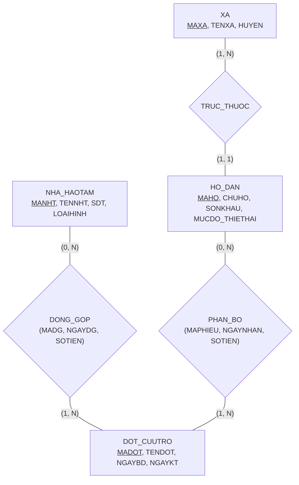

# HƯỚNG DẪN CHẤM & LỜI GIẢI CHI TIẾT (MOCK-03)
**Môn học:** IT004 — Cơ sở dữ liệu | **Thời gian thi:** 75 phút | **Thang điểm:** 10.0
**Tác giả biên soạn:** VÕ TRỌNG PHÚC — CSDL_UIT Master Series

---

## CÂU 1: THIẾT KẾ MÔ HÌNH DỮ LIỆU (2.0 ĐIỂM)

### 1.1. Phân tích thực thể, mối kết hợp & Sơ đồ ERD (1.20 điểm)

#### A. Xác định các tập thực thể và thuộc tính
1. **`XA`** (Địa bàn xã/phường):
   - Thuộc tính khóa: `MAXA` (Mã xã).
   - Thuộc tính mô tả: `TENXA` (Tên xã), `HUYEN` (Huyện).
2. **`HO_DAN`** (Hộ gia đình thiệt hại):
   - Thuộc tính khóa: `MAHO` (Mã hộ dân).
   - Thuộc tính mô tả: `CHUHO` (Họ tên chủ hộ), `SONKHAU` (Số nhân khẩu), `MUCDO_THIETHAI` (Mức độ thiệt hại).
3. **`NHA_HAOTAM`** (Nhà tài trợ / Mạnh thường quân):
   - Thuộc tính khóa: `MANHT` (Mã nhà hảo tâm).
   - Thuộc tính mô tả: `TENNHT` (Tên nhà hảo tâm), `SDT` (Số điện thoại), `LOAIHINH` (Phân loại loại hình).
4. **`DOT_CUUTRO`** (Đợt cứu trợ thiên tai):
   - Thuộc tính khóa: `MADOT` (Mã đợt cứu trợ).
   - Thuộc tính mô tả: `TENDOT` (Tên đợt cứu trợ), `NGAYBD` (Ngày bắt đầu), `NGAYKT` (Ngày kết thúc).

#### B. Xác định mối kết hợp & Bản số (Min, Max)
1. **`TRUC_THUOC`** (giữa `XA` và `HO_DAN`):
   - Một xã có ít nhất 1 hoặc nhiều hộ dân: Bản số $(1, N)$.
   - Mỗi hộ dân bắt buộc thuộc về duy nhất một xã: Bản số $(1, 1)$.
2. **`DONG_GOP`** (giữa `NHA_HAOTAM` và `DOT_CUUTRO`):
   - Một nhà hảo tâm có thể đóng góp vào $0$ hoặc nhiều đợt cứu trợ: Bản số $(0, N)$.
   - Một đợt cứu trợ có thể nhận đóng góp từ $1$ hoặc nhiều nhà hảo tâm: Bản số $(1, N)$.
   - Thuộc tính của mối kết hợp: `MADG` (Mã đóng góp), `NGAYDG` (Ngày đóng góp), `SOTIEN` (Số tiền đóng góp).
3. **`PHAN_BO`** (giữa `HO_DAN` và `DOT_CUUTRO`):
   - Một hộ dân có thể nhận tiền hỗ trợ từ $0$ hoặc nhiều đợt cứu trợ: Bản số $(0, N)$.
   - Một đợt cứu trợ phân bổ tiền hỗ trợ cho $1$ hoặc nhiều hộ dân: Bản số $(1, N)$.
   - Thuộc tính của mối kết hợp: `MAPHIEU` (Mã phiếu nhận), `NGAYNHAN` (Ngày nhận tiền), `SOTIEN` (Số tiền nhận).

#### C. Sơ đồ Thực thể – Mối kết hợp (ERD)



**Barem chấm điểm Câu 1.1 (1.20 điểm):**
- Xác định đúng 4 tập thực thể và thuộc tính khóa: 0.40đ.
- Xác định đúng 3 mối kết hợp và bản số min-max hai phía: 0.40đ.
- Vẽ sơ đồ ERD đúng chuẩn, rõ ràng, trực quan: 0.40đ.

---

### 1.2. Ánh xạ sang Lược đồ quan hệ (0.80 điểm)

Áp dụng quy tắc chuyển đổi từ mô hình ERD sang Lược đồ quan hệ:
- **Thực thể mạnh:** Tạo quan hệ tương ứng với thuộc tính khóa làm Khóa chính (PK).
- **Mối kết hợp 1:N (`TRUC_THUOC`):** Chuyển `MAXA` làm Khóa ngoại (FK) tại bảng `HO_DAN`.
- **Mối kết hợp M:N (`DONG_GOP` và `PHAN_BO`):** Tạo thành 2 bảng quan hệ riêng:
  - Bảng `DONG_GOP` có khóa chính `MADG`, khóa ngoại `MANHT` và `MADOT`.
  - Bảng `PHIEU_NHAN` có khóa chính `MAPHIEU`, khóa ngoại `MAHO` và `MADOT`.

**Lược đồ cơ sở dữ liệu quan hệ hoàn chỉnh:**

1. `XA` ($\underline{\text{MAXA}}$, TENXA, HUYEN)
   - *Khóa chính:* `MAXA`.

2. `HO_DAN` ($\underline{\text{MAHO}}$, CHUHO, SONKHAU, MUCDO_THIETHAI, MAXA)
   - *Khóa chính:* `MAHO`.
   - *Khóa ngoại:* `MAXA` tham chiếu đến `XA(MAXA)`.

3. `NHA_HAOTAM` ($\underline{\text{MANHT}}$, TENNHT, SDT, LOAIHINH)
   - *Khóa chính:* `MANHT`.

4. `DOT_CUUTRO` ($\underline{\text{MADOT}}$, TENDOT, NGAYBD, NGAYKT)
   - *Khóa chính:* `MADOT`.

5. `DONG_GOP` ($\underline{\text{MADG}}$, MANHT, MADOT, NGAYDG, SOTIEN)
   - *Khóa chính:* `MADG`.
   - *Khóa ngoại:*
     - `MANHT` tham chiếu đến `NHA_HAOTAM(MANHT)`.
     - `MADOT` tham chiếu đến `DOT_CUUTRO(MADOT)`.

6. `PHIEU_NHAN` ($\underline{\text{MAPHIEU}}$, MAHO, MADOT, NGAYNHAN, SOTIEN)
   - *Khóa chính:* `MAPHIEU`.
   - *Khóa ngoại:*
     - `MAHO` tham chiếu đến `HO_DAN(MAHO)`.
     - `MADOT` tham chiếu đến `DOT_CUUTRO(MADOT)`.

**Barem chấm điểm Câu 1.2 (0.80 điểm):**
- Ánh xạ đúng 4 quan hệ thực thể, xác định khóa chính và khóa ngoại: 0.40đ.
- Ánh xạ đúng 2 bảng quan hệ trung gian có khóa chính và khóa ngoại đầy đủ: 0.40đ.

---

## CÂU 2: SQL & ĐẠI SỐ QUAN HỆ (8.0 ĐIỂM)

### 2.1. Viết các câu lệnh SQL (1.5 điểm)

#### a. (0.75 điểm) CHECK constraint miền giá trị
```sql
-- Ràng buộc kiểm tra số tiền nhận cứu trợ phải dương và NOT NULL
ALTER TABLE PHIEU_NHAN ALTER COLUMN SOTIEN DECIMAL(18, 2) NOT NULL;
ALTER TABLE PHIEU_NHAN ADD CONSTRAINT CK_PHIEUNHAN_SOTIEN CHECK (SOTIEN > 0);

-- Ràng buộc kiểm tra ngày kết thúc đợt cứu trợ phải sau ngày bắt đầu và NOT NULL
ALTER TABLE DOT_CUUTRO ALTER COLUMN NGAYKT DATE NOT NULL;
ALTER TABLE DOT_CUUTRO ADD CONSTRAINT CK_DOTCUUTRO_NGAY CHECK (NGAYKT >= NGAYBD);
```

*Phân tích ngữ nghĩa học thuật:*
- Trong SQL Server, biểu thức so sánh trả về `UNKNOWN` khi một trong các toán hạng là `NULL`. CHECK constraint chấp nhận giá trị nếu biểu thức không phải là `FALSE` (chấp nhận cả `TRUE` và `UNKNOWN`). Do đó, khai báo cột `NOT NULL` kết hợp điều kiện logic là bắt buộc để đảm bảo tính toàn vẹn miền giá trị theo đề bài.

*Barem chấm:*
- Cú pháp `ALTER TABLE ... ADD CONSTRAINT ... CHECK`: 0.40đ.
- Điều kiện so sánh đúng và chính sách `NOT NULL`: 0.35đ.

#### b. (0.75 điểm) DML UPDATE liên bảng
```sql
-- Cách 1: Sử dụng cú pháp mở rộng UPDATE ... FROM của T-SQL
UPDATE HD
SET HD.MUCDO_THIETHAI = N'Nặng'
FROM HO_DAN HD
INNER JOIN XA X ON HD.MAXA = X.MAXA
WHERE X.TENXA = N'Hiệp Phước'
  AND HD.SONKHAU >= 5;

-- Cách 2: Sử dụng truy vấn con theo chuẩn ANSI SQL
UPDATE HO_DAN
SET MUCDO_THIETHAI = N'Nặng'
WHERE SONKHAU >= 5
  AND MAXA IN (
      SELECT MAXA
      FROM XA
      WHERE TENXA = N'Hiệp Phước'
  );
```

*Barem chấm:*
- Cú pháp UPDATE liên bảng hoặc subquery chuẩn xác: 0.40đ.
- Điều kiện lọc đúng `TENXA = N'Hiệp Phước'` và `SONKHAU >= 5`: 0.35đ.

---

### 2.2. Viết các biểu thức Đại số quan hệ (6.5 điểm)

#### a. (1.0 điểm) [Selection + Projection]
*Đề bài:* Liệt kê danh sách các nhà hảo tâm (`MANHT`, `TENNHT`, `SDT`) thuộc loại hình 'Cá nhân'.

- **Biểu thức Đại số quan hệ:**
  $$E_1 = \sigma_{\text{LOAIHINH} = \text{'Cá nhân'}}(\text{NHA\_HAOTAM})$$
  $$\text{KQ} = \pi_{\text{MANHT}, \text{TENNHT}, \text{SDT}}(E_1)$$

- **T-SQL tương đương kiểm chứng:**
  ```sql
  SELECT MANHT, TENNHT, SDT
  FROM NHA_HAOTAM
  WHERE LOAIHINH = N'Cá nhân';
  ```

*Barem chấm:*
- Phép chọn $\sigma$ đúng điều kiện loại hình: 0.40đ.
- Phép chiếu $\pi$ đúng 3 thuộc tính: 0.35đ.
- Tối ưu bước trung gian: 0.25đ.

---

#### b. (1.0 điểm) [Join]
*Đề bài:* Cho biết danh sách các hộ dân (`MAHO`, `CHUHO`, `SONKHAU`) thuộc huyện 'Cần Giờ' có mức độ thiệt hại là 'Nặng'.

- **Biểu thức Đại số quan hệ:**
  $$E_{\text{Xa}} = \sigma_{\text{HUYEN} = \text{'Cần Giờ'}}(\text{XA})$$
  $$E_{\text{Ho}} = \sigma_{\text{MUCDO\_THIETHAI} = \text{'Nặng'}}(\text{HO\_DAN})$$
  $$\text{KQ} = \pi_{\text{MAHO}, \text{CHUHO}, \text{SONKHAU}}(E_{\text{Xa}} \bowtie E_{\text{Ho}})$$

- **T-SQL tương đương kiểm chứng:**
  ```sql
  SELECT HD.MAHO, HD.CHUHO, HD.SONKHAU
  FROM HO_DAN HD
  INNER JOIN XA X ON HD.MAXA = X.MAXA
  WHERE X.HUYEN = N'Cần Giờ'
    AND HD.MUCDO_THIETHAI = N'Nặng';
  ```

*Barem chấm:*
- Chọn đúng điều kiện huyện và mức độ thiệt hại: 0.30đ.
- Phép kết tự nhiên $\bowtie$ trên `MAXA`: 0.40đ.
- Chiếu đúng các thuộc tính yêu cầu: 0.30đ.

---

#### c. (1.0 điểm) [Outer Join]
*Đề bài:* Liệt kê thông tin tất cả các xã thuộc huyện 'Cần Giờ' (`MAXA`, `TENXA`) và danh sách các mã hộ dân (`MAHO`), tên chủ hộ (`CHUHO`) trực thuộc xã đó nếu có.

- **Biểu thức Đại số quan hệ:**
  $$E_{\text{XaCG}} = \sigma_{\text{HUYEN} = \text{'Cần Giờ'}}(\text{XA})$$
  $$\text{KQ} = \pi_{\text{MAXA}, \text{TENXA}, \text{MAHO}, \text{CHUHO}}(E_{\text{XaCG}} \leftouterjoin \text{HO\_DAN})$$

- **T-SQL tương đương kiểm chứng:**
  ```sql
  SELECT X.MAXA, X.TENXA, HD.MAHO, HD.CHUHO
  FROM XA X
  LEFT OUTER JOIN HO_DAN HD ON X.MAXA = HD.MAXA
  WHERE X.HUYEN = N'Cần Giờ';
  ```

*Phân tích ngữ nghĩa:*
- Phép kết ngoài trái ($\leftouterjoin$) bảo tồn toàn bộ các xã thuộc huyện Cần Giờ. Nếu xã nào chưa có hộ dân thiệt hại đăng ký, xã đó vẫn xuất hiện với `MAHO = NULL` và `CHUHO = NULL`.

*Barem chấm:*
- Lọc đúng xã thuộc huyện Cần Giờ: 0.30đ.
- Dùng đúng ký hiệu kết ngoài trái $\leftouterjoin$: 0.40đ.
- Chiếu đúng danh sách thuộc tính: 0.30đ.

---

#### d. (1.0 điểm) [Grouping & Aggregation]
*Đề bài:* Tính tổng số tiền ủng hộ (`TONG_TIEN`) của từng nhà hảo tâm đã đóng góp trong năm 2024. Thông tin hiển thị gồm: `MANHT`, `TENNHT`, `TONG_TIEN`.

- **Biểu thức Đại số quan hệ:**
  $$E_1 = \sigma_{\text{NGAYDG} \ge \text{'2024-01-01'} \;\wedge\; \text{NGAYDG} \le \text{'2024-12-31'}}(\text{DONG\_GOP})$$
  $$E_2 = \text{NHA\_HAOTAM} \bowtie E_1$$
  $$\text{KQ} = {}_{\text{MANHT}, \text{TENNHT}}\gamma_{\text{SUM}(\text{SOTIEN}) \to \text{TONG\_TIEN}}(E_2)$$

- **T-SQL tương đương kiểm chứng:**
  ```sql
  SELECT NHT.MANHT, NHT.TENNHT, SUM(DG.SOTIEN) AS TONG_TIEN
  FROM NHA_HAOTAM NHT
  INNER JOIN DONG_GOP DG ON NHT.MANHT = DG.MANHT
  WHERE DG.NGAYDG >= '2024-01-01' AND DG.NGAYDG <= '2024-12-31'
  GROUP BY NHT.MANHT, NHT.TENNHT;
  ```

*Barem chấm:*
- Lọc đúng ngày đóng góp trong năm 2024: 0.30đ.
- Sử dụng đúng toán tử gom nhóm $\gamma$, thuộc tính gom nhóm và hàm $\text{SUM}$: 0.40đ.
- Đặt bí danh cho thuộc tính tổng tiền: 0.30đ.

---

#### e. (1.0 điểm) [Relational Division]
*Đề bài:* Tìm các đợt cứu trợ (`MADOT`, `TENDOT`, `NGAYBD`) đã tiếp nhận tiền đóng góp từ **tất cả** các nhà hảo tâm thuộc loại hình 'Doanh nghiệp'.

- **Phân tích các tập hợp:**
  - Tập bị chia $R(\text{MADOT}, \text{MANHT})$: Cặp mã đợt và mã nhà hảo tâm đã thực tế có đóng góp.
    $$R = \pi_{\text{MADOT}, \text{MANHT}}(\text{DONG\_GOP})$$
  - Tập chia $S(\text{MANHT})$: Danh sách toàn bộ mã nhà hảo tâm là doanh nghiệp.
    $$S = \pi_{\text{MANHT}}(\sigma_{\text{LOAIHINH} = \text{'Doanh nghiệp'}}(\text{NHA\_HAOTAM}))$$

- **Biểu thức Đại số quan hệ (Dạng toán tử $\div$):**
  $$R_{\text{KQ}} = R \div S$$
  $$\text{KQ} = \pi_{\text{MADOT}, \text{TENDOT}, \text{NGAYBD}}(R_{\text{KQ}} \bowtie \text{DOT\_CUUTRO})$$

- **Biểu thức tương đương thuần túy (Không dùng $\div$):**
  $$R_{\text{TatCa}} = \pi_{\text{MADOT}}(R) \times S$$
  $$R_{\text{ChuaDG}} = R_{\text{TatCa}} - R$$
  $$R_{\text{KQ}} = \pi_{\text{MADOT}}(R) - \pi_{\text{MADOT}}(R_{\text{ChuaDG}})$$
  $$\text{KQ} = \pi_{\text{MADOT}, \text{TENDOT}, \text{NGAYBD}}(R_{\text{KQ}} \bowtie \text{DOT\_CUUTRO})$$

- **T-SQL tương đương kiểm chứng:**
  ```sql
  -- Cách 1: Phủ định kép (NOT EXISTS)
  SELECT DCT.MADOT, DCT.TENDOT, DCT.NGAYBD
  FROM DOT_CUUTRO DCT
  WHERE NOT EXISTS (
      SELECT *
      FROM NHA_HAOTAM NHT
      WHERE NHT.LOAIHINH = N'Doanh nghiệp'
        AND NOT EXISTS (
            SELECT *
            FROM DONG_GOP DG
            WHERE DG.MADOT = DCT.MADOT
              AND DG.MANHT = NHT.MANHT
        )
  )
  AND EXISTS (SELECT * FROM DONG_GOP WHERE MADOT = DCT.MADOT);

  -- Cách 2: Gom nhóm & HAVING COUNT phân biệt
  SELECT DCT.MADOT, DCT.TENDOT, DCT.NGAYBD
  FROM DOT_CUUTRO DCT
  INNER JOIN DONG_GOP DG ON DCT.MADOT = DG.MADOT
  INNER JOIN NHA_HAOTAM NHT ON DG.MANHT = NHT.MANHT
  WHERE NHT.LOAIHINH = N'Doanh nghiệp'
  GROUP BY DCT.MADOT, DCT.TENDOT, DCT.NGAYBD
  HAVING COUNT(DISTINCT NHT.MANHT) = (
      SELECT COUNT(*)
      FROM NHA_HAOTAM
      WHERE LOAIHINH = N'Doanh nghiệp'
  );
  ```

*Phân tích biên (Edge Case):*
- Khi không có doanh nghiệp nào trong hệ thống ($S = \emptyset$), mệnh đề logic $\forall x \in \emptyset$ đúng chân không. Điều kiện `AND EXISTS (SELECT * FROM DONG_GOP WHERE MADOT = DCT.MADOT)` bảo đảm chỉ trả về các đợt cứu trợ đã có hoạt động tiếp nhận tài chính thực tế.

*Barem chấm:*
- Xác định đúng tập chia $S$ và quan hệ bị chia $R$: 0.30đ.
- Viết đúng biểu thức phép chia $R \div S$ (hoặc dạng trừ tích Descartes): 0.40đ.
- Chiếu kết quả đầy đủ thuộc tính đợt cứu trợ: 0.30đ.

---

#### f. (1.5 điểm) [Extreme / Tie-breaking]
*Đề bài:* Tìm thông tin xã (`MAXA`, `TENXA`, `HUYEN`) có tổng số tiền cứu trợ đã phân bổ cho các hộ dân (`TONG_CUUTRO`) nhiều nhất (bảo toàn tất cả các xã nếu có nhiều xã cùng đạt số tiền cứu trợ lớn nhất).

- **Biểu thức Đại số quan hệ:**
  - *Bước 1: Tính tổng tiền cứu trợ theo từng xã:*
    $$R_{\text{TongTien}} = {}_{\text{MAXA}}\gamma_{\text{SUM}(\text{SOTIEN}) \to \text{TONG\_CUUTRO}}(\text{HO\_DAN} \bowtie \text{PHIEU\_NHAN})$$
  - *Bước 2: Tìm các giá trị không phải cực đại bằng tích Descartes so sánh nhỏ hơn:*
    $$R_{\text{NhoHon}} = \pi_{R1.\text{TONG\_CUUTRO}}(\sigma_{R1.\text{TONG\_CUUTRO} < R2.\text{TONG\_CUUTRO}}(\rho_{R1}(R_{\text{TongTien}}) \times \rho_{R2}(R_{\text{TongTien}})))$$
  - *Bước 3: Lấy giá trị lớn nhất (bảo toàn đồng hạng):*
    $$R_{\text{Max}} = \pi_{\text{TONG\_CUUTRO}}(R_{\text{TongTien}}) - R_{\text{NhoHon}}$$
  - *Bước 4: Chiếu thông tin xã đạt cực đại:*
    $$\text{KQ} = \pi_{\text{MAXA}, \text{TENXA}, \text{HUYEN}}(\text{XA} \bowtie R_{\text{TongTien}} \bowtie R_{\text{Max}})$$

- **T-SQL tương đương kiểm chứng:**
  ```sql
  -- Sử dụng TOP 1 WITH TIES chuẩn SQL Server bảo toàn đồng hạng
  SELECT TOP 1 WITH TIES X.MAXA, X.TENXA, X.HUYEN, SUM(PN.SOTIEN) AS TONG_CUUTRO
  FROM XA X
  INNER JOIN HO_DAN HD ON X.MAXA = HD.MAXA
  INNER JOIN PHIEU_NHAN PN ON HD.MAHO = PN.MAHO
  GROUP BY X.MAXA, X.TENXA, X.HUYEN
  ORDER BY SUM(PN.SOTIEN) DESC;
  ```

*Barem chấm:*
- Gom nhóm tính tổng số tiền cứu trợ theo xã: 0.40đ.
- Thuật toán trừ tập tìm giá trị cực đại chính xác: 0.60đ.
- Kết nối lấy thuộc tính xã và bảo toàn đồng hạng: 0.50đ.

---

**TỔNG ĐIỂM TOÀN BÀI: 10.0 ĐIỂM**
