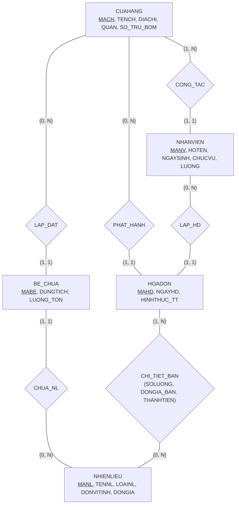

# HƯỚNG DẪN CHẤM & LỜI GIẢI CHI TIẾT (MOCK-04)
**Môn học:** IT004 — Cơ sở dữ liệu | **Thời gian thi:** 75 phút | **Thang điểm:** 10.0
**Tác giả biên soạn:** VÕ TRỌNG PHÚC — CSDL_UIT Master Series

---

## CÂU 1: THIẾT KẾ MÔ HÌNH DỮ LIỆU (2.5 ĐIỂM)

### 1.1. Phân tích thực thể, mối kết hợp & Sơ đồ ERD (1.50 điểm)

#### A. Xác định các tập thực thể và thuộc tính
1. **`CUAHANG`** (Cửa hàng xăng dầu):
   - Thuộc tính khóa: `MACH` (Mã cửa hàng).
   - Thuộc tính mô tả: `TENCH` (Tên cửa hàng), `DIACHI` (Địa chỉ), `QUAN` (Quận/huyện), `SO_TRU_BOM` (Số trụ bơm).
2. **`NHANVIEN`** (Nhân viên):
   - Thuộc tính khóa: `MANV` (Mã nhân viên).
   - Thuộc tính mô tả: `HOTEN` (Họ tên), `NGAYSINH` (Ngày sinh), `CHUCVU` (Chức vụ), `LUONG` (Lương cơ bản).
3. **`NHIENLIEU`** (Mặt hàng xăng/dầu):
   - Thuộc tính khóa: `MANL` (Mã nhiên liệu).
   - Thuộc tính mô tả: `TENNL` (Tên nhiên liệu), `LOAINL` (Phân loại nhiên liệu), `DONVITINH` (Đơn vị tính), `DONGIA` (Đơn giá niêm yết).
4. **`BE_CHUA`** (Bể chứa ngầm):
   - Thuộc tính khóa: `MABE` (Mã bể chứa).
   - Thuộc tính mô tả: `DUNGTICH` (Dung tích tối đa - lít), `LUONG_TON` (Lượng nhiên liệu tồn hiện tại - lít).
5. **`HOADON`** (Hóa đơn xuất bán):
   - Thuộc tính khóa: `MAHD` (Mã hóa đơn).
   - Thuộc tính mô tả: `NGAYHD` (Ngày giờ lập), `HINHTHUC_TT` (Hình thức thanh toán).

#### B. Xác định mối kết hợp & Bản số (Min, Max)
1. **`CONG_TAC`** (giữa `CUAHANG` và `NHANVIEN`):
   - Một cửa hàng có thể có từ 1 đến nhiều nhân viên công tác: Bản số $(1, N)$.
   - Một nhân viên bắt buộc thuộc về đúng 1 cửa hàng: Bản số $(1, 1)$.
2. **`LAP_DAT`** (giữa `CUAHANG` và `BE_CHUA`):
   - Một cửa hàng có thể có từ 0 đến nhiều bể chứa: Bản số $(0, N)$.
   - Một bể chứa bắt buộc được lắp đặt tại đúng 1 cửa hàng: Bản số $(1, 1)$.
3. **`CHUA_NHIENLIEU`** (giữa `BE_CHUA` và `NHIENLIEU`):
   - Một bể chứa bắt buộc chứa duy nhất 1 loại nhiên liệu: Bản số $(1, 1)$.
   - Một loại nhiên liệu có thể được chứa trong 0 hoặc nhiều bể chứa: Bản số $(0, N)$.
4. **`PHAT_HANH`** (giữa `CUAHANG` và `HOADON`):
   - Một cửa hàng phát hành 0 hoặc nhiều hóa đơn: Bản số $(0, N)$.
   - Một hóa đơn bắt buộc phát hành tại đúng 1 cửa hàng: Bản số $(1, 1)$.
5. **`LAP_HOADON`** (giữa `NHANVIEN` và `HOADON`):
   - Một nhân viên lập 0 hoặc nhiều hóa đơn: Bản số $(0, N)$.
   - Một hóa đơn do đúng 1 nhân viên lập: Bản số $(1, 1)$.
6. **`CHI_TIET_BAN`** (giữa `HOADON` và `NHIENLIEU`):
   - Một hóa đơn có thể có 1 hoặc nhiều mặt hàng nhiên liệu: Bản số $(1, N)$.
   - Một loại nhiên liệu có thể xuất hiện trong 0 hoặc nhiều hóa đơn: Bản số $(0, N)$.
   - Thuộc tính của mối kết hợp: `SOLUONG` (Số lít bán), `DONGIA_BAN` (Đơn giá bán thực tế), `THANHTIEN` (Thành tiền).

#### C. Sơ đồ Thực thể – Mối kết hợp (ERD)



**Barem chấm điểm Câu 1.1 (1.50 điểm):**
- Xác định đúng 5 tập thực thể và thuộc tính khóa: 0.50đ.
- Xác định đúng 6 mối kết hợp và bản số min-max hai phía: 0.50đ.
- Vẽ sơ đồ ERD đúng chuẩn, rõ ràng, trực quan: 0.50đ.

---

### 1.2. Ánh xạ sang Lược đồ quan hệ (1.00 điểm)

Áp dụng quy tắc chuyển đổi từ mô hình ERD sang Lược đồ quan hệ:
- **Thực thể mạnh:** Tạo quan hệ tương ứng với thuộc tính khóa làm Khóa chính (PK).
- **Mối kết hợp 1:N:**
  - `CONG_TAC`: Thêm khóa ngoại `MACH` vào quan hệ `NHANVIEN`.
  - `LAP_DAT`: Thêm khóa ngoại `MACH` vào quan hệ `BE_CHUA`.
  - `CHUA_NL`: Thêm khóa ngoại `MANL` vào quan hệ `BE_CHUA`.
  - `PHAT_HANH` & `LAP_HD`: Thêm khóa ngoại `MACH` và `MANV` vào quan hệ `HOADON`.
- **Mối kết hợp M:N (`CHI_TIET_BAN`):** Tạo thành quan hệ `CTHD` có khóa chính gồm cặp `(MAHD, MANL)`.

**Lược đồ cơ sở dữ liệu quan hệ hoàn chỉnh:**

1. `CUAHANG` ($\underline{\text{MACH}}$, TENCH, DIACHI, QUAN, SO_TRU_BOM)
   - *Khóa chính:* `MACH`.

2. `NHANVIEN` ($\underline{\text{MANV}}$, HOTEN, NGAYSINH, CHUCVU, LUONG, MACH)
   - *Khóa chính:* `MANV`.
   - *Khóa ngoại:* `MACH` tham chiếu đến `CUAHANG(MACH)`.

3. `NHIENLIEU` ($\underline{\text{MANL}}$, TENNL, LOAINL, DONVITINH, DONGIA)
   - *Khóa chính:* `MANL`.

4. `BE_CHUA` ($\underline{\text{MABE}}$, MACH, MANL, DUNGTICH, LUONG_TON)
   - *Khóa chính:* `MABE`.
   - *Khóa ngoại:*
     - `MACH` tham chiếu đến `CUAHANG(MACH)`.
     - `MANL` tham chiếu đến `NHIENLIEU(MANL)`.

5. `HOADON` ($\underline{\text{MAHD}}$, NGAYHD, MACH, MANV, HINHTHUC_TT)
   - *Khóa chính:* `MAHD`.
   - *Khóa ngoại:*
     - `MACH` tham chiếu đến `CUAHANG(MACH)`.
     - `MANV` tham chiếu đến `NHANVIEN(MANV)`.

6. `CTHD` ($\underline{\text{MAHD}}$, $\underline{\text{MANL}}$, SOLUONG, DONGIA_BAN, THANHTIEN)
   - *Khóa chính:* `(MAHD, MANL)`.
   - *Khóa ngoại:*
     - `MAHD` tham chiếu đến `HOADON(MAHD)`.
     - `MANL` tham chiếu đến `NHIENLIEU(MANL)`.

**Barem chấm điểm Câu 1.2 (1.00 điểm):**
- Ánh xạ đúng 5 quan hệ thực thể, xác định khóa chính và khóa ngoại: 0.60đ.
- Ánh xạ đúng quan hệ chi tiết `CTHD` có khóa chính phức hợp và khóa ngoại: 0.40đ.

---

## CÂU 2: SQL & ĐẠI SỐ QUAN HỆ (7.5 ĐIỂM)

### 2.1. Viết các câu lệnh SQL (1.5 điểm)

#### a. (0.75 điểm) Ràng buộc CHECK miền giá trị & NOT NULL
```sql
-- Ràng buộc dung tích bể phải lớn hơn 0 và NOT NULL
ALTER TABLE BE_CHUA ALTER COLUMN DUNGTICH FLOAT NOT NULL;
ALTER TABLE BE_CHUA ADD CONSTRAINT CK_BECHUA_DUNGTICH CHECK (DUNGTICH > 0);

-- Ràng buộc lượng tồn không âm, không vượt dung tích và NOT NULL
ALTER TABLE BE_CHUA ALTER COLUMN LUONG_TON FLOAT NOT NULL;
ALTER TABLE BE_CHUA ADD CONSTRAINT CK_BECHUA_LUONGTON CHECK (LUONG_TON >= 0 AND LUONG_TON <= DUNGTICH);
```

*Phân tích ngữ nghĩa học thuật:*
- Thuộc tính `DUNGTICH` thể hiện sức chứa tối đa của bể ngầm nên bắt buộc là đại lượng vật lý dương ($> 0$).
- Lượng tồn `LUONG_TON` trong kho xăng dầu không thể âm và không thể vượt quá sức chứa bể ($0 \le \text{LUONG\_TON} \le \text{DUNGTICH}$).
- Việc gán `NOT NULL` ngăn ngừa toán tử ba chân trị trả về `UNKNOWN`, triệt tiêu lỗ hổng lọt dữ liệu rác.

*Barem chấm:*
- Cú pháp `ALTER TABLE ... ADD CONSTRAINT ... CHECK`: 0.40đ.
- Điều kiện kiểm tra logic chính xác và chính sách `NOT NULL`: 0.35đ.

#### b. (0.75 điểm) Lệnh DML UPDATE
```sql
UPDATE NHIENLIEU
SET DONGIA = DONGIA * 1.05
WHERE LOAINL = N'Xăng khoáng'
  AND DONVITINH = N'Lít';
```

*Barem chấm:*
- Cú pháp `UPDATE ... SET ... WHERE`: 0.40đ.
- Điều kiện lọc `LOAINL = N'Xăng khoáng'` và `DONVITINH = N'Lít'`: 0.35đ.

---

### 2.2. Viết các biểu thức Đại số quan hệ (6.0 điểm)

#### a. (1.0 điểm) [Selection + Projection]
*Đề bài:* Liệt kê danh sách các nhân viên (`MANV`, `HOTEN`, `NGAYSINH`, `LUONG`) có chức vụ là 'Nhân viên bán hàng' và có mức lương cơ bản từ 8,000,000 đồng trở lên.

- **Biểu thức Đại số quan hệ:**
  $$E_1 = \sigma_{\text{CHUCVU} = \text{'Nhân viên bán hàng'} \;\wedge\; \text{LUONG} \ge 8000000}(\text{NHANVIEN})$$
  $$\text{KQ} = \pi_{\text{MANV}, \text{HOTEN}, \text{NGAYSINH}, \text{LUONG}}(E_1)$$

- **T-SQL tương đương kiểm chứng:**
  ```sql
  SELECT MANV, HOTEN, NGAYSINH, LUONG
  FROM NHANVIEN
  WHERE CHUCVU = N'Nhân viên bán hàng'
    AND LUONG >= 8000000;
  ```

*Barem chấm:*
- Phép chọn $\sigma$ đúng điều kiện chức vụ và lương: 0.40đ.
- Phép chiếu $\pi$ đúng 4 thuộc tính: 0.35đ.
- Tối ưu bước trung gian: 0.25đ.

---

#### b. (1.0 điểm) [Join]
*Đề bài:* Cho biết danh sách các hóa đơn (`MAHD`, `NGAYHD`, `HINHTHUC_TT`, `TENCH`) được phát hành tại các cửa hàng xăng dầu thuộc quận 'Bình Thạnh' với hình thức thanh toán là 'Chuyển khoản'.

- **Biểu thức Đại số quan hệ:**
  $$E_{\text{CH}} = \sigma_{\text{QUAN} = \text{'Bình Thạnh'}}(\text{CUAHANG})$$
  $$E_{\text{HD}} = \sigma_{\text{HINHTHUC\_TT} = \text{'Chuyển khoản'}}(\text{HOADON})$$
  $$\text{KQ} = \pi_{\text{MAHD}, \text{NGAYHD}, \text{HINHTHUC\_TT}, \text{TENCH}}(E_{\text{CH}} \bowtie E_{\text{HD}})$$

- **T-SQL tương đương kiểm chứng:**
  ```sql
  SELECT HD.MAHD, HD.NGAYHD, HD.HINHTHUC_TT, CH.TENCH
  FROM HOADON HD
  INNER JOIN CUAHANG CH ON HD.MACH = CH.MACH
  WHERE CH.QUAN = N'Bình Thạnh'
    AND HD.HINHTHUC_TT = N'Chuyển khoản';
  ```

*Barem chấm:*
- Chọn đúng điều kiện quận Bình Thạnh và Chuyển khoản: 0.30đ.
- Phép kết tự nhiên $\bowtie$ trên `MACH`: 0.40đ.
- Chiếu đúng danh sách thuộc tính yêu cầu: 0.30đ.

---

#### c. (1.0 điểm) [Outer Join]
*Đề bài:* Liệt kê danh sách thông tin tất cả các cửa hàng xăng dầu (`MACH`, `TENCH`, `QUAN`) và mã các bể chứa (`MABE`), dung tích bể (`DUNGTICH`) trực thuộc cửa hàng đó (nếu cửa hàng chưa lắp đặt bể chứa nào thì thông tin bể chứa mang giá trị `NULL`).

- **Biểu thức Đại số quan hệ:**
  $$\text{KQ} = \pi_{\text{MACH}, \text{TENCH}, \text{QUAN}, \text{MABE}, \text{DUNGTICH}}(\text{CUAHANG} \leftouterjoin \text{BE\_CHUA})$$

- **T-SQL tương đương kiểm chứng:**
  ```sql
  SELECT CH.MACH, CH.TENCH, CH.QUAN, BC.MABE, BC.DUNGTICH
  FROM CUAHANG CH
  LEFT OUTER JOIN BE_CHUA BC ON CH.MACH = BC.MACH;
  ```

*Phân tích ngữ nghĩa:*
- Phép kết ngoài trái ($\leftouterjoin$) bảo tồn toàn bộ các bộ của quan hệ bên trái (`CUAHANG`). Nếu cửa hàng chưa có bể chứa nào (ví dụ `CH05`), thông tin cửa hàng vẫn hiện diện trong kết quả với `MABE = NULL` và `DUNGTICH = NULL`.

*Barem chấm:*
- Sử dụng đúng toán tử kết ngoài trái $\leftouterjoin$: 0.40đ.
- Điều kiện kết nối đúng khóa `MACH`: 0.30đ.
- Chiếu đầy đủ thuộc tính yêu cầu: 0.30đ.

---

#### d. (1.0 điểm) [Grouping & Aggregation]
*Đề bài:* Tính tổng số lít nhiên liệu đã bán (`TONG_LIT_BAN`) của từng cửa hàng xăng dầu trong tháng 10 năm 2024. Thông tin hiển thị gồm: `MACH`, `TENCH`, `TONG_LIT_BAN`.

- **Biểu thức Đại số quan hệ:**
  $$E_1 = \sigma_{\text{NGAYHD} \ge \text{'2024-10-01'} \;\wedge\; \text{NGAYHD} \le \text{'2024-10-31'}}(\text{HOADON})$$
  $$E_2 = \text{CUAHANG} \bowtie E_1 \bowtie \text{CTHD}$$
  $$\text{KQ} = {}_{\text{MACH}, \text{TENCH}}\gamma_{\text{SUM}(\text{SOLUONG}) \to \text{TONG\_LIT\_BAN}}(E_2)$$

- **T-SQL tương đương kiểm chứng:**
  ```sql
  SELECT CH.MACH, CH.TENCH, SUM(CT.SOLUONG) AS TONG_LIT_BAN
  FROM CUAHANG CH
  INNER JOIN HOADON HD ON CH.MACH = HD.MACH
  INNER JOIN CTHD CT ON HD.MAHD = CT.MAHD
  WHERE HD.NGAYHD >= '2024-10-01' AND HD.NGAYHD <= '2024-10-31 23:59:59'
  GROUP BY CH.MACH, CH.TENCH;
  ```

*Barem chấm:*
- Lọc đúng mốc thời gian tháng 10/2024: 0.30đ.
- Kết nối các quan hệ `CUAHANG`, `HOADON`, `CTHD`: 0.30đ.
- Gom nhóm theo `MACH, TENCH` và áp dụng hàm `SUM(SOLUONG)`: 0.40đ.

---

#### e. (1.0 điểm) [Relational Division]
*Đề bài:* Tìm các hóa đơn (`MAHD`, `NGAYHD`, `MACH`) đã bán **tất cả** các loại nhiên liệu thuộc phân loại 'Xăng khoáng'.

- **Phân tích các tập hợp:**
  - Tập bị chia $R(\text{MAHD}, \text{MANL})$: Cặp mã hóa đơn và mã nhiên liệu đã xuất bán.
    $$R = \pi_{\text{MAHD}, \text{MANL}}(\text{CTHD})$$
  - Tập chia $S(\text{MANL})$: Danh sách toàn bộ mã nhiên liệu là Xăng khoáng.
    $$S = \pi_{\text{MANL}}(\sigma_{\text{LOAINL} = \text{'Xăng khoáng'}}(\text{NHIENLIEU}))$$

- **Biểu thức Đại số quan hệ (Dạng toán tử $\div$):**
  $$R_{\text{KQ}} = R \div S$$
  $$\text{KQ} = \pi_{\text{MAHD}, \text{NGAYHD}, \text{MACH}}(R_{\text{KQ}} \bowtie \text{HOADON})$$

- **Biểu thức tương đương thuần túy (Không dùng $\div$):**
  $$R_{\text{TatCa}} = \pi_{\text{MAHD}}(R) \times S$$
  $$R_{\text{ChuaBan}} = R_{\text{TatCa}} - R$$
  $$R_{\text{KQ}} = \pi_{\text{MAHD}}(R) - \pi_{\text{MAHD}}(R_{\text{ChuaBan}})$$
  $$\text{KQ} = \pi_{\text{MAHD}, \text{NGAYHD}, \text{MACH}}(R_{\text{KQ}} \bowtie \text{HOADON})$$

- **T-SQL tương đương kiểm chứng:**
  ```sql
  -- Cách 1: Phủ định kép (NOT EXISTS)
  SELECT HD.MAHD, HD.NGAYHD, HD.MACH
  FROM HOADON HD
  WHERE NOT EXISTS (
      SELECT *
      FROM NHIENLIEU NL
      WHERE NL.LOAINL = N'Xăng khoáng'
        AND NOT EXISTS (
            SELECT *
            FROM CTHD CT
            WHERE CT.MAHD = HD.MAHD
              AND CT.MANL = NL.MANL
        )
  )
  AND EXISTS (SELECT 1 FROM CTHD WHERE MAHD = HD.MAHD);

  -- Cách 2: Gom nhóm & HAVING COUNT phân biệt
  SELECT HD.MAHD, HD.NGAYHD, HD.MACH
  FROM HOADON HD
  INNER JOIN CTHD CT ON HD.MAHD = CT.MAHD
  INNER JOIN NHIENLIEU NL ON CT.MANL = NL.MANL
  WHERE NL.LOAINL = N'Xăng khoáng'
  GROUP BY HD.MAHD, HD.NGAYHD, HD.MACH
  HAVING COUNT(DISTINCT NL.MANL) = (
      SELECT COUNT(*)
      FROM NHIENLIEU
      WHERE LOAINL = N'Xăng khoáng'
  );
  ```

*Phân tích biên (Edge Case):*
- Khi không có mặt hàng Xăng khoáng nào trong hệ thống ($S = \emptyset$), mệnh đề $\forall x \in \emptyset$ đúng chân không. Điều kiện `AND EXISTS (SELECT 1 FROM CTHD WHERE MAHD = HD.MAHD)` bảo đảm không trả về hóa đơn rỗng không có chi tiết.

*Barem chấm:*
- Xác định đúng quan hệ bị chia $R$ và tập chia $S$: 0.30đ.
- Viết đúng biểu thức phép chia $R \div S$: 0.40đ.
- Chiếu đầy đủ thuộc tính yêu cầu: 0.30đ.

---

#### f. (1.0 điểm) [Extreme / Tie-breaking]
*Đề bài:* Tìm cửa hàng xăng dầu (`MACH`, `TENCH`, `QUAN`) có tổng dung tích các bể chứa (`TONG_DUNGTICH`) lớn nhất trong hệ thống (bảo toàn tất cả các cửa hàng nếu có nhiều cửa hàng cùng đạt tổng dung tích lớn nhất).

- **Biểu thức Đại số quan hệ:**
  - *Bước 1: Tính tổng dung tích bể chứa theo từng cửa hàng:*
    $$R_{\text{TongDT}} = {}_{\text{MACH}}\gamma_{\text{SUM}(\text{DUNGTICH}) \to \text{TONG\_DUNGTICH}}(\text{BE\_CHUA})$$
  - *Bước 2: Tìm các giá trị không phải cực đại:*
    $$R_{\text{NhoHon}} = \pi_{R1.\text{TONG\_DUNGTICH}}(\sigma_{R1.\text{TONG\_DUNGTICH} < R2.\text{TONG\_DUNGTICH}}(\rho_{R1}(R_{\text{TongDT}}) \times \rho_{R2}(R_{\text{TongDT}})))$$
  - *Bước 3: Lấy giá trị lớn nhất:*
    $$R_{\text{Max}} = \pi_{\text{TONG\_DUNGTICH}}(R_{\text{TongDT}}) - R_{\text{NhoHon}}$$
  - *Bước 4: Chiếu thông tin cửa hàng bảo toàn đồng hạng:*
    $$\text{KQ} = \pi_{\text{MACH}, \text{TENCH}, \text{QUAN}}(\text{CUAHANG} \bowtie R_{\text{TongDT}} \bowtie R_{\text{Max}})$$

- **T-SQL tương đương kiểm chứng:**
  ```sql
  SELECT TOP 1 WITH TIES CH.MACH, CH.TENCH, CH.QUAN, SUM(BC.DUNGTICH) AS TONG_DUNGTICH
  FROM CUAHANG CH
  INNER JOIN BE_CHUA BC ON CH.MACH = BC.MACH
  GROUP BY CH.MACH, CH.TENCH, CH.QUAN
  ORDER BY SUM(BC.DUNGTICH) DESC;
  ```

*Barem chấm:*
- Gom nhóm tính tổng dung tích bể theo cửa hàng: 0.30đ.
- Thuật toán trừ tập tìm giá trị cực đại chính xác: 0.40đ.
- Kết nối `CUAHANG` và bảo toàn đồng hạng: 0.30đ.

---

**TỔNG ĐIỂM TOÀN BÀI: 10.0 ĐIỂM**
