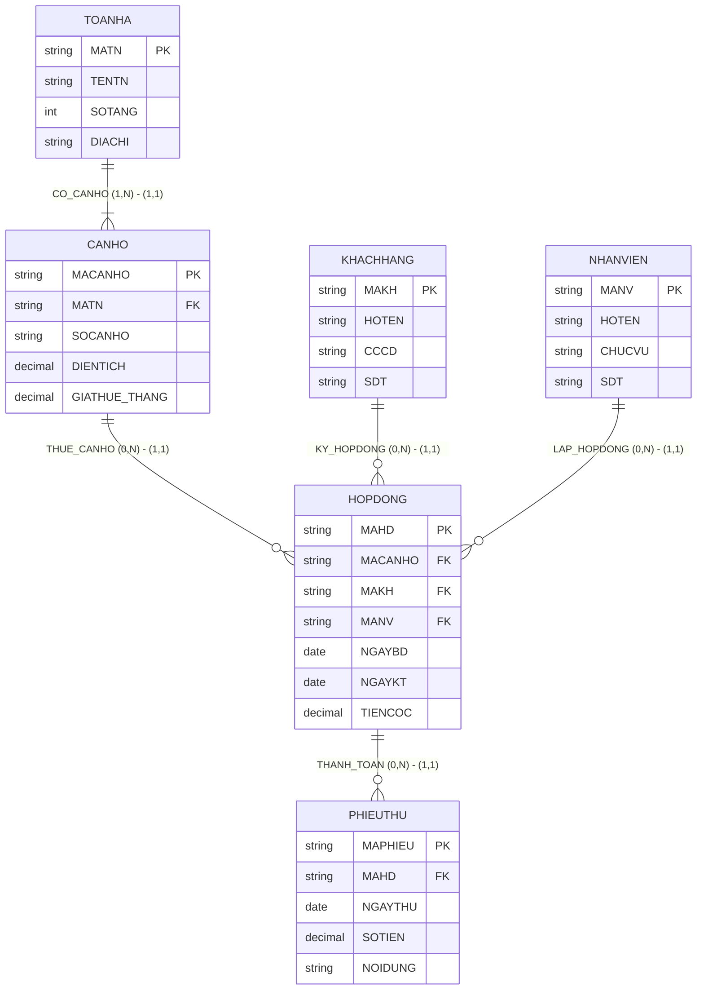

# HƯỚNG DẪN CHẤM & LỜI GIẢI CHI TIẾT (MOCK-05)
**Môn học:** IT004 — Cơ sở dữ liệu | **Thời gian thi:** 75 phút | **Thang điểm:** 10.0
**Tác giả biên soạn:** VÕ TRỌNG PHÚC — CSDL_UIT Master Series

---

## CÂU 1: THIẾT KẾ MÔ HÌNH DỮ LIỆU (2.0 ĐIỂM)

### 1.1. Phân tích thực thể, mối kết hợp & Sơ đồ ERD (1.20 điểm)

#### A. Xác định các tập thực thể và thuộc tính
1. **`TOANHA`** (Tòa nhà / Block chung cư):
   - Thuộc tính khóa: `MATN` (Mã tòa nhà).
   - Thuộc tính mô tả: `TENTN` (Tên tòa nhà), `DIACHI` (Địa chỉ), `SOTANG` (Số tầng).
2. **`CANHO`** (Căn hộ):
   - Thuộc tính khóa: `MACH` (Mã căn hộ).
   - Thuộc tính mô tả: `SOPHONG` (Số phòng ngủ), `DIENTICH` (Diện tích), `GIATHUE_CHUAN` (Giá thuê chuẩn), `TRANGTHAI` (Trạng thái).
3. **`KHACHHANG`** (Khách hàng thuê):
   - Thuộc tính khóa: `MAKH` (Mã khách hàng).
   - Thuộc tính mô tả: `HOTEN` (Họ tên), `CCCD` (Số CCCD), `SDT` (Số điện thoại), `LOAIKH` (Phân loại khách hàng).
4. **`NHANVIEN`** (Nhân viên môi giới/quản lý):
   - Thuộc tính khóa: `MANV` (Mã nhân viên).
   - Thuộc tính mô tả: `HOTEN` (Họ tên), `PHONGBAN` (Phòng ban), `SDT` (Số điện thoại).
5. **`HOPDONG`** (Hợp đồng thuê nhà):
   - Thuộc tính khóa: `MAHD` (Mã hợp đồng).
   - Thuộc tính mô tả: `NGAYKY` (Ngày ký), `NGAYBD` (Ngày bắt đầu), `NGAYKT` (Ngày kết thúc), `GIATHUE_THUCTE` (Giá thuê thực tế), `TIENCOC` (Tiền đặt cọc).
6. **`PHIEUTHU`** (Phiếu thu tiền hàng tháng):
   - Thuộc tính khóa: `SOPHIEU` (Số phiếu thu).
   - Thuộc tính mô tả: `THANG` (Tháng thu), `NAM` (Năm thu), `NGAYTHU` (Ngày thu thực tế), `SOTIEN` (Số tiền thu).

#### B. Xác định mối kết hợp & Bản số (Min, Max)
1. **`THUOC_TOA`** (giữa `TOANHA` và `CANHO`):
   - Một tòa nhà có từ 1 đến nhiều căn hộ: Bản số $(1, N)$.
   - Mỗi căn hộ bắt buộc thuộc về đúng 1 tòa nhà: Bản số $(1, 1)$.
2. **`CHO_THUE`** (giữa `CANHO` và `HOPDONG`):
   - Một căn hộ có thể được thuê trong 0 hoặc nhiều hợp đồng qua các thời kỳ: Bản số $(0, N)$.
   - Một hợp đồng thuê đúng 1 căn hộ: Bản số $(1, 1)$.
3. **`KY_KET`** (giữa `KHACHHANG` và `HOPDONG`):
   - Một khách hàng có thể ký 0 hoặc nhiều hợp đồng thuê: Bản số $(0, N)$.
   - Một hợp đồng do đúng 1 khách hàng đứng tên ký: Bản số $(1, 1)$.
4. **`MOI_GIOI`** (giữa `NHANVIEN` và `HOPDONG`):
   - Một nhân viên có thể lập 0 hoặc nhiều hợp đồng: Bản số $(0, N)$.
   - Một hợp đồng do đúng 1 nhân viên lập: Bản số $(1, 1)$.
5. **`THANH_TOAN`** (giữa `HOPDONG` và `PHIEUTHU`):
   - Một hợp đồng có 0 hoặc nhiều phiếu thu tiền: Bản số $(0, N)$.
   - Mỗi phiếu thu tiền thuộc về đúng 1 hợp đồng: Bản số $(1, 1)$.

#### C. Sơ đồ Thực thể – Mối kết hợp (ERD)



**Barem chấm điểm Câu 1.1 (1.20 điểm):**
- Xác định đúng 6 tập thực thể và thuộc tính khóa: 0.40đ.
- Xác định đúng 5 mối kết hợp và bản số min-max hai phía: 0.40đ.
- Vẽ sơ đồ ERD đúng chuẩn, rõ ràng, trực quan: 0.40đ.

---

### 1.2. Ánh xạ sang Lược đồ quan hệ (0.80 điểm)

Áp dụng quy tắc chuyển đổi từ mô hình ERD sang Lược đồ quan hệ:
- **Thực thể mạnh:** Tạo bảng quan hệ tương ứng với thuộc tính khóa làm Khóa chính (PK).
- **Mối kết hợp 1:N:**
  - `THUOC_TOA`: Chuyển `MATN` làm Khóa ngoại (FK) tại bảng `CANHO`.
  - `CHO_THUE`, `KY_KET`, `MOI_GIOI`: Chuyển `MACH`, `MAKH`, `MANV` làm Khóa ngoại (FK) tại bảng `HOPDONG`.
  - `THANH_TOAN`: Chuyển `MAHD` làm Khóa ngoại (FK) tại bảng `PHIEUTHU`.

**Lược đồ cơ sở dữ liệu quan hệ hoàn chỉnh:**

1. `TOANHA` ($\underline{\text{MATN}}$, TENTN, DIACHI, SOTANG)
   - *Khóa chính:* `MATN`.

2. `CANHO` ($\underline{\text{MACH}}$, MATN, SOPHONG, DIENTICH, GIATHUE_CHUAN, TRANGTHAI)
   - *Khóa chính:* `MACH`.
   - *Khóa ngoại:* `MATN` tham chiếu đến `TOANHA(MATN)`.

3. `KHACHHANG` ($\underline{\text{MAKH}}$, HOTEN, CCCD, SDT, LOAIKH)
   - *Khóa chính:* `MAKH`.

4. `NHANVIEN` ($\underline{\text{MANV}}$, HOTEN, PHONGBAN, SDT)
   - *Khóa chính:* `MANV`.

5. `HOPDONG` ($\underline{\text{MAHD}}$, MACH, MAKH, MANV, NGAYKY, NGAYBD, NGAYKT, GIATHUE_THUCTE, TIENCOC)
   - *Khóa chính:* `MAHD`.
   - *Khóa ngoại:*
     - `MACH` tham chiếu đến `CANHO(MACH)`.
     - `MAKH` tham chiếu đến `KHACHHANG(MAKH)`.
     - `MANV` tham chiếu đến `NHANVIEN(MANV)`.

6. `PHIEUTHU` ($\underline{\text{SOPHIEU}}$, MAHD, THANG, NAM, NGAYTHU, SOTIEN)
   - *Khóa chính:* `SOPHIEU`.
   - *Khóa ngoại:* `MAHD` tham chiếu đến `HOPDONG(MAHD)`.

**Barem chấm điểm Câu 1.2 (0.80 điểm):**
- Ánh xạ đúng các bảng thực thể độc lập, xác định PK: 0.40đ.
- Ánh xạ đúng các quan hệ có khóa ngoại liên kết chính xác: 0.40đ.

---

## CÂU 2: SQL & ĐẠI SỐ QUAN HỆ (8.0 ĐIỂM)

### 2.1. Viết các câu lệnh SQL (1.5 điểm)

#### a. (0.75 điểm) Ràng buộc CHECK miền giá trị & NOT NULL
```sql
-- Ràng buộc tiền cọc không âm và NOT NULL
ALTER TABLE HOPDONG ALTER COLUMN TIENCOC DECIMAL(18, 2) NOT NULL;
ALTER TABLE HOPDONG ADD CONSTRAINT CK_HOPDONG_TIENCOC CHECK (TIENCOC >= 0);

-- Ràng buộc ngày kết thúc hợp đồng phải sau ngày bắt đầu và NOT NULL
ALTER TABLE HOPDONG ALTER COLUMN NGAYKT DATE NOT NULL;
ALTER TABLE HOPDONG ADD CONSTRAINT CK_HOPDONG_NGAY CHECK (NGAYKT > NGAYBD);
```

*Phân tích ngữ nghĩa học thuật:*
- Tiền cọc `TIENCOC` mang tính chất bảo đảm tài chính trong hợp đồng thuê dân sự, không thể nhận giá trị âm ($\ge 0$).
- Thời hạn thuê có tính chu kỳ nên ngày chấm dứt hiệu lực `NGAYKT` bắt buộc phải sau ngày bắt đầu nhận căn hộ `NGAYBD` ($> \text{NGAYBD}$).
- Việc gán `NOT NULL` bảo đảm không phát sinh giá trị `UNKNOWN` theo logic ba chân trị của SQL Server.

*Barem chấm:*
- Cú pháp `ALTER TABLE ... ADD CONSTRAINT ... CHECK`: 0.40đ.
- Biểu thức điều kiện chính xác và ràng buộc `NOT NULL`: 0.35đ.

#### b. (0.75 điểm) Lệnh DML UPDATE liên bảng
```sql
-- Cách 1: T-SQL UPDATE ... FROM mở rộng
UPDATE CH
SET CH.TRANGTHAI = N'Đang thuê'
FROM CANHO CH
INNER JOIN HOPDONG HD ON CH.MACH = HD.MACH
WHERE HD.NGAYKY >= '2024-01-01' AND HD.NGAYKY <= '2024-12-31'
  AND HD.NGAYKT >= '2024-12-31';

-- Cách 2: Chuẩn ANSI SQL Subquery
UPDATE CANHO
SET TRANGTHAI = N'Đang thuê'
WHERE MACH IN (
    SELECT MACH
    FROM HOPDONG
    WHERE NGAYKY >= '2024-01-01' AND NGAYKY <= '2024-12-31'
      AND NGAYKT >= '2024-12-31'
);
```

*Barem chấm:*
- Cú pháp UPDATE liên bảng hoặc subquery chuẩn xác: 0.40đ.
- Điều kiện lọc thời gian ký năm 2024 và ngày kết thúc từ 31/12/2024 trở đi: 0.35đ.

---

### 2.2. Viết các biểu thức Đại số quan hệ (6.5 điểm)

#### a. (1.0 điểm) [Selection + Projection]
*Đề bài:* Liệt kê danh sách các khách hàng (`MAKH`, `HOTEN`, `SDT`) thuộc phân loại khách hàng là 'Doanh nghiệp'.

- **Biểu thức Đại số quan hệ:**
  $$E_1 = \sigma_{\text{LOAIKH} = \text{'Doanh nghiệp'}}(\text{KHACHHANG})$$
  $$\text{KQ} = \pi_{\text{MAKH}, \text{HOTEN}, \text{SDT}}(E_1)$$

- **T-SQL tương đương kiểm chứng:**
  ```sql
  SELECT MAKH, HOTEN, SDT
  FROM KHACHHANG
  WHERE LOAIKH = N'Doanh nghiệp';
  ```

*Barem chấm:*
- Phép chọn $\sigma$ đúng điều kiện loại khách hàng: 0.40đ.
- Phép chiếu $\pi$ đúng 3 thuộc tính: 0.35đ.
- Tối ưu bước trung gian: 0.25đ.

---

#### b. (1.0 điểm) [Join]
*Đề bài:* Cho biết danh sách các căn hộ (`MACH`, `SOPHONG`, `DIENTICH`, `TENTN`) thuộc tòa nhà 'Sky Garden' có giá thuê chuẩn (`GIATHUE_CHUAN`) từ 15,000,000 đồng/tháng trở lên.

- **Biểu thức Đại số quan hệ:**
  $$E_{\text{TN}} = \sigma_{\text{TENTN} = \text{'Sky Garden'}}(\text{TOANHA})$$
  $$E_{\text{CH}} = \sigma_{\text{GIATHUE\_CHUAN} \ge 15000000}(\text{CANHO})$$
  $$\text{KQ} = \pi_{\text{MACH}, \text{SOPHONG}, \text{DIENTICH}, \text{TENTN}}(E_{\text{TN}} \bowtie E_{\text{CH}})$$

- **T-SQL tương đương kiểm chứng:**
  ```sql
  SELECT CH.MACH, CH.SOPHONG, CH.DIENTICH, TN.TENTN
  FROM CANHO CH
  INNER JOIN TOANHA TN ON CH.MATN = TN.MATN
  WHERE TN.TENTN = N'Sky Garden'
    AND CH.GIATHUE_CHUAN >= 15000000;
  ```

*Barem chấm:*
- Chọn đúng điều kiện tòa nhà và giá thuê chuẩn: 0.30đ.
- Phép kết tự nhiên $\bowtie$ trên `MATN`: 0.40đ.
- Chiếu đúng các thuộc tính yêu cầu: 0.30đ.

---

#### c. (1.0 điểm) [Outer Join]
*Đề bài:* Liệt kê danh sách thông tin tất cả các tòa nhà chung cư (`MATN`, `TENTN`, `DIACHI`) và mã các căn hộ (`MACH`), số phòng ngủ (`SOPHONG`) thuộc tòa nhà đó (nếu tòa nhà chưa có căn hộ nào thì thông tin căn hộ mang giá trị `NULL`).

- **Biểu thức Đại số quan hệ:**
  $$\text{KQ} = \pi_{\text{MATN}, \text{TENTN}, \text{DIACHI}, \text{MACH}, \text{SOPHONG}}(\text{TOANHA} \leftouterjoin \text{CANHO})$$

- **T-SQL tương đương kiểm chứng:**
  ```sql
  SELECT TN.MATN, TN.TENTN, TN.DIACHI, CH.MACH, CH.SOPHONG
  FROM TOANHA TN
  LEFT OUTER JOIN CANHO CH ON TN.MATN = CH.MATN;
  ```

*Phân tích ngữ nghĩa:*
- Phép kết ngoài trái ($\leftouterjoin$) bảo tồn toàn bộ các tòa nhà trong bảng `TOANHA`. Tòa nhà mới xây dựng chưa có căn hộ nào (ví dụ `TN04`) vẫn xuất hiện với `MACH = NULL` và `SOPHONG = NULL`.

*Barem chấm:*
- Sử dụng đúng ký hiệu kết ngoài trái $\leftouterjoin$: 0.40đ.
- Điều kiện kết nối đúng thuộc tính `MATN`: 0.30đ.
- Chiếu đầy đủ thuộc tính: 0.30đ.

---

#### d. (1.0 điểm) [Grouping & Aggregation]
*Đề bài:* Tính tổng số tiền thu được (`TONG_TIEN_THU`) theo từng hợp đồng trong năm 2024. Thông tin hiển thị gồm: `MAHD`, `NGAYKY`, `TONG_TIEN_THU`.

- **Biểu thức Đại số quan hệ:**
  $$E_1 = \sigma_{\text{NAM} = 2024}(\text{PHIEUTHU})$$
  $$E_2 = \text{HOPDONG} \bowtie E_1$$
  $$\text{KQ} = {}_{\text{MAHD}, \text{NGAYKY}}\gamma_{\text{SUM}(\text{SOTIEN}) \to \text{TONG\_TIEN\_THU}}(E_2)$$

- **T-SQL tương đương kiểm chứng:**
  ```sql
  SELECT HD.MAHD, HD.NGAYKY, SUM(PT.SOTIEN) AS TONG_TIEN_THU
  FROM HOPDONG HD
  INNER JOIN PHIEUTHU PT ON HD.MAHD = PT.MAHD
  WHERE PT.NAM = 2024
  GROUP BY HD.MAHD, HD.NGAYKY;
  ```

*Barem chấm:*
- Lọc đúng phiếu thu năm 2024: 0.30đ.
- Kết nối `HOPDONG` với `PHIEUTHU` trên `MAHD`: 0.30đ.
- Gom nhóm đúng và tính `SUM(SOTIEN)`: 0.40đ.

---

#### e. (1.0 điểm) [Relational Division]
*Đề bài:* Tìm các khách hàng (`MAKH`, `HOTEN`, `SDT`) đã từng ký hợp đồng thuê căn hộ tại **tất cả** các tòa nhà tọa lạc tại địa bàn 'Quận 7'.

- **Phân tích các tập hợp:**
  - Tập bị chia $R(\text{MAKH}, \text{MATN})$: Cặp mã khách hàng và mã tòa nhà mà khách hàng đã ký hợp đồng thuê căn hộ.
    $$R = \pi_{\text{MAKH}, \text{MATN}}(\text{HOPDONG} \bowtie \text{CANHO})$$
  - Tập chia $S(\text{MATN})$: Danh sách toàn bộ mã các tòa nhà thuộc Quận 7.
    $$S = \pi_{\text{MATN}}(\sigma_{\text{DIACHI} = \text{'Quận 7'}}(\text{TOANHA}))$$

- **Biểu thức Đại số quan hệ (Dạng toán tử $\div$):**
  $$R_{\text{KQ}} = R \div S$$
  $$\text{KQ} = \pi_{\text{MAKH}, \text{HOTEN}, \text{SDT}}(R_{\text{KQ}} \bowtie \text{KHACHHANG})$$

- **Biểu thức tương đương thuần túy (Không dùng $\div$):**
  $$R_{\text{TatCa}} = \pi_{\text{MAKH}}(R) \times S$$
  $$R_{\text{ChuaThue}} = R_{\text{TatCa}} - R$$
  $$R_{\text{KQ}} = \pi_{\text{MAKH}}(R) - \pi_{\text{MAKH}}(R_{\text{ChuaThue}})$$
  $$\text{KQ} = \pi_{\text{MAKH}, \text{HOTEN}, \text{SDT}}(R_{\text{KQ}} \bowtie \text{KHACHHANG})$$

- **T-SQL tương đương kiểm chứng:**
  ```sql
  -- Cách 1: Phủ định kép (NOT EXISTS)
  SELECT KH.MAKH, KH.HOTEN, KH.SDT
  FROM KHACHHANG KH
  WHERE NOT EXISTS (
      SELECT *
      FROM TOANHA TN
      WHERE TN.DIACHI = N'Quận 7'
        AND NOT EXISTS (
            SELECT *
            FROM HOPDONG HD
            INNER JOIN CANHO CH ON HD.MACH = CH.MACH
            WHERE HD.MAKH = KH.MAKH
              AND CH.MATN = TN.MATN
        )
  )
  AND EXISTS (SELECT 1 FROM HOPDONG WHERE MAKH = KH.MAKH);

  -- Cách 2: Gom nhóm & HAVING COUNT phân biệt
  SELECT KH.MAKH, KH.HOTEN, KH.SDT
  FROM KHACHHANG KH
  INNER JOIN HOPDONG HD ON KH.MAKH = HD.MAKH
  INNER JOIN CANHO CH ON HD.MACH = CH.MACH
  INNER JOIN TOANHA TN ON CH.MATN = TN.MATN
  WHERE TN.DIACHI = N'Quận 7'
  GROUP BY KH.MAKH, KH.HOTEN, KH.SDT
  HAVING COUNT(DISTINCT TN.MATN) = (
      SELECT COUNT(*)
      FROM TOANHA
      WHERE DIACHI = N'Quận 7'
  );
  ```

*Phân tích biên (Edge Case):*
- Khi không có tòa nhà nào ở Quận 7 ($S = \emptyset$), điều kiện `AND EXISTS (SELECT 1 FROM HOPDONG WHERE MAKH = KH.MAKH)` bảo đảm không trả về các khách hàng chưa từng phát sinh hợp đồng thuê thực tế.

*Barem chấm:*
- Xác định đúng quan hệ bị chia $R$ và tập chia $S$: 0.30đ.
- Viết đúng biểu thức phép chia $R \div S$: 0.40đ.
- Chiếu kết quả đầy đủ thuộc tính khách hàng: 0.30đ.

---

#### f. (1.5 điểm) [Extreme / Tie-breaking]
*Đề bài:* Tìm thông tin tòa nhà (`MATN`, `TENTN`, `DIACHI`) có số lượng căn hộ đang ở trạng thái 'Đang thuê' nhiều nhất trong hệ thống (bảo toàn tất cả các tòa nhà nếu có nhiều tòa nhà cùng đạt số lượng căn hộ đang thuê lớn nhất).

- **Biểu thức Đại số quan hệ:**
  - *Bước 1: Lọc căn hộ đang thuê và gom nhóm đếm theo từng tòa nhà:*
    $$E_1 = \sigma_{\text{TRANGTHAI} = \text{'Đang thuê'}}(\text{CANHO})$$
    $$R_{\text{SoLuong}} = {}_{\text{MATN}}\gamma_{\text{COUNT}(\text{MACH}) \to \text{SO\_CAN\_THUE}}(E_1)$$
  - *Bước 2: Tìm các giá trị không phải cực đại:*
    $$R_{\text{NhoHon}} = \pi_{R1.\text{SO\_CAN\_THUE}}(\sigma_{R1.\text{SO\_CAN\_THUE} < R2.\text{SO\_CAN\_THUE}}(\rho_{R1}(R_{\text{SoLuong}}) \times \rho_{R2}(R_{\text{SoLuong}})))$$
  - *Bước 3: Lấy giá trị lớn nhất:*
    $$R_{\text{Max}} = \pi_{\text{SO\_CAN\_THUE}}(R_{\text{SoLuong}}) - R_{\text{NhoHon}}$$
  - *Bước 4: Chiếu thông tin tòa nhà bảo toàn đồng hạng:*
    $$\text{KQ} = \pi_{\text{MATN}, \text{TENTN}, \text{DIACHI}}(\text{TOANHA} \bowtie R_{\text{SoLuong}} \bowtie R_{\text{Max}})$$

- **T-SQL tương đương kiểm chứng:**
  ```sql
  SELECT TOP 1 WITH TIES TN.MATN, TN.TENTN, TN.DIACHI, COUNT(CH.MACH) AS SO_CAN_THUE
  FROM TOANHA TN
  INNER JOIN CANHO CH ON TN.MATN = CH.MATN
  WHERE CH.TRANGTHAI = N'Đang thuê'
  GROUP BY TN.MATN, TN.TENTN, TN.DIACHI
  ORDER BY COUNT(CH.MACH) DESC;
  ```

*Barem chấm:*
- Lọc đúng trạng thái căn hộ và gom nhóm đếm `COUNT(MACH)`: 0.40đ.
- Thuật toán trừ tập tìm giá trị cực đại chính xác: 0.60đ.
- Kết nối `TOANHA` và bảo toàn đồng hạng cực trị: 0.50đ.

---

**TỔNG ĐIỂM TOÀN BÀI: 10.0 ĐIỂM**
