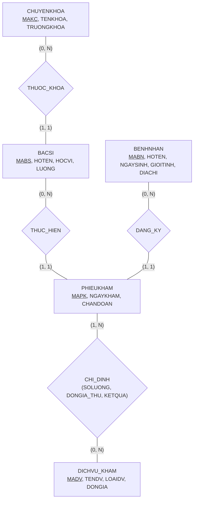

# HƯỚNG DẪN CHẤM & LỜI GIẢI CHI TIẾT (MOCK-06)
**Môn học:** IT004 — Cơ sở dữ liệu | **Thời gian thi:** 75 phút | **Thang điểm:** 10.0
**Tác giả biên soạn:** VÕ TRỌNG PHÚC — CSDL_UIT Master Series

---

## CÂU 1: THIẾT KẾ MÔ HÌNH DỮ LIỆU (2.5 ĐIỂM)

### 1.1. Phân tích thực thể, mối kết hợp & Sơ đồ ERD (1.50 điểm)

#### A. Xác định các tập thực thể và thuộc tính
1. **`CHUYENKHOA`** (Khoa chuyên môn):
   - Thuộc tính khóa: `MAKC` (Mã chuyên khoa).
   - Thuộc tính mô tả: `TENKHOA` (Tên chuyên khoa), `TRUONGKHOA` (Trưởng khoa).
2. **`BACSI`** (Bác sĩ phòng khám):
   - Thuộc tính khóa: `MABS` (Mã bác sĩ).
   - Thuộc tính mô tả: `HOTEN` (Họ tên bác sĩ), `HOCVI` (Học vị), `LUONG` (Lương cơ bản).
3. **`BENHNHAN`** (Bệnh nhân):
   - Thuộc tính khóa: `MABN` (Mã bệnh nhân).
   - Thuộc tính mô tả: `HOTEN` (Họ tên), `NGAYSINH` (Ngày sinh), `GIOITINH` (Giới tính), `DIACHI` (Địa chỉ).
4. **`DICHVU_KHAM`** (Dịch vụ kỹ thuật y tế):
   - Thuộc tính khóa: `MADV` (Mã dịch vụ).
   - Thuộc tính mô tả: `TENDV` (Tên dịch vụ), `LOAIDV` (Phân loại dịch vụ), `DONGIA` (Đơn giá niêm yết).
5. **`PHIEUKHAM`** (Phiếu khám bệnh ngoại trú):
   - Thuộc tính khóa: `MAPK` (Mã phiếu khám).
   - Thuộc tính mô tả: `NGAYKHAM` (Ngày giờ khám), `CHANDOAN` (Kết luận chẩn đoán ban đầu).

#### B. Xác định mối kết hợp & Bản số (Min, Max)
1. **`THUOC_KHOA`** (giữa `CHUYENKHOA` và `BACSI`):
   - Một chuyên khoa có từ 0 đến nhiều bác sĩ: Bản số $(0, N)$.
   - Một bác sĩ bắt buộc công tác tại đúng 1 chuyên khoa: Bản số $(1, 1)$.
2. **`DANG_KY_KHAM`** (giữa `BENHNHAN` và `PHIEUKHAM`):
   - Một bệnh nhân có thể đến khám 0 hoặc nhiều lần: Bản số $(0, N)$.
   - Một phiếu khám thuộc về đúng 1 bệnh nhân: Bản số $(1, 1)$.
3. **`THUC_HIEN_KHAM`** (giữa `BACSI` và `PHIEUKHAM`):
   - Một bác sĩ có thể thực hiện 0 hoặc nhiều phiếu khám: Bản số $(0, N)$.
   - Một phiếu khám do đúng 1 bác sĩ phụ trách: Bản số $(1, 1)$.
4. **`CHI_DINH_DV`** (giữa `PHIEUKHAM` và `DICHVU_KHAM`):
   - Một phiếu khám có thể chỉ định 1 hoặc nhiều dịch vụ kỹ thuật: Bản số $(1, N)$.
   - Một dịch vụ có thể được chỉ định trong 0 hoặc nhiều phiếu khám: Bản số $(0, N)$.
   - Thuộc tính mối kết hợp: `SOLUONG` (Số lần chỉ định), `DONGIA_THU` (Đơn giá thực thu), `KETQUA` (Kết quả thực hiện).

#### C. Sơ đồ Thực thể – Mối kết hợp (ERD)



**Barem chấm điểm Câu 1.1 (1.50 điểm):**
- Xác định đúng 5 tập thực thể và thuộc tính khóa: 0.50đ.
- Xác định đúng 4 mối kết hợp và bản số min-max hai phía: 0.50đ.
- Vẽ sơ đồ ERD đúng chuẩn, rõ ràng, trực quan: 0.50đ.

---

### 1.2. Ánh xạ sang Lược đồ quan hệ (1.00 điểm)

Áp dụng quy tắc chuyển đổi từ mô hình ERD sang Lược đồ quan hệ:
- **Thực thể mạnh:** Tạo bảng quan hệ tương ứng với thuộc tính khóa làm Khóa chính (PK).
- **Mối kết hợp 1:N:**
  - `THUOC_KHOA`: Thêm khóa ngoại `MAKC` vào quan hệ `BACSI`.
  - `DANG_KY` & `THUC_HIEN`: Thêm khóa ngoại `MABN` và `MABS` vào quan hệ `PHIEUKHAM`.
- **Mối kết hợp M:N (`CHI_DINH`):** Tạo thành quan hệ `CHITIET_DV` có khóa chính gồm cặp `(MAPK, MADV)`.

**Lược đồ cơ sở dữ liệu quan hệ hoàn chỉnh:**

1. `CHUYENKHOA` ($\underline{\text{MAKC}}$, TENKHOA, TRUONGKHOA)
   - *Khóa chính:* `MAKC`.

2. `BACSI` ($\underline{\text{MABS}}$, HOTEN, HOCVI, MAKC, LUONG)
   - *Khóa chính:* `MABS`.
   - *Khóa ngoại:* `MAKC` tham chiếu đến `CHUYENKHOA(MAKC)`.

3. `BENHNHAN` ($\underline{\text{MABN}}$, HOTEN, NGAYSINH, GIOITINH, DIACHI)
   - *Khóa chính:* `MABN`.

4. `DICHVU_KHAM` ($\underline{\text{MADV}}$, TENDV, LOAIDV, DONGIA)
   - *Khóa chính:* `MADV`.

5. `PHIEUKHAM` ($\underline{\text{MAPK}}$, NGAYKHAM, MABN, MABS, CHANDOAN)
   - *Khóa chính:* `MAPK`.
   - *Khóa ngoại:*
     - `MABN` tham chiếu đến `BENHNHAN(MABN)`.
     - `MABS` tham chiếu đến `BACSI(MABS)`.

6. `CHITIET_DV` ($\underline{\text{MAPK}}$, $\underline{\text{MADV}}$, SOLUONG, DONGIA_THU, KETQUA)
   - *Khóa chính:* `(MAPK, MADV)`.
   - *Khóa ngoại:*
     - `MAPK` tham chiếu đến `PHIEUKHAM(MAPK)`.
     - `MADV` tham chiếu đến `DICHVU_KHAM(MADV)`.

**Barem chấm điểm Câu 1.2 (1.00 điểm):**
- Ánh xạ đúng 5 bảng thực thể, xác định đúng PK và FK: 0.60đ.
- Ánh xạ đúng quan hệ chi tiết `CHITIET_DV` với khóa chính phức hợp: 0.40đ.

---

## CÂU 2: SQL & ĐẠI SỐ QUAN HỆ (7.5 ĐIỂM)

### 2.1. Viết các câu lệnh SQL (1.5 điểm)

#### a. (0.75 điểm) Ràng buộc CHECK miền giá trị & NOT NULL
```sql
-- Ràng buộc số lượng dịch vụ chỉ định phải dương và NOT NULL
ALTER TABLE CHITIET_DV ALTER COLUMN SOLUONG INT NOT NULL;
ALTER TABLE CHITIET_DV ADD CONSTRAINT CK_CTDV_SOLUONG CHECK (SOLUONG > 0);

-- Ràng buộc đơn giá dịch vụ phải dương và NOT NULL
ALTER TABLE DICHVU_KHAM ALTER COLUMN DONGIA DECIMAL(18, 2) NOT NULL;
ALTER TABLE DICHVU_KHAM ADD CONSTRAINT CK_DVKHAM_DONGIA CHECK (DONGIA > 0);
```

*Phân tích ngữ nghĩa học thuật:*
- Thuộc tính `SOLUONG` chỉ định dịch vụ kỹ thuật y tế bắt buộc là số nguyên dương ($> 0$).
- Đơn giá dịch vụ y tế `DONGIA` không thể mang giá trị âm hoặc bằng 0 trong cơ chế hạch toán viện phí phòng khám tư nhân.
- Khai báo `NOT NULL` triệt tiêu trường hợp giá trị `UNKNOWN` của logic ba chân trị SQL Server.

*Barem chấm:*
- Cú pháp `ALTER TABLE ... ADD CONSTRAINT ... CHECK`: 0.40đ.
- Biểu thức điều kiện chính xác và ràng buộc `NOT NULL`: 0.35đ.

#### b. (0.75 điểm) Lệnh DML UPDATE liên bảng
```sql
-- Cách 1: T-SQL UPDATE ... FROM mở rộng
UPDATE BS
SET BS.LUONG = BS.LUONG * 1.10
FROM BACSI BS
INNER JOIN CHUYENKHOA CK ON BS.MAKC = CK.MAKC
WHERE CK.TENKHOA = N'Nội tổng quát'
  AND (BS.HOCVI = N'Tiến sĩ' OR BS.HOCVI = N'Bác sĩ CKII');

-- Cách 2: Chuẩn ANSI SQL Subquery
UPDATE BACSI
SET LUONG = LUONG * 1.10
WHERE (HOCVI = N'Tiến sĩ' OR HOCVI = N'Bác sĩ CKII')
  AND MAKC IN (
      SELECT MAKC
      FROM CHUYENKHOA
      WHERE TENKHOA = N'Nội tổng quát'
  );
```

*Barem chấm:*
- Cú pháp UPDATE liên bảng hoặc subquery chuẩn xác: 0.40đ.
- Điều kiện lọc đúng chuyên khoa 'Nội tổng quát' và học vị 'Tiến sĩ' hoặc 'Bác sĩ CKII': 0.35đ.

---

### 2.2. Viết các biểu thức Đại số quan hệ (6.0 điểm)

#### a. (1.0 điểm) [Selection + Projection]
*Đề bài:* Liệt kê danh sách các bệnh nhân (`MABN`, `HOTEN`, `NGAYSINH`, `DIACHI`) có giới tính là 'Nữ' và có địa chỉ thường trú tại 'TP.HCM'.

- **Biểu thức Đại số quan hệ:**
  $$E_1 = \sigma_{\text{GIOITINH} = \text{'Nữ'} \;\wedge\; \text{DIACHI} = \text{'TP.HCM'}}(\text{BENHNHAN})$$
  $$\text{KQ} = \pi_{\text{MABN}, \text{HOTEN}, \text{NGAYSINH}, \text{DIACHI}}(E_1)$$

- **T-SQL tương đương kiểm chứng:**
  ```sql
  SELECT MABN, HOTEN, NGAYSINH, DIACHI
  FROM BENHNHAN
  WHERE GIOITINH = N'Nữ' AND DIACHI = N'TP.HCM';
  ```

*Barem chấm:*
- Phép chọn $\sigma$ đúng điều kiện giới tính và địa chỉ: 0.40đ.
- Phép chiếu $\pi$ đúng 4 thuộc tính: 0.35đ.
- Tối ưu bước trung gian: 0.25đ.

---

#### b. (1.0 điểm) [Join]
*Đề bài:* Cho biết danh sách các phiếu khám bệnh (`MAPK`, `NGAYKHAM`, `CHANDOAN`, `HOTEN`) do các bác sĩ thuộc chuyên khoa 'Nhi khoa' trực tiếp thăm khám.

- **Biểu thức Đại số quan hệ:**
  $$E_{\text{CK}} = \sigma_{\text{TENKHOA} = \text{'Nhi khoa'}}(\text{CHUYENKHOA})$$
  $$E_{\text{BS}} = E_{\text{CK}} \bowtie \text{BACSI}$$
  $$\text{KQ} = \pi_{\text{MAPK}, \text{NGAYKHAM}, \text{CHANDOAN}, \text{HOTEN}}(\text{PHIEUKHAM} \bowtie E_{\text{BS}})$$

- **T-SQL tương đương kiểm chứng:**
  ```sql
  SELECT PK.MAPK, PK.NGAYKHAM, PK.CHANDOAN, BS.HOTEN
  FROM PHIEUKHAM PK
  INNER JOIN BACSI BS ON PK.MABS = BS.MABS
  INNER JOIN CHUYENKHOA CK ON BS.MAKC = CK.MAKC
  WHERE CK.TENKHOA = N'Nhi khoa';
  ```

*Barem chấm:*
- Chọn đúng chuyên khoa 'Nhi khoa': 0.30đ.
- Phép kết tự nhiên $\bowtie$ trên `MAKC` và `MABS`: 0.40đ.
- Chiếu đúng các thuộc tính yêu cầu: 0.30đ.

---

#### c. (1.0 điểm) [Outer Join]
*Đề bài:* Liệt kê thông tin tất cả các chuyên khoa (`MAKC`, `TENKHOA`) và danh sách mã bác sĩ (`MABS`), họ tên bác sĩ (`HOTEN`) công tác tại chuyên khoa đó (nếu chuyên khoa mới thành lập chưa có bác sĩ nào thì thông tin bác sĩ mang giá trị `NULL`).

- **Biểu thức Đại số quan hệ:**
  $$\text{KQ} = \pi_{\text{MAKC}, \text{TENKHOA}, \text{MABS}, \text{HOTEN}}(\text{CHUYENKHOA} \leftouterjoin \text{BACSI})$$

- **T-SQL tương đương kiểm chứng:**
  ```sql
  SELECT CK.MAKC, CK.TENKHOA, BS.MABS, BS.HOTEN
  FROM CHUYENKHOA CK
  LEFT OUTER JOIN BACSI BS ON CK.MAKC = BS.MAKC;
  ```

*Phân tích ngữ nghĩa:*
- Phép kết ngoài trái ($\leftouterjoin$) bảo tồn toàn bộ các chuyên khoa trong bảng `CHUYENKHOA`. Nếu chuyên khoa chưa có bác sĩ nào (ví dụ khoa Da liễu `CK04`), chuyên khoa đó vẫn xuất hiện với `MABS = NULL` và `HOTEN = NULL`.

*Barem chấm:*
- Sử dụng đúng ký hiệu kết ngoài trái $\leftouterjoin$: 0.40đ.
- Điều kiện kết nối đúng thuộc tính `MAKC`: 0.30đ.
- Chiếu đầy đủ thuộc tính: 0.30đ.

---

#### d. (1.0 điểm) [Grouping & Aggregation]
*Đề bài:* Tính tổng số tiền dịch vụ cận lâm sàng đã chỉ định (`TONG_TIEN_DV`) của từng phiếu khám được lập trong tháng 10 năm 2024. Thông tin hiển thị gồm: `MAPK`, `NGAYKHAM`, `TONG_TIEN_DV`.

- **Biểu thức Đại số quan hệ:**
  $$E_1 = \sigma_{\text{NGAYKHAM} \ge \text{'2024-10-01'} \;\wedge\; \text{NGAYKHAM} \le \text{'2024-10-31'}}(\text{PHIEUKHAM})$$
  $$E_2 = E_1 \bowtie \text{CHITIET\_DV}$$
  $$\text{KQ} = {}_{\text{MAPK}, \text{NGAYKHAM}}\gamma_{\text{SUM}(\text{SOLUONG} \times \text{DONGIA\_THU}) \to \text{TONG\_TIEN\_DV}}(E_2)$$

- **T-SQL tương đương kiểm chứng:**
  ```sql
  SELECT PK.MAPK, PK.NGAYKHAM, SUM(CT.SOLUONG * CT.DONGIA_THU) AS TONG_TIEN_DV
  FROM PHIEUKHAM PK
  INNER JOIN CHITIET_DV CT ON PK.MAPK = CT.MAPK
  WHERE PK.NGAYKHAM >= '2024-10-01' AND PK.NGAYKHAM <= '2024-10-31 23:59:59'
  GROUP BY PK.MAPK, PK.NGAYKHAM;
  ```

*Barem chấm:*
- Lọc đúng thời gian tháng 10/2024: 0.30đ.
- Kết nối `PHIEUKHAM` với `CHITIET_DV`: 0.30đ.
- Gom nhóm theo `MAPK, NGAYKHAM` và tính tổng thành tiền: 0.40đ.

---

#### e. (1.0 điểm) [Relational Division]
*Đề bài:* Tìm các phiếu khám (`MAPK`, `NGAYKHAM`, `MABN`) đã được chỉ định **tất cả** các dịch vụ y tế thuộc phân loại 'Chẩn đoán hình ảnh'.

- **Phân tích các tập hợp:**
  - Tập bị chia $R(\text{MAPK}, \text{MADV})$: Cặp mã phiếu khám và mã dịch vụ đã được chỉ định.
    $$R = \pi_{\text{MAPK}, \text{MADV}}(\text{CHITIET\_DV})$$
  - Tập chia $S(\text{MADV})$: Danh sách toàn bộ mã dịch vụ thuộc loại Chẩn đoán hình ảnh.
    $$S = \pi_{\text{MADV}}(\sigma_{\text{LOAIDV} = \text{'Chẩn đoán hình ảnh'}}(\text{DICHVU\_KHAM}))$$

- **Biểu thức Đại số quan hệ (Dạng toán tử $\div$):**
  $$R_{\text{KQ}} = R \div S$$
  $$\text{KQ} = \pi_{\text{MAPK}, \text{NGAYKHAM}, \text{MABN}}(R_{\text{KQ}} \bowtie \text{PHIEUKHAM})$$

- **Biểu thức tương đương thuần túy (Không dùng $\div$):**
  $$R_{\text{TatCa}} = \pi_{\text{MAPK}}(R) \times S$$
  $$R_{\text{ChuaChiDinh}} = R_{\text{TatCa}} - R$$
  $$R_{\text{KQ}} = \pi_{\text{MAPK}}(R) - \pi_{\text{MAPK}}(R_{\text{ChuaChiDinh}})$$
  $$\text{KQ} = \pi_{\text{MAPK}, \text{NGAYKHAM}, \text{MABN}}(R_{\text{KQ}} \bowtie \text{PHIEUKHAM})$$

- **T-SQL tương đương kiểm chứng:**
  ```sql
  -- Cách 1: Phủ định kép (NOT EXISTS)
  SELECT PK.MAPK, PK.NGAYKHAM, PK.MABN
  FROM PHIEUKHAM PK
  WHERE NOT EXISTS (
      SELECT *
      FROM DICHVU_KHAM DV
      WHERE DV.LOAIDV = N'Chẩn đoán hình ảnh'
        AND NOT EXISTS (
            SELECT *
            FROM CHITIET_DV CT
            WHERE CT.MAPK = PK.MAPK
              AND CT.MADV = DV.MADV
        )
  )
  AND EXISTS (SELECT 1 FROM CHITIET_DV WHERE MAPK = PK.MAPK);

  -- Cách 2: LEFT JOIN & HAVING COUNT trên miền ứng viên
  SELECT CT.MAPK
  FROM CHITIET_DV CT
  LEFT JOIN (SELECT MADV FROM DICHVU_KHAM WHERE LOAIDV = N'Chẩn đoán hình ảnh') S ON CT.MADV = S.MADV
  GROUP BY CT.MAPK
  HAVING COUNT(DISTINCT S.MADV) = (
      SELECT COUNT(*)
      FROM DICHVU_KHAM
      WHERE LOAIDV = N'Chẩn đoán hình ảnh'
  );
  ```

*Phân tích biên (Edge Case):*
- Khi không có dịch vụ Chẩn đoán hình ảnh nào ($S = \emptyset$), điều kiện `AND EXISTS (SELECT 1 FROM CHITIET_DV WHERE MAPK = PK.MAPK)` bảo đảm tập kết quả khớp chính xác miền ứng viên $\pi_{\text{MAPK}}(\text{CHITIET\_DV})$ của Đại số quan hệ.

*Barem chấm:*
- Xác định đúng quan hệ bị chia $R$ và tập chia $S$: 0.30đ.
- Viết đúng biểu thức phép chia $R \div S$: 0.40đ.
- Chiếu kết quả đầy đủ thuộc tính phiếu khám: 0.30đ.

---

#### f. (1.0 điểm) [Extreme / Tie-breaking]
*Đề bài:* Tìm bác sĩ (`MABS`, `HOTEN`, `HOCVI`) đã thực hiện số lượng phiếu khám bệnh (`SO_LUOT_KHAM`) nhiều nhất trong tháng 10 năm 2024 (bảo toàn tất cả các bác sĩ nếu có nhiều bác sĩ cùng đạt số lượt khám nhiều nhất).

- **Biểu thức Đại số quan hệ:**
  - *Bước 1: Lọc phiếu khám tháng 10/2024 và gom nhóm đếm theo từng bác sĩ:*
    $$E_1 = \sigma_{\text{NGAYKHAM} \ge \text{'2024-10-01'} \;\wedge\; \text{NGAYKHAM} \le \text{'2024-10-31'}}(\text{PHIEUKHAM})$$
    $$R_{\text{LuotKham}} = {}_{\text{MABS}}\gamma_{\text{COUNT}(\text{MAPK}) \to \text{SO\_LUOT\_KHAM}}(E_1)$$
  - *Bước 2: Tìm các giá trị không phải cực đại:*
    $$R_{\text{NhoHon}} = \pi_{R1.\text{SO\_LUOT\_KHAM}}(\sigma_{R1.\text{SO\_LUOT\_KHAM} < R2.\text{SO\_LUOT\_KHAM}}(\rho_{R1}(R_{\text{LuotKham}}) \times \rho_{R2}(R_{\text{LuotKham}})))$$
  - *Bước 3: Lấy giá trị lớn nhất:*
    $$R_{\text{Max}} = \pi_{\text{SO\_LUOT\_KHAM}}(R_{\text{LuotKham}}) - R_{\text{NhoHon}}$$
  - *Bước 4: Chiếu thông tin bác sĩ bảo toàn đồng hạng:*
    $$\text{KQ} = \pi_{\text{MABS}, \text{HOTEN}, \text{HOCVI}}(\text{BACSI} \bowtie R_{\text{LuotKham}} \bowtie R_{\text{Max}})$$

- **T-SQL tương đương kiểm chứng:**
  ```sql
  SELECT TOP 1 WITH TIES BS.MABS, BS.HOTEN, BS.HOCVI, COUNT(PK.MAPK) AS SO_LUOT_KHAM
  FROM BACSI BS
  INNER JOIN PHIEUKHAM PK ON BS.MABS = PK.MABS
  WHERE PK.NGAYKHAM >= '2024-10-01' AND PK.NGAYKHAM <= '2024-10-31 23:59:59'
  GROUP BY BS.MABS, BS.HOTEN, BS.HOCVI
  ORDER BY COUNT(PK.MAPK) DESC;
  ```

*Barem chấm:*
- Lọc đúng tháng 10/2024 và gom nhóm đếm `COUNT(MAPK)`: 0.30đ.
- Thuật toán trừ tập tìm giá trị cực đại chính xác: 0.40đ.
- Kết nối `BACSI` và bảo toàn đồng hạng cực trị: 0.30đ.

---

**TỔNG ĐIỂM TOÀN BÀI: 10.0 ĐIỂM**
