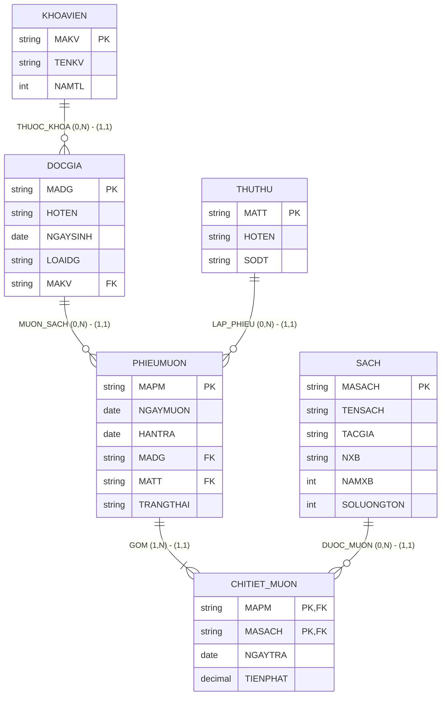

# HƯỚNG DẪN CHẤM & LỜI GIẢI CHI TIẾT (MOCK-07)
**Môn học:** IT004 — Cơ sở dữ liệu | **Thời gian thi:** 75 phút | **Thang điểm:** 10.0
**Tác giả biên soạn:** VÕ TRỌNG PHÚC — CSDL_UIT Master Series

---

## CÂU 1: THIẾT KẾ MÔ HÌNH DỮ LIỆU (2.5 ĐIỂM)

### 1.1. Phân tích thực thể, mối kết hợp & Sơ đồ ERD (1.50 điểm)

#### A. Xác định các tập thực thể và thuộc tính
1. **`KHOAVIEN`** (Khoa/Viện đào tạo):
   - Thuộc tính khóa: `MAKV` (Mã khoa viện).
   - Thuộc tính mô tả: `TENKV` (Tên khoa viện), `NAMTL` (Năm thành lập).
2. **`DOCGIA`** (Độc giả thư viện):
   - Thuộc tính khóa: `MADG` (Mã độc giả).
   - Thuộc tính mô tả: `HOTEN` (Họ tên), `NGAYSINH` (Ngày sinh), `LOAIDG` (Loại độc giả: 'Sinh viên' / 'Giảng viên').
3. **`SACH`** (Tài liệu sách in):
   - Thuộc tính khóa: `MASACH` (Mã sách).
   - Thuộc tính mô tả: `TENSACH` (Tên sách), `TACGIA` (Tác giả), `NXB` (Nhà xuất bản), `NAMXB` (Năm xuất bản), `SOLUONGTON` (Số lượng tồn kho).
4. **`THUTHU`** (Cán bộ thư viện):
   - Thuộc tính khóa: `MATT` (Mã thủ thư).
   - Thuộc tính mô tả: `HOTEN` (Họ tên), `SODT` (Số điện thoại).
5. **`PHIEUMUON`** (Phiếu mượn tài liệu):
   - Thuộc tính khóa: `MAPM` (Mã phiếu mượn).
   - Thuộc tính mô tả: `NGAYMUON` (Ngày mượn), `HANTRA` (Hạn trả dự kiến), `TRANGTHAI` (Trạng thái: 'Đang mượn' / 'Đã đóng').

#### B. Xác định mối kết hợp & Bản số (Min, Max)
1. **`THUOC_KHOA`** (giữa `KHOAVIEN` và `DOCGIA`):
   - Một khoa viện có từ 0 đến nhiều độc giả: Bản số $(0, N)$.
   - Một độc giả bắt buộc thuộc đúng 1 khoa viện: Bản số $(1, 1)$.
2. **`LAP_PHIEU`** (giữa `THUTHU` và `PHIEUMUON`):
   - Một thủ thư có thể lập từ 0 đến nhiều phiếu mượn: Bản số $(0, N)$.
   - Một phiếu mượn do đúng 1 thủ thư lập: Bản số $(1, 1)$.
3. **`MUON_SACH`** (giữa `DOCGIA` và `PHIEUMUON`):
   - Một độc giả có thể có từ 0 đến nhiều phiếu mượn: Bản số $(0, N)$.
   - Một phiếu mượn thuộc về đúng 1 độc giả: Bản số $(1, 1)$.
4. **`CHITIET_MUON`** (giữa `PHIEUMUON` và `SACH`):
   - Mối kết hợp Nhiều - Nhiều ($M:N$).
   - Một phiếu mượn mượn ít nhất 1 cuốn sách: Bản số $(1, N)$.
   - Một cuốn sách có thể được mượn trong 0 hoặc nhiều phiếu: Bản số $(0, N)$.
   - Thuộc tính mối kết hợp: `NGAYTRA` (Ngày trả thực tế), `TIENPHAT` (Tiền phạt phát sinh).

#### C. Sơ đồ Thực thể – Mối kết hợp (ERD)



---

### 1.2. Ánh xạ sang Lược đồ CSDL Quan hệ (1.00 điểm)

Chuyển đổi các tập thực thể và mối kết hợp theo các quy tắc chuẩn:
1. `KHOAVIEN` (**<u>MAKV</u>**, TENKV, NAMTL)
   - Khóa chính (PK): `MAKV`.
2. `DOCGIA` (**<u>MADG</u>**, HOTEN, NGAYSINH, LOAIDG, MAKV)
   - Khóa chính (PK): `MADG`.
   - Khóa ngoại (FK): `MAKV` tham chiếu đến `KHOAVIEN(MAKV)`.
3. `SACH` (**<u>MASACH</u>**, TENSACH, TACGIA, NXB, NAMXB, SOLUONGTON)
   - Khóa chính (PK): `MASACH`.
4. `THUTHU` (**<u>MATT</u>**, HOTEN, SODT)
   - Khóa chính (PK): `MATT`.
5. `PHIEUMUON` (**<u>MAPM</u>**, NGAYMUON, HANTRA, MADG, MATT, TRANGTHAI)
   - Khóa chính (PK): `MAPM`.
   - Khóa ngoại (FK): `MADG` tham chiếu đến `DOCGIA(MADG)`.
   - Khóa ngoại (FK): `MATT` tham chiếu đến `THUTHU(MATT)`.
6. `CHITIET_MUON` (**<u>MAPM</u>**, **<u>MASACH</u>**, NGAYTRA, TIENPHAT)
   - Khóa chính phức hợp (PK): (`MAPM`, `MASACH`).
   - Khóa ngoại (FK): `MAPM` tham chiếu đến `PHIEUMUON(MAPM)`.
   - Khóa ngoại (FK): `MASACH` tham chiếu đến `SACH(MASACH)`.

---

## CÂU 2: SQL & ĐẠI SỐ QUAN HỆ (7.5 ĐIỂM)

### 2.1. Viết các câu lệnh SQL (1.5 điểm)

#### a. Tạo ràng buộc CHECK kiểm tra số lượng tồn và tiền phạt (0.75 điểm)
```sql
ALTER TABLE SACH
ADD CONSTRAINT CK_SACH_SOLUONGTON CHECK (SOLUONGTON >= 0);

ALTER TABLE CHITIET_MUON
ADD CONSTRAINT CK_CTMUON_TIENPHAT CHECK (TIENPHAT >= 0);
```
*Ghi chú chính sách dữ liệu:* Hai thuộc tính này phải được định nghĩa `NOT NULL` khi tạo bảng để đảm bảo tính toàn vẹn nghiệp vụ.

#### b. Cập nhật gia hạn HANTRA thêm 15 ngày cho Giảng viên mượn sách tháng 10/2024 (0.75 điểm)
```sql
UPDATE PHIEUMUON
SET HANTRA = DATEADD(DAY, 15, HANTRA)
FROM PHIEUMUON pm
JOIN DOCGIA dg ON pm.MADG = dg.MADG
WHERE dg.LOAIDG = N'Giảng viên'
  AND pm.NGAYMUON >= '2024-10-01'
  AND pm.NGAYMUON <= '2024-10-31';
```

---

### 2.2. Viết các biểu thức Đại số quan hệ (6.0 điểm)

#### a. Liệt kê sinh viên thuộc khoa 'Khoa học Máy tính' (1.0 điểm)
- **Đại số quan hệ:**
  $$E_1 = \sigma_{LOAIDG = \text{'Sinh viên'}}(DOCGIA)$$
  $$E_2 = \sigma_{TENKV = \text{'Khoa học Máy tính'}}(KHOAVIEN)$$
  $$E_3 = E_1 \bowtie E_2$$
  $$\text{KQ} = \pi_{MADG, HOTEN, NGAYSINH}(E_3)$$
- **T-SQL tương đương:**
```sql
SELECT dg.MADG, dg.HOTEN, dg.NGAYSINH
FROM DOCGIA dg
JOIN KHOAVIEN kv ON dg.MAKV = kv.MAKV
WHERE dg.LOAIDG = N'Sinh viên'
  AND kv.TENKV = N'Khoa học Máy tính';
```

#### b. Sách của 'NXB Giáo Dục' được mượn bởi độc giả 'DG01' (1.0 điểm)
- **Đại số quan hệ:**
  $$E_1 = \sigma_{MADG = \text{'DG01'}}(PHIEUMUON)$$
  $$E_2 = E_1 \bowtie CHITIET_MUON$$
  $$E_3 = \sigma_{NXB = \text{'NXB Giáo Dục'}}(SACH)$$
  $$E_4 = E_2 \bowtie E_3$$
  $$\text{KQ} = \pi_{MASACH, TENSACH, NXB}(E_4)$$
- **T-SQL tương đương:**
```sql
SELECT s.MASACH, s.TENSACH, s.NXB
FROM PHIEUMUON pm
JOIN CHITIET_MUON ct ON pm.MAPM = ct.MAPM
JOIN SACH s ON ct.MASACH = s.MASACH
WHERE pm.MADG = 'DG01'
  AND s.NXB = N'NXB Giáo Dục';
```

#### c. Liệt kê tất cả khoa viện và độc giả (nếu có) (1.0 điểm)
- **Đại số quan hệ:**
  $$E_1 = KHOAVIEN = \bowtie DOCGIA$$
  $$\text{KQ} = \pi_{MAKV, TENKV, MADG, HOTEN}(E_1)$$
- **T-SQL tương đương:**
```sql
SELECT kv.MAKV, kv.TENKV, dg.MADG, dg.HOTEN
FROM KHOAVIEN kv
LEFT JOIN DOCGIA dg ON kv.MAKV = dg.MAKV;
```

#### d. Tổng tiền phạt theo từng độc giả trong năm 2024 (1.0 điểm)
- **Đại số quan hệ:**
  $$E_1 = \sigma_{NGAYMUON \ge \text{'2024-01-01'} \wedge NGAYMUON \le \text{'2024-12-31'}}(PHIEUMUON)$$
  $$E_2 = \sigma_{TIENPHAT > 0}(CHITIET_MUON)$$
  $$E_3 = E_1 \bowtie E_2$$
  $$E_4 = \gamma_{MADG, \text{SUM}(TIENPHAT) \to TONG_TIEN_PHAT}(E_3)$$
  $$E_5 = E_4 \bowtie DOCGIA$$
  $$\text{KQ} = \pi_{MADG, HOTEN, TONG_TIEN_PHAT}(E_5)$$
- **T-SQL tương đương:**
```sql
SELECT dg.MADG, dg.HOTEN, SUM(ct.TIENPHAT) AS TONG_TIEN_PHAT
FROM PHIEUMUON pm
JOIN CHITIET_MUON ct ON pm.MAPM = ct.MAPM
JOIN DOCGIA dg ON pm.MADG = dg.MADG
WHERE pm.NGAYMUON >= '2024-01-01'
  AND pm.NGAYMUON <= '2024-12-31'
  AND ct.TIENPHAT > 0
GROUP BY dg.MADG, dg.HOTEN;
```

#### e. Độc giả đã mượn tất cả các sách của tác giả 'Nguyễn Nhật Ánh' (1.0 điểm)
- **Đại số quan hệ (Phép chia):**
  $$R = \pi_{MADG, MASACH}(PHIEUMUON \bowtie CHITIET_MUON)$$
  $$S = \pi_{MASACH}(\sigma_{TACGIA = \text{'Nguyễn Nhật Ánh'}}(SACH))$$
  $$E_{\text{DIV}} = R \div S$$
  $$\text{KQ} = \pi_{MADG, HOTEN, LOAIDG}(E_{\text{DIV}} \bowtie DOCGIA)$$
- **T-SQL tương đương (Double NOT EXISTS bounded to candidate readers):**
```sql
SELECT dg.MADG, dg.HOTEN, dg.LOAIDG
FROM DOCGIA dg
WHERE EXISTS (
    SELECT 1 FROM PHIEUMUON pm
    JOIN CHITIET_MUON ct ON pm.MAPM = ct.MAPM
    WHERE pm.MADG = dg.MADG
)
AND NOT EXISTS (
    SELECT 1 FROM SACH s
    WHERE s.TACGIA = N'Nguyễn Nhật Ánh'
      AND NOT EXISTS (
          SELECT 1 FROM PHIEUMUON pm2
          JOIN CHITIET_MUON ct2 ON pm2.MAPM = ct2.MAPM
          WHERE pm2.MADG = dg.MADG
            AND ct2.MASACH = s.MASACH
      )
);
```
*Cách giải T-SQL phụ (HAVING COUNT):*
```sql
WITH R AS (
    SELECT DISTINCT pm.MADG, ct.MASACH
    FROM PHIEUMUON pm
    JOIN CHITIET_MUON ct ON pm.MAPM = ct.MAPM
),
S AS (
    SELECT MASACH FROM SACH WHERE TACGIA = N'Nguyễn Nhật Ánh'
)
SELECT dg.MADG, dg.HOTEN, dg.LOAIDG
FROM DOCGIA dg
JOIN (
    SELECT R.MADG
    FROM R
    LEFT JOIN S ON R.MASACH = S.MASACH
    GROUP BY R.MADG
    HAVING COUNT(DISTINCT S.MASACH) = (SELECT COUNT(*) FROM S)
) div ON dg.MADG = div.MADG;
```

#### f. Cuốn sách có số lượt mượn nhiều nhất năm 2024 (1.0 điểm)
- **Đại số quan hệ (Cực trị bảo toàn đồng hạng):**
  $$E_1 = \sigma_{NGAYMUON \ge \text{'2024-01-01'} \wedge NGAYMUON \le \text{'2024-12-31'}}(PHIEUMUON)$$
  $$E_2 = E_1 \bowtie CHITIET_MUON$$
  $$E_{\text{DEM}} = \gamma_{MASACH, \text{COUNT}(MAPM) \to SO_LUOT_MUON}(E_2)$$
  $$E_{\text{NHO_HON}} = \pi_{MASACH, SO_LUOT_MUON}(E_{\text{DEM}} \bowtie_{SO_LUOT_MUON < SO_LUOT_MUON2} \rho_{MASACH2, SO_LUOT_MUON2}(E_{\text{DEM}}))$$
  $$E_{\text{MAX}} = E_{\text{DEM}} - E_{\text{NHO_HON}}$$
  $$\text{KQ} = \pi_{MASACH, TENSACH, TACGIA, SO_LUOT_MUON}(E_{\text{MAX}} \bowtie SACH)$$
- **T-SQL tương đương:**
```sql
WITH ThongKe AS (
    SELECT ct.MASACH, COUNT(pm.MAPM) AS SO_LUOT_MUON
    FROM PHIEUMUON pm
    JOIN CHITIET_MUON ct ON pm.MAPM = ct.MAPM
    WHERE pm.NGAYMUON >= '2024-01-01'
      AND pm.NGAYMUON <= '2024-12-31'
    GROUP BY ct.MASACH
)
SELECT s.MASACH, s.TENSACH, s.TACGIA, tk.SO_LUOT_MUON
FROM SACH s
JOIN ThongKe tk ON s.MASACH = tk.MASACH
WHERE tk.SO_LUOT_MUON = (SELECT MAX(SO_LUOT_MUON) FROM ThongKe);
```

---

## BẢNG PHÂN BỔ ĐIỂM CHI TIẾT (RUBRIC)

| Câu hỏi | Nội dung đánh giá | Điểm tối đa |
|:---|:---|:---:|
| **Câu 1.1** | Tập thực thể (5), thuộc tính khóa và mô tả đầy đủ | 0.50 đ |
| | Xác định đúng mối kết hợp và bản số min-max 2 phía | 0.50 đ |
| | Vẽ đúng mô hình ERD theo chuẩn | 0.50 đ |
| **Câu 1.2** | Ánh xạ 6 bảng, gạch dưới Khóa chính (PK) | 0.50 đ |
| | Khai báo Khóa ngoại (FK) chỉ rõ bảng tham chiếu đúng nghiệp vụ | 0.50 đ |
| **Câu 2.1a** | Cú pháp ALTER TABLE ... ADD CONSTRAINT CHECK đúng cho 2 bảng | 0.75 đ |
| **Câu 2.1b** | UPDATE ... FROM ... JOIN đúng điều kiện LOAIDG & khoảng thời gian | 0.75 đ |
| **Câu 2.2a** | Biểu thức chọn $\sigma$ và phép kết nối, chiếu $\pi$ đúng | 1.00 đ |
| **Câu 2.2b** | Kết nối 3 bảng qua khóa ngoại, điều kiện đúng | 1.00 đ |
| **Câu 2.2c** | Phép kết ngoài trái $\leftouterjoin$ bảo toàn khoa chưa có độc giả | 1.00 đ |
| **Câu 2.2d** | Gom nhóm $\gamma$, hàm SUM, điều kiện năm 2024 & TIENPHAT > 0 | 1.00 đ |
| **Câu 2.2e** | Phép chia $R \div S$ xác định đúng tập bị chia, tập chia và kết quả | 1.00 đ |
| **Câu 2.2f** | Gom nhóm đếm, tìm giá trị lớn nhất bảo toàn đồng hạng | 1.00 đ |
| **TỔNG CỘNG** | **Toàn bộ đề thi giữa kỳ mô phỏng số 07** | **10.00 đ** |
