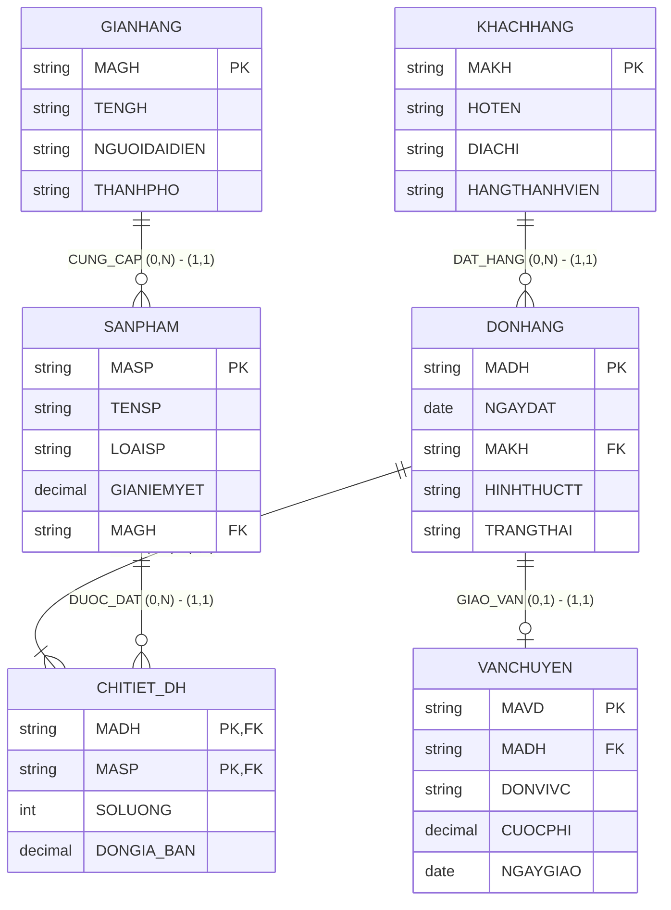

# HƯỚNG DẪN CHẤM & LỜI GIẢI CHI TIẾT (MOCK-08)
**Môn học:** IT004 — Cơ sở dữ liệu | **Thời gian thi:** 75 phút | **Thang điểm:** 10.0
**Tác giả biên soạn:** VÕ TRỌNG PHÚC — CSDL_UIT Master Series

---

## CÂU 1: THIẾT KẾ MÔ HÌNH DỮ LIỆU (2.5 ĐIỂM)

### 1.1. Phân tích thực thể, mối kết hợp & Sơ đồ ERD (1.50 điểm)

#### A. Xác định các tập thực thể và thuộc tính
1. **`GIANHANG`** (Gian hàng người bán):
   - Thuộc tính khóa: `MAGH` (Mã gian hàng).
   - Thuộc tính mô tả: `TENGH` (Tên gian hàng), `NGUOIDAIDIEN` (Họ tên người đại diện), `THANHPHO` (Thành phố đặt kho hàng).
2. **`SANPHAM`** (Hàng hóa đăng bán):
   - Thuộc tính khóa: `MASP` (Mã sản phẩm).
   - Thuộc tính mô tả: `TENSP` (Tên sản phẩm), `LOAISP` (Phân loại sản phẩm), `GIANIEMYET` (Giá niêm yết hiện hành).
3. **`KHACHHANG`** (Khách hàng mua hàng):
   - Thuộc tính khóa: `MAKH` (Mã khách hàng).
   - Thuộc tính mô tả: `HOTEN` (Họ tên), `DIACHI` (Địa chỉ giao hàng), `HANGTHANHVIEN` (Hạng thành viên: Standard, Silver, Gold, Diamond).
4. **`DONHANG`** (Đơn đặt hàng trực tuyến):
   - Thuộc tính khóa: `MADH` (Mã đơn hàng).
   - Thuộc tính mô tả: `NGAYDAT` (Ngày giờ đặt hàng), `HINHTHUCTT` (Hình thức thanh toán: 'COD', 'Ví điện tử', 'Thẻ tín dụng'), `TRANGTHAI` (Trạng thái: 'Chờ giao', 'Đã giao', 'Đã hủy').
5. **`VANCHUYEN`** (Vận đơn giao nhận):
   - Thuộc tính khóa: `MAVD` (Mã vận đơn).
   - Thuộc tính mô tả: `DONVIVC` (Đơn vị vận chuyển), `CUOCPHI` (Cước phí vận chuyển), `NGAYGIAO` (Ngày giao thực tế).

#### B. Xác định mối kết hợp & Bản số (Min, Max)
1. **`CUNG_CAP`** (giữa `GIANHANG` và `SANPHAM`):
   - Một gian hàng có thể đăng bán từ 0 đến nhiều sản phẩm: Bản số $(0, N)$.
   - Một sản phẩm bắt buộc trực thuộc đúng 1 gian hàng cung ứng: Bản số $(1, 1)$.
2. **`DAT_HANG`** (giữa `KHACHHANG` và `DONHANG`):
   - Một khách hàng có thể đặt từ 0 đến nhiều đơn hàng: Bản số $(0, N)$.
   - Một đơn hàng bắt buộc thuộc về đúng 1 khách hàng: Bản số $(1, 1)$.
3. **`GIAO_VAN`** (giữa `DONHANG` và `VANCHUYEN`):
   - Một đơn hàng có thể có tối đa 1 phiếu giao hàng: Bản số $(0, 1)$.
   - Một phiếu giao hàng phục vụ đúng 1 đơn hàng: Bản số $(1, 1)$.
4. **`CHITIET_DH`** (giữa `DONHANG` và `SANPHAM`):
   - Mối kết hợp Nhiều - Nhiều ($M:N$).
   - Một đơn hàng chứa ít nhất 1 sản phẩm: Bản số $(1, N)$.
   - Một sản phẩm có thể xuất hiện trong 0 hoặc nhiều đơn hàng: Bản số $(0, N)$.
   - Thuộc tính mối kết hợp: `SOLUONG` (Số lượng mua), `DONGIA_BAN` (Đơn giá bán thực tế).

#### C. Sơ đồ Thực thể – Mối kết hợp (ERD)



---

### 1.2. Ánh xạ sang Lược đồ CSDL Quan hệ (1.00 điểm)

Chuyển đổi các tập thực thể và mối kết hợp theo các quy tắc chuẩn:
1. `GIANHANG` (**<u>MAGH</u>**, TENGH, NGUOIDAIDIEN, THANHPHO)
   - Khóa chính (PK): `MAGH`.
2. `SANPHAM` (**<u>MASP</u>**, TENSP, LOAISP, GIANIEMYET, MAGH)
   - Khóa chính (PK): `MASP`.
   - Khóa ngoại (FK): `MAGH` tham chiếu đến `GIANHANG(MAGH)`.
3. `KHACHHANG` (**<u>MAKH</u>**, HOTEN, DIACHI, HANGTHANHVIEN)
   - Khóa chính (PK): `MAKH`.
4. `DONHANG` (**<u>MADH</u>**, NGAYDAT, MAKH, HINHTHUCTT, TRANGTHAI)
   - Khóa chính (PK): `MADH`.
   - Khóa ngoại (FK): `MAKH` tham chiếu đến `KHACHHANG(MAKH)`.
5. `CHITIET_DH` (**<u>MADH</u>**, **<u>MASP</u>**, SOLUONG, DONGIA_BAN)
   - Khóa chính phức hợp (PK): (`MADH`, `MASP`).
   - Khóa ngoại (FK): `MADH` tham chiếu đến `DONHANG(MADH)`.
   - Khóa ngoại (FK): `MASP` tham chiếu đến `SANPHAM(MASP)`.
6. `VANCHUYEN` (**<u>MAVD</u>**, MADH, DONVIVC, CUOCPHI, NGAYGIAO)
   - Khóa chính (PK): `MAVD`.
   - Khóa ngoại (FK): `MADH` tham chiếu đến `DONHANG(MADH)`.

---

## CÂU 2: SQL & ĐẠI SỐ QUAN HỆ (7.5 ĐIỂM)

### 2.1. Viết các câu lệnh SQL (1.5 điểm)

#### a. Tạo ràng buộc CHECK kiểm tra số lượng và giá niêm yết (0.75 điểm)
```sql
ALTER TABLE CHITIET_DH
ADD CONSTRAINT CK_CTDH_SOLUONG CHECK (SOLUONG > 0);

ALTER TABLE SANPHAM
ADD CONSTRAINT CK_SANPHAM_GIANIEMYET CHECK (GIANIEMYET > 0);
```
*Ghi chú chính sách dữ liệu:* Hai thuộc tính này phải được định nghĩa `NOT NULL` khi tạo bảng để đảm bảo tính toàn vẹn nghiệp vụ.

#### b. Cập nhật giảm giá 10% hàng gia dụng của người đại diện Lê Hoàng Nam (0.75 điểm)
```sql
UPDATE SANPHAM
SET GIANIEMYET = GIANIEMYET * 0.90
FROM SANPHAM sp
JOIN GIANHANG gh ON sp.MAGH = gh.MAGH
WHERE gh.NGUOIDAIDIEN = N'Lê Hoàng Nam'
  AND sp.LOAISP = N'Gia dụng';
```

---

### 2.2. Viết các biểu thức Đại số quan hệ (6.0 điểm)

#### a. Liệt kê sản phẩm 'Điện tử' có giá từ 10.000.000 trở lên (1.0 điểm)
- **Đại số quan hệ:**
  $$E_1 = \sigma_{LOAISP = \text{'Điện tử'} \wedge GIANIEMYET \ge 10000000}(SANPHAM)$$
  $$\text{KQ} = \pi_{MASP, TENSP, GIANIEMYET}(E_1)$$
- **T-SQL tương đương:**
```sql
SELECT MASP, TENSP, GIANIEMYET
FROM SANPHAM
WHERE LOAISP = N'Điện tử'
  AND GIANIEMYET >= 10000000;
```

#### b. Đơn hàng của khách hàng tại Hà Nội thanh toán Ví điện tử (1.0 điểm)
- **Đại số quan hệ:**
  $$E_1 = \sigma_{DIACHI = \text{'Hà Nội'}}(KHACHHANG)$$
  $$E_2 = \sigma_{HINHTHUCTT = \text{'Ví điện tử'}}(DONHANG)$$
  $$E_3 = E_1 \bowtie E_2$$
  $$\text{KQ} = \pi_{MADH, NGAYDAT, HINHTHUCTT, HOTEN}(E_3)$$
- **T-SQL tương đương:**
```sql
SELECT dh.MADH, dh.NGAYDAT, dh.HINHTHUCTT, kh.HOTEN
FROM DONHANG dh
JOIN KHACHHANG kh ON dh.MAKH = kh.MAKH
WHERE kh.DIACHI = N'Hà Nội'
  AND dh.HINHTHUCTT = N'Ví điện tử';
```

#### c. Liệt kê tất cả các gian hàng và sản phẩm nếu có (1.0 điểm)
- **Đại số quan hệ:**
  $$E_1 = GIANHANG = \bowtie SANPHAM$$
  $$\text{KQ} = \pi_{MAGH, TENGH, MASP, TENSP}(E_1)$$
- **T-SQL tương đương:**
```sql
SELECT gh.MAGH, gh.TENGH, sp.MASP, sp.TENSP
FROM GIANHANG gh
LEFT JOIN SANPHAM sp ON gh.MAGH = sp.MAGH;
```

#### d. Tính tổng giá trị tiền hàng theo từng đơn hàng tháng 11/2024 (1.0 điểm)
- **Đại số quan hệ:**
  $$E_1 = \sigma_{NGAYDAT \ge \text{'2024-11-01'} \wedge NGAYDAT \le \text{'2024-11-30'} \wedge TRANGTHAI = \text{'Đã giao'}}(DONHANG)$$
  $$E_2 = \pi_{MADH, SOLUONG * DONGIA_BAN \to THANHTIEN}(CHITIET_DH)$$
  $$E_3 = \gamma_{MADH, \text{SUM}(THANHTIEN) \to TONG_TIEN_HANG}(E_2)$$
  $$E_4 = E_1 \bowtie E_3$$
  $$\text{KQ} = \pi_{MADH, NGAYDAT, TONG_TIEN_HANG}(E_4)$$
- **T-SQL tương đương:**
```sql
SELECT dh.MADH, dh.NGAYDAT, SUM(ct.SOLUONG * ct.DONGIA_BAN) AS TONG_TIEN_HANG
FROM DONHANG dh
JOIN CHITIET_DH ct ON dh.MADH = ct.MADH
WHERE dh.NGAYDAT >= '2024-11-01'
  AND dh.NGAYDAT <= '2024-11-30'
  AND dh.TRANGTHAI = N'Đã giao'
GROUP BY dh.MADH, dh.NGAYDAT;
```

#### e. Đơn hàng đã mua tất cả sản phẩm 'Gia dụng' của gian hàng 'Gia Dụng Thông Minh' (1.0 điểm)
- **Đại số quan hệ (Phép chia):**
  $$R = \pi_{MADH, MASP}(CHITIET_DH)$$
  $$S = \pi_{MASP}(\sigma_{LOAISP = \text{'Gia dụng'}}(SANPHAM) \bowtie \sigma_{TENGH = \text{'Gia Dụng Thông Minh'}}(GIANHANG))$$
  $$E_{\text{DIV}} = R \div S$$
  $$\text{KQ} = \pi_{MADH, NGAYDAT, MAKH}(E_{\text{DIV}} \bowtie DONHANG)$$
- **T-SQL tương đương (Double NOT EXISTS bounded to candidate orders):**
```sql
SELECT dh.MADH, dh.NGAYDAT, dh.MAKH
FROM DONHANG dh
WHERE EXISTS (
    SELECT 1 FROM CHITIET_DH ct
    WHERE ct.MADH = dh.MADH
)
AND NOT EXISTS (
    SELECT 1 FROM SANPHAM sp
    JOIN GIANHANG gh ON sp.MAGH = gh.MAGH
    WHERE sp.LOAISP = N'Gia dụng'
      AND gh.TENGH = N'Gia Dụng Thông Minh'
      AND NOT EXISTS (
          SELECT 1 FROM CHITIET_DH ct2
          WHERE ct2.MADH = dh.MADH
            AND ct2.MASP = sp.MASP
      )
);
```
*Cách giải T-SQL phụ (HAVING COUNT):*
```sql
WITH R AS (
    SELECT DISTINCT MADH, MASP
    FROM CHITIET_DH
),
S AS (
    SELECT sp.MASP
    FROM SANPHAM sp
    JOIN GIANHANG gh ON sp.MAGH = gh.MAGH
    WHERE sp.LOAISP = N'Gia dụng'
      AND gh.TENGH = N'Gia Dụng Thông Minh'
)
SELECT dh.MADH, dh.NGAYDAT, dh.MAKH
FROM DONHANG dh
JOIN (
    SELECT R.MADH
    FROM R
    LEFT JOIN S ON R.MASP = S.MASP
    GROUP BY R.MADH
    HAVING COUNT(DISTINCT S.MASP) = (SELECT COUNT(*) FROM S)
) div ON dh.MADH = div.MADH;
```

#### f. Khách hàng có tổng số lượng sản phẩm đã mua nhiều nhất tháng 11/2024 (1.0 điểm)
- **Đại số quan hệ (Cực trị bảo toàn đồng hạng):**
  $$E_1 = \sigma_{NGAYDAT \ge \text{'2024-11-01'} \wedge NGAYDAT \le \text{'2024-11-30'}}(DONHANG) \bowtie CHITIET_DH$$
  $$E_{\text{DEM}} = \gamma_{MAKH, \text{SUM}(SOLUONG) \to TONG_SOLUONG}(E_1)$$
  $$E_{\text{NHO_HON}} = \pi_{MAKH, TONG_SOLUONG}(E_{\text{DEM}} \bowtie_{TONG_SOLUONG < TONG_SOLUONG2} \rho_{MAKH2, TONG_SOLUONG2}(E_{\text{DEM}}))$$
  $$E_{\text{MAX}} = E_{\text{DEM}} - E_{\text{NHO_HON}}$$
  $$\text{KQ} = \pi_{MAKH, HOTEN, HANGTHANHVIEN, TONG_SOLUONG}(E_{\text{MAX}} \bowtie KHACHHANG)$$
- **T-SQL tương đương:**
```sql
WITH ThongKe AS (
    SELECT dh.MAKH, SUM(ct.SOLUONG) AS TONG_SOLUONG
    FROM DONHANG dh
    JOIN CHITIET_DH ct ON dh.MADH = ct.MADH
    WHERE dh.NGAYDAT >= '2024-11-01'
      AND dh.NGAYDAT <= '2024-11-30'
    GROUP BY dh.MAKH
)
SELECT kh.MAKH, kh.HOTEN, kh.HANGTHANHVIEN, tk.TONG_SOLUONG
FROM KHACHHANG kh
JOIN ThongKe tk ON kh.MAKH = tk.MAKH
WHERE tk.TONG_SOLUONG = (SELECT MAX(TONG_SOLUONG) FROM ThongKe);
```

---

## BẢNG PHÂN BỔ ĐIỂM CHI TIẾT (RUBRIC)

| Câu hỏi | Nội dung đánh giá | Điểm tối đa |
|:---|:---|:---:|
| **Câu 1.1** | Tập thực thể (5), thuộc tính khóa và mô tả đầy đủ | 0.50 đ |
| | Xác định đúng mối kết hợp và bản số min-max 2 phía | 0.50 đ |
| | Vẽ đúng mô hình ERD theo chuẩn Mermaid | 0.50 đ |
| **Câu 1.2** | Ánh xạ 6 bảng, gạch dưới Khóa chính (PK) | 0.50 đ |
| | Khai báo Khóa ngoại (FK) chỉ rõ bảng tham chiếu đúng nghiệp vụ | 0.50 đ |
| **Câu 2.1a** | Cú pháp ALTER TABLE ... ADD CONSTRAINT CHECK đúng cho 2 bảng | 0.75 đ |
| **Câu 2.1b** | UPDATE ... FROM ... JOIN đúng điều kiện người đại diện & loại SP | 0.75 đ |
| **Câu 2.2a** | Biểu thức chọn $\sigma$ và chiếu $\pi$ đúng | 1.00 đ |
| **Câu 2.2b** | Kết nối 2 bảng qua khóa ngoại, điều kiện đúng | 1.00 đ |
| **Câu 2.2c** | Phép kết ngoài trái $\leftouterjoin$ bảo toàn gian hàng chưa có sản phẩm | 1.00 đ |
| **Câu 2.2d** | Gom nhóm $\gamma$, hàm SUM, điều kiện tháng 11/2024 & trạng thái | 1.00 đ |
| **Câu 2.2e** | Phép chia $R \div S$ xác định đúng tập bị chia, tập chia và kết quả | 1.00 đ |
| **Câu 2.2f** | Gom nhóm tính tổng số lượng, tìm giá trị lớn nhất bảo toàn đồng hạng | 1.00 đ |
| **TỔNG CỘNG** | **Toàn bộ đề thi giữa kỳ mô phỏng số 08** | **10.00 đ** |
