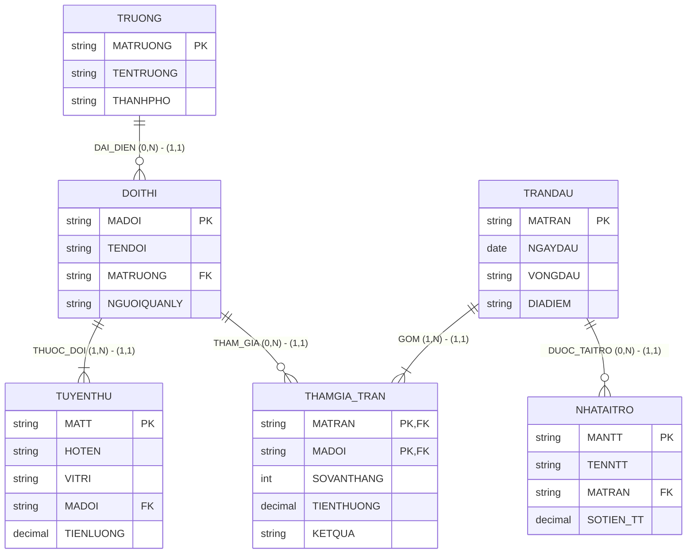

# HƯỚNG DẪN CHẤM & LỜI GIẢI CHI TIẾT (MOCK-09)
**Môn học:** IT004 — Cơ sở dữ liệu | **Thời gian thi:** 75 phút | **Thang điểm:** 10.0
**Tác giả biên soạn:** VÕ TRỌNG PHÚC — CSDL_UIT Master Series

---

## CÂU 1: THIẾT KẾ MÔ HÌNH DỮ LIỆU (2.0 ĐIỂM)

### 1.1. Phân tích thực thể, mối kết hợp & Sơ đồ ERD (1.20 điểm)

#### A. Xác định các tập thực thể và thuộc tính
1. **`TRUONG`** (Trường đại học tham dự):
   - Thuộc tính khóa: `MATRUONG` (Mã trường).
   - Thuộc tính mô tả: `TENTRUONG` (Tên trường đại học), `THANHPHO` (Thành phố trụ sở).
2. **`DOITHI`** (Đội tuyển thi đấu):
   - Thuộc tính khóa: `MADOI` (Mã đội).
   - Thuộc tính mô tả: `TENDOI` (Tên đội tuyển), `NGUOIQUANLY` (Người quản lý đội).
3. **`TUYENTHU`** (Vận động viên / Tuyển thủ):
   - Thuộc tính khóa: `MATT` (Mã tuyển thủ).
   - Thuộc tính mô tả: `HOTEN` (Họ tên), `VITRI` (Vị trí thi đấu), `TIENLUONG` (Thù lao theo mùa).
4. **`TRANDAU`** (Trận đấu theo lịch trình):
   - Thuộc tính khóa: `MATRAN` (Mã trận đấu).
   - Thuộc tính mô tả: `NGAYDAU` (Ngày thi đấu), `VONGDAU` (Vòng đấu), `DIADIEM` (Địa điểm thi đấu).
5. **`NHATAITRO`** (Nhà tài trợ thương mại):
   - Thuộc tính khóa: `MANTT` (Mã nhà tài trợ).
   - Thuộc tính mô tả: `TENNTT` (Tên nhà tài trợ), `SOTIEN_TT` (Số tiền tài trợ).

#### B. Xác định mối kết hợp & Bản số (Min, Max)
1. **`DAI_DIEN`** (giữa `TRUONG` và `DOITHI`):
   - Một trường có thể có từ 0 đến nhiều đội tuyển: Bản số $(0, N)$.
   - Một đội tuyển đại diện cho đúng 1 trường: Bản số $(1, 1)$.
2. **`THUOC_DOI`** (giữa `DOITHI` và `TUYENTHU`):
   - Một đội tuyển có nhiều tuyển thủ thi đấu: Bản số $(1, N)$.
   - Một tuyển thủ thi đấu cho đúng 1 đội tuyển: Bản số $(1, 1)$.
3. **`THAMGIA_TRAN`** (giữa `TRANDAU` và `DOITHI`):
   - Mối kết hợp Nhiều - Nhiều ($M:N$).
   - Một trận đấu có đúng 2 đội tham gia: Bản số $(2, 2)$ (trong ERD khái niệm tổng quát là $(1, N)$).
   - Một đội tuyển có thể tham gia 0 hoặc nhiều trận: Bản số $(0, N)$.
   - Thuộc tính mối kết hợp: `SOVANTHANG` (Số ván thắng), `TIENTHUONG` (Tiền thưởng), `KETQUA` (Kết quả: 'Thắng' / 'Thua').
4. **`TAI_TRO`** (giữa `NHATAITRO` và `TRANDAU`):
   - Một trận đấu có thể được tài trợ bởi 0 hoặc nhiều nhà tài trợ: Bản số $(0, N)$.
   - Một nhà tài trợ tài trợ cho đúng 1 trận đấu: Bản số $(1, 1)$.

#### C. Sơ đồ Thực thể – Mối kết hợp (ERD)



---

### 1.2. Ánh xạ sang Lược đồ CSDL Quan hệ (0.80 điểm)

Chuyển đổi các tập thực thể và mối kết hợp theo các quy tắc chuẩn:
1. `TRUONG` (**<u>MATRUONG</u>**, TENTRUONG, THANHPHO)
   - Khóa chính (PK): `MATRUONG`.
2. `DOITHI` (**<u>MADOI</u>**, TENDOI, MATRUONG, NGUOIQUANLY)
   - Khóa chính (PK): `MADOI`.
   - Khóa ngoại (FK): `MATRUONG` tham chiếu đến `TRUONG(MATRUONG)`.
3. `TUYENTHU` (**<u>MATT</u>**, HOTEN, VITRI, MADOI, TIENLUONG)
   - Khóa chính (PK): `MATT`.
   - Khóa ngoại (FK): `MADOI` tham chiếu đến `DOITHI(MADOI)`.
4. `TRANDAU` (**<u>MATRAN</u>**, NGAYDAU, VONGDAU, DIADIEM)
   - Khóa chính (PK): `MATRAN`.
5. `THAMGIA_TRAN` (**<u>MATRAN</u>**, **<u>MADOI</u>**, SOVANTHANG, TIENTHUONG, KETQUA)
   - Khóa chính phức hợp (PK): (`MATRAN`, `MADOI`).
   - Khóa ngoại (FK): `MATRAN` tham chiếu đến `TRANDAU(MATRAN)`.
   - Khóa ngoại (FK): `MADOI` tham chiếu đến `DOITHI(MADOI)`.
6. `NHATAITRO` (**<u>MANTT</u>**, TENNTT, MATRAN, SOTIEN_TT)
   - Khóa chính (PK): `MANTT`.
   - Khóa ngoại (FK): `MATRAN` tham chiếu đến `TRANDAU(MATRAN)`.

---

## CÂU 2: SQL & ĐẠI SỐ QUAN HỆ (8.0 ĐIỂM)

### 2.1. Viết các câu lệnh SQL (1.5 điểm)

#### a. Tạo ràng buộc CHECK kiểm tra số ván thắng và tiền lương (0.75 điểm)
```sql
ALTER TABLE THAMGIA_TRAN
ADD CONSTRAINT CK_THAMGIA_SOVANTHANG CHECK (SOVANTHANG >= 0);

ALTER TABLE TUYENTHU
ADD CONSTRAINT CK_TUYENTHU_TIENLUONG CHECK (TIENLUONG > 0);
```
*Ghi chú chính sách dữ liệu:* Hai thuộc tính này phải được định nghĩa `NOT NULL` khi tạo bảng để đảm bảo tính toàn vẹn nghiệp vụ.

#### b. Cập nhật tăng 15% thù lao tuyển thủ Đường giữa của Đại học CNTT (0.75 điểm)
```sql
UPDATE TUYENTHU
SET TIENLUONG = TIENLUONG * 1.15
FROM TUYENTHU tt
JOIN DOITHI dt ON tt.MADOI = dt.MADOI
JOIN TRUONG tr ON dt.MATRUONG = tr.MATRUONG
WHERE tr.TENTRUONG = N'Đại học CNTT'
  AND tt.VITRI = N'Đường giữa';
```

---

### 2.2. Viết các biểu thức Đại số quan hệ (6.5 điểm)

#### a. Tuyển thủ Xạ thủ có thù lao từ 15 triệu trở lên (1.0 điểm)
- **Đại số quan hệ:**
  $$E_1 = \sigma_{VITRI = \text{'Xạ thủ'} \wedge TIENLUONG \ge 15000000}(TUYENTHU)$$
  $$\text{KQ} = \pi_{MATT, HOTEN, TIENLUONG}(E_1)$$
- **T-SQL tương đương:**
```sql
SELECT MATT, HOTEN, TIENLUONG
FROM TUYENTHU
WHERE VITRI = N'Xạ thủ'
  AND TIENLUONG >= 15000000;
```

#### b. Các trận đấu có đội tuyển UIT Hunters tham gia (1.0 điểm)
- **Đại số quan hệ:**
  $$E_1 = \sigma_{TENDOI = \text{'UIT Hunters'}}(DOITHI)$$
  $$E_2 = E_1 \bowtie THAMGIA_TRAN$$
  $$E_3 = E_2 \bowtie TRANDAU$$
  $$\text{KQ} = \pi_{MATRAN, NGAYDAU, VONGDAU, TENDOI}(E_3)$$
- **T-SQL tương đương:**
```sql
SELECT td.MATRAN, td.NGAYDAU, td.VONGDAU, dt.TENDOI
FROM TRANDAU td
JOIN THAMGIA_TRAN tgt ON td.MATRAN = tgt.MATRAN
JOIN DOITHI dt ON tgt.MADOI = dt.MADOI
WHERE dt.TENDOI = N'UIT Hunters';
```

#### c. Liệt kê tất cả các trường và đội tuyển nếu có (1.0 điểm)
- **Đại số quan hệ:**
  $$E_1 = TRUONG = \bowtie DOITHI$$
  $$\text{KQ} = \pi_{MATRUONG, TENTRUONG, MADOI, TENDOI}(E_1)$$
- **T-SQL tương đương:**
```sql
SELECT tr.MATRUONG, tr.TENTRUONG, dt.MADOI, dt.TENDOI
FROM TRUONG tr
LEFT JOIN DOITHI dt ON tr.MATRUONG = dt.MATRUONG;
```

#### d. Tổng tiền thưởng theo từng đội thắng trận tháng 11/2024 (1.0 điểm)
- **Đại số quan hệ:**
  $$E_1 = \sigma_{NGAYDAU \ge \text{'2024-11-01'} \wedge NGAYDAU \le \text{'2024-11-30'}}(TRANDAU)$$
  $$E_2 = \sigma_{KETQUA = \text{'Thắng'}}(THAMGIA_TRAN)$$
  $$E_3 = E_1 \bowtie E_2$$
  $$E_4 = \gamma_{MADOI, \text{SUM}(TIENTHUONG) \to TONG_TIEN_THUONG}(E_3)$$
  $$E_5 = E_4 \bowtie DOITHI$$
  $$\text{KQ} = \pi_{MADOI, TENDOI, TONG_TIEN_THUONG}(E_5)$$
- **T-SQL tương đương:**
```sql
SELECT dt.MADOI, dt.TENDOI, SUM(tgt.TIENTHUONG) AS TONG_TIEN_THUONG
FROM TRANDAU td
JOIN THAMGIA_TRAN tgt ON td.MATRAN = tgt.MATRAN
JOIN DOITHI dt ON tgt.MADOI = dt.MADOI
WHERE td.NGAYDAU >= '2024-11-01'
  AND td.NGAYDAU <= '2024-11-30'
  AND tgt.KETQUA = N'Thắng'
GROUP BY dt.MADOI, dt.TENDOI;
```

#### e. Đội thi đấu tại tất cả địa điểm thuộc Vòng bảng (1.0 điểm)
- **Đại số quan hệ (Phép chia):**
  $$R = \pi_{MADOI, DIADIEM}(THAMGIA_TRAN \bowtie TRANDAU)$$
  $$S = \pi_{DIADIEM}(\sigma_{VONGDAU = \text{'Vòng bảng'}}(TRANDAU))$$
  $$E_{\text{DIV}} = R \div S$$
  $$\text{KQ} = \pi_{MADOI, TENDOI, MATRUONG}(E_{\text{DIV}} \bowtie DOITHI)$$
- **T-SQL tương đương (Double NOT EXISTS bounded to candidate teams):**
```sql
SELECT dt.MADOI, dt.TENDOI, dt.MATRUONG
FROM DOITHI dt
WHERE EXISTS (
    SELECT 1 FROM THAMGIA_TRAN tgt
    WHERE tgt.MADOI = dt.MADOI
)
AND NOT EXISTS (
    SELECT 1 FROM TRANDAU td
    WHERE td.VONGDAU = N'Vòng bảng'
      AND NOT EXISTS (
          SELECT 1 FROM THAMGIA_TRAN tgt2
          JOIN TRANDAU td2 ON tgt2.MATRAN = td2.MATRAN
          WHERE tgt2.MADOI = dt.MADOI
            AND td2.DIADIEM = td.DIADIEM
      )
);
```
*Cách giải T-SQL phụ (HAVING COUNT):*
```sql
WITH R AS (
    SELECT DISTINCT tgt.MADOI, td.DIADIEM
    FROM THAMGIA_TRAN tgt
    JOIN TRANDAU td ON tgt.MATRAN = td.MATRAN
),
S AS (
    SELECT DISTINCT DIADIEM
    FROM TRANDAU
    WHERE VONGDAU = N'Vòng bảng'
)
SELECT dt.MADOI, dt.TENDOI, dt.MATRUONG
FROM DOITHI dt
JOIN (
    SELECT R.MADOI
    FROM R
    LEFT JOIN S ON R.DIADIEM = S.DIADIEM
    GROUP BY R.MADOI
    HAVING COUNT(DISTINCT S.DIADIEM) = (SELECT COUNT(*) FROM S)
) div ON dt.MADOI = div.MADOI;
```

#### f. Đội thi có tổng số ván thắng nhiều nhất giải đấu năm 2024 (1.5 điểm)
- **Đại số quan hệ (Cực trị bảo toàn đồng hạng):**
  $$E_1 = \sigma_{NGAYDAU \ge \text{'2024-01-01'} \wedge NGAYDAU \le \text{'2024-12-31'}}(TRANDAU) \bowtie THAMGIA_TRAN$$
  $$E_{\text{DEM}} = \gamma_{MADOI, \text{SUM}(SOVANTHANG) \to TONG_SO_VAN_THANG}(E_1)$$
  $$E_{\text{NHO_HON}} = \pi_{MADOI, TONG_SO_VAN_THANG}(E_{\text{DEM}} \bowtie_{TONG_SO_VAN_THANG < TONG_SO_VAN_THANG2} \rho_{MADOI2, TONG_SO_VAN_THANG2}(E_{\text{DEM}}))$$
  $$E_{\text{MAX}} = E_{\text{DEM}} - E_{\text{NHO_HON}}$$
  $$E_{\text{KQS}} = E_{\text{MAX}} \bowtie DOITHI \bowtie TRUONG$$
  $$\text{KQ} = \pi_{MADOI, TENDOI, TENTRUONG, TONG_SO_VAN_THANG}(E_{\text{KQS}})$$
- **T-SQL tương đương:**
```sql
WITH ThongKe AS (
    SELECT tgt.MADOI, SUM(tgt.SOVANTHANG) AS TONG_SO_VAN_THANG
    FROM TRANDAU td
    JOIN THAMGIA_TRAN tgt ON td.MATRAN = tgt.MATRAN
    WHERE td.NGAYDAU >= '2024-01-01'
      AND td.NGAYDAU <= '2024-12-31'
    GROUP BY tgt.MADOI
)
SELECT dt.MADOI, dt.TENDOI, tr.TENTRUONG, tk.TONG_SO_VAN_THANG
FROM DOITHI dt
JOIN TRUONG tr ON dt.MATRUONG = tr.MATRUONG
JOIN ThongKe tk ON dt.MADOI = tk.MADOI
WHERE tk.TONG_SO_VAN_THANG = (SELECT MAX(TONG_SO_VAN_THANG) FROM ThongKe);
```

---

## BẢNG PHÂN BỔ ĐIỂM CHI TIẾT (RUBRIC)

| Câu hỏi | Nội dung đánh giá | Điểm tối đa |
|:---|:---|:---:|
| **Câu 1.1** | Xác định tập thực thể (5), thuộc tính khóa và bản số min-max | 0.60 đ |
| | Vẽ đúng mô hình ERD theo chuẩn | 0.60 đ |
| **Câu 1.2** | Ánh xạ 6 bảng, gạch dưới Khóa chính (PK) | 0.40 đ |
| | Khai báo Khóa ngoại (FK) chỉ rõ bảng tham chiếu đúng nghiệp vụ | 0.40 đ |
| **Câu 2.1a** | Cú pháp ALTER TABLE ... ADD CONSTRAINT CHECK đúng cho 2 bảng | 0.75 đ |
| **Câu 2.1b** | UPDATE ... FROM ... JOIN 3 bảng, đúng điều kiện trường & vị trí | 0.75 đ |
| **Câu 2.2a** | Biểu thức chọn $\sigma$ và chiếu $\pi$ đúng | 1.00 đ |
| **Câu 2.2b** | Kết nối 3 bảng qua khóa ngoại, điều kiện đúng | 1.00 đ |
| **Câu 2.2c** | Phép kết ngoài trái $\leftouterjoin$ bảo toàn trường chưa có đội | 1.00 đ |
| **Câu 2.2d** | Gom nhóm $\gamma$, hàm SUM, điều kiện tháng 11/2024 & kết quả Thắng | 1.00 đ |
| **Câu 2.2e** | Phép chia $R \div S$ xác định đúng tập bị chia, tập chia và kết quả | 1.00 đ |
| **Câu 2.2f** | Gom nhóm tính tổng số ván thắng, tìm giá trị lớn nhất bảo toàn đồng hạng | 1.50 đ |
| **TỔNG CỘNG** | **Toàn bộ đề thi giữa kỳ mô phỏng số 09** | **10.00 đ** |
