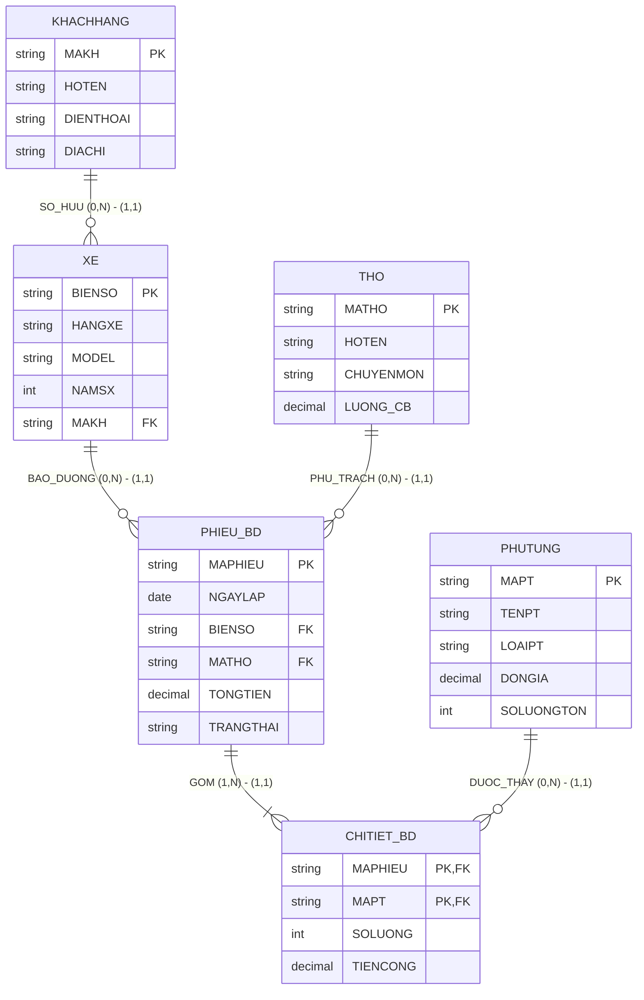

# HƯỚNG DẪN CHẤM & LỜI GIẢI CHI TIẾT (MOCK-10)
**Môn học:** IT004 — Cơ sở dữ liệu | **Thời gian thi:** 75 phút | **Thang điểm:** 10.0
**Tác giả biên soạn:** VÕ TRỌNG PHÚC — CSDL_UIT Master Series

---

## CÂU 1: THIẾT KẾ MÔ HÌNH DỮ LIỆU (2.5 ĐIỂM)

### 1.1. Phân tích thực thể, mối kết hợp & Sơ đồ ERD (1.50 điểm)

#### A. Xác định các tập thực thể và thuộc tính
1. **`KHACHHANG`** (Khách hàng chủ xe):
   - Thuộc tính khóa: `MAKH` (Mã khách hàng).
   - Thuộc tính mô tả: `HOTEN` (Họ tên), `DIENTHOAI` (Số điện thoại), `DIACHI` (Địa chỉ thường trú).
2. **`XE`** (Phương tiện ô tô):
   - Thuộc tính khóa: `BIENSO` (Biển số xe kiểm định).
   - Thuộc tính mô tả: `HANGXE` (Hãng sản xuất: Toyota, Honda, Ford,...), `MODEL` (Dòng xe), `NAMSX` (Năm sản xuất).
3. **`THO`** (Thợ kỹ thuật gara):
   - Thuộc tính khóa: `MATHO` (Mã thợ kỹ thuật).
   - Thuộc tính mô tả: `HOTEN` (Họ tên), `CHUYENMON` (Chuyên môn chính: Máy gầm, Điện lạnh, Sơn gò), `LUONG_CB` (Lương cơ bản).
4. **`PHUTUNG`** (Linh kiện, phụ tùng vật tư):
   - Thuộc tính khóa: `MAPT` (Mã phụ tùng).
   - Thuộc tính mô tả: `TENPT` (Tên phụ tùng), `LOAIPT` (Phân loại phụ tùng: Dầu nhớt, Hệ thống phanh,...), `DONGIA` (Đơn giá niêm yết), `SOLUONGTON` (Số lượng tồn kho).
5. **`PHIEU_BD`** (Phiếu dịch vụ bảo dưỡng/sửa chữa):
   - Thuộc tính khóa: `MAPHIEU` (Mã phiếu bảo dưỡng).
   - Thuộc tính mô tả: `NGAYLAP` (Ngày lập phiếu), `TONGTIEN` (Tổng chi phí dự toán), `TRANGTHAI` (Trạng thái: 'Đang xử lý', 'Đã hoàn thành', 'Đã hủy').

#### B. Xác định mối kết hợp & Bản số (Min, Max)
1. **`SO_HUU`** (giữa `KHACHHANG` và `XE`):
   - Một khách hàng có thể sở hữu từ 0 đến nhiều xe: Bản số $(0, N)$.
   - Một xe ô tô thuộc quyền sở hữu của đúng 1 khách hàng: Bản số $(1, 1)$.
2. **`BAO_DUONG`** (giữa `XE` và `PHIEU_BD`):
   - Một xe ô tô có thể có từ 0 đến nhiều phiếu bảo dưỡng: Bản số $(0, N)$.
   - Một phiếu bảo dưỡng phục vụ đúng 1 xe ô tô: Bản số $(1, 1)$.
3. **`PHU_TRACH`** (giữa `THO` và `PHIEU_BD`):
   - Một thợ kỹ thuật có thể phụ trách từ 0 đến nhiều phiếu bảo dưỡng: Bản số $(0, N)$.
   - Một phiếu bảo dưỡng do đúng 1 thợ phụ trách chính: Bản số $(1, 1)$.
4. **`CHITIET_BD`** (giữa `PHIEU_BD` và `PHUTUNG`):
   - Mối kết hợp Nhiều - Nhiều ($M:N$).
   - Một phiếu bảo dưỡng sử dụng ít nhất 1 phụ tùng: Bản số $(1, N)$.
   - Một loại phụ tùng có thể được thay thế trong 0 hoặc nhiều phiếu: Bản số $(0, N)$.
   - Thuộc tính mối kết hợp: `SOLUONG` (Số lượng thay thế), `TIENCONG` (Tiền công kỹ thuật).

#### C. Sơ đồ Thực thể – Mối kết hợp (ERD)



---

### 1.2. Ánh xạ sang Lược đồ CSDL Quan hệ (1.00 điểm)

Chuyển đổi các tập thực thể và mối kết hợp theo các quy tắc chuẩn:
1. `KHACHHANG` (**<u>MAKH</u>**, HOTEN, DIENTHOAI, DIACHI)
   - Khóa chính (PK): `MAKH`.
2. `XE` (**<u>BIENSO</u>**, HANGXE, MODEL, NAMSX, MAKH)
   - Khóa chính (PK): `BIENSO`.
   - Khóa ngoại (FK): `MAKH` tham chiếu đến `KHACHHANG(MAKH)`.
3. `THO` (**<u>MATHO</u>**, HOTEN, CHUYENMON, LUONG_CB)
   - Khóa chính (PK): `MATHO`.
4. `PHUTUNG` (**<u>MAPT</u>**, TENPT, LOAIPT, DONGIA, SOLUONGTON)
   - Khóa chính (PK): `MAPT`.
5. `PHIEU_BD` (**<u>MAPHIEU</u>**, NGAYLAP, BIENSO, MATHO, TONGTIEN, TRANGTHAI)
   - Khóa chính (PK): `MAPHIEU`.
   - Khóa ngoại (FK): `BIENSO` tham chiếu đến `XE(BIENSO)`.
   - Khóa ngoại (FK): `MATHO` tham chiếu đến `THO(MATHO)`.
6. `CHITIET_BD` (**<u>MAPHIEU</u>**, **<u>MAPT</u>**, SOLUONG, TIENCONG)
   - Khóa chính phức hợp (PK): (`MAPHIEU`, `MAPT`).
   - Khóa ngoại (FK): `MAPHIEU` tham chiếu đến `PHIEU_BD(MAPHIEU)`.
   - Khóa ngoại (FK): `MAPT` tham chiếu đến `PHUTUNG(MAPT)`.

---

## CÂU 2: SQL & ĐẠI SỐ QUAN HỆ (7.5 ĐIỂM)

### 2.1. Viết các câu lệnh SQL (1.5 điểm)

#### a. Tạo ràng buộc CHECK kiểm tra tồn kho và đơn giá phụ tùng (0.75 điểm)
```sql
ALTER TABLE PHUTUNG
ADD CONSTRAINT CK_PHUTUNG_SOLUONGTON CHECK (SOLUONGTON >= 0);

ALTER TABLE PHUTUNG
ADD CONSTRAINT CK_PHUTUNG_DONGIA CHECK (DONGIA > 0);
```
*Ghi chú chính sách dữ liệu:* Hai thuộc tính này phải được định nghĩa `NOT NULL` khi tạo bảng để đảm bảo tính toàn vẹn nghiệp vụ.

#### b. Cập nhật tăng 10% lương cho thợ Máy gầm có phiếu bảo dưỡng tháng 11/2024 (0.75 điểm)
```sql
UPDATE THO
SET LUONG_CB = LUONG_CB * 1.10
FROM THO t
WHERE t.CHUYENMON = N'Máy gầm'
  AND EXISTS (
      SELECT 1 FROM PHIEU_BD pbd
      WHERE pbd.MATHO = t.MATHO
        AND pbd.NGAYLAP >= '2024-11-01'
        AND pbd.NGAYLAP <= '2024-11-30'
  );
```

---

### 2.2. Viết các biểu thức Đại số quan hệ (6.0 điểm)

#### a. Danh sách xe Toyota sản xuất từ năm 2022 trở lại đây (1.0 điểm)
- **Đại số quan hệ:**
  $$E_1 = \sigma_{HANGXE = \text{'Toyota'} \wedge NAMSX \ge 2022}(XE)$$
  $$\text{KQ} = \pi_{BIENSO, HANGXE, MODEL, NAMSX}(E_1)$$
- **T-SQL tương đương:**
```sql
SELECT BIENSO, HANGXE, MODEL, NAMSX
FROM XE
WHERE HANGXE = N'Toyota'
  AND NAMSX >= 2022;
```

#### b. Phiếu bảo dưỡng do thợ Trần Văn Mạnh phụ trách (1.0 điểm)
- **Đại số quan hệ:**
  $$E_1 = \sigma_{HOTEN = \text{'Trần Văn Mạnh'}}(THO)$$
  $$E_2 = E_1 \bowtie PHIEU\_BD$$
  $$\text{KQ} = \pi_{MAPHIEU, NGAYLAP, BIENSO, HOTEN}(E_2)$$
- **T-SQL tương đương:**
```sql
SELECT pbd.MAPHIEU, pbd.NGAYLAP, pbd.BIENSO, t.HOTEN
FROM PHIEU_BD pbd
JOIN THO t ON pbd.MATHO = t.MATHO
WHERE t.HOTEN = N'Trần Văn Mạnh';
```

#### c. Liệt kê tất cả khách hàng và xe ô tô nếu có (1.0 điểm)
- **Đại số quan hệ:**
  $$E_1 = KHACHHANG = \bowtie XE$$
  $$\text{KQ} = \pi_{MAKH, HOTEN, BIENSO, HANGXE}(E_1)$$
- **T-SQL tương đương:**
```sql
SELECT kh.MAKH, kh.HOTEN, x.BIENSO, x.HANGXE
FROM KHACHHANG kh
LEFT JOIN XE x ON kh.MAKH = x.MAKH;
```

#### d. Tổng tiền phụ tùng theo từng phiếu bảo dưỡng Đã hoàn thành tháng 11/2024 (1.0 điểm)
- **Đại số quan hệ:**
  $$E_1 = \sigma_{NGAYLAP \ge \text{'2024-11-01'} \wedge NGAYLAP \le \text{'2024-11-30'} \wedge TRANGTHAI = \text{'Đã hoàn thành'}}(PHIEU\_BD)$$
  $$E_2 = CHITIET\_BD \bowtie PHUTUNG$$
  $$E_3 = \pi_{MAPHIEU, SOLUONG * DONGIA \to THANHTIEN}(E_2)$$
  $$E_4 = \gamma_{MAPHIEU, \text{SUM}(THANHTIEN) \to TONG\_TIEN\_PHU\_TUNG}(E_3)$$
  $$E_5 = E_1 \bowtie E_4$$
  $$\text{KQ} = \pi_{MAPHIEU, NGAYLAP, TONG\_TIEN\_PHU\_TUNG}(E_5)$$
- **T-SQL tương đương:**
```sql
SELECT pbd.MAPHIEU, pbd.NGAYLAP, SUM(ct.SOLUONG * pt.DONGIA) AS TONG_TIEN_PHU_TUNG
FROM PHIEU_BD pbd
JOIN CHITIET_BD ct ON pbd.MAPHIEU = ct.MAPHIEU
JOIN PHUTUNG pt ON ct.MAPT = pt.MAPT
WHERE pbd.NGAYLAP >= '2024-11-01'
  AND pbd.NGAYLAP <= '2024-11-30'
  AND pbd.TRANGTHAI = N'Đã hoàn thành'
GROUP BY pbd.MAPHIEU, pbd.NGAYLAP;
```

#### e. Xe ô tô đã từng thay thế tất cả phụ tùng loại 'Dầu nhớt' (1.0 điểm)
- **Đại số quan hệ (Phép chia):**
  $$R = \pi_{BIENSO, MAPT}(PHIEU\_BD \bowtie CHITIET\_BD)$$
  $$S = \pi_{MAPT}(\sigma_{LOAIPT = \text{'Dầu nhớt'}}(PHUTUNG))$$
  $$E_{\text{DIV}} = R \div S$$
  $$\text{KQ} = \pi_{BIENSO, HANGXE, MAKH}(E_{\text{DIV}} \bowtie XE)$$
- **T-SQL tương đương (Double NOT EXISTS bounded to candidate vehicles):**
```sql
SELECT x.BIENSO, x.HANGXE, x.MAKH
FROM XE x
WHERE EXISTS (
    SELECT 1 FROM PHIEU_BD pbd
    JOIN CHITIET_BD ct ON pbd.MAPHIEU = ct.MAPHIEU
    WHERE pbd.BIENSO = x.BIENSO
)
AND NOT EXISTS (
    SELECT 1 FROM PHUTUNG pt
    WHERE pt.LOAIPT = N'Dầu nhớt'
      AND NOT EXISTS (
          SELECT 1 FROM PHIEU_BD pbd2
          JOIN CHITIET_BD ct2 ON pbd2.MAPHIEU = ct2.MAPHIEU
          WHERE pbd2.BIENSO = x.BIENSO
            AND ct2.MAPT = pt.MAPT
      )
);
```
*Cách giải T-SQL phụ (HAVING COUNT):*
```sql
WITH R AS (
    SELECT DISTINCT pbd.BIENSO, ct.MAPT
    FROM PHIEU_BD pbd
    JOIN CHITIET_BD ct ON pbd.MAPHIEU = ct.MAPHIEU
),
S AS (
    SELECT MAPT FROM PHUTUNG WHERE LOAIPT = N'Dầu nhớt'
)
SELECT x.BIENSO, x.HANGXE, x.MAKH
FROM XE x
JOIN (
    SELECT R.BIENSO
    FROM R
    LEFT JOIN S ON R.MAPT = S.MAPT
    GROUP BY R.BIENSO
    HAVING COUNT(DISTINCT S.MAPT) = (SELECT COUNT(*) FROM S)
) div ON x.BIENSO = div.BIENSO;
```

#### f. Phụ tùng có tổng số lượng sử dụng nhiều nhất năm 2024 (1.0 điểm)
- **Đại số quan hệ (Cực trị bảo toàn đồng hạng):**
  $$E_1 = \sigma_{NGAYLAP \ge \text{'2024-01-01'} \wedge NGAYLAP \le \text{'2024-12-31'}}(PHIEU\_BD) \bowtie CHITIET\_BD$$
  $$E_{\text{DEM}} = \gamma_{MAPT, \text{SUM}(SOLUONG) \to TONG\_SOLUONG}(E_1)$$
  $$E_{\text{NHO_HON}} = \pi_{MAPT, TONG\_SOLUONG}(E_{\text{DEM}} \bowtie_{TONG\_SOLUONG < TONG\_SOLUONG2} \rho_{MAPT2, TONG\_SOLUONG2}(E_{\text{DEM}}))$$
  $$E_{\text{MAX}} = E_{\text{DEM}} - E_{\text{NHO_HON}}$$
  $$\text{KQ} = \pi_{MAPT, TENPT, LOAIPT, TONG\_SOLUONG}(E_{\text{MAX}} \bowtie PHUTUNG)$$
- **T-SQL tương đương:**
```sql
WITH ThongKe AS (
    SELECT ct.MAPT, SUM(ct.SOLUONG) AS TONG_SOLUONG
    FROM PHIEU_BD pbd
    JOIN CHITIET_BD ct ON pbd.MAPHIEU = ct.MAPHIEU
    WHERE pbd.NGAYLAP >= '2024-01-01'
      AND pbd.NGAYLAP <= '2024-12-31'
    GROUP BY ct.MAPT
)
SELECT pt.MAPT, pt.TENPT, pt.LOAIPT, tk.TONG_SOLUONG
FROM PHUTUNG pt
JOIN ThongKe tk ON pt.MAPT = tk.MAPT
WHERE tk.TONG_SOLUONG = (SELECT MAX(TONG_SOLUONG) FROM ThongKe);
```

---

## BẢNG PHÂN BỔ ĐIỂM CHI TIẾT (RUBRIC)

| Câu hỏi | Nội dung đánh giá | Điểm tối đa |
|:---|:---|:---:|
| **Câu 1.1** | Xác định tập thực thể (5), thuộc tính khóa và bản số min-max | 0.75 đ |
| | Vẽ đúng mô hình ERD theo chuẩn | 0.75 đ |
| **Câu 1.2** | Ánh xạ 6 bảng, gạch dưới Khóa chính (PK) | 0.50 đ |
| | Khai báo Khóa ngoại (FK) chỉ rõ bảng tham chiếu đúng nghiệp vụ | 0.50 đ |
| **Câu 2.1a** | Cú pháp ALTER TABLE ... ADD CONSTRAINT CHECK đúng cho 2 cột | 0.75 đ |
| **Câu 2.1b** | UPDATE ... WHERE chuyên môn & EXISTS phiếu tháng 11/2024 | 0.75 đ |
| **Câu 2.2a** | Biểu thức chọn $\sigma$ và chiếu $\pi$ đúng | 1.00 đ |
| **Câu 2.2b** | Kết nối 2 bảng qua khóa ngoại, điều kiện đúng | 1.00 đ |
| **Câu 2.2c** | Phép kết ngoài trái $\leftouterjoin$ bảo toàn khách hàng chưa có xe | 1.00 đ |
| **Câu 2.2d** | Gom nhóm $\gamma$, hàm SUM, kết nối tính tiền đúng điều kiện | 1.00 đ |
| **Câu 2.2e** | Phép chia $R \div S$ xác định đúng tập bị chia, tập chia và kết quả | 1.00 đ |
| **Câu 2.2f** | Gom nhóm tính tổng số lượng, tìm giá trị lớn nhất bảo toàn đồng hạng | 1.00 đ |
| **TỔNG CỘNG** | **Toàn bộ đề thi giữa kỳ mô phỏng số 10** | **10.00 đ** |
