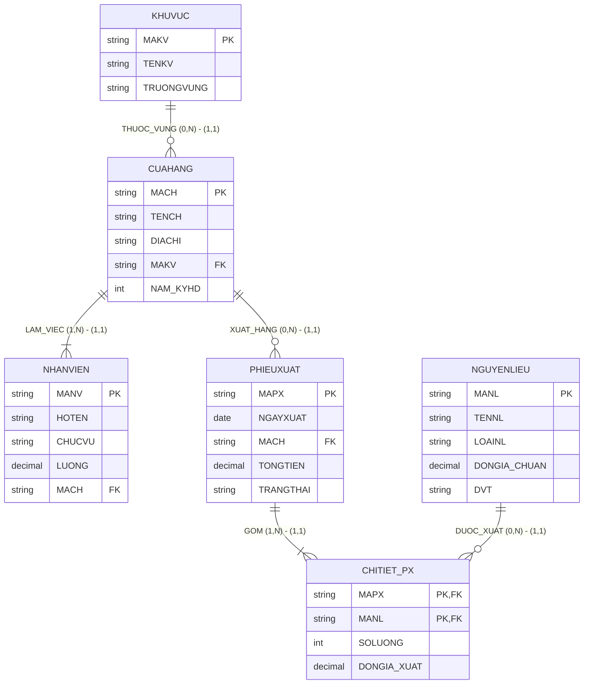

# HƯỚNG DẪN CHẤM & LỜI GIẢI CHI TIẾT (MOCK-11)
**Môn học:** IT004 — Cơ sở dữ liệu | **Thời gian thi:** 75 phút | **Thang điểm:** 10.0
**Tác giả biên soạn:** VÕ TRỌNG PHÚC — CSDL_UIT Master Series

---

## CÂU 1: THIẾT KẾ MÔ HÌNH DỮ LIỆU (2.0 ĐIỂM)

### 1.1. Phân tích thực thể, mối kết hợp & Sơ đồ ERD (1.20 điểm)

#### A. Xác định các tập thực thể và thuộc tính
1. **`KHUVUC`** (Khu vực quản lý kinh doanh):
   - Thuộc tính khóa: `MAKV` (Mã khu vực).
   - Thuộc tính mô tả: `TENKV` (Tên khu vực), `TRUONGVUNG` (Họ tên trưởng vùng).
2. **`CUAHANG`** (Cửa hàng chi nhánh nhượng quyền):
   - Thuộc tính khóa: `MACH` (Mã cửa hàng).
   - Thuộc tính mô tả: `TENCH` (Tên cửa hàng), `DIACHI` (Địa chỉ kinh doanh), `NAM_KYHD` (Năm ký hợp đồng).
3. **`NHANVIEN`** (Nhân sự cửa hàng):
   - Thuộc tính khóa: `MANV` (Mã nhân viên).
   - Thuộc tính mô tả: `HOTEN` (Họ tên), `CHUCVU` (Chức vụ: Cửa hàng trưởng, Pha chế,...), `LUONG` (Lương cơ bản).
4. **`NGUYENLIEU`** (Nguyên liệu pha chế):
   - Thuộc tính khóa: `MANL` (Mã nguyên liệu).
   - Thuộc tính mô tả: `TENNL` (Tên nguyên liệu), `LOAINL` (Phân loại: Hạt cà phê, Syrup,...), `DONGIA_CHUAN` (Đơn giá chuẩn), `DVT` (Đơn vị tính).
5. **`PHIEUXUAT`** (Phiếu xuất kho phân phối):
   - Thuộc tính khóa: `MAPX` (Mã phiếu xuất kho).
   - Thuộc tính mô tả: `NGAYXUAT` (Ngày xuất kho), `TONGTIEN` (Tổng giá trị dự kiến), `TRANGTHAI` (Trạng thái: 'Đang chuẩn bị', 'Đang chuyển hàng', 'Đã giao').

#### B. Xác định mối kết hợp & Bản số (Min, Max)
1. **`THUOC_VUNG`** (giữa `KHUVUC` và `CUAHANG`):
   - Một khu vực có từ 0 đến nhiều cửa hàng: Bản số $(0, N)$.
   - Một cửa hàng trực thuộc đúng 1 khu vực: Bản số $(1, 1)$.
2. **`LAM_VIEC`** (giữa `CUAHANG` và `NHANVIEN`):
   - Một cửa hàng có nhiều nhân viên làm việc: Bản số $(1, N)$.
   - Một nhân viên làm việc cố định tại đúng 1 cửa hàng: Bản số $(1, 1)$.
3. **`XUAT_HANG`** (giữa `CUAHANG` và `PHIEUXUAT`):
   - Một cửa hàng có thể nhận từ 0 đến nhiều phiếu xuất kho: Bản số $(0, N)$.
   - Một phiếu xuất kho xuất cho đúng 1 cửa hàng: Bản số $(1, 1)$.
4. **`CHITIET_PX`** (giữa `PHIEUXUAT` và `NGUYENLIEU`):
   - Mối kết hợp Nhiều - Nhiều ($M:N$).
   - Một phiếu xuất kho xuất ít nhất 1 loại nguyên liệu: Bản số $(1, N)$.
   - Một loại nguyên liệu có thể xuất hiện trong 0 hoặc nhiều phiếu: Bản số $(0, N)$.
   - Thuộc tính mối kết hợp: `SOLUONG` (Số lượng xuất), `DONGIA_XUAT` (Đơn giá xuất thực tế).

#### C. Sơ đồ Thực thể – Mối kết hợp (ERD)



---

### 1.2. Ánh xạ sang Lược đồ CSDL Quan hệ (0.80 điểm)

Chuyển đổi các tập thực thể và mối kết hợp theo các quy tắc chuẩn:
1. `KHUVUC` (**<u>MAKV</u>**, TENKV, TRUONGVUNG)
   - Khóa chính (PK): `MAKV`.
2. `CUAHANG` (**<u>MACH</u>**, TENCH, DIACHI, MAKV, NAM_KYHD)
   - Khóa chính (PK): `MACH`.
   - Khóa ngoại (FK): `MAKV` tham chiếu đến `KHUVUC(MAKV)`.
3. `NHANVIEN` (**<u>MANV</u>**, HOTEN, CHUCVU, LUONG, MACH)
   - Khóa chính (PK): `MANV`.
   - Khóa ngoại (FK): `MACH` tham chiếu đến `CUAHANG(MACH)`.
4. `NGUYENLIEU` (**<u>MANL</u>**, TENNL, LOAINL, DONGIA_CHUAN, DVT)
   - Khóa chính (PK): `MANL`.
5. `PHIEUXUAT` (**<u>MAPX</u>**, NGAYXUAT, MACH, TONGTIEN, TRANGTHAI)
   - Khóa chính (PK): `MAPX`.
   - Khóa ngoại (FK): `MACH` tham chiếu đến `CUAHANG(MACH)`.
6. `CHITIET_PX` (**<u>MAPX</u>**, **<u>MANL</u>**, SOLUONG, DONGIA_XUAT)
   - Khóa chính phức hợp (PK): (`MAPX`, `MANL`).
   - Khóa ngoại (FK): `MAPX` tham chiếu đến `PHIEUXUAT(MAPX)`.
   - Khóa ngoại (FK): `MANL` tham chiếu đến `NGUYENLIEU(MANL)`.

---

## CÂU 2: SQL & ĐẠI SỐ QUAN HỆ (8.0 ĐIỂM)

### 2.1. Viết các câu lệnh SQL (1.5 điểm)

#### a. Tạo ràng buộc CHECK kiểm tra số lượng và đơn giá xuất (0.75 điểm)
```sql
ALTER TABLE CHITIET_PX
ADD CONSTRAINT CK_CTPX_SOLUONG CHECK (SOLUONG > 0);

ALTER TABLE CHITIET_PX
ADD CONSTRAINT CK_CTPX_DONGIA CHECK (DONGIA_XUAT > 0);
```
*Ghi chú chính sách dữ liệu:* Hai thuộc tính này phải được định nghĩa `NOT NULL` khi tạo bảng để đảm bảo tính toàn vẹn nghiệp vụ.

#### b. Cập nhật tăng 10% lương cho Cửa hàng trưởng ở Khu vực Trung tâm (0.75 điểm)
```sql
UPDATE NHANVIEN
SET LUONG = LUONG * 1.10
FROM NHANVIEN nv
JOIN CUAHANG ch ON nv.MACH = ch.MACH
JOIN KHUVUC kv ON ch.MAKV = kv.MAKV
WHERE kv.TENKV = N'Khu vực Trung tâm'
  AND nv.CHUCVU = N'Cửa hàng trưởng';
```

---

### 2.2. Viết các biểu thức Đại số quan hệ (6.5 điểm)

#### a. Nguyên liệu 'Hạt cà phê' có đơn giá chuẩn từ 200.000 trở lên (1.0 điểm)
- **Đại số quan hệ:**
  $$E_1 = \sigma_{LOAINL = \text{'Hạt cà phê'} \wedge DONGIA\_CHUAN \ge 200000}(NGUYENLIEU)$$
  $$\text{KQ} = \pi_{MANL, TENNL, DONGIA\_CHUAN, DVT}(E_1)$$
- **T-SQL tương đương:**
```sql
SELECT MANL, TENNL, DONGIA_CHUAN, DVT
FROM NGUYENLIEU
WHERE LOAINL = N'Hạt cà phê'
  AND DONGIA_CHUAN >= 200000;
```

#### b. Các phiếu xuất kho xuất cho cửa hàng The Coffee House Landmark 81 (1.0 điểm)
- **Đại số quan hệ:**
  $$E_1 = \sigma_{TENCH = \text{'The Coffee House Landmark 81'}}(CUAHANG)$$
  $$E_2 = E_1 \bowtie PHIEUXUAT$$
  $$\text{KQ} = \pi_{MAPX, NGAYXUAT, TONGTIEN, TENCH}(E_2)$$
- **T-SQL tương đương:**
```sql
SELECT px.MAPX, px.NGAYXUAT, px.TONGTIEN, ch.TENCH
FROM PHIEUXUAT px
JOIN CUAHANG ch ON px.MACH = ch.MACH
WHERE ch.TENCH = N'The Coffee House Landmark 81';
```

#### c. Liệt kê tất cả các khu vực và cửa hàng nếu có (1.0 điểm)
- **Đại số quan hệ:**
  $$E_1 = KHUVUC = \bowtie CUAHANG$$
  $$\text{KQ} = \pi_{MAKV, TENKV, MACH, TENCH}(E_1)$$
- **T-SQL tương đương:**
```sql
SELECT kv.MAKV, kv.TENKV, ch.MACH, ch.TENCH
FROM KHUVUC kv
LEFT JOIN CUAHANG ch ON kv.MAKV = ch.MAKV;
```

#### d. Tổng giá trị xuất hàng thực tế theo từng phiếu xuất Đã giao tháng 11/2024 (1.0 điểm)
- **Đại số quan hệ:**
  $$E_1 = \sigma_{NGAYXUAT \ge \text{'2024-11-01'} \wedge NGAYXUAT \le \text{'2024-11-30'} \wedge TRANGTHAI = \text{'Đã giao'}}(PHIEUXUAT)$$
  $$E_2 = \pi_{MAPX, SOLUONG * DONGIA\_XUAT \to THANHTIEN}(CHITIET\_PX)$$
  $$E_3 = \gamma_{MAPX, \text{SUM}(THANHTIEN) \to TONG\_GIA\_TRI\_XUAT}(E_2)$$
  $$E_4 = E_1 \bowtie E_3$$
  $$\text{KQ} = \pi_{MAPX, NGAYXUAT, TONG\_GIA\_TRI\_XUAT}(E_4)$$
- **T-SQL tương đương:**
```sql
SELECT px.MAPX, px.NGAYXUAT, SUM(ct.SOLUONG * ct.DONGIA_XUAT) AS TONG_GIA_TRI_XUAT
FROM PHIEUXUAT px
JOIN CHITIET_PX ct ON px.MAPX = ct.MAPX
WHERE px.NGAYXUAT >= '2024-11-01'
  AND px.NGAYXUAT <= '2024-11-30'
  AND px.TRANGTHAI = N'Đã giao'
GROUP BY px.MAPX, px.NGAYXUAT;
```

#### e. Cửa hàng đã từng nhập tất cả nguyên liệu loại 'Syrup pha chế' (1.0 điểm)
- **Đại số quan hệ (Phép chia):**
  $$R = \pi_{MACH, MANL}(PHIEUXUAT \bowtie CHITIET\_PX)$$
  $$S = \pi_{MANL}(\sigma_{LOAINL = \text{'Syrup pha chế'}}(NGUYENLIEU))$$
  $$E_{\text{DIV}} = R \div S$$
  $$\text{KQ} = \pi_{MACH, TENCH, MAKV}(E_{\text{DIV}} \bowtie CUAHANG)$$
- **T-SQL tương đương (Double NOT EXISTS bounded to candidate stores):**
```sql
SELECT ch.MACH, ch.TENCH, ch.MAKV
FROM CUAHANG ch
WHERE EXISTS (
    SELECT 1 FROM PHIEUXUAT px
    JOIN CHITIET_PX ct ON px.MAPX = ct.MAPX
    WHERE px.MACH = ch.MACH
)
AND NOT EXISTS (
    SELECT 1 FROM NGUYENLIEU nl
    WHERE nl.LOAINL = N'Syrup pha chế'
      AND NOT EXISTS (
          SELECT 1 FROM PHIEUXUAT px2
          JOIN CHITIET_PX ct2 ON px2.MAPX = ct2.MAPX
          WHERE px2.MACH = ch.MACH
            AND ct2.MANL = nl.MANL
      )
);
```
*Cách giải T-SQL phụ (HAVING COUNT):*
```sql
WITH R AS (
    SELECT DISTINCT px.MACH, ct.MANL
    FROM PHIEUXUAT px
    JOIN CHITIET_PX ct ON px.MAPX = ct.MAPX
),
S AS (
    SELECT MANL FROM NGUYENLIEU WHERE LOAINL = N'Syrup pha chế'
)
SELECT ch.MACH, ch.TENCH, ch.MAKV
FROM CUAHANG ch
JOIN (
    SELECT R.MACH
    FROM R
    LEFT JOIN S ON R.MANL = S.MANL
    GROUP BY R.MACH
    HAVING COUNT(DISTINCT S.MANL) = (SELECT COUNT(*) FROM S)
) div ON ch.MACH = div.MACH;
```

#### f. Cửa hàng có tổng số lượng nguyên liệu nhập nhiều nhất năm 2024 (1.5 điểm)
- **Đại số quan hệ (Cực trị bảo toàn đồng hạng):**
  $$E_1 = \sigma_{NGAYXUAT \ge \text{'2024-01-01'} \wedge NGAYXUAT \le \text{'2024-12-31'}}(PHIEUXUAT) \bowtie CHITIET\_PX$$
  $$E_{\text{DEM}} = \gamma_{MACH, \text{SUM}(SOLUONG) \to TONG\_SOLUONG\_NHAP}(E_1)$$
  $$E_{\text{NHO_HON}} = \pi_{MACH, TONG\_SOLUONG\_NHAP}(E_{\text{DEM}} \bowtie_{TONG\_SOLUONG\_NHAP < TONG\_SOLUONG\_NHAP2} \rho_{MACH2, TONG\_SOLUONG\_NHAP2}(E_{\text{DEM}}))$$
  $$E_{\text{MAX}} = E_{\text{DEM}} - E_{\text{NHO_HON}}$$
  $$E_{\text{KQS}} = E_{\text{MAX}} \bowtie CUAHANG \bowtie KHUVUC$$
  $$\text{KQ} = \pi_{MACH, TENCH, TENKV, TONG\_SOLUONG\_NHAP}(E_{\text{KQS}})$$
- **T-SQL tương đương:**
```sql
WITH ThongKe AS (
    SELECT px.MACH, SUM(ct.SOLUONG) AS TONG_SOLUONG_NHAP
    FROM PHIEUXUAT px
    JOIN CHITIET_PX ct ON px.MAPX = ct.MAPX
    WHERE px.NGAYXUAT >= '2024-01-01'
      AND px.NGAYXUAT <= '2024-12-31'
    GROUP BY px.MACH
)
SELECT ch.MACH, ch.TENCH, kv.TENKV, tk.TONG_SOLUONG_NHAP
FROM CUAHANG ch
JOIN KHUVUC kv ON ch.MAKV = kv.MAKV
JOIN ThongKe tk ON ch.MACH = tk.MACH
WHERE tk.TONG_SOLUONG_NHAP = (SELECT MAX(TONG_SOLUONG_NHAP) FROM ThongKe);
```

---

## BẢNG PHÂN BỔ ĐIỂM CHI TIẾT (RUBRIC)

| Câu hỏi | Nội dung đánh giá | Điểm tối đa |
|:---|:---|:---:|
| **Câu 1.1** | Xác định tập thực thể (5), thuộc tính khóa và bản số min-max | 0.60 đ |
| | Vẽ đúng mô hình ERD theo chuẩn Mermaid | 0.60 đ |
| **Câu 1.2** | Ánh xạ 6 bảng, gạch dưới Khóa chính (PK) | 0.40 đ |
| | Khai báo Khóa ngoại (FK) chỉ rõ bảng tham chiếu đúng nghiệp vụ | 0.40 đ |
| **Câu 2.1a** | Cú pháp ALTER TABLE ... ADD CONSTRAINT CHECK đúng cho 2 cột | 0.75 đ |
| **Câu 2.1b** | UPDATE ... FROM ... JOIN 3 bảng, đúng điều kiện khu vực & chức vụ | 0.75 đ |
| **Câu 2.2a** | Biểu thức chọn $\sigma$ và chiếu $\pi$ đúng | 1.00 đ |
| **Câu 2.2b** | Kết nối 2 bảng qua khóa ngoại, điều kiện đúng | 1.00 đ |
| **Câu 2.2c** | Phép kết ngoài trái $\leftouterjoin$ bảo toàn khu vực chưa có cửa hàng | 1.00 đ |
| **Câu 2.2d** | Gom nhóm $\gamma$, hàm SUM, điều kiện tháng 11/2024 & trạng thái Đã giao | 1.00 đ |
| **Câu 2.2e** | Phép chia $R \div S$ xác định đúng tập bị chia, tập chia và kết quả | 1.00 đ |
| **Câu 2.2f** | Gom nhóm tính tổng số lượng nhập, tìm giá trị lớn nhất bảo toàn đồng hạng | 1.50 đ |
| **TỔNG CỘNG** | **Toàn bộ đề thi giữa kỳ mô phỏng số 11** | **10.00 đ** |
