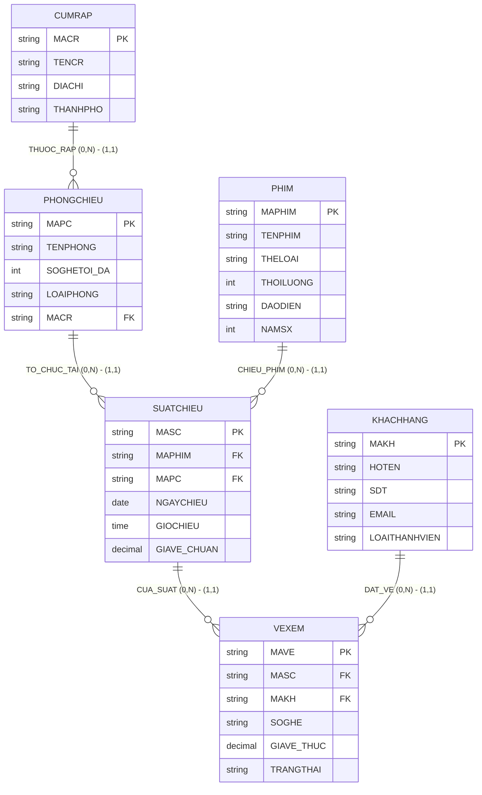

# HƯỚNG DẪN CHẤM & LỜI GIẢI CHI TIẾT (MOCK-12)
**Môn học:** IT004 — Cơ sở dữ liệu | **Thời gian thi:** 75 phút | **Thang điểm:** 10.0
**Tác giả biên soạn:** VÕ TRỌNG PHÚC — CSDL_UIT Master Series

---

## CÂU 1: THIẾT KẾ MÔ HÌNH DỮ LIỆU (2.5 ĐIỂM)

### 1.1. Phân tích thực thể, mối kết hợp & Sơ đồ ERD (1.50 điểm)

#### A. Xác định các tập thực thể và thuộc tính
1. **`CUMRAP`** (Cụm rạp chiếu phim):
   - Thuộc tính khóa: `MACR` (Mã cụm rạp).
   - Thuộc tính mô tả: `TENCR` (Tên cụm rạp), `DIACHI` (Địa chỉ), `THANHPHO` (Thành phố).
2. **`PHONGCHIEU`** (Phòng chiếu phim):
   - Thuộc tính khóa: `MAPC` (Mã phòng chiếu).
   - Thuộc tính mô tả: `TENPHONG` (Tên phòng), `SOGHETOI_DA` (Số ghế tối đa), `LOAIPHONG` (Loại phòng: 2D Standard, 3D IMAX,...).
3. **`PHIM`** (Danh mục phim):
   - Thuộc tính khóa: `MAPHIM` (Mã phim).
   - Thuộc tính mô tả: `TENPHIM` (Tên phim), `THELOAI` (Thể loại phim), `THOILUONG` (Thời lượng phút), `DAODIEN` (Đạo diễn), `NAMSX` (Năm sản xuất).
4. **`SUATCHIEU`** (Lịch suất chiếu cụ thể):
   - Thuộc tính khóa: `MASC` (Mã suất chiếu).
   - Thuộc tính mô tả: `NGAYCHIEU` (Ngày chiếu), `GIOCHIEU` (Giờ chiếu), `GIAVE_CHUAN` (Giá vé niêm yết chuẩn).
5. **`KHACHHANG`** (Thành viên rạp):
   - Thuộc tính khóa: `MAKH` (Mã khách hàng).
   - Thuộc tính mô tả: `HOTEN` (Họ tên), `SDT` (Số điện thoại), `EMAIL` (Địa chỉ email), `LOAITHANHVIEN` (Hạng thành viên: Standard, VIP, Diamond).
6. **`VEXEM`** (Vé xem phim đã phát hành):
   - Thuộc tính khóa: `MAVE` (Mã vé xem).
   - Thuộc tính mô tả: `SOGHE` (Số ghế), `GIAVE_THUC` (Giá vé thực tế thanh toán), `TRANGTHAI` (Trạng thái: 'Đã thanh toán', 'Đã hủy', 'Đang giữ chỗ').

#### B. Xác định mối kết hợp & Bản số (Min, Max)
1. **`THUOC_RAP`** (giữa `CUMRAP` và `PHONGCHIEU`):
   - Một cụm rạp có từ 0 đến nhiều phòng chiếu: Bản số $(0, N)$.
   - Một phòng chiếu trực thuộc duy nhất 1 cụm rạp: Bản số $(1, 1)$.
2. **`CHIEU_PHIM`** (giữa `PHIM` và `SUATCHIEU`):
   - Một bộ phim có thể được chiếu trong 0 hoặc nhiều suất chiếu: Bản số $(0, N)$.
   - Một suất chiếu chỉ chiếu duy nhất 1 bộ phim: Bản số $(1, 1)$.
3. **`TO_CHUC_TAI`** (giữa `PHONGCHIEU` và `SUATCHIEU`):
   - Một phòng chiếu có thể tổ chức từ 0 đến nhiều suất chiếu: Bản số $(0, N)$.
   - Một suất chiếu diễn ra tại đúng 1 phòng chiếu: Bản số $(1, 1)$.
4. **`DAT_VE`** (giữa `KHACHHANG` và `VEXEM`):
   - Một khách hàng có thể mua từ 0 đến nhiều vé xem phim: Bản số $(0, N)$.
   - Một vé xem phim thuộc về đúng 1 khách hàng: Bản số $(1, 1)$.
5. **`CUA_SUAT`** (giữa `SUATCHIEU` và `VEXEM`):
   - Một suất chiếu có thể phát hành từ 0 đến nhiều vé xem: Bản số $(0, N)$.
   - Một vé xem phim thuộc về đúng 1 suất chiếu: Bản số $(1, 1)$.

#### C. Sơ đồ Thực thể – Mối kết hợp (ERD)



---

### 1.2. Ánh xạ sang Lược đồ CSDL Quan hệ (1.00 điểm)

Chuyển đổi các tập thực thể và mối kết hợp theo các quy tắc chuẩn:
1. `CUMRAP` (**<u>MACR</u>**, TENCR, DIACHI, THANHPHO)
   - Khóa chính (PK): `MACR`.
2. `PHONGCHIEU` (**<u>MAPC</u>**, TENPHONG, SOGHETOI_DA, LOAIPHONG, MACR)
   - Khóa chính (PK): `MAPC`.
   - Khóa ngoại (FK): `MACR` tham chiếu đến `CUMRAP(MACR)`.
3. `PHIM` (**<u>MAPHIM</u>**, TENPHIM, THELOAI, THOILUONG, DAODIEN, NAMSX)
   - Khóa chính (PK): `MAPHIM`.
4. `SUATCHIEU` (**<u>MASC</u>**, MAPHIM, MAPC, NGAYCHIEU, GIOCHIEU, GIAVE_CHUAN)
   - Khóa chính (PK): `MASC`.
   - Khóa ngoại (FK): `MAPHIM` tham chiếu đến `PHIM(MAPHIM)`.
   - Khóa ngoại (FK): `MAPC` tham chiếu đến `PHONGCHIEU(MAPC)`.
5. `KHACHHANG` (**<u>MAKH</u>**, HOTEN, SDT, EMAIL, LOAITHANHVIEN)
   - Khóa chính (PK): `MAKH`.
6. `VEXEM` (**<u>MAVE</u>**, MASC, MAKH, SOGHE, GIAVE_THUC, TRANGTHAI)
   - Khóa chính (PK): `MAVE`.
   - Khóa ngoại (FK): `MASC` tham chiếu đến `SUATCHIEU(MASC)`.
   - Khóa ngoại (FK): `MAKH` tham chiếu đến `KHACHHANG(MAKH)`.

---

## CÂU 2: SQL & ĐẠI SỐ QUAN HỆ (7.5 ĐIỂM)

### 2.1. Viết các câu lệnh SQL (1.5 điểm)

#### a. Tạo ràng buộc CHECK kiểm tra giá vé và trạng thái vé (0.75 điểm)
```sql
ALTER TABLE VEXEM
ADD CONSTRAINT CK_VEXEM_GIAVE CHECK (GIAVE_THUC > 0);

ALTER TABLE VEXEM
ADD CONSTRAINT CK_VEXEM_TRANGTHAI CHECK (TRANGTHAI IN (N'Đã thanh toán', N'Đã hủy', N'Đang giữ chỗ'));
```
*Ghi chú chính sách dữ liệu:* Hai thuộc tính này phải được định nghĩa `NOT NULL` khi tạo bảng để đảm bảo tính toàn vẹn nghiệp vụ.

#### b. Cập nhật giảm giá 10% vé chuẩn phim Hoạt hình tháng 12/2024 (0.75 điểm)
```sql
UPDATE SUATCHIEU
SET GIAVE_CHUAN = GIAVE_CHUAN * 0.90
FROM SUATCHIEU sc
JOIN PHIM p ON sc.MAPHIM = p.MAPHIM
WHERE p.THELOAI = N'Hoạt hình'
  AND sc.NGAYCHIEU >= '2024-12-01'
  AND sc.NGAYCHIEU <= '2024-12-31';
```

---

### 2.2. Viết các biểu thức Đại số quan hệ (6.0 điểm)

#### a. Phim Khoa học viễn tưởng thời lượng từ 120 phút trở lên (1.0 điểm)
- **Đại số quan hệ:**
  $$E_1 = \sigma_{THELOAI = \text{'Khoa học viễn tưởng'} \wedge THOILUONG \ge 120}(PHIM)$$
  $$\text{KQ} = \pi_{MAPHIM, TENPHIM, THOILUONG, DAODIEN}(E_1)$$
- **T-SQL tương đương:**
```sql
SELECT MAPHIM, TENPHIM, THOILUONG, DAODIEN
FROM PHIM
WHERE THELOAI = N'Khoa học viễn tưởng'
  AND THOILUONG >= 120;
```

#### b. Danh sách vé xem phim tại cụm rạp CGV Landmark 81 (1.0 điểm)
- **Đại số quan hệ:**
  $$E_1 = \sigma_{TENCR = \text{'CGV Landmark 81'}}(CUMRAP)$$
  $$E_2 = E_1 \bowtie PHONGCHIEU \bowtie SUATCHIEU \bowtie VEXEM$$
  $$\text{KQ} = \pi_{MAVE, SOGHE, GIAVE\_THUC, TENCR}(E_2)$$
- **T-SQL tương đương:**
```sql
SELECT vx.MAVE, vx.SOGHE, vx.GIAVE_THUC, cr.TENCR
FROM VEXEM vx
JOIN SUATCHIEU sc ON vx.MASC = sc.MASC
JOIN PHONGCHIEU pc ON sc.MAPC = pc.MAPC
JOIN CUMRAP cr ON pc.MACR = cr.MACR
WHERE cr.TENCR = N'CGV Landmark 81';
```

#### c. Liệt kê tất cả cụm rạp và phòng chiếu trực thuộc nếu có (1.0 điểm)
- **Đại số quan hệ:**
  $$E_1 = CUMRAP = \bowtie PHONGCHIEU$$
  $$\text{KQ} = \pi_{MACR, TENCR, MAPC, TENPHONG}(E_1)$$
- **T-SQL tương đương:**
```sql
SELECT cr.MACR, cr.TENCR, pc.MAPC, pc.TENPHONG
FROM CUMRAP cr
LEFT JOIN PHONGCHIEU pc ON cr.MACR = pc.MACR;
```

#### d. Tổng doanh thu bán vé thực tế từng suất chiếu Đã thanh toán tháng 11/2024 (1.0 điểm)
- **Đại số quan hệ:**
  $$E_1 = \sigma_{NGAYCHIEU \ge \text{'2024-11-01'} \wedge NGAYCHIEU \le \text{'2024-11-30'}}(SUATCHIEU)$$
  $$E_2 = \sigma_{TRANGTHAI = \text{'Đã thanh toán'}}(VEXEM)$$
  $$E_3 = \gamma_{MASC, \text{SUM}(GIAVE\_THUC) \to TONG\_DOANHTHU}(E_2)$$
  $$E_4 = E_1 \bowtie E_3$$
  $$\text{KQ} = \pi_{MASC, NGAYCHIEU, TONG\_DOANHTHU}(E_4)$$
- **T-SQL tương đương:**
```sql
SELECT sc.MASC, sc.NGAYCHIEU, SUM(vx.GIAVE_THUC) AS TONG_DOANHTHU
FROM SUATCHIEU sc
JOIN VEXEM vx ON sc.MASC = vx.MASC
WHERE sc.NGAYCHIEU >= '2024-11-01'
  AND sc.NGAYCHIEU <= '2024-11-30'
  AND vx.TRANGTHAI = N'Đã thanh toán'
GROUP BY sc.MASC, sc.NGAYCHIEU;
```

#### e. Khách hàng đã từng mua vé xem tất cả phim thể loại 'Kinh dị' (1.0 điểm)
- **Đại số quan hệ (Phép chia):**
  $$R = \pi_{MAKH, MAPHIM}(SUATCHIEU \bowtie \sigma_{TRANGTHAI = \text{'Đã thanh toán'}}(VEXEM))$$
  $$S = \pi_{MAPHIM}(\sigma_{THELOAI = \text{'Kinh dị'}}(PHIM))$$
  $$E_{\text{DIV}} = R \div S$$
  $$\text{KQ} = \pi_{MAKH, HOTEN, SDT}(E_{\text{DIV}} \bowtie KHACHHANG)$$
- **T-SQL tương đương (Double NOT EXISTS bounded to candidate customers):**
```sql
SELECT kh.MAKH, kh.HOTEN, kh.SDT
FROM KHACHHANG kh
WHERE EXISTS (
    SELECT 1 FROM VEXEM vx
    WHERE vx.MAKH = kh.MAKH
      AND vx.TRANGTHAI = N'Đã thanh toán'
)
AND NOT EXISTS (
    SELECT 1 FROM PHIM p
    WHERE p.THELOAI = N'Kinh dị'
      AND NOT EXISTS (
          SELECT 1 FROM VEXEM vx2
          JOIN SUATCHIEU sc2 ON vx2.MASC = sc2.MASC
          WHERE vx2.MAKH = kh.MAKH
            AND sc2.MAPHIM = p.MAPHIM
            AND vx2.TRANGTHAI = N'Đã thanh toán'
      )
);
```
*Cách giải T-SQL phụ (HAVING COUNT):*
```sql
WITH R AS (
    SELECT DISTINCT vx.MAKH, sc.MAPHIM
    FROM VEXEM vx
    JOIN SUATCHIEU sc ON vx.MASC = sc.MASC
    WHERE vx.TRANGTHAI = N'Đã thanh toán'
),
S AS (
    SELECT MAPHIM FROM PHIM WHERE THELOAI = N'Kinh dị'
)
SELECT kh.MAKH, kh.HOTEN, kh.SDT
FROM KHACHHANG kh
JOIN (
    SELECT R.MAKH
    FROM R
    LEFT JOIN S ON R.MAPHIM = S.MAPHIM
    GROUP BY R.MAKH
    HAVING COUNT(DISTINCT S.MAPHIM) = (SELECT COUNT(*) FROM S)
) div ON kh.MAKH = div.MAKH;
```

#### f. Phim có tổng số vé bán thành công nhiều nhất năm 2024 (1.0 điểm)
- **Đại số quan hệ (Cực trị bảo toàn đồng hạng):**
  $$E_1 = \sigma_{NGAYCHIEU \ge \text{'2024-01-01'} \wedge NGAYCHIEU \le \text{'2024-12-31'}}(SUATCHIEU) \bowtie \sigma_{TRANGTHAI = \text{'Đã thanh toán'}}(VEXEM)$$
  $$E_{\text{DEM}} = \gamma_{MAPHIM, \text{COUNT}(MAVE) \to TONG\_VE}(E_1)$$
  $$E_{\text{NHO_HON}} = \pi_{MAPHIM, TONG\_VE}(E_{\text{DEM}} \bowtie_{TONG\_VE < TONG\_VE2} \rho_{MAPHIM2, TONG\_VE2}(E_{\text{DEM}}))$$
  $$E_{\text{MAX}} = E_{\text{DEM}} - E_{\text{NHO_HON}}$$
  $$E_{\text{KQS}} = E_{\text{MAX}} \bowtie PHIM$$
  $$\text{KQ} = \pi_{MAPHIM, TENPHIM, THELOAI, TONG\_VE}(E_{\text{KQS}})$$
- **T-SQL tương đương:**
```sql
WITH ThongKe AS (
    SELECT sc.MAPHIM, COUNT(vx.MAVE) AS TONG_VE
    FROM SUATCHIEU sc
    JOIN VEXEM vx ON sc.MASC = vx.MASC
    WHERE sc.NGAYCHIEU >= '2024-01-01'
      AND sc.NGAYCHIEU <= '2024-12-31'
      AND vx.TRANGTHAI = N'Đã thanh toán'
    GROUP BY sc.MAPHIM
)
SELECT p.MAPHIM, p.TENPHIM, p.THELOAI, tk.TONG_VE
FROM PHIM p
JOIN ThongKe tk ON p.MAPHIM = tk.MAPHIM
WHERE tk.TONG_VE = (SELECT MAX(TONG_VE) FROM ThongKe);
```

---

## BẢNG PHÂN BỔ ĐIỂM CHI TIẾT (RUBRIC)

| Câu hỏi | Nội dung đánh giá | Điểm tối đa |
|:---|:---|:---:|
| **Câu 1.1** | Xác định tập thực thể (6), thuộc tính khóa và bản số min-max | 0.75 đ |
| | Vẽ đúng mô hình ERD theo chuẩn Mermaid | 0.75 đ |
| **Câu 1.2** | Ánh xạ 6 bảng, gạch dưới Khóa chính (PK) | 0.50 đ |
| | Khai báo Khóa ngoại (FK) chỉ rõ bảng tham chiếu đúng nghiệp vụ | 0.50 đ |
| **Câu 2.1a** | Cú pháp ALTER TABLE ... ADD CONSTRAINT CHECK đúng cho 2 cột | 0.75 đ |
| **Câu 2.1b** | UPDATE ... FROM ... JOIN đúng phim Hoạt hình và tháng 12/2024 | 0.75 đ |
| **Câu 2.2a** | Biểu thức chọn $\sigma$ và chiếu $\pi$ đúng | 1.00 đ |
| **Câu 2.2b** | Kết nối qua các khóa ngoại, điều kiện cụm rạp đúng | 1.00 đ |
| **Câu 2.2c** | Phép kết ngoài trái $\leftouterjoin$ bảo toàn cụm rạp chưa có phòng chiếu | 1.00 đ |
| **Câu 2.2d** | Gom nhóm $\gamma$, hàm SUM, điều kiện tháng 11/2024 & Đã thanh toán | 1.00 đ |
| **Câu 2.2e** | Phép chia $R \div S$ xác định đúng tập bị chia, tập chia và kết quả | 1.00 đ |
| **Câu 2.2f** | Gom nhóm đếm số vé bán, tìm giá trị lớn nhất bảo toàn đồng hạng | 1.00 đ |
| **TỔNG CỘNG** | **Toàn bộ đề thi giữa kỳ mô phỏng số 12** | **10.00 đ** |
