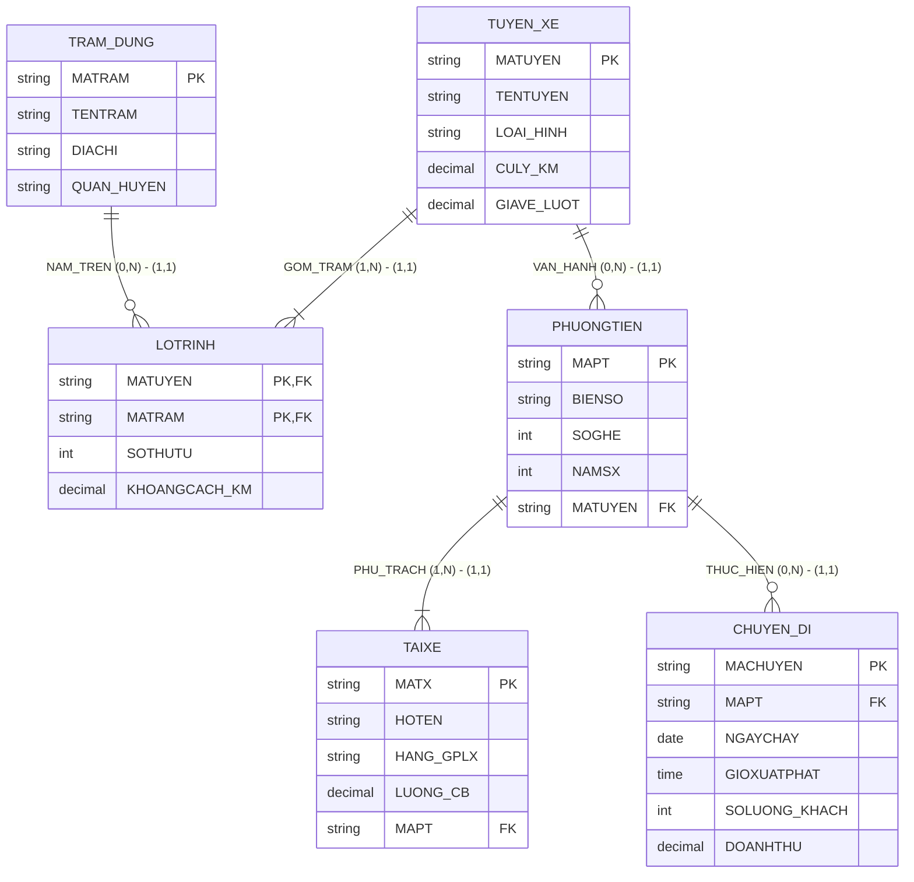

# HƯỚNG DẪN CHẤM & LỜI GIẢI CHI TIẾT (MOCK-13)
**Môn học:** IT004 — Cơ sở dữ liệu | **Thời gian thi:** 75 phút | **Thang điểm:** 10.0
**Tác giả biên soạn:** VÕ TRỌNG PHÚC — CSDL_UIT Master Series

---

## CÂU 1: THIẾT KẾ MÔ HÌNH DỮ LIỆU (2.0 ĐIỂM)

### 1.1. Phân tích thực thể, mối kết hợp & Sơ đồ ERD (1.20 điểm)

#### A. Xác định các tập thực thể và thuộc tính
1. **`TUYEN_XE`** (Tuyến vận chuyển hành khách):
   - Thuộc tính khóa: `MATUYEN` (Mã tuyến).
   - Thuộc tính mô tả: `TENTUYEN` (Tên tuyến), `LOAI_HINH` (Loại hình: Xe buýt phổ thông, VinBus, Tuyến Metro), `CULY_KM` (Cự ly km), `GIAVE_LUOT` (Giá vé lượt).
2. **`TRAM_DUNG`** (Trạm dừng đón trả khách):
   - Thuộc tính khóa: `MATRAM` (Mã trạm dừng).
   - Thuộc tính mô tả: `TENTRAM` (Tên trạm), `DIACHI` (Địa chỉ trạm), `QUAN_HUYEN` (Quận huyện).
3. **`PHUONGTIEN`** (Phương tiện vận tải xe buýt / tàu metro):
   - Thuộc tính khóa: `MAPT` (Mã phương tiện).
   - Thuộc tính mô tả: `BIENSO` (Biển số xe), `SOGHE` (Số ghế ngồi), `NAMSX` (Năm sản xuất).
4. **`TAIXE`** (Tài xế điều khiển phương tiện):
   - Thuộc tính khóa: `MATX` (Mã tài xế).
   - Thuộc tính mô tả: `HOTEN` (Họ tên), `HANG_GPLX` (Hạng GPLX: Hạng D, Hạng E), `LUONG_CB` (Lương cơ bản).
5. **`CHUYEN_DI`** (Chuyến xe vận hành thực tế):
   - Thuộc tính khóa: `MACHUYEN` (Mã chuyến đi).
   - Thuộc tính mô tả: `NGAYCHAY` (Ngày chạy), `GIOXUATPHAT` (Giờ xuất phát), `SOLUONG_KHACH` (Số khách), `DOANHTHU` (Doanh thu chuyến).

#### B. Xác định mối kết hợp & Bản số (Min, Max)
1. **`LOTRINH`** (giữa `TUYEN_XE` và `TRAM_DUNG`):
   - Mối kết hợp Nhiều - Nhiều ($M:N$).
   - Một tuyến xe đi qua ít nhất 2 trạm dừng: Bản số $(1, N)$.
   - Một trạm dừng có thể phục vụ từ 0 đến nhiều tuyến xe: Bản số $(0, N)$.
   - Thuộc tính mối kết hợp: `SOTHUTU` (Thứ tự ghé trạm), `KHOANGCACH_KM` (Khoảng cách từ trạm đầu).
2. **`VAN_HANH_TREN`** (giữa `TUYEN_XE` và `PHUONGTIEN`):
   - Một tuyến xe có thể có từ 0 đến nhiều phương tiện phục vụ: Bản số $(0, N)$.
   - Một phương tiện vận hành cố định trên đúng 1 tuyến xe: Bản số $(1, 1)$.
3. **`PHU_TRACH_LAI`** (giữa `PHUONGTIEN` và `TAIXE`):
   - Một phương tiện được phân công cho nhiều tài xế đổi ca: Bản số $(1, N)$.
   - Một tài xế phụ trách cố định đúng 1 phương tiện: Bản số $(1, 1)$.
4. **`THUC_HIEN`** (giữa `PHUONGTIEN` và `CHUYEN_DI`):
   - Một phương tiện có thể thực hiện từ 0 đến nhiều chuyến đi: Bản số $(0, N)$.
   - Một chuyến đi do đúng 1 phương tiện thực hiện: Bản số $(1, 1)$.

#### C. Sơ đồ Thực thể – Mối kết hợp (ERD)



---

### 1.2. Ánh xạ sang Lược đồ CSDL Quan hệ (0.80 điểm)

Chuyển đổi các tập thực thể và mối kết hợp theo các quy tắc chuẩn:
1. `TUYEN_XE` (**<u>MATUYEN</u>**, TENTUYEN, LOAI_HINH, CULY_KM, GIAVE_LUOT)
   - Khóa chính (PK): `MATUYEN`.
2. `TRAM_DUNG` (**<u>MATRAM</u>**, TENTRAM, DIACHI, QUAN_HUYEN)
   - Khóa chính (PK): `MATRAM`.
3. `LOTRINH` (**<u>MATUYEN</u>**, **<u>MATRAM</u>**, SOTHUTU, KHOANGCACH_KM)
   - Khóa chính phức hợp (PK): (`MATUYEN`, `MATRAM`).
   - Khóa ngoại (FK): `MATUYEN` tham chiếu đến `TUYEN_XE(MATUYEN)`.
   - Khóa ngoại (FK): `MATRAM` tham chiếu đến `TRAM_DUNG(MATRAM)`.
4. `PHUONGTIEN` (**<u>MAPT</u>**, BIENSO, SOGHE, NAMSX, MATUYEN)
   - Khóa chính (PK): `MAPT`.
   - Khóa ngoại (FK): `MATUYEN` tham chiếu đến `TUYEN_XE(MATUYEN)`.
5. `TAIXE` (**<u>MATX</u>**, HOTEN, HANG_GPLX, LUONG_CB, MAPT)
   - Khóa chính (PK): `MATX`.
   - Khóa ngoại (FK): `MAPT` tham chiếu đến `PHUONGTIEN(MAPT)`.
6. `CHUYEN_DI` (**<u>MACHUYEN</u>**, MAPT, NGAYCHAY, GIOXUATPHAT, SOLUONG_KHACH, DOANHTHU)
   - Khóa chính (PK): `MACHUYEN`.
   - Khóa ngoại (FK): `MAPT` tham chiếu đến `PHUONGTIEN(MAPT)`.

---

## CÂU 2: SQL & ĐẠI SỐ QUAN HỆ (8.0 ĐIỂM)

### 2.1. Viết các câu lệnh SQL (1.5 điểm)

#### a. Tạo ràng buộc CHECK kiểm tra số lượng khách và doanh thu (0.75 điểm)
```sql
ALTER TABLE CHUYEN_DI
ADD CONSTRAINT CK_CHUYENDI_KHACH CHECK (SOLUONG_KHACH >= 0);

ALTER TABLE CHUYEN_DI
ADD CONSTRAINT CK_CHUYENDI_DOANHTHU CHECK (DOANHTHU >= 0);
```
*Ghi chú chính sách dữ liệu:* Hai thuộc tính này phải được định nghĩa `NOT NULL` khi tạo bảng để đảm bảo tính toàn vẹn nghiệp vụ.

#### b. Cập nhật tăng 10% lương tài xế tuyến Xe buýt điện VinBus (0.75 điểm)
```sql
UPDATE TAIXE
SET LUONG_CB = LUONG_CB * 1.10
FROM TAIXE tx
JOIN PHUONGTIEN pt ON tx.MAPT = pt.MAPT
JOIN TUYEN_XE tx_route ON pt.MATUYEN = tx_route.MATUYEN
WHERE tx_route.LOAI_HINH = N'Xe buýt điện VinBus';
```

---

### 2.2. Viết các biểu thức Đại số quan hệ (6.5 điểm)

#### a. Tuyến Metro có cự ly từ 15 km trở lên (1.0 điểm)
- **Đại số quan hệ:**
  $$E_1 = \sigma_{LOAI\_HINH = \text{'Tuyến Metro'} \wedge CULY\_KM \ge 15}(TUYEN\_XE)$$
  $$\text{KQ} = \pi_{MATUYEN, TENTUYEN, CULY\_KM, GIAVE\_LUOT}(E_1)$$
- **T-SQL tương đương:**
```sql
SELECT MATUYEN, TENTUYEN, CULY_KM, GIAVE_LUOT
FROM TUYEN_XE
WHERE LOAI_HINH = N'Tuyến Metro'
  AND CULY_KM >= 15;
```

#### b. Phương tiện phục vụ tuyến Bến Thành - Bến xe Miền Đông mới (1.0 điểm)
- **Đại số quan hệ:**
  $$E_1 = \sigma_{TENTUYEN = \text{'Bến Thành - Bến xe Miền Đông mới'}}(TUYEN\_XE)$$
  $$E_2 = E_1 \bowtie PHUONGTIEN$$
  $$\text{KQ} = \pi_{MAPT, BIENSO, SOGHE}(E_2)$$
- **T-SQL tương đương:**
```sql
SELECT pt.MAPT, pt.BIENSO, pt.SOGHE
FROM PHUONGTIEN pt
JOIN TUYEN_XE tx ON pt.MATUYEN = tx.MATUYEN
WHERE tx.TENTUYEN = N'Bến Thành - Bến xe Miền Đông mới';
```

#### c. Liệt kê tất cả trạm dừng và tuyến xe đi qua nếu có (1.0 điểm)
- **Đại số quan hệ:**
  $$E_1 = TRAM\_DUNG = \bowtie LOTRINH$$
  $$\text{KQ} = \pi_{MATRAM, TENTRAM, QUAN\_HUYEN, MATUYEN, SOTHUTU}(E_1)$$
- **T-SQL tương đương:**
```sql
SELECT td.MATRAM, td.TENTRAM, td.QUAN_HUYEN, lt.MATUYEN, lt.SOTHUTU
FROM TRAM_DUNG td
LEFT JOIN LOTRINH lt ON td.MATRAM = lt.MATRAM;
```

#### d. Tổng số lượng khách phục vụ từng phương tiện ngày 20/11/2024 (1.0 điểm)
- **Đại số quan hệ:**
  $$E_1 = \sigma_{NGAYCHAY = \text{'2024-11-20'}}(CHUYEN\_DI)$$
  $$E_2 = \gamma_{MAPT, \text{SUM}(SOLUONG\_KHACH) \to TONG\_KHACH}(E_1)$$
  $$E_3 = E_2 \bowtie PHUONGTIEN$$
  $$\text{KQ} = \pi_{MAPT, BIENSO, TONG\_KHACH}(E_3)$$
- **T-SQL tương đương:**
```sql
SELECT pt.MAPT, pt.BIENSO, SUM(cd.SOLUONG_KHACH) AS TONG_KHACH
FROM PHUONGTIEN pt
JOIN CHUYEN_DI cd ON pt.MAPT = cd.MAPT
WHERE cd.NGAYCHAY = '2024-11-20'
GROUP BY pt.MAPT, pt.BIENSO;
```

#### e. Tuyến xe đi qua tất cả trạm dừng ở quận Thủ Đức (1.0 điểm)
- **Đại số quan hệ (Phép chia):**
  $$R = \pi_{MATUYEN, MATRAM}(LOTRINH)$$
  $$S = \pi_{MATRAM}(\sigma_{QUAN\_HUYEN = \text{'Thủ Đức'}}(TRAM\_DUNG))$$
  $$E_{\text{DIV}} = R \div S$$
  $$\text{KQ} = \pi_{MATUYEN, TENTUYEN, LOAI\_HINH}(E_{\text{DIV}} \bowtie TUYEN\_XE)$$
- **T-SQL tương đương (Double NOT EXISTS bounded to candidate routes):**
```sql
SELECT tx.MATUYEN, tx.TENTUYEN, tx.LOAI_HINH
FROM TUYEN_XE tx
WHERE EXISTS (
    SELECT 1 FROM LOTRINH lt
    WHERE lt.MATUYEN = tx.MATUYEN
)
AND NOT EXISTS (
    SELECT 1 FROM TRAM_DUNG td
    WHERE td.QUAN_HUYEN = N'Thủ Đức'
      AND NOT EXISTS (
          SELECT 1 FROM LOTRINH lt2
          WHERE lt2.MATUYEN = tx.MATUYEN
            AND lt2.MATRAM = td.MATRAM
      )
);
```
*Cách giải T-SQL phụ (HAVING COUNT):*
```sql
WITH R AS (
    SELECT DISTINCT MATUYEN, MATRAM FROM LOTRINH
),
S AS (
    SELECT MATRAM FROM TRAM_DUNG WHERE QUAN_HUYEN = N'Thủ Đức'
)
SELECT tx.MATUYEN, tx.TENTUYEN, tx.LOAI_HINH
FROM TUYEN_XE tx
JOIN (
    SELECT R.MATUYEN
    FROM R
    LEFT JOIN S ON R.MATRAM = S.MATRAM
    GROUP BY R.MATUYEN
    HAVING COUNT(DISTINCT S.MATRAM) = (SELECT COUNT(*) FROM S)
) div ON tx.MATUYEN = div.MATUYEN;
```

#### f. Tuyến xe có tổng doanh thu chuyến đi cao nhất năm 2024 (1.5 điểm)
- **Đại số quan hệ (Cực trị bảo toàn đồng hạng):**
  $$E_1 = \sigma_{NGAYCHAY \ge \text{'2024-01-01'} \wedge NGAYCHAY \le \text{'2024-12-31'}}(CHUYEN\_DI) \bowtie PHUONGTIEN$$
  $$E_{\text{DEM}} = \gamma_{MATUYEN, \text{SUM}(DOANHTHU) \to TONG\_DOANHTHU}(E_1)$$
  $$E_{\text{NHO_HON}} = \pi_{MATUYEN, TONG\_DOANHTHU}(E_{\text{DEM}} \bowtie_{TONG\_DOANHTHU < TONG\_DOANHTHU2} \rho_{MATUYEN2, TONG\_DOANHTHU2}(E_{\text{DEM}}))$$
  $$E_{\text{MAX}} = E_{\text{DEM}} - E_{\text{NHO_HON}}$$
  $$E_{\text{KQS}} = E_{\text{MAX}} \bowtie TUYEN\_XE$$
  $$\text{KQ} = \pi_{MATUYEN, TENTUYEN, LOAI\_HINH, TONG\_DOANHTHU}(E_{\text{KQS}})$$
- **T-SQL tương đương:**
```sql
WITH ThongKe AS (
    SELECT pt.MATUYEN, SUM(cd.DOANHTHU) AS TONG_DOANHTHU
    FROM PHUONGTIEN pt
    JOIN CHUYEN_DI cd ON pt.MAPT = cd.MAPT
    WHERE cd.NGAYCHAY >= '2024-01-01'
      AND cd.NGAYCHAY <= '2024-12-31'
    GROUP BY pt.MATUYEN
)
SELECT tx.MATUYEN, tx.TENTUYEN, tx.LOAI_HINH, tk.TONG_DOANHTHU
FROM TUYEN_XE tx
JOIN ThongKe tk ON tx.MATUYEN = tk.MATUYEN
WHERE tk.TONG_DOANHTHU = (SELECT MAX(TONG_DOANHTHU) FROM ThongKe);
```

---

## BẢNG PHÂN BỔ ĐIỂM CHI TIẾT (RUBRIC)

| Câu hỏi | Nội dung đánh giá | Điểm tối đa |
|:---|:---|:---:|
| **Câu 1.1** | Phân tích 5 thực thể, thuộc tính khóa, bản số min-max đúng nghiệp vụ | 0.60 đ |
| | Vẽ mô hình ERD chuẩn cú pháp Mermaid | 0.60 đ |
| **Câu 1.2** | Ánh xạ 6 quan hệ, xác định chính xác Khóa chính (PK) | 0.40 đ |
| | Khai báo các Khóa ngoại (FK) chỉ rõ bảng cha tham chiếu | 0.40 đ |
| **Câu 2.1a** | Cú pháp ALTER TABLE ... ADD CONSTRAINT CHECK đúng cho 2 cột | 0.75 đ |
| **Câu 2.1b** | Cú pháp UPDATE ... FROM ... JOIN 3 bảng, đúng loại hình xe VinBus | 0.75 đ |
| **Câu 2.2a** | Biểu thức chọn $\sigma$ và chiếu $\pi$ đúng tuyến Metro $\ge 15\text{ km}$ | 1.00 đ |
| **Câu 2.2b** | Kết nối qua khóa ngoại `MATUYEN`, điều kiện tên tuyến chính xác | 1.00 đ |
| **Câu 2.2c** | Phép kết ngoài trái $\leftouterjoin$ bảo toàn trạm dừng chưa có tuyến | 1.00 đ |
| **Câu 2.2d** | Gom nhóm $\gamma$, hàm SUM số khách theo ngày 20/11/2024 | 1.00 đ |
| **Câu 2.2e** | Phép chia $R \div S$ xác định đúng các trạm quận Thủ Đức và tập ứng viên | 1.00 đ |
| **Câu 2.2f** | Gom nhóm tính tổng doanh thu năm 2024, bảo toàn tuyến đồng hạng cực đại | 1.50 đ |
| **TỔNG CỘNG** | **Toàn bộ đề thi giữa kỳ mô phỏng số 13** | **10.00 đ** |
