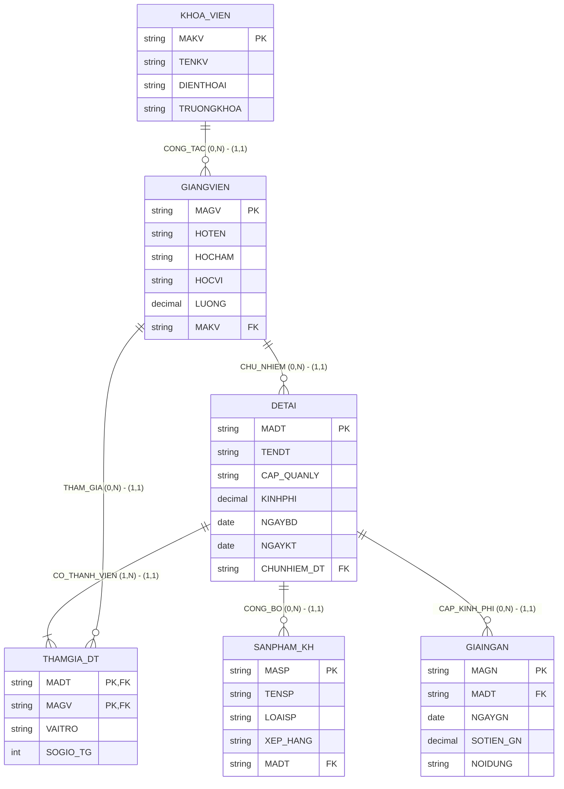

# HƯỚNG DẪN CHẤM & LỜI GIẢI CHI TIẾT (MOCK-14)
**Môn học:** IT004 — Cơ sở dữ liệu | **Thời gian thi:** 75 phút | **Thang điểm:** 10.0
**Tác giả biên soạn:** VÕ TRỌNG PHÚC — CSDL_UIT Master Series

---

## CÂU 1: THIẾT KẾ MÔ HÌNH DỮ LIỆU (2.5 ĐIỂM)

### 1.1. Phân tích thực thể, mối kết hợp & Sơ đồ ERD (1.50 điểm)

#### A. Xác định các tập thực thể và thuộc tính
1. **`KHOA_VIEN`** (Khoa / Viện nghiên cứu chuyên ngành):
   - Thuộc tính khóa: `MAKV` (Mã khoa viện).
   - Thuộc tính mô tả: `TENKV` (Tên khoa viện), `DIENTHOAI` (Số điện thoại), `TRUONGKHOA` (Họ tên lãnh đạo đơn vị).
2. **`GIANGVIEN`** (Giảng viên / Nhà nghiên cứu):
   - Thuộc tính khóa: `MAGV` (Mã giảng viên).
   - Thuộc tính mô tả: `HOTEN` (Họ tên), `HOCHAM` (Học hàm), `HOCVI` (Học vị: Tiến sĩ, Thạc sĩ,...), `LUONG` (Lương cơ bản).
3. **`DETAI`** (Đề tài nghiên cứu khoa học):
   - Thuộc tính khóa: `MADT` (Mã đề tài).
   - Thuộc tính mô tả: `TENDT` (Tên đề tài), `CAP_QUANLY` (Cấp quản lý: Cấp Nhà nước, Cấp Bộ, Cấp ĐHQG), `KINHPHI` (Kinh phí phê duyệt), `NGAYBD` (Ngày bắt đầu), `NGAYKT` (Ngày kết thúc dự kiến).
4. **`SANPHAM_KH`** (Sản phẩm khoa học / Công bố quốc tế):
   - Thuộc tính khóa: `MASP` (Mã sản phẩm).
   - Thuộc tính mô tả: `TENSP` (Tên sản phẩm/bài báo), `LOAISP` (Loại sản phẩm), `XEP_HANG` (Xếp hạng: Q1, Q2, Scopus, Trong nước).
5. **`GIAINGAN`** (Đợt giải ngân kinh phí):
   - Thuộc tính khóa: `MAGN` (Mã giải ngân).
   - Thuộc tính mô tả: `NGAYGN` (Ngày giải ngân), `SOTIEN_GN` (Số tiền giải ngân thực tế), `NOIDUNG` (Nội dung chi).

#### B. Xác định mối kết hợp & Bản số (Min, Max)
1. **`CONG_TAC_TAI`** (giữa `KHOA_VIEN` và `GIANGVIEN`):
   - Một khoa viện có từ 0 đến nhiều giảng viên công tác: Bản số $(0, N)$.
   - Một giảng viên công tác cố định tại đúng 1 khoa viện: Bản số $(1, 1)$.
2. **`CHU_NHIEM`** (giữa `GIANGVIEN` và `DETAI`):
   - Một giảng viên có thể làm chủ nhiệm từ 0 đến nhiều đề tài: Bản số $(0, N)$.
   - Một đề tài do đúng 1 giảng viên làm chủ nhiệm: Bản số $(1, 1)$.
3. **`THAMGIA_DT`** (giữa `DETAI` và `GIANGVIEN`):
   - Mối kết hợp Nhiều - Nhiều ($M:N$).
   - Một đề tài có ít nhất 1 nhà khoa học tham gia: Bản số $(1, N)$.
   - Một giảng viên có thể tham gia từ 0 đến nhiều đề tài: Bản số $(0, N)$.
   - Thuộc tính mối kết hợp: `VAITRO` (Vai trò), `SOGIO_TG` (Số giờ tham gia đóng góp).
4. **`CONG_BO_TU`** (giữa `DETAI` và `SANPHAM_KH`):
   - Một đề tài có thể công bố từ 0 đến nhiều sản phẩm: Bản số $(0, N)$.
   - Một sản phẩm khoa học xuất phát từ đúng 1 đề tài: Bản số $(1, 1)$.
5. **`GIAI_NGAN_CHO`** (giữa `DETAI` và `GIAINGAN`):
   - Một đề tài có thể nhận từ 0 đến nhiều đợt giải ngân: Bản số $(0, N)$.
   - Một đợt giải ngân cấp cho đúng 1 đề tài: Bản số $(1, 1)$.

#### C. Sơ đồ Thực thể – Mối kết hợp (ERD)



---

### 1.2. Ánh xạ sang Lược đồ CSDL Quan hệ (1.00 điểm)

Chuyển đổi các tập thực thể và mối kết hợp theo các quy tắc chuẩn:
1. `KHOA_VIEN` (**<u>MAKV</u>**, TENKV, DIENTHOAI, TRUONGKHOA)
   - Khóa chính (PK): `MAKV`.
2. `GIANGVIEN` (**<u>MAGV</u>**, HOTEN, HOCHAM, HOCVI, LUONG, MAKV)
   - Khóa chính (PK): `MAGV`.
   - Khóa ngoại (FK): `MAKV` tham chiếu đến `KHOA_VIEN(MAKV)`.
3. `DETAI` (**<u>MADT</u>**, TENDT, CAP_QUANLY, KINHPHI, NGAYBD, NGAYKT, CHUNHIEM_DT)
   - Khóa chính (PK): `MADT`.
   - Khóa ngoại (FK): `CHUNHIEM_DT` tham chiếu đến `GIANGVIEN(MAGV)`.
4. `THAMGIA_DT` (**<u>MADT</u>**, **<u>MAGV</u>**, VAITRO, SOGIO_TG)
   - Khóa chính phức hợp (PK): (`MADT`, `MAGV`).
   - Khóa ngoại (FK): `MADT` tham chiếu đến `DETAI(MADT)`.
   - Khóa ngoại (FK): `MAGV` tham chiếu đến `GIANGVIEN(MAGV)`.
5. `SANPHAM_KH` (**<u>MASP</u>**, TENSP, LOAISP, XEP_HANG, MADT)
   - Khóa chính (PK): `MASP`.
   - Khóa ngoại (FK): `MADT` tham chiếu đến `DETAI(MADT)`.
6. `GIAINGAN` (**<u>MAGN</u>**, MADT, NGAYGN, SOTIEN_GN, NOIDUNG)
   - Khóa chính (PK): `MAGN`.
   - Khóa ngoại (FK): `MADT` tham chiếu đến `DETAI(MADT)`.

---

## CÂU 2: SQL & ĐẠI SỐ QUAN HỆ (7.5 ĐIỂM)

### 2.1. Viết các câu lệnh SQL (1.5 điểm)

#### a. Tạo ràng buộc CHECK trên GIAINGAN và DETAI (0.75 điểm)
```sql
ALTER TABLE GIAINGAN
ADD CONSTRAINT CK_GIAINGAN_SOTIEN CHECK (SOTIEN_GN > 0);

ALTER TABLE DETAI
ADD CONSTRAINT CK_DETAI_NGAY CHECK (NGAYKT > NGAYBD);
```
*Ghi chú chính sách dữ liệu:* Các thuộc tính này phải được định nghĩa `NOT NULL` khi tạo bảng để đảm bảo tính toàn vẹn nghiệp vụ.

#### b. Cập nhật tăng 15% lương Tiến sĩ Viện CNTT (0.75 điểm)
```sql
UPDATE GIANGVIEN
SET LUONG = LUONG * 1.15
FROM GIANGVIEN gv
JOIN KHOA_VIEN kv ON gv.MAKV = kv.MAKV
WHERE kv.TENKV = N'Viện Công Nghệ Thông Tin'
  AND gv.HOCVI = N'Tiến sĩ';
```

---

### 2.2. Viết các biểu thức Đại số quan hệ (6.0 điểm)

#### a. Đề tài Cấp Nhà nước có kinh phí từ 1 tỷ đồng trở lên (1.0 điểm)
- **Đại số quan hệ:**
  $$E_1 = \sigma_{CAP\_QUANLY = \text{'Cấp Nhà nước'} \wedge KINHPHI \ge 1000000000}(DETAI)$$
  $$\text{KQ} = \pi_{MADT, TENDT, KINHPHI, NGAYBD}(E_1)$$
- **T-SQL tương đương:**
```sql
SELECT MADT, TENDT, KINHPHI, NGAYBD
FROM DETAI
WHERE CAP_QUANLY = N'Cấp Nhà nước'
  AND KINHPHI >= 1000000000;
```

#### b. Sản phẩm khoa học từ đề tài do GV01 làm chủ nhiệm (1.0 điểm)
- **Đại số quan hệ:**
  $$E_1 = \sigma_{CHUNHIEM\_DT = \text{'GV01'}}(DETAI)$$
  $$E_2 = E_1 \bowtie SANPHAM\_KH$$
  $$\text{KQ} = \pi_{MASP, TENSP, LOAISP, XEP\_HANG}(E_2)$$
- **T-SQL tương đương:**
```sql
SELECT sp.MASP, sp.TENSP, sp.LOAISP, sp.XEP_HANG
FROM SANPHAM_KH sp
JOIN DETAI dt ON sp.MADT = dt.MADT
WHERE dt.CHUNHIEM_DT = 'GV01';
```

#### c. Liệt kê tất cả khoa viện và đề tài do giảng viên chủ nhiệm (1.0 điểm)
- **Đại số quan hệ:**
  $$E_1 = KHOA\_VIEN = \bowtie_{KHOA\_VIEN.MAKV = GIANGVIEN.MAKV} (GIANGVIEN \bowtie_{GIANGVIEN.MAGV = DETAI.CHUNHIEM\_DT} DETAI)$$
  $$\text{KQ} = \pi_{MAKV, TENKV, MADT, TENDT}(E_1)$$
- **T-SQL tương đương:**
```sql
SELECT kv.MAKV, kv.TENKV, dt.MADT, dt.TENDT
FROM KHOA_VIEN kv
LEFT JOIN GIANGVIEN gv ON kv.MAKV = gv.MAKV
LEFT JOIN DETAI dt ON gv.MAGV = dt.CHUNHIEM_DT;
```

#### d. Tổng kinh phí đã giải ngân năm 2024 theo từng đề tài (1.0 điểm)
- **Đại số quan hệ:**
  $$E_1 = \sigma_{NGAYGN \ge \text{'2024-01-01'} \wedge NGAYGN \le \text{'2024-12-31'}}(GIAINGAN)$$
  $$E_2 = \gamma_{MADT, \text{SUM}(SOTIEN\_GN) \to TONG\_GIAINGAN}(E_1)$$
  $$E_3 = E_2 \bowtie DETAI$$
  $$\text{KQ} = \pi_{MADT, TENDT, TONG\_GIAINGAN}(E_3)$$
- **T-SQL tương đương:**
```sql
SELECT dt.MADT, dt.TENDT, SUM(gn.SOTIEN_GN) AS TONG_GIAINGAN
FROM DETAI dt
JOIN GIAINGAN gn ON dt.MADT = gn.MADT
WHERE gn.NGAYGN >= '2024-01-01'
  AND gn.NGAYGN <= '2024-12-31'
GROUP BY dt.MADT, dt.TENDT;
```

#### e. Giảng viên tham gia tất cả đề tài Cấp Nhà nước (1.0 điểm)
- **Đại số quan hệ (Phép chia):**
  $$R = \pi_{MAGV, MADT}(THAMGIA\_DT)$$
  $$S = \pi_{MADT}(\sigma_{CAP\_QUANLY = \text{'Cấp Nhà nước'}}(DETAI))$$
  $$E_{\text{DIV}} = R \div S$$
  $$\text{KQ} = \pi_{MAGV, HOTEN, HOCVI}(E_{\text{DIV}} \bowtie GIANGVIEN)$$
- **T-SQL tương đương (Double NOT EXISTS bounded to candidate researchers):**
```sql
SELECT gv.MAGV, gv.HOTEN, gv.HOCVI
FROM GIANGVIEN gv
WHERE EXISTS (
    SELECT 1 FROM THAMGIA_DT tg
    WHERE tg.MAGV = gv.MAGV
)
AND NOT EXISTS (
    SELECT 1 FROM DETAI dt
    WHERE dt.CAP_QUANLY = N'Cấp Nhà nước'
      AND NOT EXISTS (
          SELECT 1 FROM THAMGIA_DT tg2
          WHERE tg2.MAGV = gv.MAGV
            AND tg2.MADT = dt.MADT
      )
);
```
*Cách giải T-SQL phụ (HAVING COUNT):*
```sql
WITH R AS (
    SELECT DISTINCT MAGV, MADT FROM THAMGIA_DT
),
S AS (
    SELECT MADT FROM DETAI WHERE CAP_QUANLY = N'Cấp Nhà nước'
)
SELECT gv.MAGV, gv.HOTEN, gv.HOCVI
FROM GIANGVIEN gv
JOIN (
    SELECT R.MAGV
    FROM R
    LEFT JOIN S ON R.MADT = S.MADT
    GROUP BY R.MAGV
    HAVING COUNT(DISTINCT S.MADT) = (SELECT COUNT(*) FROM S)
) div ON gv.MAGV = div.MAGV;
```

#### f. Đề tài có số lượng sản phẩm Q1 nhiều nhất (1.0 điểm)
- **Đại số quan hệ (Cực trị bảo toàn đồng hạng):**
  $$E_1 = \sigma_{XEP\_HANG = \text{'Q1'}}(SANPHAM\_KH)$$
  $$E_{\text{DEM}} = \gamma_{MADT, \text{COUNT}(MASP) \to TONG\_SP}(E_1)$$
  $$E_{\text{NHO_HON}} = \pi_{MADT, TONG\_SP}(E_{\text{DEM}} \bowtie_{TONG\_SP < TONG\_SP2} \rho_{MADT2, TONG\_SP2}(E_{\text{DEM}}))$$
  $$E_{\text{MAX}} = E_{\text{DEM}} - E_{\text{NHO_HON}}$$
  $$\text{KQ} = \pi_{MADT, TENDT, CAP\_QUANLY, TONG\_SP}(E_{\text{MAX}} \bowtie DETAI)$$
- **T-SQL tương đương:**
```sql
WITH ThongKe AS (
    SELECT sp.MADT, COUNT(sp.MASP) AS TONG_SP
    FROM SANPHAM_KH sp
    WHERE sp.XEP_HANG = 'Q1'
    GROUP BY sp.MADT
)
SELECT dt.MADT, dt.TENDT, dt.CAP_QUANLY, tk.TONG_SP
FROM DETAI dt
JOIN ThongKe tk ON dt.MADT = tk.MADT
WHERE tk.TONG_SP = (SELECT MAX(TONG_SP) FROM ThongKe);
```

---

## BẢNG PHÂN BỔ ĐIỂM CHI TIẾT (RUBRIC)

| Câu hỏi | Nội dung đánh giá | Điểm tối đa |
|:---|:---|:---:|
| **Câu 1.1** | Xác định 5 thực thể, thuộc tính khóa và bản số min-max | 0.75 đ |
| | Vẽ đúng mô hình ERD theo chuẩn Mermaid | 0.75 đ |
| **Câu 1.2** | Ánh xạ 6 bảng, gạch dưới Khóa chính (PK) | 0.50 đ |
| | Khai báo Khóa ngoại (FK) chỉ rõ bảng tham chiếu đúng nghiệp vụ | 0.50 đ |
| **Câu 2.1a** | Cú pháp ALTER TABLE ... ADD CONSTRAINT CHECK đúng cho 2 bảng | 0.75 đ |
| **Câu 2.1b** | UPDATE ... FROM ... JOIN đúng giảng viên Tiến sĩ Viện CNTT | 0.75 đ |
| **Câu 2.2a** | Biểu thức chọn $\sigma$ và chiếu $\pi$ đúng đề tài Nhà nước $\ge 1\text{ tỷ}$ | 1.00 đ |
| **Câu 2.2b** | Kết nối qua `MADT`, điều kiện chủ nhiệm `GV01` đúng | 1.00 đ |
| **Câu 2.2c** | Phép kết ngoài trái $\leftouterjoin$ bảo toàn khoa viện chưa có đề tài | 1.00 đ |
| **Câu 2.2d** | Gom nhóm $\gamma$, hàm SUM kinh phí giải ngân năm 2024 | 1.00 đ |
| **Câu 2.2e** | Phép chia $R \div S$ xác định đúng các đề tài Nhà nước và tập ứng viên | 1.00 đ |
| **Câu 2.2f** | Gom nhóm đếm số sản phẩm Q1, tìm giá trị lớn nhất bảo toàn đồng hạng | 1.00 đ |
| **TỔNG CỘNG** | **Toàn bộ đề thi giữa kỳ mô phỏng số 14** | **10.00 đ** |
