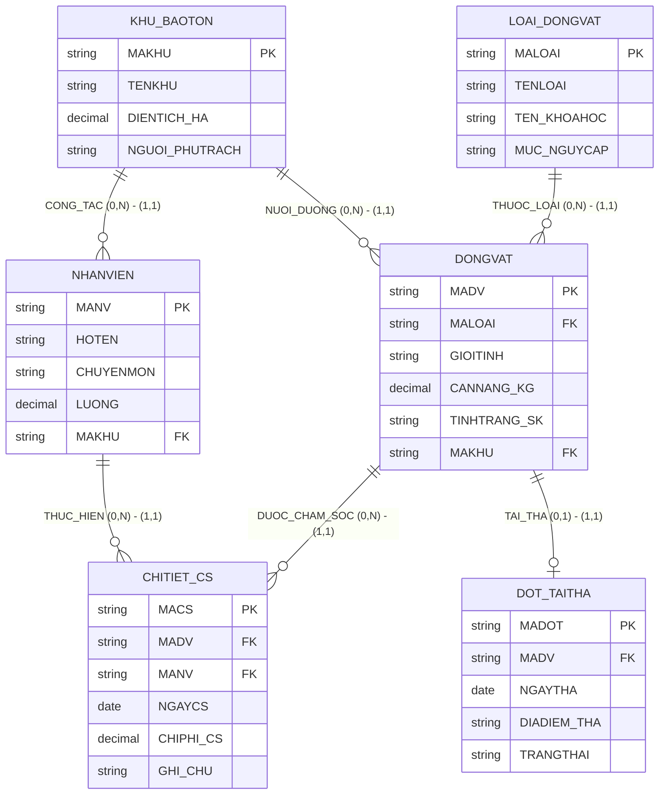

# HƯỚNG DẪN CHẤM & LỜI GIẢI CHI TIẾT (MOCK-15)
**Môn học:** IT004 — Cơ sở dữ liệu | **Thời gian thi:** 75 phút | **Thang điểm:** 10.0
**Tác giả biên soạn:** VÕ TRỌNG PHÚC — CSDL_UIT Master Series

---

## CÂU 1: THIẾT KẾ MÔ HÌNH DỮ LIỆU (2.0 ĐIỂM)

### 1.1. Phân tích thực thể, mối kết hợp & Sơ đồ ERD (1.20 điểm)

#### A. Xác định các tập thực thể và thuộc tính
1. **`KHU_BAOTON`** (Phân khu bảo tồn chức năng):
   - Thuộc tính khóa: `MAKHU` (Mã phân khu).
   - Thuộc tính mô tả: `TENKHU` (Tên phân khu), `DIENTICH_HA` (Diện tích hecta), `NGUOI_PHUTRACH` (Cán bộ phụ trách).
2. **`LOAI_DONGVAT`** (Danh mục loài động vật quý hiếm):
   - Thuộc tính khóa: `MALOAI` (Mã loài).
   - Thuộc tính mô tả: `TENLOAI` (Tên loài), `TEN_KHOAHOC` (Tên khoa học), `MUC_NGUYCAP` (Mức độ nguy cấp: Cực kỳ nguy cấp, Nguy cấp, Sắp nguy cấp).
3. **`DONGVAT`** (Cá thể động vật cứu hộ):
   - Thuộc tính khóa: `MADV` (Mã cá thể động vật).
   - Thuộc tính mô tả: `GIOITINH` (Giới tính: Đực, Cái), `CANNANG_KG` (Cân nặng kg), `TINHTRANG_SK` (Tình trạng: Khỏe mạnh, Đang điều trị, Chờ tái thả).
4. **`NHANVIEN`** (Nhân viên bảo tồn & thú y):
   - Thuộc tính khóa: `MANV` (Mã nhân viên).
   - Thuộc tính mô tả: `HOTEN` (Họ tên), `CHUYENMON` (Chuyên môn: Bác sĩ thú y, Chuyên viên cứu hộ, Kiểm lâm), `LUONG` (Lương cơ bản).
5. **`CHITIET_CS`** (Nhật ký chăm sóc điều trị):
   - Thuộc tính khóa: `MACS` (Mã lượt chăm sóc).
   - Thuộc tính mô tả: `NGAYCS` (Ngày chăm sóc), `CHIPHI_CS` (Chi phí phát sinh), `GHI_CHU` (Ghi chú y khoa).
6. **`DOT_TAITHA`** (Đợt tái thả về tự nhiên):
   - Thuộc tính khóa: `MADOT` (Mã đợt tái thả).
   - Thuộc tính mô tả: `NGAYTHA` (Ngày tái thả), `DIADIEM_THA` (Địa điểm thả), `TRANGTHAI` (Trạng thái: Thành công, Đang giám sát GPS, Thất bại).

#### B. Xác định mối kết hợp & Bản số (Min, Max)
1. **`THUOC_LOAI`** (giữa `LOAI_DONGVAT` và `DONGVAT`):
   - Một loài có thể có từ 0 đến nhiều cá thể tiếp nhận: Bản số $(0, N)$.
   - Một cá thể động vật thuộc về đúng 1 loài: Bản số $(1, 1)$.
2. **`NUOI_DUONG_TAI`** (giữa `KHU_BAOTON` và `DONGVAT`):
   - Một phân khu nuôi dưỡng từ 0 đến nhiều cá thể: Bản số $(0, N)$.
   - Một cá thể được nuôi dưỡng tại đúng 1 phân khu: Bản số $(1, 1)$.
3. **`CONG_TAC`** (giữa `KHU_BAOTON` và `NHANVIEN`):
   - Một phân khu có từ 0 đến nhiều nhân viên làm việc: Bản số $(0, N)$.
   - Một nhân viên công tác cố định tại đúng 1 phân khu: Bản số $(1, 1)$.
4. **`DUOC_CHAM_SOC`** (giữa `DONGVAT` và `CHITIET_CS`):
   - Một cá thể có thể trải qua từ 0 đến nhiều lượt chăm sóc: Bản số $(0, N)$.
   - Một lượt chăm sóc thực hiện cho đúng 1 cá thể: Bản số $(1, 1)$.
5. **`THUC_HIEN_CS`** (giữa `NHANVIEN` và `CHITIET_CS`):
   - Một nhân viên có thể thực hiện từ 0 đến nhiều lượt chăm sóc: Bản số $(0, N)$.
   - Một lượt chăm sóc do đúng 1 nhân viên thực hiện: Bản số $(1, 1)$.
6. **`DUOC_TAI_THA`** (giữa `DONGVAT` và `DOT_TAITHA`):
   - Một cá thể có thể được tái thả 0 hoặc 1 lần: Bản số $(0, 1)$.
   - Một đợt tái thả tương ứng với đúng 1 cá thể: Bản số $(1, 1)$.

#### C. Sơ đồ Thực thể – Mối kết hợp (ERD)



---

### 1.2. Ánh xạ sang Lược đồ CSDL Quan hệ (0.80 điểm)

Chuyển đổi các tập thực thể và mối kết hợp theo các quy tắc chuẩn:
1. `KHU_BAOTON` (**<u>MAKHU</u>**, TENKHU, DIENTICH_HA, NGUOI_PHUTRACH)
   - Khóa chính (PK): `MAKHU`.
2. `LOAI_DONGVAT` (**<u>MALOAI</u>**, TENLOAI, TEN_KHOAHOC, MUC_NGUYCAP)
   - Khóa chính (PK): `MALOAI`.
3. `DONGVAT` (**<u>MADV</u>**, MALOAI, GIOITINH, CANNANG_KG, TINHTRANG_SK, MAKHU)
   - Khóa chính (PK): `MADV`.
   - Khóa ngoại (FK): `MALOAI` tham chiếu đến `LOAI_DONGVAT(MALOAI)`.
   - Khóa ngoại (FK): `MAKHU` tham chiếu đến `KHU_BAOTON(MAKHU)`.
4. `NHANVIEN` (**<u>MANV</u>**, HOTEN, CHUYENMON, LUONG, MAKHU)
   - Khóa chính (PK): `MANV`.
   - Khóa ngoại (FK): `MAKHU` tham chiếu đến `KHU_BAOTON(MAKHU)`.
5. `CHITIET_CS` (**<u>MACS</u>**, MADV, MANV, NGAYCS, CHIPHI_CS, GHI_CHU)
   - Khóa chính (PK): `MACS`.
   - Khóa ngoại (FK): `MADV` tham chiếu đến `DONGVAT(MADV)`.
   - Khóa ngoại (FK): `MANV` tham chiếu đến `NHANVIEN(MANV)`.
6. `DOT_TAITHA` (**<u>MADOT</u>**, MADV, NGAYTHA, DIADIEM_THA, TRANGTHAI)
   - Khóa chính (PK): `MADOT`.
   - Khóa ngoại (FK): `MADV` tham chiếu đến `DONGVAT(MADV)`.

---

## CÂU 2: SQL & ĐẠI SỐ QUAN HỆ (8.0 ĐIỂM)

### 2.1. Viết các câu lệnh SQL (1.5 điểm)

#### a. Tạo ràng buộc CHECK trên CHITIET_CS và DONGVAT (0.75 điểm)
```sql
ALTER TABLE CHITIET_CS
ADD CONSTRAINT CK_CHITIETCS_CHIPHI CHECK (CHIPHI_CS >= 0);

ALTER TABLE DONGVAT
ADD CONSTRAINT CK_DONGVAT_CANNANG CHECK (CANNANG_KG > 0);
```
*Ghi chú chính sách dữ liệu:* Hai thuộc tính này phải được định nghĩa `NOT NULL` khi tạo bảng để đảm bảo tính toàn vẹn nghiệp vụ.

#### b. Cập nhật tăng 10% lương Bác sĩ thú y Khu Cứu Hộ Thú Lớn (0.75 điểm)
```sql
UPDATE NHANVIEN
SET LUONG = LUONG * 1.10
FROM NHANVIEN nv
JOIN KHU_BAOTON kb ON nv.MAKHU = kb.MAKHU
WHERE kb.TENKHU = N'Khu Cứu Hộ Thú Lớn'
  AND nv.CHUYENMON = N'Bác sĩ thú y';
```

---

### 2.2. Viết các biểu thức Đại số quan hệ (6.5 điểm)

#### a. Danh sách các loài động vật Cực kỳ nguy cấp (1.0 điểm)
- **Đại số quan hệ:**
  $$E_1 = \sigma_{MUC\_NGUYCAP = \text{'Cực kỳ nguy cấp'}}(LOAI\_DONGVAT)$$
  $$\text{KQ} = \pi_{MALOAI, TENLOAI, TEN\_KHOAHOC}(E_1)$$
- **T-SQL tương đương:**
```sql
SELECT MALOAI, TENLOAI, TEN_KHOAHOC
FROM LOAI_DONGVAT
WHERE MUC_NGUYCAP = N'Cực kỳ nguy cấp';
```

#### b. Danh sách cá thể thuộc Khu Bán Tự Nhiên Cát Tiên (1.0 điểm)
- **Đại số quan hệ:**
  $$E_1 = \sigma_{TENKHU = \text{'Khu Bán Tự Nhiên Cát Tiên'}}(KHU\_BAOTON)$$
  $$E_2 = E_1 \bowtie DONGVAT$$
  $$\text{KQ} = \pi_{MADV, GIOITINH, CANNANG\_KG, TINHTRANG\_SK}(E_2)$$
- **T-SQL tương đương:**
```sql
SELECT dv.MADV, dv.GIOITINH, dv.CANNANG_KG, dv.TINHTRANG_SK
FROM DONGVAT dv
JOIN KHU_BAOTON kb ON dv.MAKHU = kb.MAKHU
WHERE kb.TENKHU = N'Khu Bán Tự Nhiên Cát Tiên';
```

#### c. Liệt kê tất cả phân khu và nhân viên nếu có (1.0 điểm)
- **Đại số quan hệ:**
  $$E_1 = KHU\_BAOTON = \bowtie NHANVIEN$$
  $$\text{KQ} = \pi_{MAKHU, TENKHU, MANV, HOTEN}(E_1)$$
- **T-SQL tương đương:**
```sql
SELECT kb.MAKHU, kb.TENKHU, nv.MANV, nv.HOTEN
FROM KHU_BAOTON kb
LEFT JOIN NHANVIEN nv ON kb.MAKHU = nv.MAKHU;
```

#### d. Tổng chi phí chăm sóc y tế từng cá thể tháng 10/2024 (1.0 điểm)
- **Đại số quan hệ:**
  $$E_1 = \sigma_{NGAYCS \ge \text{'2024-10-01'} \wedge NGAYCS \le \text{'2024-10-31'}}(CHITIET\_CS)$$
  $$E_2 = \gamma_{MADV, \text{SUM}(CHIPHI\_CS) \to TONG\_CHIPHI}(E_1)$$
  $$E_3 = E_2 \bowtie DONGVAT$$
  $$\text{KQ} = \pi_{MADV, TINHTRANG\_SK, TONG\_CHIPHI}(E_3)$$
- **T-SQL tương đương:**
```sql
SELECT dv.MADV, dv.TINHTRANG_SK, SUM(cs.CHIPHI_CS) AS TONG_CHIPHI
FROM DONGVAT dv
JOIN CHITIET_CS cs ON dv.MADV = cs.MADV
WHERE cs.NGAYCS >= '2024-10-01'
  AND cs.NGAYCS <= '2024-10-31'
GROUP BY dv.MADV, dv.TINHTRANG_SK;
```

#### e. Nhân viên trực tiếp chăm sóc tất cả cá thể loài Tê tê Java (1.0 điểm)
- **Đại số quan hệ (Phép chia):**
  $$R = \pi_{MANV, MADV}(CHITIET\_CS)$$
  $$S = \pi_{MADV}(DONGVAT \bowtie \sigma_{TENLOAI = \text{'Tê tê Java'}}(LOAI\_DONGVAT))$$
  $$E_{\text{DIV}} = R \div S$$
  $$\text{KQ} = \pi_{MANV, HOTEN, CHUYENMON}(E_{\text{DIV}} \bowtie NHANVIEN)$$
- **T-SQL tương đương (Double NOT EXISTS bounded to candidate employees):**
```sql
SELECT nv.MANV, nv.HOTEN, nv.CHUYENMON
FROM NHANVIEN nv
WHERE EXISTS (
    SELECT 1 FROM CHITIET_CS cs
    WHERE cs.MANV = nv.MANV
)
AND NOT EXISTS (
    SELECT 1 FROM DONGVAT dv
    JOIN LOAI_DONGVAT ldv ON dv.MALOAI = ldv.MALOAI
    WHERE ldv.TENLOAI = N'Tê tê Java'
      AND NOT EXISTS (
          SELECT 1 FROM CHITIET_CS cs2
          WHERE cs2.MANV = nv.MANV
            AND cs2.MADV = dv.MADV
      )
);
```
*Cách giải T-SQL phụ (HAVING COUNT):*
```sql
WITH R AS (
    SELECT DISTINCT MANV, MADV FROM CHITIET_CS
),
S AS (
    SELECT dv.MADV
    FROM DONGVAT dv
    JOIN LOAI_DONGVAT ldv ON dv.MALOAI = ldv.MALOAI
    WHERE ldv.TENLOAI = N'Tê tê Java'
)
SELECT nv.MANV, nv.HOTEN, nv.CHUYENMON
FROM NHANVIEN nv
JOIN (
    SELECT R.MANV
    FROM R
    LEFT JOIN S ON R.MADV = S.MADV
    GROUP BY R.MANV
    HAVING COUNT(DISTINCT S.MADV) = (SELECT COUNT(*) FROM S)
) div ON nv.MANV = div.MANV;
```

#### f. Phân khu tiếp nhận nhiều cá thể động vật nhất (1.5 điểm)
- **Đại số quan hệ (Cực trị bảo toàn đồng hạng):**
  $$E_{\text{DEM}} = \gamma_{MAKHU, \text{COUNT}(MADV) \to TONG\_DONGVAT}(DONGVAT)$$
  $$E_{\text{NHO_HON}} = \pi_{MAKHU, TONG\_DONGVAT}(E_{\text{DEM}} \bowtie_{TONG\_DONGVAT < TONG\_DONGVAT2} \rho_{MAKHU2, TONG\_DONGVAT2}(E_{\text{DEM}}))$$
  $$E_{\text{MAX}} = E_{\text{DEM}} - E_{\text{NHO_HON}}$$
  $$E_{\text{KQS}} = E_{\text{MAX}} \bowtie KHU\_BAOTON$$
  $$\text{KQ} = \pi_{MAKHU, TENKHU, DIENTICH\_HA, TONG\_DONGVAT}(E_{\text{KQS}})$$
- **T-SQL tương đương:**
```sql
WITH ThongKe AS (
    SELECT dv.MAKHU, COUNT(dv.MADV) AS TONG_DONGVAT
    FROM DONGVAT dv
    GROUP BY dv.MAKHU
)
SELECT kb.MAKHU, kb.TENKHU, kb.DIENTICH_HA, tk.TONG_DONGVAT
FROM KHU_BAOTON kb
JOIN ThongKe tk ON kb.MAKHU = tk.MAKHU
WHERE tk.TONG_DONGVAT = (SELECT MAX(TONG_DONGVAT) FROM ThongKe);
```

---

## BẢNG PHÂN BỔ ĐIỂM CHI TIẾT (RUBRIC)

| Câu hỏi | Nội dung đánh giá | Điểm tối đa |
|:---|:---|:---:|
| **Câu 1.1** | Phân tích 6 thực thể, thuộc tính khóa, bản số min-max đúng nghiệp vụ | 0.60 đ |
| | Vẽ mô hình ERD chuẩn cú pháp Mermaid | 0.60 đ |
| **Câu 1.2** | Ánh xạ 6 quan hệ, xác định chính xác Khóa chính (PK) | 0.40 đ |
| | Khai báo các Khóa ngoại (FK) chỉ rõ bảng cha tham chiếu | 0.40 đ |
| **Câu 2.1a** | Cú pháp ALTER TABLE ... ADD CONSTRAINT CHECK đúng cho 2 bảng | 0.75 đ |
| **Câu 2.1b** | Cú pháp UPDATE ... FROM ... JOIN 2 bảng, đúng Bác sĩ thú y Khu Thú Lớn | 0.75 đ |
| **Câu 2.2a** | Biểu thức chọn $\sigma$ và chiếu $\pi$ đúng loài Cực kỳ nguy cấp | 1.00 đ |
| **Câu 2.2b** | Kết nối qua khóa ngoại `MAKHU`, điều kiện tên phân khu chính xác | 1.00 đ |
| **Câu 2.2c** | Phép kết ngoài trái $\leftouterjoin$ bảo toàn phân khu chưa có nhân viên | 1.00 đ |
| **Câu 2.2d** | Gom nhóm $\gamma$, hàm SUM chi phí chăm sóc theo tháng 10/2024 | 1.00 đ |
| **Câu 2.2e** | Phép chia $R \div S$ xác định đúng các cá thể Tê tê Java và tập ứng viên | 1.00 đ |
| **Câu 2.2f** | Gom nhóm đếm số cá thể theo phân khu, bảo toàn phân khu đồng hạng cực đại | 1.50 đ |
| **TỔNG CỘNG** | **Toàn bộ đề thi giữa kỳ mô phỏng số 15** | **10.00 đ** |
